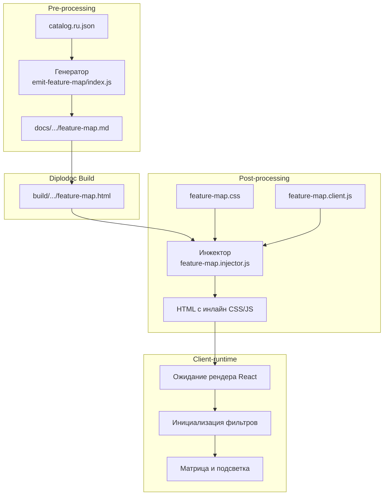
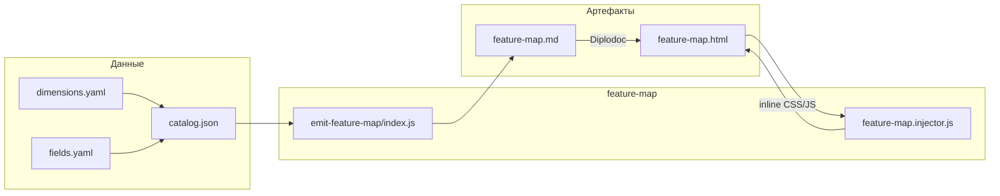



## Назначение

Модуль `feature-map` генерирует интерактивную страницу-визуализацию архитектуры проекта, внешне напоминающую таблицу Менделеева. Он анализирует `catalog.<lang>.json` (сборку всех метаданных из `frontmatter`) и строит HTML-матрицу, где:
- **Строки** — это семейства (`family`);
- **Столбцы** — это слои (`layer`);
- **Ячейки** — это модули, сгруппированные в плотную «мозаику».

Практический смысл: техписатель, архитектор или менеджер получает единую картину зависимостей и распределения функционала. С помощью интерактивных фильтров (Актор, Капабилити) можно за один клик увидеть, например, «все модули для Читателя» или «все модули категории Навигация», а механизм предпросмотра (hover) заранее показывает, какие ячейки будут скрыты или добавлены.

Модуль работает в три этапа: `pre-processing` (генерация Markdown), `post-processing` (инъекция CSS/JS в готовый HTML) и `client-runtime` (обработка кликов и подсветка в браузере).

## Применение

**Когда использовать:** в проекте более 20–30 модулей/плагинов, и требуется наглядная карта для презентации архитектуры, онбординга новых разработчиков или анализа дублирования функционала.

**Когда НЕ использовать:** проект состоит из 3–5 файлов — лучше использовать обычный текстовый список или `registry-table.md` (генерируется через `emitModulesTable`).

**Альтернативы:** 
- Статическая таблица `registry-table.md` — не даёт интерактивной фильтрации.
- Treemap из `json-to-md` — показывает размеры, но не даёт матричного пересечения.

**Типичный сценарий:** `docs-build.js` → `pre` → `catalog` (сбор JSON) → `emitFeatureMap` (генерация `.md`) → Diplodoc Build → `post` → `featureMapInject` (инъекция JS/CSS в HTML).

## Как это работает



1. **Генерация (Pre-processing).** Скрипт `emit-feature-map/index.js` читает `catalog.json` и `dimensions.yaml`. Он отбрасывает пустые измерения, собирает статистику по `actors` и `capabilities`. Для каждого модуля в ячейке создаётся `<a class="fm-chip">` с `data-*` атрибутами (слой, семейство, актор и т.д.). Итоговый HTML-блок записывается в `feature-map.md`.
2. **Инъекция (Post-processing).** Так как Diplodoc (React) вырезает теги `<script>` и `<link>` из тела Markdown, модуль `feature-map.injector.js` ищет в готовом HTML маркер `data-feature-map` и принудительно вставляет `<style id="dl-feature-map-style">` в `<head>`, а `<script id="dl-feature-map-client">` — в конец `<body>`.
3. **Клиент (Client-runtime).** Скрипт ждет, пока React отрисует таблицу в DOM (опрос через `setInterval`). Как только таблица найдена, JS вычисляет оптимальное количество колонок внутри каждой ячейки по формуле \( \lceil\sqrt{N}\rceil \) (где N — количество модулей). При клике на фильтр происходит пересечение по логике AND (И): подсвечиваются только те чипы, которые удовлетворяют всем выбранным условиям.
4. **Стилизация.** Вся таблица использует `table-layout: fixed` для жесткого распределения ширины. Ячейки модулей используют CSS Grid для идеальной мозаики. Цветовая палитра берется из брендбука (`--brand-deep`, `--brand-color` и т.д.).

### Файлы модуля

| Файл                   | Ответственность                                 |
| ---------------------- | ----------------------------------------------- |
| `index.js`             | `runEmitFeatureMap` — парсинг JSON, сборка `.md`|
| `feature-map.injector.js` | `runGeneration(buildDir)` — инъекция CSS/JS  |
| `feature-map.client.js`   | Логика фильтрации, hover-эффекты, подсветка  |
| `feature-map.css`         | Стили таблицы, сетка, цвета, состояния       |

### Правила визуализации

- **Мозаика:** модули заполняют ячейку целиком, текст обрезается через `text-overflow: ellipsis`.
- **Мульти-выбор (AND):** клик по «Читатель» + клик по «Навигация» оставит только модули, которые подходят под оба критерия.
- **Умный предпросмотр (hover):** при наведении на неактивный фильтр, модули, которые **добавятся**, получают пунктирную рамку, а модули, которые **исчезнут**, становятся прозрачными.
- **Единый серый фон:** в момент фильтрации пустые ячейки (где нет совпадений) заливаются однородным серым, чтобы не отвлекать внимание пользователя.

## Режимы работы

### CLI

Модуль вызывается в два этапа:

```bash
# 1. Генерация Markdown (Pre)
node ./plugins/diplodoc-helper-cli.js emitFeatureMap --lang=ru --out=./docs/ru/Модули/FM/feature-map.md

# 2. Инъекция CSS/JS в готовый HTML (Post)
node ./plugins/diplodoc-helper-cli.js featureMapInject --buildDir ./build
```

| Аргумент    | Обязателен | По умолчанию | Описание            |
| ----------- | ---------- | ------------ | ------------------- |
| `--lang`    | нет        | `ru`         | Язык документации   |
| `--catalog` | нет        | `<docs>/_generated/catalog.<lang>.json` | Путь к JSON |
| `--out`     | нет        | `<docs>/ru/Модули/FM/feature-map.md` | Куда писать `.md` |
| `--buildDir`| да (для inject) | `./build` | Папка собранного сайта |

VS Code-команды **нет**. Карта является частью автоматической сборки документации.

### Сборочный пайплайн

В `docs-build.js`:

```js
// В фазе pre (после сборки каталога):
cli('emitFeatureMap', '--lang=ru', '--out=./docs/ru/Модули/FM/feature-map.md'),

// В фазе post (после работы Diplodoc):
cli('featureMapInject', '--buildDir', './build'),
```

## Связи

Модуль зависит от данных, которые собирает `collectCatalog` (модуль `docs-registry/collect-catalog`). Он также опирается на структуру `dimensions.yaml` (справочник слоёв, семейств и акторов) и `fields.yaml`.

С клиентской стороны модуль не имеет внешних зависимостей (используется Vanilla JS и CSS Grid), что обеспечивает мгновенную загрузку и отсутствие конфликтов с React-рантаймом Diplodoc.




