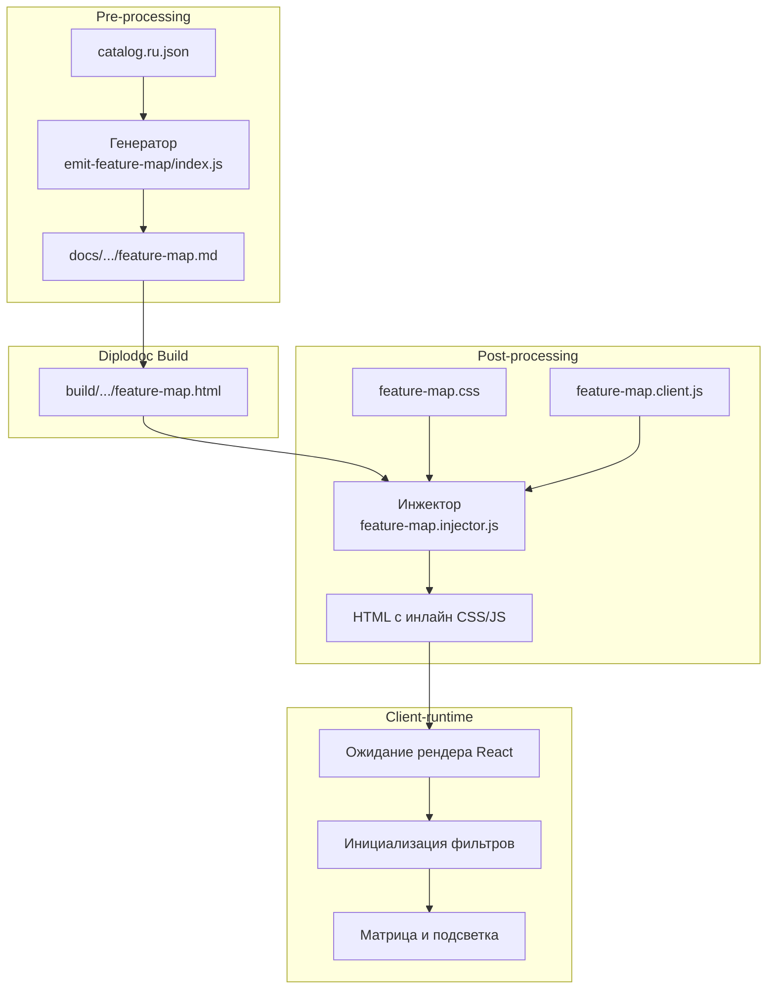
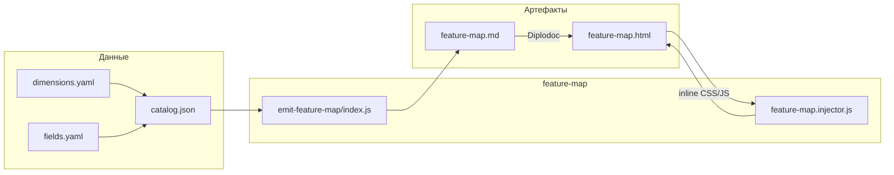



Руководство по использованию интерактивной матрицы модулей в проектах
документации Diplodoc.

Покрывает: назначение, модель данных, конфиги, примеры, ограничения,
roadmap.

---

## Что это

Матрица вида **«строки × колонки»** с карточками статей в ячейках.
Оси — два измерения из конфига (например, «Аудитория» × «Раздел»).
Над матрицей — полосы фильтров (**strips**) по другим измерениям.

**Клик по фильтру** сужает выборку: карточки вне выбранного значения
сереют. **Hover** — превью: какие исчезнут (пунктир), какие останутся
(заливка). **Клик по карточке** открывает статью по якорю из конфига.

**Зачем:** навигация по «карте всего документа» вместо дерева. Для
больших руководств (сотни статей) FM — это оглавление по измерениям.


## Назначение

Модуль `feature-map` генерирует интерактивную страницу-визуализацию архитектуры проекта, внешне напоминающую таблицу Менделеева. Он анализирует `catalog.<lang>.json` (сборку всех метаданных из `frontmatter`) и строит HTML-матрицу, где:
- **Строки** — это семейства (`family`);
- **Столбцы** — это слои (`layer`);
- **Ячейки** — это модули, сгруппированные в плотную «мозаику».

Практический смысл: техписатель, архитектор или менеджер получает единую картину зависимостей и распределения функционала. С помощью интерактивных фильтров (Актор, Капабилити) можно за один клик увидеть, например, «все модули для Читателя» или «все модули категории Навигация», а механизм предпросмотра (hover) заранее показывает, какие ячейки будут скрыты или добавлены.

Модуль работает в три этапа: `pre-processing` (генерация Markdown), `post-processing` (инъекция CSS/JS в готовый HTML) и `client-runtime` (обработка кликов и подсветка в браузере).

## Применение

**Когда использовать:** в проекте более 20–30 модулей/плагинов, и требуется наглядная карта для презентации архитектуры, онбординга новых разработчиков или анализа дублирования функционала.

**Когда НЕ использовать:** проект состоит из 3–5 файлов — лучше использовать обычный текстовый список или `registry-table.md` (генерируется через `emitModulesTable`).

**Альтернативы:** 
- Статическая таблица `registry-table.md` — не даёт интерактивной фильтрации.
- Treemap из `json-to-md` — показывает размеры, но не даёт матричного пересечения.

**Типичный сценарий:** `docs-build.js` → `pre` → `catalog` (сбор JSON) → `emitFeatureMap` (генерация `.md`) → Diplodoc Build → `post` → `featureMapInject` (инъекция JS/CSS в HTML).

## Как это работает



1. **Генерация (Pre-processing).** Скрипт `emit-feature-map/index.js` читает `catalog.json` и `dimensions.yaml`. Он отбрасывает пустые измерения, собирает статистику по `actors` и `capabilities`. Для каждого модуля в ячейке создаётся `<a class="fm-chip">` с `data-*` атрибутами (слой, семейство, актор и т.д.). Итоговый HTML-блок записывается в `feature-map.md`.
2. **Инъекция (Post-processing).** Так как Diplodoc (React) вырезает теги `<script>` и `<link>` из тела Markdown, модуль `feature-map.injector.js` ищет в готовом HTML маркер `data-feature-map` и принудительно вставляет `<style id="dl-feature-map-style">` в `<head>`, а `<script id="dl-feature-map-client">` — в конец `<body>`.
3. **Клиент (Client-runtime).** Скрипт ждет, пока React отрисует таблицу в DOM (опрос через `setInterval`). Как только таблица найдена, JS вычисляет оптимальное количество колонок внутри каждой ячейки по формуле \( \lceil\sqrt{N}\rceil \) (где N — количество модулей). При клике на фильтр происходит пересечение по логике AND (И): подсвечиваются только те чипы, которые удовлетворяют всем выбранным условиям.
4. **Стилизация.** Вся таблица использует `table-layout: fixed` для жесткого распределения ширины. Ячейки модулей используют CSS Grid для идеальной мозаики. Цветовая палитра берется из брендбука (`--brand-deep`, `--brand-color` и т.д.).

### Файлы модуля

| Файл                   | Ответственность                                 |
| ---------------------- | ----------------------------------------------- |
| `index.js`             | `runEmitFeatureMap` — парсинг JSON, сборка `.md`|
| `feature-map.injector.js` | `runGeneration(buildDir)` — инъекция CSS/JS  |
| `feature-map.client.js`   | Логика фильтрации, hover-эффекты, подсветка  |
| `feature-map.css`         | Стили таблицы, сетка, цвета, состояния       |

### Правила визуализации

- **Мозаика:** модули заполняют ячейку целиком, текст обрезается через `text-overflow: ellipsis`.
- **Мульти-выбор (AND):** клик по «Читатель» + клик по «Навигация» оставит только модули, которые подходят под оба критерия.
- **Умный предпросмотр (hover):** при наведении на неактивный фильтр, модули, которые **добавятся**, получают пунктирную рамку, а модули, которые **исчезнут**, становятся прозрачными.
- **Единый серый фон:** в момент фильтрации пустые ячейки (где нет совпадений) заливаются однородным серым, чтобы не отвлекать внимание пользователя.

## Режимы работы

### CLI

Модуль вызывается в два этапа:

```bash
# 1. Генерация Markdown (Pre)
node ./plugins/diplodoc-helper-cli.js emitFeatureMap --lang=ru --out=./docs/ru/Модули/FM/feature-map.md

# 2. Инъекция CSS/JS в готовый HTML (Post)
node ./plugins/diplodoc-helper-cli.js featureMapInject --buildDir ./build
```

| Аргумент    | Обязателен | По умолчанию | Описание            |
| ----------- | ---------- | ------------ | ------------------- |
| `--lang`    | нет        | `ru`         | Язык документации   |
| `--catalog` | нет        | `<docs>/_generated/catalog.<lang>.json` | Путь к JSON |
| `--out`     | нет        | `<docs>/ru/Модули/FM/feature-map.md` | Куда писать `.md` |
| `--buildDir`| да (для inject) | `./build` | Папка собранного сайта |

VS Code-команды **нет**. Карта является частью автоматической сборки документации.

### Сборочный пайплайн

В `docs-build.js`:

```js
// В фазе pre (после сборки каталога):
cli('emitFeatureMap', '--lang=ru', '--out=./docs/ru/Модули/FM/feature-map.md'),

// В фазе post (после работы Diplodoc):
cli('featureMapInject', '--buildDir', './build'),
```

## Связи

Модуль зависит от данных, которые собирает `collectCatalog` (модуль `docs-registry/collect-catalog`). Он также опирается на структуру `dimensions.yaml` (справочник слоёв, семейств и акторов) и `fields.yaml`.

С клиентской стороны модуль не имеет внешних зависимостей (используется Vanilla JS и CSS Grid), что обеспечивает мгновенную загрузку и отсутствие конфликтов с React-рантаймом Diplodoc.







## 2. Модель данных

### 2.1. Frontmatter в статьях

Каждая статья (модуль / глава / буклет / продукт) — папка с `index.md`.
Frontmatter содержит измерения и сервисные поля:

```yaml
---
title: 1.1. Создание заказа
sectionType: Page
pureTitle: 1.1. Создание заказа
sectionIndex: "1.1"

# измерения — заполняет техпис
module: orders
content_type: flow
audience: [manager]
status: done

# service — деривится
# ident         ← pureTitle (через _fields.yaml.frontmatterKey)
# designation   ← title (через _fields.yaml.frontmatterKey)
---

```

**Правила:**

- имя поля-измерения → `dimensions.<name>.items.<slug>`;
- multi-измерение — YAML-список;
- `ident` (текст карточки) и `designation` (tooltip) **деривятся** из
  `pureTitle` / `title` через `_fields.yaml.frontmatterKey`;
- `sectionType` пишет `diplodoc-helper` (Chapter / Part / Section / Page);
- `section` может быть **path-based** (см. §3.3) — техпис не пишет.

## 3. Конфигурации

<br>



- catalog.<lang>.json

    Снимок всех статей и измерений, генерируется `collect-catalog`:
    
    <br>

    

    

    

    <br>

- dimensions.yaml

    Справочник измерений. Приоритет: `<lang>.yaml` (MES style,
    мультиязычный) → `dimensions.yaml` (shared, diplodoc-helper style).

    **`dir` опционален:** если задан, на заголовке строки/колонки будет
    кнопка «→» (переход на страницу-указатель). Если не задан — только
    кнопка-фильтр.

    <br>

    

    

    

    <br>

- `layout.json` — «что считать модулем»

    | Поле                 | `null` / default           | Значение                                             |
    | -------------------- | -------------------------- | ---------------------------------------------------- |
    | `modulesFolder`      | walk от `<docsDir>/<lang>` | walk от `<docsDir>/<lang>/<modulesFolder>`           |
    | `modulePrefix`       | walk all                   | фильтр по префиксу (`'Модуль'` для diplodoc-helper)  |
    | `moduleIndexFile`    | `'index.md'`               | любое                                                |
    | `moduleSectionTypes` | фильтр не применяется      | только эти `sectionType`                             |
    | `outFolder`          | `'Реестр'`                 | папка для `modules.md`                               |
    | `skipDirs`           | `[]`                       | доп. папки, не считающиеся модулями                  |
    | `strictDimensions`   | `true`                     | `throw` при unknown slug / `warning` + auto-register |
    | `includeEmpty`       | `false`                    | `true` / `string[]` — включать `__empty__`           |
    | `emptyLabel`         | `'Без значения'`           | `string` / `object` (per-dim)                        |

    **Примеры:**

    - diplodoc-helper: без `layout.json` — дефолт (`Модули/Модуль*/Реестр`, strict, без empty);
    - MES: `modulesFolder: null, modulePrefix: null, moduleSectionTypes: ["Chapter","Page"], strictDimensions: false, includeEmpty: true`.

    <br>

    

    

    

    <br>


- `_fields.yaml` — маппинг полей

    | Поле                           | Что                                                      |
    | ------------------------------ | -------------------------------------------------------- |
    | `kind`                         | `'multi'` (массив) / `'scalar'`                          |
    | `dimension`                    | имя измерения (`dimensions.<name>`)                      |
    | `dimField`                     | имя поля в `CatalogModule` (`content_types`, `sections`) |
    | `frontmatterKey`               | ключ в frontmatter (default — `key`)                     |
    | `format`                       | `plain` / `backtick` / `double`                          |
    | `source`                       | `'frontmatter'` / `'path'` / `'frontmatter-or-path'`     |
    | `path.regex` + `path.template` | `{regex: "Раздел(\\d+)", template: "s$1"}`               |
    | `path.rules[]`                 | `[{regex: "…", slug: "…"}, …]` — словарь                 |

    - `source: path` — извлечение из `dir`

    Техпис **не пишет** `section` и `audience` в frontmatter — они
    извлекаются из пути статьи.

    ```yaml
    # dir = "Раздел1.…/Глава1.…/11Созданиезаказа/АРМ Менеджера/"
    # → sections: ['s1'], audiences: ['manager']
    ```

    Три режима:
    - `source: 'frontmatter'` (default) — только frontmatter.
    - `source: 'path'` — только regex/rules. Если не матчится — пусто.
    - `source: 'frontmatter-or-path'` — frontmatter приоритетнее, path как fallback.

    <br>

    

    

    

    <br>

- `feature-map.config.json` — параметры отрисовки

    **Ключевые поля:**
    - `stripDimensions` — полосы фильтров над сеткой (порядок = порядок в массиве);
    - `rowDimension` / `columnDimension` — оси сетки;
    - `dimToFieldMap` — имя измерения → имя поля в `CatalogModule`;
    - `chipLabelField` — поле для текста карточки, fallback
    `ident → pureTitle → basename(dir)`;
    - `moduleHrefAnchor` — якорь на странице модуля;
    - `outputPathTemplate` — куда писать `map.md`, `{lang}` подставляется.

    **Пример для MES:** `audience × section`, strips `content_type` + `status`.
    **Пример для буклетов:** `form_factor × category`, strips `manufacturer` + `audience`.

    <br>

    

    

    

    <br>





## 4. Пример — MES-проект

### 4.1. Структура

```
docs/
├── _registry/
│   ├── dimension.yaml                 ← dimensions
│   ├── layout.json                    ← modules config
│   ├── fields.yaml                    ← frontmatter → catalog
│   └── feature-map.config.json        ← render config
└── ru/
    ├── Раздел1.Управление…/
    │   ├── index.md                   ← Chapter
    │   └── Глава1.…/
    │       ├── index.md               ← Chapter
    │       └── 11Созданиезаказа/
    │           └── index.md           ← Page (→ модуль в FM)
    └── Дополнительнаяинформация/      ← в skipDirs
        ├── ГОСТы/
        └── Терминыиопределения/
```

### 4.2. Frontmatter статьи

```yaml
---
title: 1.1. Создание заказа
sectionType: Page
pureTitle: 1.1. Создание заказа
sectionIndex: "1.1"

module: orders
content_type: flow
status: done
# audience и section — из пути (АРМ, РазделN)
---
```

### 4.3. Прогон

```bash
# 1. Сбор каталога (с path-extractors)
node ./plugins/diplodoc-helper-cli.js catalog --lang=ru

# 2. Feature-map
node ./plugins/diplodoc-helper-cli.js emitFeatureMap --lang=ru

# 3. Сборка (Diplodoc)
npx @diplodoc/cli -i ./docs -o ./build

# 4. Инжект CSS+JS
node ./plugins/diplodoc-helper-cli.js featureMapInject --buildDir=./build

# 5. Открыть
# ./build/ru/_index/feature-map/map.html
```

**Ожидаемо:**

- сетка `audience × section` — 8 строк (АРМ) × 8 колонок (Раздел);
- strip «Тип контента» — 5 кнопок + «Без типа» (`__empty__`);
- strip «Статус» — 4 кнопки + «Без статуса»;
- карточки в ячейках — статьи, у которых `audience` ∩ `section` совпадают;
- клик по карточке → статья по `/{docsRootRel}/{dir}/index.html`.

---

## 5. CLI cheatsheet

```bash
# === Полный pipeline ===
node ./plugins/diplodoc-helper-cli.js catalog --lang=ru
node ./plugins/diplodoc-helper-cli.js pageLegend --lang=ru --rewrite --with-include
node ./plugins/diplodoc-helper-cli.js renderModules --lang=ru --rewrite --with-include
node ./plugins/diplodoc-helper-cli.js emitModulesTable --lang=ru --anchor=naznachenie
node ./plugins/diplodoc-helper-cli.js emitFeatureMap --lang=ru
npx @diplodoc/cli -i ./docs -o ./build
node ./plugins/diplodoc-helper-cli.js featureMapInject --buildDir=./build

# === Точечно ===

# catalog с override путей
node ./plugins/diplodoc-helper-cli.js catalog --lang=ru \
    --docs-project-root=<path>

# Только feature-map
node ./plugins/diplodoc-helper-cli.js emitFeatureMap --lang=ru \
    --catalog=./docs/_generated/catalog.ru.json \
    --config=./docs/_registry/feature-map.config.json \
    --out=./docs/ru/_index/feature-map/map.md

# С --docs-root / --generated-dir (точечно)
node ./plugins/diplodoc-helper-cli.js emitFeatureMap --lang=ru \
    --docs-root=./docs/ru \
    --generated-dir=./docs/_generated
```

---

## 6. Ограничения

### 6.1. `docsRoot` внутри `docsDir`

`catalog.docsRoot` должен быть **внутри** `docsDir` (или `DOCS_DIR`).
Иначе `docsRootRel` начнётся с `..`, и `href` станут `/../...` —
технически битые. Проверка: `grep href="/../ map.md` — не должно быть.

### 6.2. `dimToFieldMap` обязателен для row/col

Если в config `rowDimension: "audience"`, но в `dimToFieldMap` нет
`audience: "audiences"` → `runEmitFeatureMap` бросает `Error`.

### 6.3. `stripLabels` — shallow merge

Частичный merge **не делается**. Чтобы изменить **одну** подпись из
двух — укажи обе. Иначе вторая пропадёт (fallback `dim` — техническое
имя).

### 6.4. `chipLabelField` — fallback

`ident` (или `mod[chipLabelField]`) → `pureTitle` → `basename(dir)`.
Никогда не полный `dir` (в глубоких иерархиях карточка нечитаема).

### 6.5. `__empty__` — служебный slug

Клиентский фильтр по `data-value="__empty__"` работает. **Не пиши
`__empty__` в `dimensions.yaml` явно** — он добавляется автоматически
при `includeEmpty`.

### 6.6. `auto-register` (strictDimensions: false)

Новые slug'и попадают в `catalog.dimensions`, но **не** в
`dimensions.yaml`. При следующем прогоне — снова warning. Если нужна
постоянная регистрация — добавь slug в `dimensions.yaml` вручную.

### 6.7. `featureMapInject` инжектит 0 HTML

- неверный `--buildDir` (должен указывать на корень сборки);
- в HTML нет `<div data-feature-map>` (map.md не собрался / не попал в tree);
- сборка не завершена (`build/` пустой).

### 6.8. Warning `MODULE_TYPELESS_PACKAGE_JSON`

Косметика. Уйдёт с CLI-A (прекомпиляция `.ts` → `.js`).

---

## 7. Roadmap

| Волна   | Что                                                                                                            | Статус                                       |
| ------- | -------------------------------------------------------------------------------------------------------------- | -------------------------------------------- |
| FM-pre  | Smoke-тесты, shim `escHtml`, прямой `Fs_Walk_Directory`                                                        | ✅                                            |
| FM-a    | `feature-map.types.ts` + `feature-map.constants.ts`                                                            | ✅                                            |
| FM-b    | `--config=<path>` + `dimToFieldMap`                                                                            | ✅                                            |
| FM-c    | `--docs-root` / `--generated-dir` в `runEmitFeatureMap`                                                        | ✅                                            |
| FM-d    | `feature-map.client.js` → `client.ts` через esbuild-бандл                                                      | отложено (по решению — client остаётся IIFE) |
| FM-e    | `data-attrs` + `data-dims` (Phase A/B/C)                                                                       | ✅                                            |
| FM-f    | `__empty__` (strips + cells)                                                                                   | ✅                                            |
| FM-g    | `strictDimensions` + `auto-register`                                                                           | ✅                                            |
| FM-h    | `source: path` (regex/template + rules)                                                                        | ✅                                            |
| FM-i    | `init-config` CLI (скаффолд 4 конфигов)                                                                        | не начато                                    |
| CLI-A   | Прекомпиляция `src/plugins/**/*.ts` → `.js` (снимает warning)                                                  | не начато                                    |
| metrics | `metrics.collector.ts` — per-article `screens_count` / `transitions_count` / `terms_count` / `standards_count` | не начато                                    |

---

## 8. Troubleshooting

### 8.1. FM генерит `data-dims="actor,capability,family,layer"`

Причина: `feature-map.config.json` не найден. Проверь
`<docsDir>/_registry/feature-map.config.json`. В логе `emitFeatureMap`
должна быть строка `config: <path>`. Если её нет — значит используется
`DEFAULT_FEATURE_MAP_CONFIG` (back-compat для diplodoc-helper).

### 8.2. `catalog` падает с `Cannot read properties of undefined`

Проверь `--verbose` вывод. Скорее всего `ru.yaml` имеет не ту
структуру (`dimensions` — массив вместо object, или `items` у
измерения нет). Или `layout.json` не найден → дефолт `modulesFolder: "Модули"`
→ папка не существует.

### 8.3. 22 warning'а «папка не существует: _index/sections/s1»

Измерение `section.items.s1.dir` указывает на несуществующую папку.
**Убрано:** в текущей версии `dir` в `dimensions.yaml` опционален, и
`collect-catalog` не ругается. Если видишь warning — старая версия
`collect-catalog`.

### 8.4. Только 1 модуль в каждом измерении

Все 122 статьи не заполнены `module` / `content_type` / `status`.
Это работа техписа. Для MVP — заполнить 5-10 вручную, FM покажет
реальную картину.

### 8.5. `__empty__` не появляется в FM

Проверь:
- `layout.json` содержит `includeEmpty: true` (или массив с нужным
  измерением);
- в `catalog.index.<dim>.__empty__` есть записи (проверь в
  `_generated/catalog.ru.json`);
- в `map.md` есть `<button data-strip="…" data-value="__empty__">`.

---

## 9. Ссылки

- `CONTRIBUTING.md` — правила разработки, миграции, тестовой
  дисциплины.
- `docs-registry/` — все модули (`collect-catalog`, `build-page-legend`,
  `render-modules`, `emit-modules-table`, `feature-map/*`).
- `_layout.ts` / `_fields.ts` / `_paths.ts` — конфиги и loader'ы.
- `FeatureMap_Filter_Engine.ts` — референс-реализация клиентской
  фильтрации (используется в тестах; в браузере — inline-копия в
  `feature-map.client.js` до FM-d).