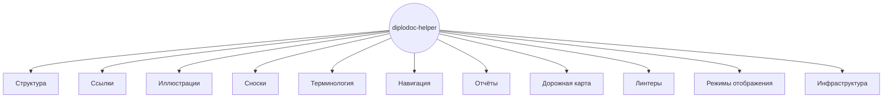

|               |                                                                 |
| ------------- | --------------------------------------------------------------- |
| Идентификатор | `modules`                                                       |
| layer         | `shared-core`                                                   |
| designation   | Точка входа в раздел: навигация по 50 модулям через 4 измерения |

{: .page-legend }

## Назначение

Раздел описывает **50 модулей** расширения `diplodoc-helper` — от создания секций до клиентских скриптов в браузере. Каждый модуль — отдельная статья, но чтобы в них **ориентироваться**, нужны оси навигации.

У нас **четыре измерения**, по которым можно смотреть на модули. Это не «теги» — это разные вопросы, на которые они отвечают:

| Измерение    | Вопрос                           | Куда ведёт                                                       |
| ------------ | -------------------------------- | ---------------------------------------------------------------- |
| `capability` | **Ради чего** модуль существует? | [Каталог (Capability map)](./КаталогCapabilitymap/index.md)      |
| `layer`      | **Когда** модуль запускается?    | [Слои (layer)](./Слоиlayer/index.md)                             |
| `family`     | **С кем** в паре/цепочке?        | [Семейство (family)](./Семействоfamily/index.md)                 |
| `context`    | **Какими тегами** найти?         | [Контексты](../Контексты/index.md) (генерируются из frontmatter) |

Плюс — плоский список всех модулей с ID:

- [Реестр модулей](./Реестр/index.html#naznachenie) — 50 строк «ID → модуль → папка → слой → статус».

## С чего начать

**Если вы впервые видите раздел** — начните с [Каталога](./КаталогCapabilitymap/index.md). Он отвечает на главный вопрос: «что умеет расширение?». 11 capability — 11 «задач», которые решает `diplodoc-helper`.

**Если ищете конкретный модуль** — [Реестр](./Реестр/index.html#naznachenie). Алфавитный список с ID.

**Если разбираетесь, как модули работают вместе** — [Семейство](./Семействоfamily/index.md). Например, `link.Copy` бесполезен без `link.Paste` — это семья.

**Если чините сборку или настраиваете CI** — [Слои](./Слоиlayer/index.md). Показывает, какие модули работают в `pre-processing`, какие в `post-processing`, и в каком порядке.

**Если изучаете один модуль** — начните со статьи. Формат одинаковый, см. ниже.

## Capability map (кратко)

11 capability — «ради чего» пользователь обращается к расширению. Один модуль может входить в **несколько** (см. [Многочлены](./КаталогCapabilitymap/index.md#многочлены)).



Подробное описание каждой capability и таблицы модулей — в [Каталоге](./КаталогCapabilitymap/index.md).

## Как читать статью модуля

Каждая статья модуля следует одному формату. Обязательные разделы — всегда, опциональные — только если есть что сказать.

### Обязательные

| Раздел                | Назначение                                                                     |
| --------------------- | ------------------------------------------------------------------------------ |
| Легенда-таблица       | ID, идентификатор, слой, расположение, точка входа, назначение                 |
| **Применение**        | **Когда использовать, когда НЕ использовать, альтернативы, типичный сценарий** |
| Назначение            | Что делает, зачем, какую проблему решает                                       |
| Связи                 | Проза + диаграмма (в ``)                                              |
| Известные ограничения | Что может пойти не так                                                         |

### Опциональные

| Раздел           | Когда                                         |
| ---------------- | --------------------------------------------- |
| Как это работает | Модуль нетривиален (несколько фаз, файлов)    |
| Режимы работы    | Есть точка входа в VS Code, CLI или пайплайне |
| Юнит-тесты       | Есть `test/**/*.test.js`                      |

### Раздел «Применение»

**Ключевой** раздел для ответа «нужен ли мне этот модуль». Формат:

```md
## Применение

**Когда использовать:** <1–2 предложения>

**Когда НЕ использовать:** <1–2 предложения>

**Альтернативы:**
- <альтернатива 1> — <когда>
- <альтернатива 2> — <когда>

**Типичный сценарий:** <шаги>
```

Пример (для `link.Copy`):

> **Когда использовать:** нужна ссылка на другой документ, и вы хотите, чтобы путь был вычислен автоматически с URL-encoding кириллицы.
>
> **Когда НЕ использовать:** ссылка на внешний URL (обычный markdown), ссылка на заголовок в текущем файле (`[text](#anchor)`).
>
> **Альтернативы:**
> - Обычный `Ctrl+C` / `Ctrl+V` — копирует абсолютный путь, работает только в одной ОС.
> - `image.PasteFromList` — для картинок (список всех картинок проекта).
>
> **Типичный сценарий:** выделить папку в Explorer → **Diplodoc → Копировать ссылку** → открыть целевой `.md` → **Diplodoc → Вставить ссылку** → выбрать якорь из QuickPick.

Раздел важен потому, что статья без него отвечает на вопрос «что модуль делает», но не «зачем мне его вызывать».

## Внутреннее vs пользовательское

Не все модули одинаково релевантны читателю.

| Тип                  | Модули                                                                                 | Кому                              |
| -------------------- | -------------------------------------------------------------------------------------- | --------------------------------- |
| **Для пользователя** | 45 модулей                                                                             | Техписатель, редактор, интегратор |
| **Внутреннее**       | `manifest`, `build.js`, `sections.core`, частично `diplodoc-helper-cli` и `docs-build` | Только разработчик расширения     |

**«Внутреннее»** — не значит «не описано». Читатель, работающий с документацией, может их **пропустить** без потери понимания. Они нужны, если вы форкаете расширение или чините сборку.

## Известные проблемы

Сводный реестр известных дефектов, компромиссов и пробелов — в отдельной статье:

**[Известные проблемы](%D0%98%D0%B7%D0%B2%D0%B5%D1%81%D1%82%D0%BD%D1%8B%D0%B5%D0%BF%D1%80%D0%BE%D0%B1%D0%BB%D0%B5%D0%BC%D1%8B/index.html#naznachenie)**

В реестре — ~70 записей: `bug`, `tradeoff`, `gap`, `by-design`. Каждая — с ссылкой на модуль(и), где проблема проявляется. Из статей модулей обратной ссылки нет — статья описывает «как должно быть», реестр — «что не так».

## См. также

- [Каталог (Capability map)](./КаталогCapabilitymap/index.md) — 11 capability с таблицами модулей.
- [Слои (layer)](./Слоиlayer/index.md) — 7 слоёв, от VS Code до client-runtime.
- [Семейство (family)](./Семействоfamily/index.md) — модули в парах и цепочках.
- [Реестр модулей](./Реестр/index.html#naznachenie) — плоский список 50 модулей.
- [Соглашения](../Соглашения/index.md) — формат статей, ID-схема, оформление.