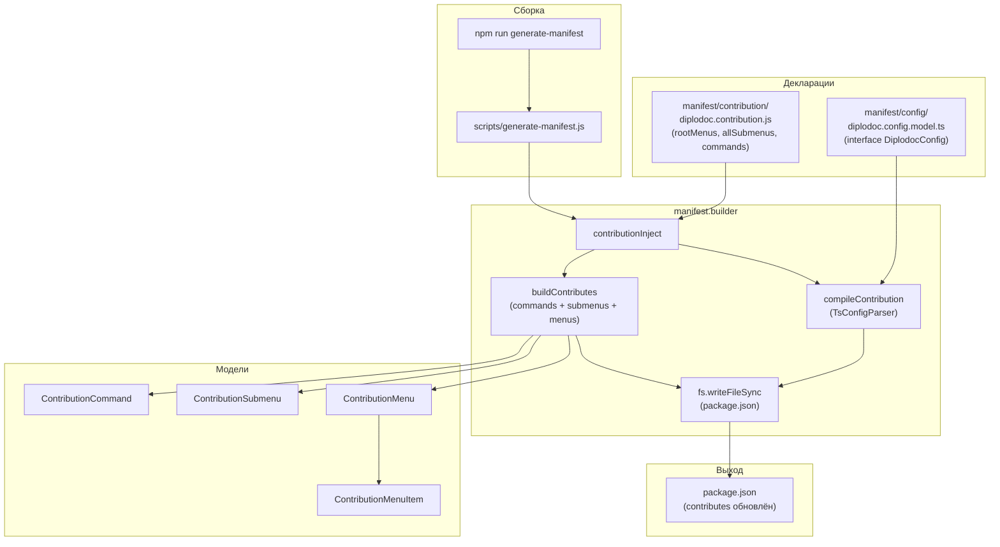
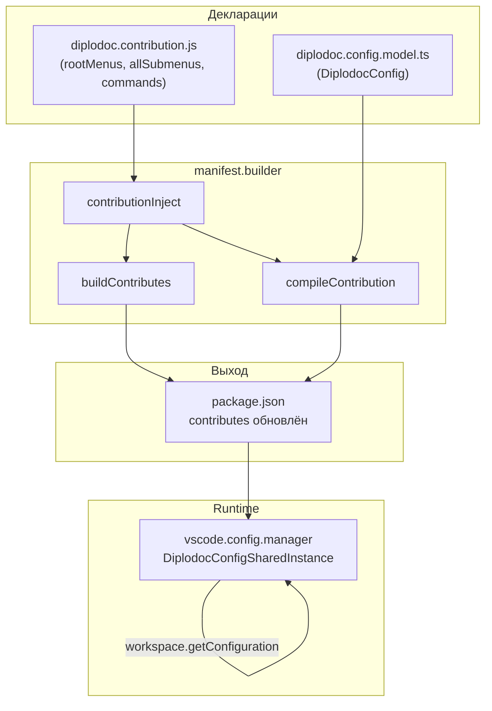

|               |                                                                                                               |
| ------------- | ------------------------------------------------------------------------------------------------------------- |
| ID            | [6.2-048](../../%D0%A1%D0%BE%D0%B3%D0%BB%D0%B0%D1%88%D0%B5%D0%BD%D0%B8%D1%8F/index.md#identifikaciya-modulej) |
| Идентификатор | `manifest`                                                                                                    |
| Наименование  | Manifest                                                                                                      |
| Слой          | [cli](../%D0%A1%D0%BB%D0%BE%D0%B8layer/Cli/index.md#naznachenie)                                                |
| Расположение  | `src/plugins/manifest.builder/` + `src/plugins/manifest/`                                                     |
| Точка входа   | `node scripts/generate-manifest.js`                                                                           |
| Версия        | `1.54.0`                                                                                                      |
| Назначение    | Генерирует `contributes` в `package.json` из декларативного кода (команды, меню, подменю, настройки)          |

{: .page-legend }

## Назначение

`manifest` — «генератор `contributes`» для `package.json` расширения. В VS Code-расширении `contributes` (команды, меню, настройки) — это **декларация**, которая пишется вручную в `package.json`. Расширение с ~35 командами, ~11 подменю, ~5 настройками — `contributes` занимает **сотни строк** JSON. Поддерживать его вручную (особенно синхронизацию `commands` с `menus`) — больно.

`manifest` решает это через **декларативный код**:

- `src/plugins/manifest/contribution/diplodoc.contribution.js` — список команд, подменю, корневых меню — в виде объектов `ManifestCommand`, `ManifestSubmenu`, `ManifestMenuItem`.
- `src/plugins/manifest.builder/` — движок, который из этих объектов собирает JSON.
- `scripts/generate-manifest.js` — точка входа: загружает декларации, вызывает `contributionInject(packageJsonPath, configPath, contributionData, configData)`.

`contributionInject`:

1. **Собирает `contributes`** из `ManifestCommand[]`, `ManifestSubmenu[]`, `ManifestMenu[]`.
2. **Компилирует настройки** из `diplodoc.config.model.ts` (TS-интерфейс) через `TsConfigParser`.
3. **Записывает** в `package.json` (`contributes = {…}`).

После генерации — `package.json` содержит актуальный `contributes`. При добавлении новой команды достаточно добавить строку в `diplodoc.contribution.js` и запустить `npm run generate-manifest` (он вызывается автоматически в `npm run compile`).

Без модуля пришлось бы:

- держать `contributes` вручную;
- синхронизировать `commands` и `menus` (команда без `menus` — не видна; `menus` без `commands` — ошибка VS Code);
- переписывать сотни строк JSON при каждом изменении.

## Применение

**Когда использовать:** добавляете новую команду/подменю/настройку в расширение — вместо ручной правки `contributes` в `package.json` (сотни строк) правите декларацию и генерируете.

**Когда НЕ использовать:** вы просто **используете** расширение — `package.json` уже содержит сгенерированный `contributes`.

**Альтернативы:**
- Ручная правка `package.json` — рассинхронизируется `commands` и `menus`, ошибки валидации VS Code.
- `vsce` сам не генерирует `contributes` — только валидирует.

**Типичный сценарий:** добавить `ManifestCommand` в `diplodoc.contribution.js` → `npm run generate-manifest` (или `npm run compile`, который вызывает его) → `package.json → contributes` обновлён.

## Как это работает




### Фаза 1. Декларация (`diplodoc.contribution.js`)

```js
const ManifestCommand = require('../../manifest.builder/contribution/model/ContributionCommand');
const ManifestSubmenu = require('../../manifest.builder/contribution/model/ContributionSubmenu');
const ManifestMenuItem = require('../../manifest.builder/contribution/model/ContributionMenuItem');
const ManifestMenu = require('../../manifest.builder/contribution/model/ContributionMenu');
const SeparatorPosition = require('../../manifest.builder/contribution/model/ContributionMenuSeparatorPosition');
const { menuItem, submenuItem } = require('../../manifest.builder/contribution/model');
```

Определяются:

**`GROUP` и `GROUP_ORDER`** — константы для группировки в меню:

```js
const GROUP_ORDER = {
    SECTION: 1, OTHER: 2, CONTEXT: 3, HELPTAG: 4, GENERATORS: 5,
    FILES: 6, NAVIGATION: 7, MENU: 8, BREADCRUMBS: 9, DEBUG: 10, SETTINGS: 99,
};
```

**`WHEN`** — условия появления:

```js
const WHEN = {
    EXPLORER_IS_FOLDER: 'explorerResourceIsFolder',
    EXPLORER_IS_FOLDER_OR_MD_OR_IMAGES: 'explorerResourceIsFolder || resourceExtname == .md || …',
    …
};
```

**Подменю** (`explorerSubmenu`, `editorSubmenu`, `otherSubmenu`, `debugSubmenu`, `lintSubmenu`, `abbrsSubmenu`, `termsSubmenu`, `helptagSubmenu`, `contextSubmenu`, `reindexierSubmenu`, `breadcrumbsSubmenu`) — каждый `ManifestSubmenu` с `addItem(...)`.

**Корневые меню** (`editorRootMenu`, `explorerRootMenu`) — `ManifestMenu` с `addItem(...)`.

**Команды** — `commands: ManifestCommand[]`.

**Экспорт:**

```js
module.exports = { commands, rootMenus, allSubmenus };
```

То есть декларация — это код на JS, где «правила» описаны объектами. При добавлении команды:

```js
new ManifestCommand('diplodoc-helper.newCmd', '%command.newCmd.title%'),
```

Добавляется в `commands`. При добавлении в меню:

```js
explorerSubmenu.addItem(menuItem('diplodoc-helper.newCmd', WHEN.EXPLORER_IS_FOLDER, GROUP.DIPLODOC_SECTION, GROUP_ORDER.SECTION, 10));
```

Добавляется в `explorerSubmenu`.

### Фаза 2. `contributionInject`

```js
function contributionInject(packageJsonPath, configPath, contributionData, configData) {
    try {
        const originalPackage = JSON.parse(fs.readFileSync(packageJsonPath, 'utf8'));

        console.log('Собираем contributes из классов...');

        const contributes = buildContributes(
            contributionData.rootMenus,
            contributionData.allSubmenus,
            contributionData.commands
        );

        const tsParser = new TsConfigParser(configData.settingPrefix);
        const configContribute = compileContribution({
            modelPath: configPath.toString(),
            typeDefName: configData.typeDefName,
            settingPrefix: configData.settingPrefix,
            title: configData.title,
            parser: tsParser,
        });

        Object.assign(contributes, configContribute.contributes);

        const finalManifest = {
            ...originalPackage,
            contributes: contributes,
        };

        fs.writeFileSync(packageJsonPath, JSON.stringify(finalManifest, null, 4));

        console.log('\nManifest успешно собран!');
    } catch (error) {
        console.error(`❌ Ошибка генерации манифеста: \n ${msg}`);
        process.exit(1);
    }
}
```

1. Читает `package.json` (сохраняет все поля, чтобы не потерять `name`, `version`, `dependencies`, …).
2. `buildContributes(rootMenus, allSubmenus, commands)` — JSON для `commands`, `submenus`, `menus`.
3. `compileContribution(...)` — JSON для `configuration` (настройки из `diplodoc.config.model.ts`).
4. `Object.assign(contributes, configContribute.contributes)` — мерджит `configuration` в `contributes`.
5. `{ ...originalPackage, contributes }` — сохраняет все поля `originalPackage`, **перезаписывает** `contributes`.
6. `JSON.stringify(finalManifest, null, 4)` — pretty-print с 4 пробелами.
7. `fs.writeFileSync` — перезаписывает `package.json`.

**Важно:** `originalPackage` содержит **исходный** `contributes` (со всеми командами). Если пользователь **удалил** команду из `diplodoc.contribution.js` — `buildContributes` её **не** вернёт, `contributes` в новом `package.json` её **не** будет. То есть `manifest` **перезаписывает** `contributes` полностью, а не мерджит с исходным.

### Фаза 3. `buildContributes`

```js
function buildContributes(rootMenus, allSubmenus, commands) {
    const contributes = {};

    contributes.commands = commands.map(cmd => cmd.toJSON());
    contributes.submenus = allSubmenus.map(sub => sub.toJSON());

    const menus = {};
    for (const menu of rootMenus) {
        Object.assign(menus, menu.toJSON());
    }
    for (const sub of allSubmenus) {
        menus[sub.id] = sub.getItemsJSON();
    }

    contributes.menus = menus;
    return contributes;
}
```

- **`commands`** — плоский массив `ManifestCommand.toJSON()` (`{ command, title }`).
- **`submenus`** — плоский массив `ManifestSubmenu.toJSON()` (`{ id, label }`).
- **`menus`** — объект:
  - `editor/context` — из `editorRootMenu.toJSON()`;
  - `explorer/context` — из `explorerRootMenu.toJSON()`;
  - каждый `<submenu.id>` — из `sub.getItemsJSON()`.

**Итоговый `contributes`:**

```json
{
  "commands": [{ "command": "diplodoc-helper.createSection", "title": "%command.md.section.create%" }, …],
  "submenus": [{ "id": "diplodoc.explorer.context.menu", "label": "%submenu.diplodoc%" }, …],
  "menus": {
    "editor/context": [{ "submenu": "diplodoc.editor.context.menu", "group": "8.diplodoc.menu@1" }],
    "explorer/context": [{ "submenu": "diplodoc.explorer.context.menu", "group": "8.diplodoc.menu@1" }],
    "diplodoc.explorer.context.menu": [
      { "command": "diplodoc-helper.createSection", "when": "explorerResourceIsFolder", "group": "1.diplodoc.section@1" },
      …
    ],
    "diplodoc.lint.explorer.context.menu": [
      { "command": "diplodoc-helper.linter.links", "when": "explorerResourceIsFolder", "group": "5.diplodoc.generators@3" },
      …
    ],
    …
  },
  "configuration": { … }
}
```

### Фаза 4. `compileContribution`

```js
function compileContribution(config) {
    const { modelPath, typeDefName, settingPrefix, title, parser } = config;

    const fullModelPath = path.resolve(__dirname, modelPath);
    const source = fs.readFileSync(fullModelPath, 'utf8');

    if (parser.settingPrefix !== settingPrefix) {
        parser.settingPrefix = settingPrefix;
    }

    const properties = parser.parse(source, typeDefName);

    return {
        contributes: {
            configuration: {
                title,
                properties,
            },
        },
    };
}
```

1. **`fullModelPath`** — `path.resolve(__dirname, modelPath)`. `__dirname` — `src/plugins/manifest.builder/contribution/`, `modelPath` — `../manifest/config/diplodoc.config.model.ts` (абсолютный путь от `scripts/generate-manifest.js`). Итог — `<repo>/src/plugins/manifest/config/diplodoc.config.model.ts`.
2. **`TsConfigParser.parse(source, 'DiplodocConfig')`** — парсит TS-интерфейс `DiplodocConfig` и извлекает `properties`.
3. **`return`** — `{ contributes: { configuration: { title, properties } } }`.

### Фаза 5. `TsConfigParser`

Парсит TS-интерфейс:

```typescript
export interface DiplodocConfig {
    figureCaptionPrefix?: string;

    figureReferenceCaptionPrefix?: string;

    usePollingForContext?: boolean;

    contextPollingInterval?: number;

    defaultLanguage: string;
}
```

`TsConfigParser.parse(source, 'DiplodocConfig')`:

1. Regex — `export interface DiplodocConfig {([\s\S]*?)\n}`.
2. Обходит строки, для каждой находит `(\w+)(\?)?\s*:\s*([^2]+);?`.
3. Извлекает `name`, `type`, `optional`.
4. Парсит JSDoc-комментарии (`@default`, `@enum`, `@order`).
5. Возвращает `properties`:

```json
{
  "diplodoc-helper.figureCaptionPrefix": {
    "type": "string",
    "default": "…",
    "description": "…",
    "order": 10
  },
  "diplodoc-helper.usePollingForContext": {
    "type": "boolean",
    "default": true,
    "description": "…",
    "order": 30
  }
}
```

**Парсинг JSDoc:**

```ts
/**
 * Заголовок для рисунка
 * @default "Рисунок"
 * @order 10
 */
figureCaptionPrefix?: string;
```

- `@default` — `default` в properties.
- `@enum value1, value2` — `enum` (для `string`).
- `@order` — `order`.
- Описание (без тегов) — `description`.

**Тип:** `normalizeType(typeStr)` — `'string'` → `'string'`, `'boolean'` → `'boolean'`, `'number'` → `'number'`, `'array'` → `'array'`, `'…' | '…'` (union строк) → `'string'` с `enum`.

### Фаза 6. `JsdocConfigParser`

Альтернативный парсер — для `@typedef {Object}`. Не используется сейчас (только `TsConfigParser`), но есть в `manifest.builder/config/config.parser.jsdocconfig.js`. Если `diplodoc.config.model.ts` заменят на JS с JSDoc — этот парсер подхватит.

### Фаза 7. Модели (`ContributionCommand`, `ContributionMenu`, `ContributionMenuItem`, `ContributionSubmenu`, `ContributionMenuSeparatorPosition`)

**`ContributionCommand`:**

```js
class ContributionCommand {
    constructor(command, title) { this.command = command; this.title = title; }
    toJSON() { return { command: this.command, title: this.title }; }
}
```

**`ContributionMenu`** (корневое меню):

```js
class ContributionManifestMenu {
    constructor(id) { this.id = id; this.items = []; }
    addItem(item) { this.items.push(item); return this; }
    toJSON() { return { [this.id]: this.items.map(item => item.toJSON()) }; }
}
```

**`ContributionMenuItem`** (элемент меню):

```js
class ContributionMenuItem {
    constructor({ command, submenu, when, group, groupName, groupOrder, order, separator = SeparatorPosition.NONE }) {
        if (!command && !submenu) throw new Error('MenuItem must have either "command" or "submenu"');
        // …
    }
    toJSON() {
        const result = {};
        if (this.command) result.command = this.command;
        if (this.submenu) result.submenu = this.submenu;
        if (this.when) result.when = this.when;
        if (this.group) result.group = this.group;
        else if (this.groupName && this.groupOrder !== undefined && this.order !== undefined) {
            let prefix = '';
            if (this.separator === SeparatorPosition.BOTTOM) prefix = 'z';
            else if (this.separator === SeparatorPosition.TOP) prefix = '0';
            result.group = `${prefix}${this.groupOrder}.${this.groupName}@${this.order}`;
        }
        return result;
    }
}
```

**Формирование `group`:** `<prefix><groupOrder>.<groupName>@<order>`. `prefix` — `''` (NONE), `'z'` (BOTTOM), `'0'` (TOP). Используется для сортировки в меню VS Code.

**`ContributionSubmenu`:**

```js
class ContributionSubmenu {
    constructor(id, label) { this.id = id; this.label = label; this.items = []; }
    addItem(item) { this.items.push(item); return this; }
    toJSON() { return { id: this.id, label: this.label }; }
    getItemsJSON() { return this.items.map(item => item.toJSON()); }
}
```

**`ContributionMenuSeparatorPosition`:**

```js
const ContributionSeparatorPosition = { NONE: 'none', BOTTOM: 'bottom', TOP: 'top' };
```

**`menuItem` / `submenuItem`** — фабрики:

```js
function menuItem(command, when, groupName, groupOrder, order, separator = SeparatorPosition.NONE) {
    return new ContributionMenuItem({ command, when, groupName, groupOrder, order, separator });
}

function submenuItem(submenuId, when, groupName, groupOrder, order, separator = SeparatorPosition.NONE) {
    return new ContributionMenuItem({ submenu: submenuId, when, groupName, groupOrder, order, separator });
}
```

### Файлы модуля

| Файл                                                                                   | Ответственность                                                                                                                  |
| -------------------------------------------------------------------------------------- | -------------------------------------------------------------------------------------------------------------------------------- |
| `src/plugins/manifest/contribution/diplodoc.contribution.js`                           | **Декларация** команд/подменю/меню                                                                                               |
| `src/plugins/manifest/constants.js`                                                    | `CONFIG_KEY`, `CONFIG_TITLE`                                                                                                     |
| `src/plugins/manifest/config/diplodoc.config.js`                                       | `DefaultDiplodocConfig`, `DiplodocConfigFromJson`, `DiplodocConfigFromWorkspace`, `DiplodocConfigFromCli`, `DiplodocConfigProxy` |
| `src/plugins/manifest/config/vscode.config.manager.js`                                 | `DiplodocConfigSharedInstance`, `setupDiplodocConfigChangeWatcher` (VS Code)                                                     |
| `src/plugins/manifest/config/diplodoc.config.model.ts`                                 | TS-интерфейс `DiplodocConfig`                                                                                                    |
| `src/plugins/manifest.builder/contribution/contributionInjector.js`                    | `contributionInject`, `ConfigData`                                                                                               |
| `src/plugins/manifest.builder/contribution/contributionBuilder.js`                     | `buildContributes`                                                                                                               |
| `src/plugins/manifest.builder/contribution/contributionCompiler.js`                    | `compileContribution`                                                                                                            |
| `src/plugins/manifest.builder/config/config.parser.base.js`                            | `ConfigParserBase`                                                                                                               |
| `src/plugins/manifest.builder/config/config.parser.tsconfig.js`                        | `TsConfigParser`                                                                                                                 |
| `src/plugins/manifest.builder/config/config.parser.jsdocconfig.js`                     | `JsdocConfigParser`                                                                                                              |
| `src/plugins/manifest.builder/config/config.parser.utils.js`                           | `normalizeType`, `getDefaultByType`, `parseDefaultValue`, `parseTypeScriptType`                                                  |
| `src/plugins/manifest.builder/contribution/model/ContributionCommand.js`               | `ContributionCommand`                                                                                                            |
| `src/plugins/manifest.builder/contribution/model/ContributionMenu.js`                  | `ContributionManifestMenu`                                                                                                       |
| `src/plugins/manifest.builder/contribution/model/ContributionMenuItem.js`              | `ContributionMenuItem`                                                                                                           |
| `src/plugins/manifest.builder/contribution/model/ContributionSubmenu.js`               | `ContributionSubmenu`                                                                                                            |
| `src/plugins/manifest.builder/contribution/model/ContributionMenuSeparatorPosition.js` | `ContributionSeparatorPosition`                                                                                                  |
| `src/plugins/manifest.builder/contribution/model/ContributionMenuItemCustom.js`        | `menuItem`, `submenuItem`                                                                                                        |
| `src/plugins/manifest.builder/contribution/model/index.js`                             | barrel                                                                                                                           |
| `scripts/generate-manifest.js`                                                         | Точка входа                                                                                                                      |

## Режимы работы

### CLI / npm

```bash
npm run generate-manifest
```

Вызывает `node scripts/generate-manifest.js`. В `package.json → scripts`:

```json
"generate-manifest": "node scripts/generate-manifest.js",
"compile": "npm run generate-manifest && node build.js",
"build": "npm run compile",
```

То есть `npm run build` (и `npm run compile`) **автоматически** вызывает `generate-manifest` до `build.js`. `contributes` всегда актуален при сборке.

**Скрипт `scripts/generate-manifest.js`:**

```js
const path = require('path');
const contribution = require('../src/plugins/manifest.builder/contribution/contributionInjector');
const { rootMenus, allSubmenus, commands } = require('../src/plugins/manifest/contribution/diplodoc.contribution');
const constants = require('../src/plugins/manifest/constants');

const packageJsonPath = path.resolve(__dirname, '../package.json');
const configPath = path.resolve(__dirname, '../src/plugins/manifest/config/diplodoc.config.model.ts');

let request = { rootMenus, allSubmenus, commands };

const configData = new contribution.ConfigData('DiplodocConfig', constants.CONFIG_KEY, constants.CONFIG_TITLE);
contribution.contributionInject(packageJsonPath, configPath, request, configData);
```

### VS Code

`manifest` **не участвует** в runtime VS Code. Это build-time-инструмент. При установке расширения `package.json` уже содержит `contributes` (сгенерированный).

`vscode.config.manager.js` (`DiplodocConfigSharedInstance`, `setupDiplodocConfigChangeWatcher`) — **runtime** часть: читает настройки из `workspace.getConfiguration(CONFIG_KEY)`, подписывается на изменения. Это не про `manifest.builder`, но живёт в той же папке `manifest/config/`.

## Юнит-тесты





## Связи

`manifest` — единственный модуль, работающий с `package.json` расширения. Зависимости:

**С `package.json`** (читает исходный, перезаписывает `contributes`). `manifest` — единственное место, которое генерирует `contributes`.

**С `diplodoc.contribution.js`** — декларация. При добавлении новой команды:

1. Добавить `ManifestCommand` в `commands`.
2. Добавить `menuItem`/`submenuItem` в нужное подменю.
3. `npm run generate-manifest`.
4. `package.json → contributes` обновлён.

**С `diplodoc.config.model.ts`** — интерфейс настроек. При добавлении настройки:

1. Добавить поле в TS-интерфейс.
2. `npm run generate-manifest`.
3. `package.json → contributes.configuration.properties` обновлён.

**С `build.js`** — `generate-manifest` вызывается **до** `build.js` (через `npm run compile`). `build.js` собирает `dist/extension.js` — runtime код. `generate-manifest` обновляет `package.json` — декларация. Оба нужны для корректной работы расширения.

**С `diplodoc-helper-cli`** — не связан. `diplodoc-helper-cli` — про CLI-команды, `manifest` — про VS Code-команды.






