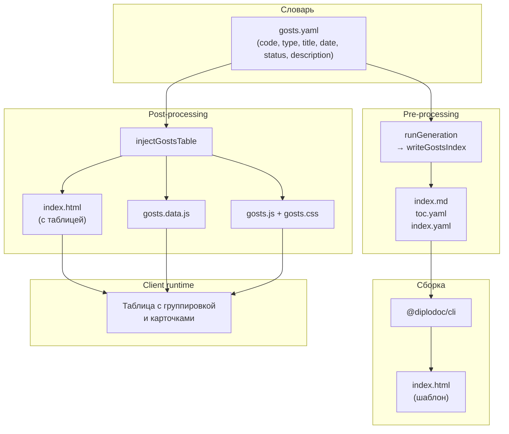
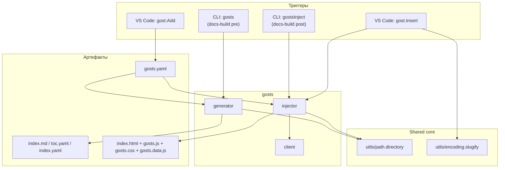

|               |                                                                                                                                                                             |
| ------------- | --------------------------------------------------------------------------------------------------------------------------------------------------------------------------- |
| ID            | [3.1-002](../../%D0%A1%D0%BE%D0%B3%D0%BB%D0%B0%D1%88%D0%B5%D0%BD%D0%B8%D1%8F/index.md#identifikaciya-modulej)                                                               |
| Идентификатор | `gosts`                                                                                                                                                                     |
| Наименование  | ГОСТы                                                                                                                                                                       |
| Слой          | [pre-processing](../%D0%A1%D0%BB%D0%BE%D0%B8layer/PreProcessing/index.md#naznachenie) / [post-processing](../%D0%A1%D0%BB%D0%BE%D0%B8layer/PostProcessing/index.md#naznachenie) |
| Расположение  | `src/plugins/gosts/`                                                                                                                                                        |
| Точка входа   | `runGeneration(docsRoot)`, `injectGostsTable({ langDir, targetHtml, lang })`                                                                                                |
| Версия        | `1.54.0`                                                                                                                                                                    |
| Назначение    | Ведёт словарь стандартов и рендерит его таблицей на странице справочника                                                                                                    |

{: .page-legend }

## Назначение

Модуль `gosts` превращает плоский YAML-словарь стандартов в интерактивную HTML-таблицу на странице справочника. Задача — избавить техписателя от ручного ведения таблицы ГОСТов: словарь правится в одном месте (`gosts.yaml`), а таблица с группировкой по типу, сортировкой и раскрывающимися карточками собирается автоматически.

Модуль затрагивает три слоя:

- **pre-processing** — генерация `index.md` / `toc.yaml` / `index.yaml` страницы-справочника из словаря;
- **post-processing** — внедрение таблицы в готовую HTML-страницу (данные + клиентский скрипт);
- **client-runtime** — построение и интерактивность таблицы уже в браузере.

Плюс две команды VS Code (`gost.Add`, `gost.Insert`) — точечное редактирование словаря и вставка ссылок на ГОСТ из редактора.

## Применение

**Когда использовать:** нужно вести словарь стандартов (ГОСТ, ISO, ТУ) и показывать его читателю таблицей с сортировкой, группировкой и раскрывающимися карточками.

**Когда НЕ использовать:** один-два стандарта — хватит обычной markdown-таблицы; нет нужды в интерактивности — `gosts.client` не нужен.

**Альтернативы:**
- Markdown-таблица в `index.md` — статична, без сортировки и карточек.
- Обычный `` с длинным списком — не масштабируется на 100+ записей.

**Типичный сценарий:** добавить ГОСТ через **Diplodoc → Добавить ГОСТ** → запустить сборку → `gosts` генерирует страницу, `gostsInject` встраивает таблицу, `gosts.client` оживляет.

## Как это работает



1. **Словарь.** `gosts.yaml` — массив записей `{ code, type, title, date, status, description }`. Ведётся вручную в редакторе или через команду `diplodoc-helper.gost.Add` (добавляет запись с валидацией на дубль по `code`, сортирует по `type` и `code`, дописывает буквенные разделители-комментарии).

2. **Генерация страницы.** `runGeneration` вызывает `writeGostsIndex`, который пишет в папку модуля (`Дополнительнаяинформация/ГОСТы` по `gosts.paths.yaml`) три файла:
   - `index.md` — только `<div id="gosts-container">Загрузка таблицы...</div>`, без таблицы;
   - `toc.yaml` и `index.yaml` — заголовок и `href` для навигации.
   Сама таблица в Markdown не пишется — она собирается клиентом.

3. **Инжектор.** `injectGostsTable` (post-processing):
   - читает словарь;
   - прогоняет поля `title`, `description`, `status` через `resolveMarkdownLinks` — markdown-ссылки на `.md` переписываются в абсолютные URL от корня сайта и меняют расширение на `.html`;
   - пишет `gosts.data.js` вида `window.__GOSTS_DATA__ = [...]` рядом с целевой страницей;
   - копирует `gosts.js` и `gosts.css` рядом с HTML;
   - прописывает `<link rel="stylesheet">`, `<script defer>` в `</head>` / `</body>`, если их там ещё нет (идемпотентно по строковому маркеру).

4. **Клиент.** `gosts.js` (IIFE) читает `window.__GOSTS_DATA__`, группирует записи по `type`, рендерит таблицу с колонками `#№ п/п`, `Обозначение`, `Название`, `Дата введения`, `Статус` и раскрывающимися карточками (по клику на строку). Сортировка — по любой колонке, кроме `#№ п/п`. При наличии `location.hash` — скроллит к карточке и раскрывает её.

### Файлы модуля

| Файл                                  | Ответственность                                                      |
| ------------------------------------- | -------------------------------------------------------------------- |
| `gosts.js`                            | `runGeneration(docsRoot)` — генератор страницы                       |
| `gosts.dictionary.js`                 | `loadGostDictionary`, `getGostDictionaryPath`                        |
| `gosts.dictionary.writer.js`          | `appendGostToDictionary` — запись в YAML                             |
| `gosts.paths.js` + `gosts.paths.yaml` | пути к папке модуля по языкам                                        |
| `gosts.writer.js`                     | `writeGostsIndex` — генерация `index.md` / `toc.yaml` / `index.yaml` |
| `gosts.injector.js`                   | `injectGostsTable` — внедрение в HTML                                |
| `cli-inject.js`                       | тонкая CLI-обёртка над `injectGostsTable`                            |
| `client/_assets/scripts/gosts.js`     | клиентский скрипт таблицы                                            |

### Формат `gosts.yaml`

```yaml
# ── ГОСТ ──

- code: "ГОСТ 11371-78"
  type: "ГОСТ"
  title: >-
    Шайба. Технические условия
  date: "01.01.1980"
  status: "Действующий"
  description: >-
    См. также [ГОСТ 25346-89](../Справочник/25346.md)
```

| Поле          | Обязательность | Комментарий                                                |
| ------------- | -------------- | ---------------------------------------------------------- |
| `code`        | да             | Уникальный ключ (проверяется при `gost.Add`)               |
| `type`        | нет            | Группировка в таблице; по умолчанию `Прочее`               |
| `title`       | да             | Название; допускает markdown-ссылки                        |
| `date`        | нет            | Дата введения (строка, не парсится как дата)               |
| `status`      | нет            | Действующий / Заменён / Отменён; допускает markdown-ссылки |
| `description` | нет            | Дополнительная информация; допускает markdown-ссылки       |

## Режимы работы

### VS Code

| Команда                       | Заголовок               | Где появляется              |
| ----------------------------- | ----------------------- | --------------------------- |
| `diplodoc-helper.gost.Add`    | Добавить ГОСТ           | Редактор → контекстное меню |
| `diplodoc-helper.gost.Insert` | Вставить из списка ГОСТ | Редактор → контекстное меню |

`gost.Add` последовательно запрашивает код (с подстановкой выделенного текста), название, дату, статус и описание; пишет запись в `gosts.yaml`; при дубле по `code` выдаёт предупреждение. `gost.Insert` показывает `QuickPick` со всеми записями; при выборе вставляет markdown-ссылку на якорь `#gost-<slug(code)>` в `index.md` справочника.

### CLI

Генерация страницы:

```bash
node ./plugins/diplodoc-helper-cli.js gosts --docsDir ./docs/ru
```

| Аргумент    | Обязателен | По умолчанию | Описание            |
| ----------- | ---------- | ------------ | ------------------- |
| `--docsDir` | нет        | `./docs`     | Корень документации |

Внедрение таблицы в готовый HTML:

```bash
node ./plugins/diplodoc-helper-cli.js gostsInject --docsDir ./docs/ru --section "ГОСТы"
```

| Аргумент       | Обязателен | По умолчанию | Описание                                                      |
| -------------- | ---------- | ------------ | ------------------------------------------------------------- |
| `--docsDir`    | нет        | `./docs`     | Корень документации                                           |
| `--outputDir`  | нет        | `./build`    | Корень сборки (где искать HTML)                               |
| `--section`    | нет        | `ГОСТы`      | Имя папки-справочника (поиск `index.html` без учёта регистра) |
| `--targetHtml` | нет        | —            | Явный путь к `index.html`; приоритетнее `--section`           |

### Сборочный пайплайн

В `docs-build.js` — два шага:

- **pre**: `cli('gosts')` — генерация страницы перед `@diplodoc/cli`;
- **post**: `cli('gostsInject', '--docsDir', './docs/ru')` — внедрение таблицы в готовый `index.html`.

Оба шага пропускаются флагами `--skip=gosts` и `--skip=gostsInject` при вызове `docs-build.js`.

## Юнит-тесты





## Связи

Модуль — самодостаточная «коробка»: словарь + генератор + инжектор + клиент. Из общих зависимостей использует только `utils/path.directory` (`getLanguageRoot`) и `utils/encoding.slugify` (`slugify_latin_alphanumeric` для якорей карточек). Соседи по пайплайну — `abbrs` и `terms`, устроенные похожим образом (словарь → генератор → инжектор → клиент), но пересечений по артефактам нет: каждый пишет в свою папку и копирует свой клиентский скрипт.






