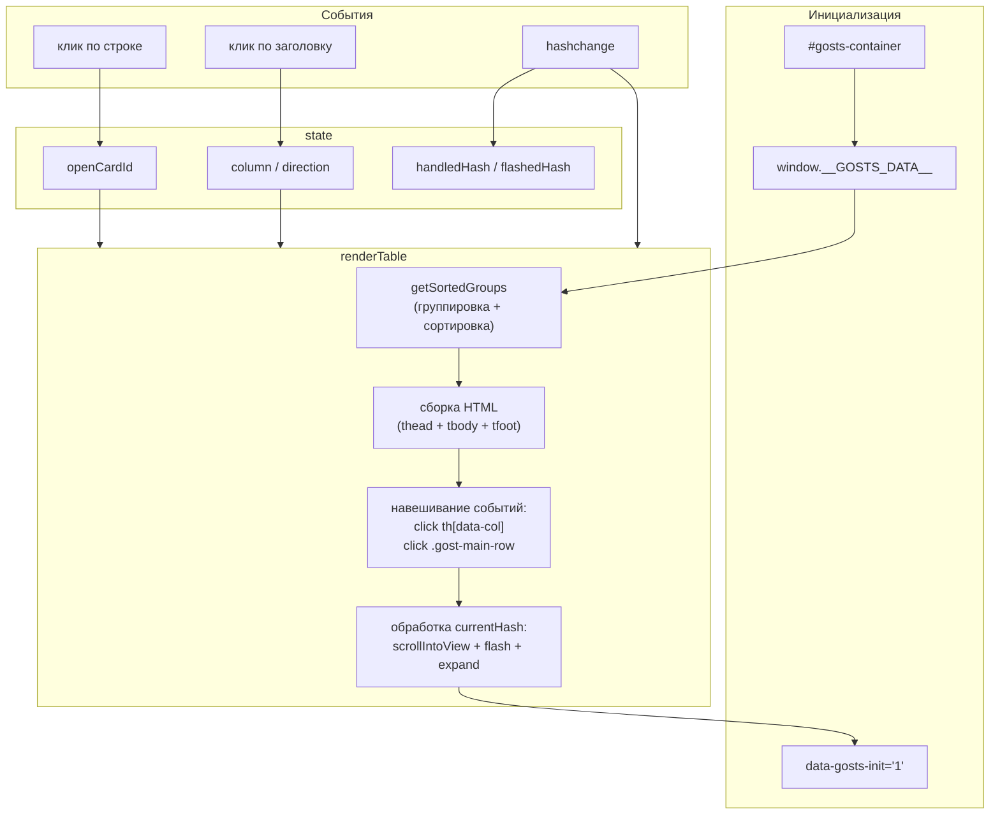
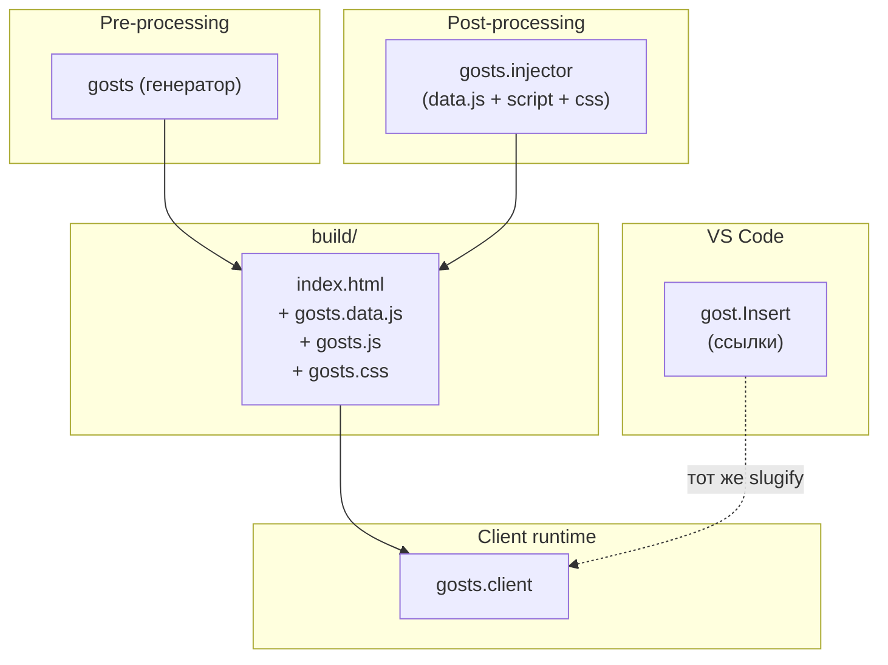

|               |                                                                                                                                             |
| ------------- | ------------------------------------------------------------------------------------------------------------------------------------------- |
| ID            | [5.1-035](../../%D0%A1%D0%BE%D0%B3%D0%BB%D0%B0%D1%88%D0%B5%D0%BD%D0%B8%D1%8F/index.md#identifikaciya-modulej)                               |
| Идентификатор | `gosts.client`                                                                                                                              |
| Наименование  | Клиент ГОСТов                                                                                                                               |
| Слой          | [client-runtime](../%D0%A1%D0%BB%D0%BE%D0%B8layer/ClientRuntime/index.md#naznachenie)                                                         |
| Расположение  | `src/plugins/gosts/client/_assets/scripts/gosts.js` (внедряется в HTML через [`gosts.injector`](../МодульГОСТы/index.md))                   |
| Точка входа   | IIFE на странице `Дополнительнаяинформация/ГОСТы/index.html`                                                                                |
| Версия        | `1.54.0`                                                                                                                                    |
| Назначение    | Строит интерактивную таблицу ГОСТов из `window.__GOSTS_DATA__`: группировка, сортировка, карточки с раскрытием, flash при переходе по якорю |

{: .page-legend }

## Назначение

`gosts.client` — клиентская часть модуля [`gosts`](../МодульГОСТы/index.md). Инжектор `gosts.injector` вставляет в `index.html` справочника:

- `<div id="gosts-container">Загрузка таблицы...</div>` — заглушка;
- `<script src="…/gosts.data.js">` — `window.__GOSTS_DATA__ = [...]`;
- `<script src="…/gosts.js">` — этот модуль;
- `<link rel="stylesheet" href="…/gosts.css">` — стили.

`gosts.client` подхватывает `window.__GOSTS_DATA__` и строит таблицу:

- **группировка по `type`** — «ГОСТ», «Классификатор», «Прочее»; группа — заголовок + подвал с итогом;
- **сортировка** — по клику на `#№ п/п`, «Обозначение», «Название», «Дата введения», «Статус»; по возрастанию → убыванию → сброс;
- **карточки** — клик по строке раскрывает под ней карточку с полями `Обозначение`, `Тип`, `Название`, `Дата введения`, `Статус`, `Доп. информация`;
- **flash** — при переходе по `#gost-<anchorId>` строка «мигает» и карточка раскрывается автоматически;
- **скролл к якорю** — `scrollIntoView({ behavior: 'smooth', block: 'center' })` через 50 мс после рендера.

Зачем это нужно. ГОСТы в документации — десятки-сотни записей. Markdown-таблица из `index.md` была бы:

- неинтерактивной (нет сортировки, нет раскрытия);
- тяжёлой (все поля всех записей видны сразу);
- без группировки по типу.

`gosts.client` даёт «песочницу»: пользователь листает таблицу, сортирует по нужной колонке, кликает в интересующую запись — видит детали.

## Применение

**Когда использовать:** всегда вместе с [`gosts`](../МодульГОСТы/index.md) — рисует таблицу из `window.__GOSTS_DATA__`, навешивает сортировку, группировку, карточки, flash при переходе по `#gost-…`.

**Когда НЕ использовать:** без `gosts.injector` данных нет — таблица будет пустая.

**Альтернативы:**
- Markdown-таблица — статична.
- Собственный JS-рендерер — дублирует код.

**Типичный сценарий:** `gosts.injector` встраивает `<script src="gosts.js">` + `<link rel="stylesheet">` + `window.__GOSTS_DATA__` → клиент рендерит таблицу.

## Как это работает



### Фаза 1. Инициализация

```js
function initGostsTable() {
    const container = document.getElementById('gosts-container');
    if (!container) return false;
    if (container.getAttribute('data-gosts-init') === '1') return true;

    const data = window.__GOSTS_DATA__ || [];
    container.setAttribute('data-gosts-init', '1');

    if (data.length === 0) {
        container.innerHTML = '<p>Справочник пуст.</p>';
        return true;
    }
    // …state, COLUMNS, esc, formatMarkdown…
}
```

- **`#gosts-container`** — если нет, `return false` (не инициализировано, будет retry).
- **`data-gosts-init`** — идемпотентность.
- **Пустой `__GOSTS_DATA__`** — «Справочник пуст».

**`state`**:

```js
let state = {
    column: null,
    direction: 'asc',
    openCardId: null,
    handledHash: null,
    flashedHash: null,
};
```

`handledHash` и `flashedHash` — фиксы багов: не переоткрывать карточку, не перезапускать flash на каждом рендере.

**`COLUMNS`**:

```js
const COLUMNS = [
    { key: 'num',    label: '#№ п/п',          className: 'col-num' },
    { key: 'code',   label: 'Обозначение',     className: 'col-code' },
    { key: 'title',  label: 'Название',        className: 'col-title' },
    { key: 'date',   label: 'Дата введения',   className: 'col-date' },
    { key: 'status', label: 'Статус',          className: 'col-status' },
];
```

`num` — синтетическая колонка (номер строки, не сортируется). Остальные — сортируемые.

**`esc`** — экранирование `&<>"'`. **`formatMarkdown`** — `esc` + замена `[text](url)` на `<a href="url">text</a>` с проверкой `url.startsWith('http')` для `target="_blank"`.

### Фаза 2. `getSortedGroups()`

```js
function getSortedGroups() {
    const groups = {};
    data.forEach(item => {
        const type = item.type || 'Прочее';
        if (!groups[type]) groups[type] = [];
        groups[type].push(item);
    });

    const sortedTypes = Object.keys(groups).sort();

    for (const type of sortedTypes) {
        const items = groups[type];
        if (state.column && state.direction) {
            const dir = state.direction === 'asc' ? 1 : -1;
            const col = state.column;
            items.sort((a, b) => {
                const valA = String(a[col] || '');
                const valB = String(b[col] || '');
                return valA.localeCompare(valB, 'ru', { numeric: true }) * dir;
            });
        } else {
            items.sort((a, b) => String(a.code).localeCompare(String(b.code), 'ru', { numeric: true }));
        }
    }
    return { groups, sortedTypes };
}
```

- **Группировка** по `item.type` (fallback `'Прочее'`).
- **`sortedTypes`** — алфавитно (`Object.keys().sort()`).
- **Сортировка внутри группы** — по `state.column` + `state.direction`. `localeCompare('ru', { numeric: true })` — цифры в кодах (`ГОСТ 1.2.3`) сравниваются числово, а не лексикографически (`'10' < '2'`).
- **Без выбранной колонки** — по `code` (дефолт).

### Фаза 3. `renderTable()`

**3.1. Чтение `currentHash`** с `decodeURIComponent` (для percent-encoded) и вычисление `shouldHandleHash = currentHash && currentHash !== state.handledHash`.

**3.2. Сборка HTML:**

```js
let html = '<div class="gost-table-wrapper"><table class="gost-table"><thead><tr>';
for (const c of COLUMNS) {
    const cls = state.column === c.key ? c.className + ' is-active' : c.className;
    const sortAttr = c.key !== 'num' ? `data-col="${c.key}"` : '';
    html += `<th class="${cls}" ${sortAttr}>${esc(c.label)}<span class="sort-indicator">${indicator(c.key)}</span></th>`;
}
html += '</tr></thead><tbody>';

for (const type of sortedTypes) {
    const items = groups[type];
    let rowNum = 1;
    html += `<tr class="gost-group-header"><td colspan="5">${esc(type)}</td></tr>`;

    for (const item of items) {
        const anchorId = item.anchorId || ('gost-' + (item.code || '').replace(/[^15]/g, '_').toLowerCase());
        const isOpen = state.openCardId === anchorId;
        const isTarget = currentHash === anchorId && state.flashedHash !== currentHash ? 'gost-flash' : '';

        html += `<tr id="${anchorId}" class="gost-main-row ${isOpen ? 'is-expanded' : ''} ${isTarget}" data-id="${anchorId}">`;
        html += `<td class="col-num">${rowNum++}</td>`;
        html += `<td class="col-code"><strong>${formatMarkdown(item.code)}</strong></td>`;
        html += `<td class="col-title">${formatMarkdown(item.title)}</td>`;
        html += `<td class="col-date">${formatMarkdown(item.date || '—')}</td>`;
        html += `<td class="col-status">${formatMarkdown(item.status || '—')}</td>`;
        html += `</tr>`;

        html += `<tr class="gost-card-row ${isOpen ? 'is-open' : ''}"><td colspan="5">`;
        html += `<div class="gost-card-wrapper"><div class="gost-card-inner"><div class="gost-card-content">`;
        html += `<div class="gost-card-item"><div class="gost-card-label">Обозначение:</div><div class="gost-card-value">${formatMarkdown(item.code)}</div></div>`;
        // … ещё 5 полей …
        html += `</div></div></div></td></tr>`;
    }

    html += `<tr class="gost-group-footer"><td colspan="5">Итого по группе ${esc(type)}: ${items.length}</td></tr>`;
    totalCount += items.length;
}
html += '</tbody>';
html += `<tfoot><tr><td colspan="5" class="gost-total-footer">Итого по перечню: ${totalCount}</td></tr></tfoot>`;
html += '</table></div>';
```

**3.3. `container.innerHTML = html`** — полная перерисовка.

**3.4. Навешивание событий** — по `th[data-col]` и по `.gost-main-row`.

**3.5. Обработка `currentHash`:**

```js
if (shouldHandleHash) {
    const target = document.getElementById(currentHash);
    if (target) {
        state.handledHash = currentHash;
        state.flashedHash = currentHash;
        setTimeout(() => target.scrollIntoView({ behavior: 'smooth', block: 'center' }), 50);
        if (state.openCardId !== currentHash) {
            state.openCardId = currentHash;
            renderTable();
        }
    }
}
```

Скролл, flash, экспанд — **только один раз** на хэш. Повторный рендер — `shouldHandleHash = false` (handledHash уже этот).

### Фаза 4. События

**`onHeaderClick(colKey)`** — по клику на `<th data-col>`:

- `num` — игнорируется;
- новая колонка → `column = key`, `direction = 'asc'`;
- та же колонка → `'asc'` → `'desc'` → `null` (сброс);
- `renderTable()`.

**`onRowClick(anchorId)`** — по клику на `.gost-main-row`:

- если `openCardId === anchorId` → `openCardId = null` (закрыть);
- иначе → `openCardId = anchorId` (открыть, если была открыта другая — она закроется, т.к. `openCardId` один);
- `renderTable()`.

**`hashchange`** — сброс `handledHash`, `flashedHash`, `openCardId`, `renderTable()`. Новый якорь — снова сработает авто-раскрытие.

### Фаза 5. Retry + MutationObserver

```js
if (!initGostsTable()) {
    let attempts = 0;
    const timer = setInterval(() => {
        attempts++;
        if (initGostsTable() || attempts > 120) clearInterval(timer);
    }, 250);
}

if (typeof MutationObserver !== 'undefined' && document.body) {
    const obs = new MutationObserver(() => initGostsTable());
    obs.observe(document.body, { childList: true, subtree: true });
}
```

До 120 попыток по 250 мс (30 сек) + `MutationObserver`. Защита от случаев, когда контейнер появляется позже (SPA, отложенный рендер).

### Файлы модуля

| Файл                                                | Ответственность                                                    |
| --------------------------------------------------- | ------------------------------------------------------------------ |
| `src/plugins/gosts/client/_assets/scripts/gosts.js` | Весь клиент                                                        |
| `src/plugins/gosts/gosts.css`                       | Стили (`.gost-table`, `.gost-card-*`, `.gost-flash`, `@keyframes`) |

### Данные

`window.__GOSTS_DATA__ = [{ code, type, title, date, status, description, anchorId? }, ...]`.

`anchorId` — предвычисленный в [`gosts.injector`](../МодульГОСТы/index.md) (`gost-${slugify_latin_alphanumeric(code)}`). Если его нет (старый `data.js`), клиент вычисляет fallback (`'gost-' + code.replace(/[^15]/g, '_').toLowerCase()`), но это даёт **другой** результат для кириллицы — расхождение с `gost.Insert` (см. [`gosts`](../МодульГОСТы/index.md) — bug #2).

## Режимы работы

### Клиентский runtime

Внедряется автоматически в `build/<lang>/Дополнительнаяинформация/ГОСТы/index.html` инжектором. Никаких ручных `<script>` — `gosts.injector` сам вставляет `<script defer>` + `<link>`.

### Проверка в DevTools

```js
document.getElementById('gosts-container')           // → <div data-gosts-init="1">
window.__GOSTS_DATA__                                // → массив
document.querySelectorAll('.gost-main-row').length   // → число ГОСТов
document.querySelectorAll('.gost-group-header').length // → число групп
```

### URL-хэши

`#gost-gost_1_1_2002` — переход из другой статьи к ГОСТ 1.1-2002. Клиент находит `<tr id="gost-gost_1_1_2002">`, `scrollIntoView`, `gost-flash` на 2 секунды, карточка раскрывается.

## Юнит-тесты





## Связи

`gosts.client` — «листовая» часть пары `gosts` / `gosts.client`. Все зависимости через готовый HTML:

- **`gosts.injector`** — вставляет `<script>`, `<link>`, `gosts.data.js`, `gosts.css`;
- **`gosts.js` (генератор)** — `writeGostsIndex` создаёт `index.md` с `<div id="gosts-container">`;
- **`ux_gost_insert`** — генерирует ссылки `#gost-<slug>` (тот же `slugify_latin_alphanumeric`, что и `gosts.injector` использует для `anchorId`).

С `image.PasteFromClipboard`/`image.PasteFromList` — **нет** связи. С `breadcrumb`, `tocCleanMode`, `context-tags` — общий слой `client-runtime`, но независимы.






