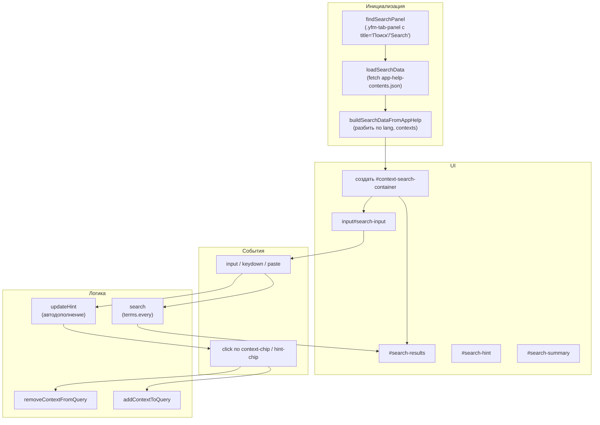
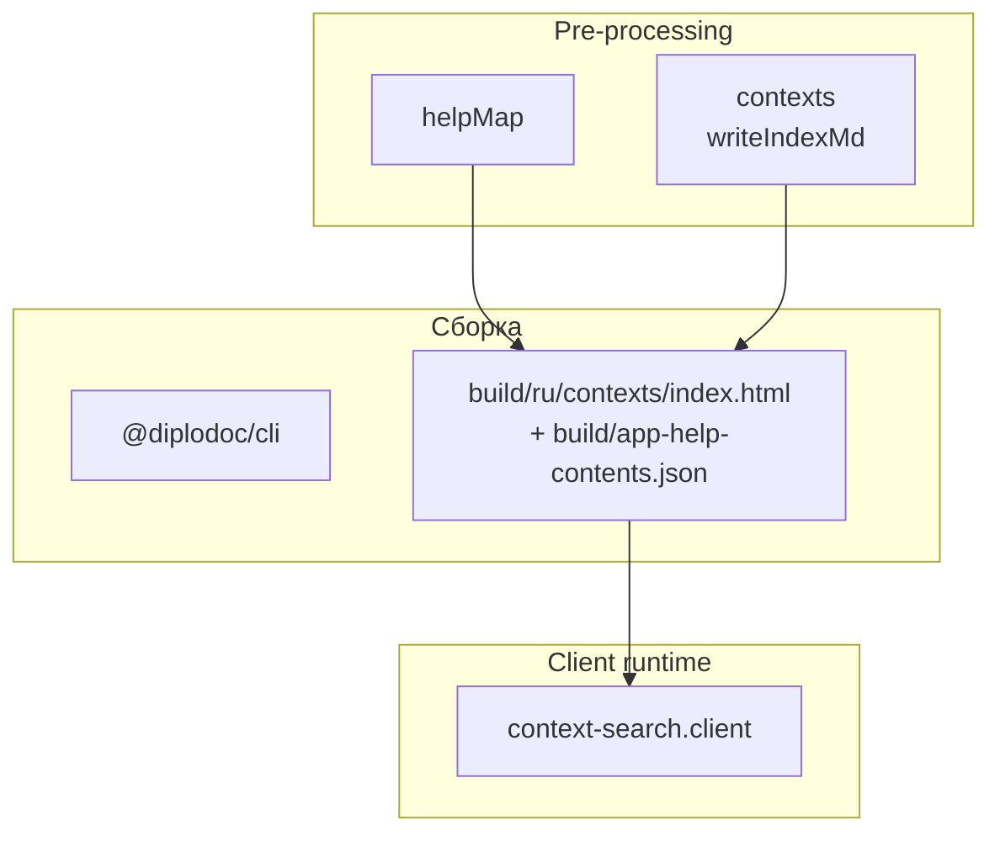

|               |                                                                                                                                                           |
| ------------- | --------------------------------------------------------------------------------------------------------------------------------------------------------- |
| ID            | [5.1-034](../../%D0%A1%D0%BE%D0%B3%D0%BB%D0%B0%D1%88%D0%B5%D0%BD%D0%B8%D1%8F/index.md#identifikaciya-modulej)                                             |
| Идентификатор | `context-search.client`                                                                                                                                   |
| Наименование  | Клиентский поиск по контекстам                                                                                                                            |
| Слой          | [client-runtime](../%D0%A1%D0%BB%D0%BE%D0%B8layer/ClientRuntime/index.md#naznachenie)                                                                       |
| Расположение  | `src/plugins/contexts/context-search.client.js` (копируется в `docs/_assets/scripts/context-search.js` модулем [`contexts`](../МодульКонтексты/index.md)) |
| Точка входа   | IIFE на вкладке «Поиск» страницы `contexts/index.html`                                                                                                    |
| Версия        | `1.54.0`                                                                                                                                                  |
| Назначение    | Даёт поиск статей по набору контекстов с чипами-подсказками и клиентской фильтрацией по `app-help-contents.json`                                          |

{: .page-legend }

## Назначение

`context-search.client` — «живая» вкладка **«Поиск»** на странице `contexts/index.html`. Пользователь вводит контексты через пробел (`nomenclature invoice`) — клиент показывает статьи, у которых **все** указанные контексты есть одновременно. Под полем ввода — чипы-подсказки по мере набора (с автодополнением из уже существующих контекстов), в результатах — заголовок статьи, её размер и чипы всех её контекстов (активные подсвечены, по клику добавляются/удаляются из запроса).

Зачем это нужно. Алфавитный указатель и карта контекстов (`contexts/index.md` — вкладки «Алфавитный указатель», «Карта», «Рейтинг») дают **навигацию** по контекстам. Поиск решает другую задачу: «найти все статьи, где есть одновременно `invoice` и `nomenclature`, но нет `report`» — то есть **фильтрация** по комбинации контекстов. Без модуля пришлось бы открывать `app-help-contents.json`, grep-ать, вручную отбирать.

Модуль работает **только в браузере**: читает JSON через `fetch`, строит интерфейс в существующей панели `.yfm-tab-panel`. На сервере не исполняется, `.md` не читает (кроме одного fetch).

## Применение

**Когда использовать:** нужна фильтрация статей по **комбинации** контекстов (`invoice` + `nomenclature`, но без `report`) — это невозможно через алфавитный указатель.

**Когда НЕ использовать:** нужен «каталог по одному контексту» — `contexts` уже даёт страницы `<context>.html`; нужен только JSON — `helpMap`.

**Альтернативы:**
- `grep context:` вручную — не даёт UI и фильтрации по комбинации.
- `contextmap` — визуальная карта, не поиск.

**Типичный сценарий:** открыть `contexts/index.html` → вкладка «Поиск» → ввести `invoice nomenclature` → отфильтрованный список статей.

## Как это работает



### Фаза 1. Загрузка данных

```js
function loadSearchData(callback) {
    if (dataLoaded) { callback(contextData); return; }
    pendingInit.push(callback);
    if (pendingInit.length > 1) return;

    var jsonUrl = '../' + DATASET_FILENAME;
    var scriptTag = document.currentScript;
    if (scriptTag) {
        var baseUrl = scriptTag.src.replace(/\/[^10]*$/, '/');
        jsonUrl = baseUrl + '../../' + DATASET_FILENAME;
    }

    fetch(jsonUrl)
        .then(r => { if (!r.ok) throw new Error('HTTP ' + r.status); return r.json(); })
        .then(entries => { contextData = buildSearchDataFromAppHelp(entries); dataLoaded = true; pendingInit.forEach(cb => cb(contextData)); })
        .catch(err => {
            console.error('❌ Ошибка загрузки данных поиска:', err);
            contextData = { ru: [], en: [] };
            dataLoaded = true;
            pendingInit.forEach(cb => cb(contextData));
        });
}
```

- **`DATASET_FILENAME = 'app-help-contents.json'`** — файл, который создаёт [`helpMap`](../МодульКартапомощи/index.md).
- **URL** — относительно `<script src>` (`document.currentScript.src`), `../../app-help-contents.json`. То есть скрипт лежит в `build/_assets/scripts/context-search.js`, JSON — в `build/app-help-contents.json`. `../../` — два уровня вверх.
- **Fallback** — если `document.currentScript` недоступен (редкость), используется `'../' + filename` (некорректно, но хоть что-то).
- **Ошибка fetch** — `console.error` в DevTools, `contextData = { ru: [], en: [] }`, поиск работает «пустым» (ничего не находит).

**`buildSearchDataFromAppHelp(entries)`**:

```js
var result = { ru: [], en: [] };
entries.forEach(entry => {
    var lang = (entry.lang || '').substring(0, 2).toLowerCase();
    if (lang !== 'ru' && lang !== 'en') return;
    var contexts = entry.context
        ? entry.context.split(',').map(s => s.trim()).filter(s => s.length > 0)
        : [];
    var href = entry.url.replace(/\.md$/, '.html');
    if (href.startsWith('/')) href = href.substring(1);
    result[lang].push({ href, title: entry.title, size: entry.size || 0, contexts });
});
return result;
```

Из массива `app-help-contents.json` строит `{ ru: [...], en: [...] }`. **Разделитель — только запятая** (`split(',')`), как и в `contextmap` (см. [`contextmap`](../МодульКартаконтекстов/index.md) — там та же проблема). Терминал `.trim()` — пробелы вокруг запятых не считаются.

### Фаза 2. Создание UI

```js
function doInitializeSearch(data) {
    var panel = findSearchPanel();
    if (!panel) return;

    var container = panel.querySelector('#context-search-container');
    if (!container) {
        var lang = getLang();
        var placeholder = lang === 'ru' ? 'Введите контексты через пробел...' : 'Enter contexts separated by space...';

        container = document.createElement('div');
        container.id = 'context-search-container';
        container.dataset.lang = lang;

        var input = document.createElement('input');
        input.type = 'text';
        input.id = 'search-input';
        input.placeholder = placeholder;

        var resultsDiv = document.createElement('div');
        resultsDiv.id = 'search-results';

        container.appendChild(input);
        container.appendChild(resultsDiv);
        panel.appendChild(container);
    }

    if (container.dataset.initialized === 'true') return;
    container.dataset.initialized = 'true';

    initSearch(container, container.dataset.lang || getLang(), data);
}
```

- **`findSearchPanel()`** — ищет `.yfm-tab-panel` с `data-title === 'Поиск'` или `'Search'`. Это панель вкладки ``, которую генерирует `contexts.writer.writeIndexMd` (через `generateSearchContent`).
- **Создание UI** — если контейнера нет, создаётся `<div>`, `<input>`, `<div>`, добавляются в панель.
- **Идемпотентность** — `data-initialized === 'true'`.
- **Удаление старых hint/summary** — перед initSearch, чтобы при повторной инициализации не дублировались.

**Важно:** скрипт **не подключается автоматически**. `contexts` копирует его в `docs/_assets/scripts/`, но `@diplodoc/cli` не вставляет `<script>` в HTML. Пользователь должен сам добавить в `.yfm` или в шаблон (`contexts/index.md` → `<script src="/_assets/scripts/context-search.js" defer>`). Без подключения — панель «Поиск» пустая, инпут не работает.

### Фаза 3. `initSearch(container, lang, data)`

**3.1. Чипы и подсказки:**

```js
var hintDiv = document.createElement('div');
hintDiv.id = 'search-hint';
results.parentNode.insertBefore(hintDiv, results);

var summaryDiv = document.createElement('div');
summaryDiv.id = 'search-summary';
results.parentNode.insertBefore(summaryDiv, results);
```

**3.2. `updateHint()`** — по последнему слову в инпуте ищет контексты, начинающиеся с этого префикса:

```js
var lastWord = words[words.length - 1] || '';
var matches = allContexts.filter(ctx => ctx.toLowerCase().indexOf(lastWord.toLowerCase()) === 0);
var display = matches.slice(0, 5);
var hintHtml = lang === 'ru' ? 'Возможно, вы имели в виду: ' : 'Did you mean: ';
display.forEach(ctx => { hintHtml += `<span class="hint-chip" data-context="${ctx}">${ctx}</span>`; });
```

Показывает до 5 подсказок. Клик по чипу — `addContextToQuery(ctx)`.

**3.3. `search()`** — по текущему значению инпута:

```js
var terms = query.split(/\s+/).filter(t => t.length > 0);
var matched = pages.filter(page => {
    var pageContexts = page.contexts.map(c => c.toLowerCase());
    return terms.every(term => pageContexts.some(c => c === term));
});
```

**Ключевая семантика:** `terms.every()` — **все** указанные контексты должны быть в статье. `pageContexts.some()` — сравнение по точному равенству после lower-case. Частичного совпадения (`invoice` ↔ `invoice-line`) нет.

**3.4. `removeContextFromQuery(context)`** — клик по активному чипу в результатах: убирает слово из инпута, пересчитывает `search()`.

**3.5. `addContextToQuery(context)`** — клик по неактивному чипу: добавляет слово в инпут с пробелом.

**3.6. События:**

- **`keydown`** — на `Space`/`Enter`/`Tab` → `updateHint()` + `search()`. `Tab` с `preventDefault` (чтобы не уходить с поля).
- **`input`** — на любое изменение → если пусто — очистка, иначе `updateHint()`.
- **`paste`** — `setTimeout(() => { updateHint(); search(); }, 10)` — ждёт вставки.

**3.7. `formatSize(bytes)`** — `Б` / `КБ` / `МБ`, целые для байт, `toFixed(1)` для КБ/МБ до 10.

### Фаза 4. `tryInitialize()`

```js
function tryInitialize() {
    var panel = findSearchPanel();
    if (panel && !panel.dataset.searchInitialized) {
        initializeSearch();
    }
}
```

**`MutationObserver` на `document.body`** — при появлении `.yfm-tab-panel` (Diplodoc рендерит после `DOMContentLoaded`) инициализирует поиск. `panel.dataset.searchInitialized` — маркер «уже инициализировано».

При загрузке страницы — `tryInitialize()` либо на `DOMContentLoaded`, либо сразу (если `document.readyState !== 'loading'`).

### Файлы модуля

| Файл                                            | Ответственность |
| ----------------------------------------------- | --------------- |
| `src/plugins/contexts/context-search.client.js` | Весь клиент     |

### Формат данных

`window` — не используется. Данные `contextData` — в замыкании IIFE.

В `app-help-contents.json` — массив записей (см. [`helpMap`](../МодульКартапомощи/index.md)), клиент фильтрует по `lang`, разбирает `context`, нормализует `href` (`.md` → `.html`, срез `/`).

## Режимы работы

### Клиентский runtime

Подключается в `contexts/index.md` (или `.yfm`):

```html
<script src="/_assets/scripts/context-search.js" defer></script>
```

На вкладке «Поиск» появляется инпут + подсказки + результаты.

### Проверка в DevTools

```js
document.getElementById('context-search-container')      // → <div>
document.getElementById('search-input')                   // → <input>
document.querySelectorAll('.yfm-tab-panel').length        // → >0, если вкладки
fetch('/app-help-contents.json').then(r => r.json())      // → массив
```

## Юнит-тесты





## Связи

`context-search.client` — потребитель двух артефактов:

- **`app-help-contents.json`** — создан [`helpMap`](../МодульКартапомощи/index.md);
- **HTML-панель «Поиск»** — создана [`contexts`](../МодульКонтексты/index.md) (`writeIndexMd` → `generateSearchContent`).

Без `helpMap` — `fetch` вернёт 404, поиск «пустой». Без `contexts` — нет `.yfm-tab-panel` с `data-title="Поиск"`, скрипт не инициализируется.

Третий потребитель `app-help-contents.json` — [`contextmap`](../МодульКартаконтекстов/index.md) (карта), [`helptagmap`](../МодульКартасправочныхтегов/index.md), [`presetsStat`](../МодульСтатистикапресетов/index.md), [`bytescounter`](../МодульРазмерыстатей/index.md). Все читают один JSON, но `context-search` — единственный **клиентский** потребитель.






