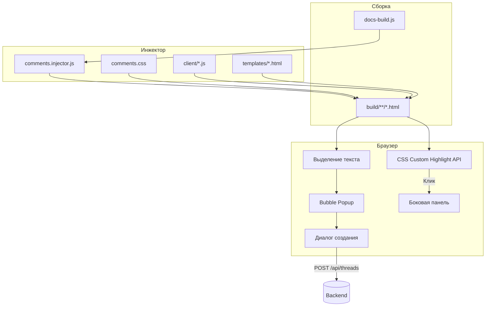

|               |                                                                                                                                         |
| ------------- | --------------------------------------------------------------------------------------------------------------------------------------- |
| ID            | [5.3-051](../../Соглашения/index.md#identifikaciya-modulej)                                                                             |
| Идентификатор | `comments`                                                                                                                              |
| Наименование  | Комментарии (Клиент)                                                                                                                    |
| Слой          | [post-processing](../Слоиlayer/PostProcessing/index.md#naznachenie) / [Client runtime](../Слоиlayer/ClientRuntime/index.md#naznachenie) |
| Расположение  | `plugins/comments/`                                                                                                                     |
| Точка входа   | `runGeneration(buildDir)` (инжектор)                                                                                                    |
| Версия        | `1.0.0`                                                                                                                                 |
| Назначение    | Внедряет в HTML интерфейс комментариев, подсвечивает фрагменты и управляет выезжающей панелью тредов                                    |

{: .page-legend }

## Назначение

Модуль `comments` замыкает на себе клиентское взаимодействие с читателем:
- **выделение текста** — при выделении появляется «пузырёк» (bubble) для создания комментария;
- **диалог создания** — форма с валидацией (Email + код, тип замечания, текст);
- **подсветка (Highlights)** — наложение цветных маркеров на откомментированные фрагменты;
- **выезжающая панель** — просмотр тредов и ответов техписа.

## Как это работает

**Post-processing (Инъекция):**
1. `comments.injector.js` читает исходники из `plugins/comments/client/` и `plugins/comments/templates/`.
2. Склеивает JS-файлы в единый IIFE (модуль), а HTML-шаблоны оборачивает в `<script type="text/template">`.
3. Вставляет `<style>` в `<head>` и `<script>` перед `</body>` во все HTML-файлы сборки.

**Client runtime (Работа в браузере):**
1. **Сегментация:** скрипт находит все треды с их `quote` и `prefix/suffix`. Разбивает текст на сегменты (чтобы корректно обрабатывать наложения нескольких комментариев).
2. **Подсветка:** использует современный `CSS.highlights` (не ломает DOM). Открытые треды подсвечиваются жёлтым, разрешённые — зелёным.
3. **Пузырёк:** при `mouseup` скрипт берёт координаты *последней* строки выделения (`range.getClientRects()`) и показывает круглую кнопку.
4. **Панель:** при клике на подсвеченный текст открывается боковая панель (`position: absolute`), привязанная к координатам текста.

### Файлы модуля

| Файл                    | Ответственность                            |
| ----------------------- | ------------------------------------------ |
| `comments.injector.js`  | Сборка и вставка JS/CSS/HTML в страницы    |
| `comments.client.js`    | Точка входа клиента (или папка `client/*`) |
| `comments.config.js`    | Настройки API, локализация (ru/en)         |
| `client/50-bubble.js`   | Логика появления «пузырька»                |
| `client/60-panel.js`    | Логика выезжающей панели и ответов         |
| `client/70-dialog.js`   | Форма создания нового комментария          |
| `templates/dialog.html` | Шаблон диалога (Тип, Текст, Документ)      |

## Типы замечаний

Для удобства техписа читатель выбирает тип при создании:
1. **Грамматика** — опечатка, пунктуация. Требует только текст.
2. **Несоответствие** — противоречие ТЗ/ГОСТ. Требует обязательное поле «Документ источник».

Визуально такие комментарии помечаются бейджем `⚠️ Несоответствие документу`.