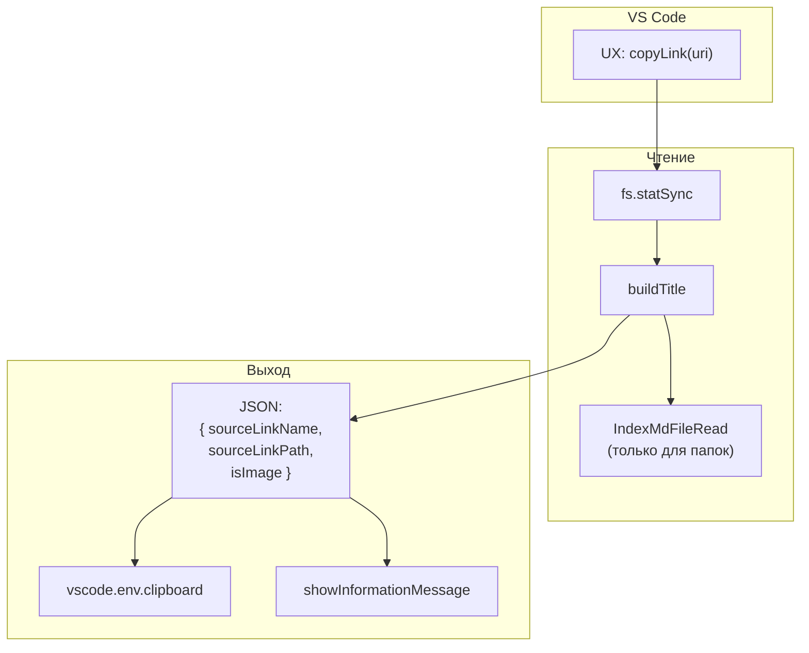
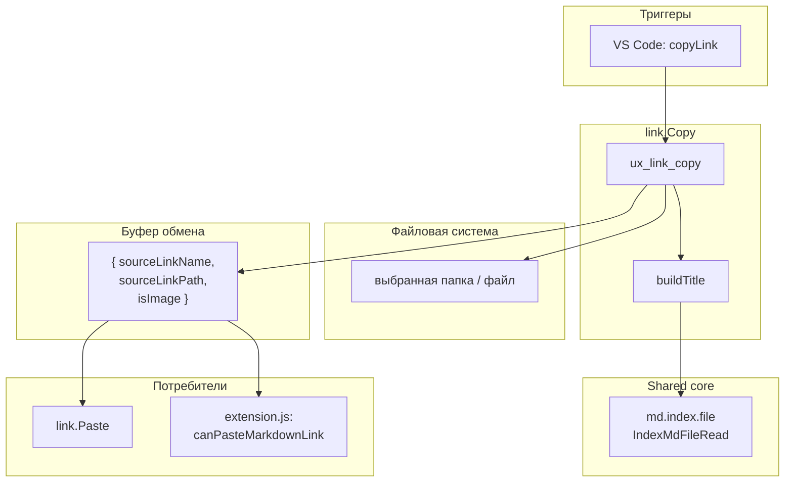

|               |                                                                                                               |
| ------------- | ------------------------------------------------------------------------------------------------------------- |
| ID            | [2.2-027](../../%D0%A1%D0%BE%D0%B3%D0%BB%D0%B0%D1%88%D0%B5%D0%BD%D0%B8%D1%8F/index.md#identifikaciya-modulej) |
| Идентификатор | `link.Copy`                                                                                                   |
| Наименование  | Копирование ссылки                                                                                            |
| Слой          | [vscode-ui](../%D0%A1%D0%BB%D0%BE%D0%B8layer/VsCodeUi/index.md#naznachenie)                                     |
| Расположение  | `src/commands/diplodoc-helper.link.Copy.js`                                                                   |
| Точка входа   | `ux_link_copy(uri)`                                                                                           |
| Версия        | `1.54.0`                                                                                                      |
| Назначение    | Сохраняет в буфер обмена JSON с именем и путём документа для последующей вставки                              |

{: .page-legend }

## Назначение

`link.Copy` — первая половина «умного» копирования ссылок. Пользователь кликает правой кнопкой на папке-секции, `.md`-файле или картинке в Explorer, выбирает **Diplodoc → Копировать ссылку на документ** — и модуль кладёт в буфер обмена небольшой JSON с путём и «человеческим» именем объекта.

В отличие от стандартного «Copy» в VS Code (который копирует абсолютный путь), `link.Copy` сохраняет данные в структурированном виде, чтобы [`link.Paste`](../МодульВставкассылки/index.md) при вставке в другой документ мог корректно вычислить **относительный** путь (из текущего `.md` к целевому) с URL-encoding кириллицы — то, что руками делать долго.

Пара команд (`link.Copy` → `link.Paste`) заменяет ручной сценарий:

1. Открыть исходный файл, посмотреть его путь относительно корня проекта.
2. Переключиться на целевой файл, посчитать относительный путь (`../Раздел2/foo/index.md`).
3. Закодировать кириллицу (`%D0%A0…`).
4. Написать `[]()` или ``.

Модуль делает первый шаг. Второй — [`link.Paste`](../МодульВставкассылки/index.md).

## Применение

**Когда использовать:** нужна ссылка на другой документ, и вы хотите, чтобы относительный путь с URL-encoding кириллицы был вычислен автоматически — не вручную.

**Когда НЕ использовать:** ссылка на внешний URL (обычный markdown); ссылка на заголовок в текущем файле (`[text](#anchor)`); вставка картинки из буфера (`image.PasteFromClipboard`).

**Альтернативы:**
- Стандартный `Ctrl+C` / `Ctrl+V` — копирует абсолютный путь, работает только в одной ОС.
- `image.PasteFromList` — для картинок (QuickPick по всем изображениям проекта).

**Типичный сценарий:** ПКМ на папке/`.md`/картинке → **Diplodoc → Копировать ссылку на документ** → JSON в буфере → открыть целевой `.md` → **Diplodoc → Вставить ссылку** → выбрать якорь из QuickPick.

## Как это работает



### Единственная фаза

```js
async function ux_link_copy(uri) {
    if (!uri) return;
    const fsPath = uri.fsPath;
    const stats = fs.statSync(fsPath);
    let targetPath = fsPath;
    let title = buildTitle(stats, fsPath);
    const data = {
        sourceLinkName: title,
        sourceLinkPath: targetPath,
        isImage: /\.(png|jpe?g|gif|svg|webp)$/i.test(fsPath),
    };
    await vscode.env.clipboard.writeText(JSON.stringify(data));
    vscode.window.showInformationMessage(translate('plugin.link.copy.info.success', title));
}
```

1. **Валидация.** Если `uri` не передан (команда вызвана из палитры) — тихий `return`. См. «Известные ограничения».
2. **`fs.statSync(fsPath)`.** Если путь не существует (например, пользователь удалил папку и кликает по кэшу Explorer) — `throw`, `try/catch` нет, ошибка уйдёт в VS Code. См. «Известные ограничения».
3. **`targetPath = fsPath`.** Просто дублирование переменной — никакой нормализации пути. Абсолютный путь на текущей ОС (`C:\Users\…\docs\ru\Раздел1\index.md` или `/home/…/docs/ru/Раздел1/index.md`).
4. **`title = buildTitle(stats, fsPath)`** — человекочитаемое имя (см. ниже).
5. **JSON.** `{ sourceLinkName, sourceLinkPath, isImage }`.
6. **`clipboard.writeText(JSON.stringify(data))`** — сериализация без `\n`/indent.
7. **Сообщение.** `plugin.link.copy.info.success`: `"Ссылка на «{0}» скопирована в буфер"`.

### `buildTitle`

```js
function buildTitle(stats, fsPath) {
    if (stats.isDirectory()) {
        const section = IndexMdFileRead(fsPath);
        return section?.pureTitle || path.basename(fsPath);
    } else {
        return path.basename(fsPath);
    }
}
```

- **Папка.** Пробует `IndexMdFileRead(fsPath)` (`gray-matter.parse` для `index.md`):
  - если `index.md` есть и содержит `pureTitle: 'Введение'` — вернёт `'Введение'`;
  - если `index.md` есть, но `pureTitle` пуст (`title: 'Раздел 1. Введение'`, без `pureTitle`) — **вернёт `''`** (пустая строка), потому что `IndexMdFileRead` возвращает `data` из `gray-matter`, а `pureTitle` — `undefined`, `section?.pureTitle || path.basename(fsPath)` → `undefined || path.basename(fsPath)` → `path.basename(fsPath)`. **Стоп, нет**: `undefined || '...'` → `'...'` (fallback сработает). А если `pureTitle: ''` (пустая строка явно) — `'' || '...'` → `'...'` (тоже fallback). Так что пустого title не будет — либо `pureTitle`, либо имя папки.
  - **НО**: `IndexMdFileRead` возвращает **весь `data`** (объект frontmatter). Не только `pureTitle`. То есть `section` — это `{ title: '…', pureTitle: '…', sectionType: '…', sectionIndex: '…' }`. `section?.pureTitle` — корректный доступ. См. «Известные ограничения» — если `index.md` содержит `title` (не `pureTitle`), fallback на имя папки будет, что может не совпадать с «человеческим» названием.
- **Файл.** `path.basename(fsPath)` — имя с расширением (`foo.md`, `image.png`). Для `.md` — с `.md`, для картинки — с `.png`.

### `isImage`

```js
isImage: /\.(png|jpe?g|gif|svg|webp)$/i.test(fsPath),
```

Регексп проверяет расширение. Список:

| Расширение | `isImage` |
| ---------- | --------- |
| `.png`     | `true`    |
| `.jpg`     | `true`    |
| `.jpeg`    | `true`    |
| `.gif`     | `true`    |
| `.svg`     | `true`    |
| `.webp`    | `true`    |
| `.bmp`     | `false`   |
| `.tiff`    | `false`   |
| `.ico`     | `false`   |
| `.md`      | `false`   |
| (папка)    | `false`   |

`isImage` не влияет на то, что кладётся в буфер (JSON тот же). Используется в [`link.Paste`](../МодульВставкассылки/index.md) для выбора `` vs `[]()` и для `buildFigure`/`buildImageLink` в `utils/md.links.figure.js`. Также — для исключения выбора якоря (для картинок `promptAnchorSelection` не вызывается).

### Файлы модуля

| Файл                                        | Ответственность                                          |
| ------------------------------------------- | -------------------------------------------------------- |
| `src/commands/diplodoc-helper.link.Copy.js` | `ux_link_copy`, `buildTitle`                             |
| `src/plugins/utils/md.index.file.js`        | `IndexMdFileRead` — для чтения `pureTitle` из `index.md` |

### Формат JSON в буфере

```json
{
    "sourceLinkName": "Введение",
    "sourceLinkPath": "C:\\projects\\docs\\ru\\Раздел1.Введение",
    "isImage": false
}
```

| Поле             | Что              | Пример                                       |
| ---------------- | ---------------- | -------------------------------------------- |
| `sourceLinkName` | Человеческое имя | `'Введение'`                                 |
| `sourceLinkPath` | Абсолютный путь  | `'C:\\projects\\docs\\ru\\Раздел1.Введение'` |
| `isImage`        | Флаг картинки    | `false`                                      |

Именно JSON, а не markdown-ссылка. Пользователь, который «случайно» нажмёт `Ctrl+V` после `Copy Link` в обычном тексте, увидит JSON. См. «Известные ограничения».

## Режимы работы

### VS Code

| Команда                    | Заголовок                     | Где появляется                                      |
| -------------------------- | ----------------------------- | --------------------------------------------------- |
| `diplodoc-helper.copyLink` | Копировать ссылку на документ | Explorer → Diplodoc → Копировать ссылку на документ |

`when` (`package.json`):

```json
{
    "command": "diplodoc-helper.copyLink",
    "when": "explorerResourceIsFolder || resourceExtname == .md || resourceExtname == .png || resourceExtname == .jpg || resourceExtname == .svg",
    "group": "z1.diplodoc.section@5"
}
```

Работает на папках, `.md`, `.png`, `.jpg`, `.svg`. На `.jpeg`, `.gif`, `.webp` — команда **не видна** (хотя `isImage` в коде их учитывает). См. «Известные ограничения».

### CLI

CLI-команды нет. Модуль — только VS Code.

### Сборочный пайплайн

В `docs-build.js` не участвует.

### Дополнение: `diplodoc-helper:canPasteMarkdownLink`

В `extension.js` регистрируется контекстный ключ `diplodoc-helper:canPasteMarkdownLink`, который проверяет содержимое буфера через `parseClipboardLink` (из `link.Paste`). Это **влияет на видимость** команды `diplodoc-helper.pasteLink` в контекстном меню редактора:

```json
{
    "command": "diplodoc-helper.pasteLink",
    "when": "editorTextFocus && !editorReadonly && (diplodoc-helper:canPasteMarkdownLink || resourceFilename =~ /^(gosts|abbreviations)\\.yaml$/)",
    ...
}
```

То есть после `link.Copy` (когда в буфере JSON правильного формата) — `pasteLink` становится видимым. До — скрыт. Это связка Copy → Paste через буфер.

## Юнит-тесты





## Связи

`link.Copy` — «поставщик данных» для [`link.Paste`](../МодульВставкассылки/index.md). Формат JSON в буфере — контракт между двумя модулями.

| Модуль                                                             | Роль                                                                                                              |
| ------------------------------------------------------------------ | ----------------------------------------------------------------------------------------------------------------- |
| **`link.Copy`**                                                    | Пишет JSON в буфер (этот модуль)                                                                                  |
| [`link.Paste`](../МодульВставкассылки/index.md)                    | Читает JSON из буфера, вычисляет относительный путь, вставляет ссылку                                             |
| [`image.PasteFromClipboard`](../МодульВставкаизображения/index.md) | **Не** использует JSON — работает с растровым изображением из буфера (`vscode.env.clipboard.readText` не при чём) |
| [`image.PasteFromList`](../МодульВставкаизображения/index.md)      | **Не** использует JSON — показывает список всех картинок проекта через `QuickPick`                                |

Копирование работает и для картинок (`isImage: true`). При вставке через `link.Paste` картинка оборачивается в `buildFigure` (с `<figure>` и `<figcaption>`), а не просто ``. При вставке картинки через `image.PasteFromList` — `link.Copy` не участвует.

С `utils/md.index.file` — `IndexMdFileRead` используется только для чтения `pureTitle` из `index.md` при `buildTitle`. Для файлов (`stats.isDirectory() === false`) — не вызывается.

С `extension.js` — регистрация `diplodoc-helper:canPasteMarkdownLink` через `parseClipboardLink`. Фактически `link.Copy` и `link.Paste` связаны через `ContextMenuManager` в `extension.js`:

```js
contextManager.registerContextKey('diplodoc-helper:canPasteMarkdownLink', async () => {
    const clipboardText = await vscode.env.clipboard.readText();
    const link = parseClipboardLink(clipboardText);
    return link !== null;
});
```

То есть после `link.Copy` расширение **автоматически** узнаёт (через polling с интервалом `contextPollingInterval`), что в буфере появилась ссылка, и делает `pasteLink` видимой.






