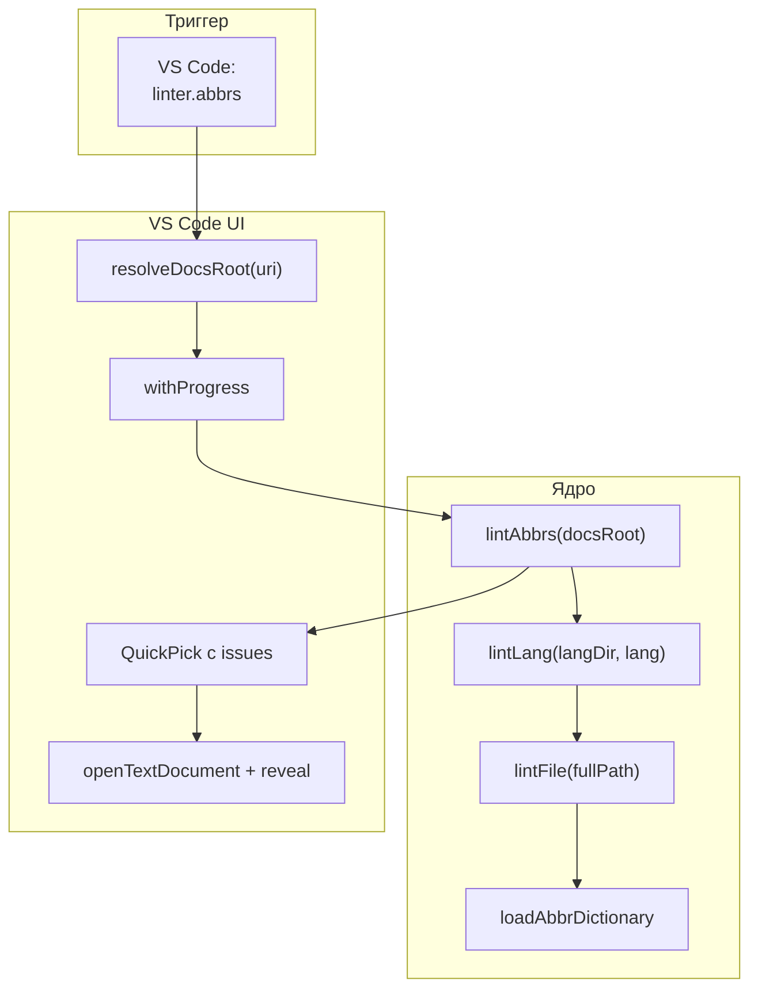
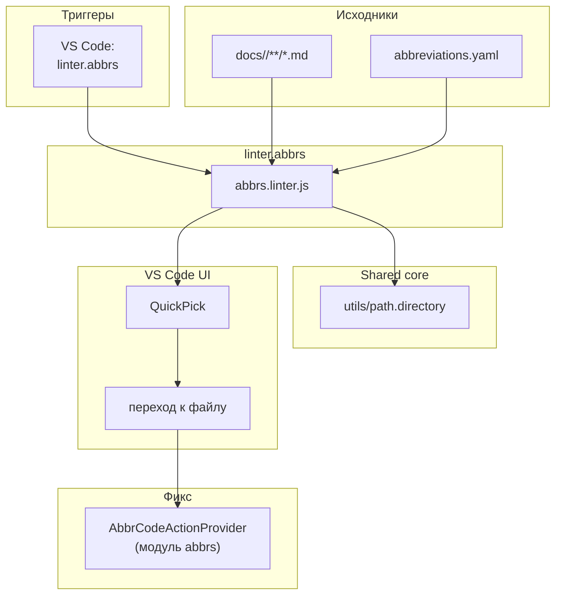

|               |                                                                                                               |
| ------------- | ------------------------------------------------------------------------------------------------------------- |
| ID            | [7.1-020](../../%D0%A1%D0%BE%D0%B3%D0%BB%D0%B0%D1%88%D0%B5%D0%BD%D0%B8%D1%8F/index.md#identifikaciya-modulej) |
| Идентификатор | `linter.abbrs`                                                                                                |
| Наименование  | Линтер аббревиатур                                                                                            |
| Слой          | [vscode-ui](../%D0%A1%D0%BB%D0%BE%D0%B8layer/VsCodeUi/index.md#naznachenie)                                     |
| Расположение  | `src/plugins/abbrs/abbrs.linter.js`, `src/commands/diplodoc-helper.linter.abbrs.js`                           |
| Точка входа   | `lintAbbrs(docsRoot, options)` (ядро), `ux_linter_abbrs(uri)` (VS Code)                                       |
| Версия        | `1.54.0`                                                                                                      |
| Назначение    | Находит `&lt;abbr&gt;` без определения в словаре и предлагает перейти к файлу                                 |

{: .page-legend }

## Назначение

`linter.abbrs` проверяет, что каждый `<abbr>`-тег в статьях **определён в словаре** `abbreviations.yaml`. Находит все `<abbr>` без `class=` (не «чужие», не `terms`), без `title=` (без inline-override) и сверяет с `loadAbbrDictionary(langDir)`.

Практический смысл: если в статье появилась аббревиатура `<abbr>ИСО</abbr>`, а в словаре `ИСО` нет:

- на странице-указателе `Список сокращений` она не появится;
- тултип на неё не появится;
- пользователь увидит «просто тег `<abbr>`, без подсказки» — но не поймёт, что проблема в словаре.

`linter.abbrs` вылавливает такие «сироты» и показывает их списком с переходом к файлу. Пользователь кликает → попадает в редактор на позицию `<abbr>` → через CodeAction (`AbbrCodeActionProvider`) добавляет запись в словарь.

В отличие от [`linter.links`](../МодульЛинтерссылок/index.md), здесь нет `Diagnostic`-ов — результат показывается как `QuickPick` с переходом. Причина: аббревиатуры «размазаны» по всему тексту, диагностики на каждую — визуальный шум. Список + переход — экономнее.

## Применение

**Когда использовать:** после добавления новых `<abbr>` — проверить, все ли они определены в `abbreviations.yaml` (иначе они не появятся в «Списке сокращений» и без тултипа).

**Когда НЕ использовать:** сокращений мало и вы уверены в словаре; нужен автоматический фикс — модуль только показывает список, фикс через Code Actions.

**Альтернативы:**
- `grep '<abbr'` + `abbreviations.yaml` вручную — утомительно.
- `linter.terms` — для `<abbr class="term">`, не для сокращений.

**Типичный сценарий:** в VS Code **Diplodoc → Очистка и проверки → Сокращения: проверить определения** → QuickPick со списком «не найдено» → клик → переход к файлу → Code Action «Добавить в словарь».

## Как это работает



### Фаза 1. `resolveDocsRoot(uri)`

Из `src/commands/diplodoc-helper.linter.abbrs.js` (общая функция с `linter.terms`):

1. Если `uri` задан и существует:
   - `current = uri.fsPath` (файл → `dirname`);
   - идти вверх по дереву до папки с basename `docs` (без учёта регистра);
   - если нашли — вернуть этот путь.
2. Иначе — `workspaceFolders[0].uri.fsPath + '/docs'`, если существует.
3. Иначе — `null`.

То есть линтер работает **всегда в контексте `docs/`**, независимо от того, какой файл выделен в Explorer.

### Фаза 2. `lintAbbrs(docsRoot, options)`

1. **Список языков.** `options.languages || ['ru', 'en']` — захардкожено.
2. **Для каждого языка** — `lintLang(docsRoot + '/' + lang, lang)`. Если папки нет — пропуск.
3. **`lintLang`**:
   - `dictionary = loadAbbrDictionary(langDir)` — словарь `<abbr>`-записей;
   - `skipFullPaths = new Set([path.resolve(getAbbrOutputDir(langDir, lang))])` — выходная папка `abbrs` (её `index.md` содержит `<abbr data-abbr="…">` для каждой записи; если проверять, все дадут «не найдено»);
   - рекурсивный обход `langDir`:
     - пропускаются папки из `SKIP_DIRS` (`abbrs`, `terms`, `contexts`, `helptags`, `figures`, `roadmap`, `node_modules`);
     - пропускаются папки, начинающиеся с `_` или `.`;
     - для каждого `.md` — `lintFile(fullPath)`.
4. **`lintFile`**:
   - regex `<abbr([^24]*)>([^25]+)<\/abbr>` — находит все `<abbr>` с inline-текстом (не пустые);
   - пропускает `class=` (зона `terms`), `title=` (inline-override);
   - `lookupAbbr = data-abbr || innerText`;
   - если `dictionary.has(lookupAbbr)` — ок, пропуск;
   - иначе — `issues.push({ filePath, line, character, abbr, innerText, lang })`.
5. **Сортировка** — по `filePath`, `line`, `character`.
6. **Возврат** — плоский `issues[]` по всем языкам.

### Фаза 3. VS Code UI (`ux_linter_abbrs`)

1. `resolveDocsRoot(uri)` → если `null` — `showErrorMessage('Не найдена папка docs в проекте')`.
2. `withProgress('Проверка сокращений…')` → `lintAbbrs(docsRoot)`.
3. Если `issues.length === 0` — `showInformationMessage('Все сокращения определены в abbreviations.yaml')`.
4. Иначе — `QuickPick`:
   - `label: $(warning) <abbr>`
   - `description: — <relative path>:<line+1>`
   - `placeHolder: 'Не определено в словаре: N. Выберите, чтобы перейти к файлу.'`
5. При выборе — `openTextDocument`, `showTextDocument`, `revealRange` по позиции.

### Файлы модуля

| Файл                                           | Ответственность                                                            |
| ---------------------------------------------- | -------------------------------------------------------------------------- |
| `src/plugins/abbrs/abbrs.linter.js`            | `lintAbbrs`, `lintLang`, `lintFile`, `extractDataAbbr`, `offsetToPosition` |
| `src/commands/diplodoc-helper.linter.abbrs.js` | `resolveDocsRoot`, `ux_linter_abbrs`                                       |

### Формат `issues[]`

```js
[
    { filePath: '/abs/path/foo.md', line: 5, character: 8, abbr: 'ИСО', innerText: 'ИСО', lang: 'ru' },
    { filePath: '/abs/path/bar.md', line: 12, character: 2, abbr: 'ГОСТ', innerText: 'ГОСТ', lang: 'ru' },
]
```

`line`/`character` — позиция начала `<abbr>` (не внутри). `abbr` = `data-abbr || innerText`.

## Режимы работы

### VS Code

| Команда                        | Заголовок                         | Где появляется                           |
| ------------------------------ | --------------------------------- | ---------------------------------------- |
| `diplodoc-helper.linter.abbrs` | Сокращения: проверить определения | Explorer → Diplodoc → Очистка и проверки |

Реализация — `ux_linter_abbrs`. Вызывается из контекстного меню Explorer на любой папке/файле; `uri` не обязателен (если вызвано из палитры — `resolveDocsRoot` берёт `docs/` из workspace).

### CLI

CLI-команды нет. Только VS Code.

### Сборочный пайплайн

В `docs-build.js` не участвует. Линтер — инструмент редактора, не сборки.

### Code Actions

`AbbrCodeActionProvider` (из модуля [`abbrs`](../МодульАббревиатуры/index.md), не из этого) при клике на лампочку рядом с `<abbr>`:

| Действие                          | Условие                 |
| --------------------------------- | ----------------------- |
| Показать расшифровку: …           | `<abbr>` есть в словаре |
| Добавить «X» в словарь сокращений | `<abbr>` нет в словаре  |
| Снять разметку сокращения         | Курсор внутри `<abbr>`  |
| Обернуть в сокращение             | Выделен диапазон        |
| Обернуть слово в сокращение       | Курсор на слове         |

То есть из результата `linter.abbrs` пользователь **переходит к файлу** и через лампочку делает фикс. Два шага: «нашёл проблему» (линтер) → «исправил» (CodeAction).

## Юнит-тесты





## Связи

`linter.abbrs` работает с тем же словарём, что и [`abbrs`](../МодульАббревиатуры/index.md) (`abbreviations.yaml`), использует те же `getAbbrOutputDir` / `loadAbbrDictionary`. Код `lintFile` перекликается с `extractAbbrsFromFile` (из `abbrs.extractor`), но написан заново.

Три линтера не пересекаются:

| Модуль             | Область               | Что ищет                     |
| ------------------ | --------------------- | ---------------------------- |
| `linter.links`     | `.md`-ссылки          | Битые файлы и якоря          |
| **`linter.abbrs`** | `<abbr>` без `class=` | Отсутствующие в словаре      |
| `linter.terms`     | `<abbr class="term">` | Отсутствующие в `terms.yaml` |

`linter.abbrs` и `linter.terms` **симметричны** по структуре (одинаковый `resolveDocsRoot`, одинаковый обход `docs/`, одинаковая `withProgress` + `QuickPick`), но проверяют разные теги и разные словари.

С [`abbrs.injector`](../МодульАббревиатуры/index.md) — не пересекается: injector тоже читает `<abbr>` и `abbreviations.yaml`, но на фазе post-processing и для тултипов. Линтер — на фазе редактирования и для диагностики.






