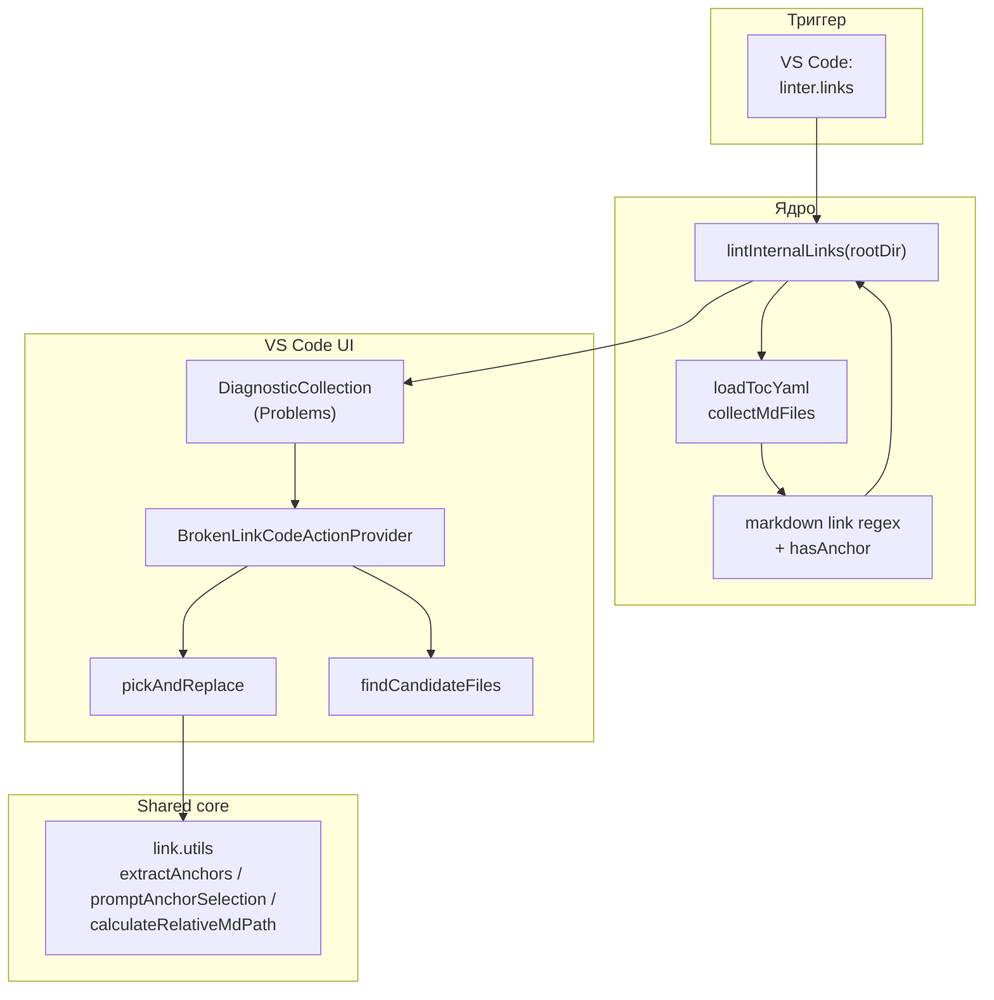
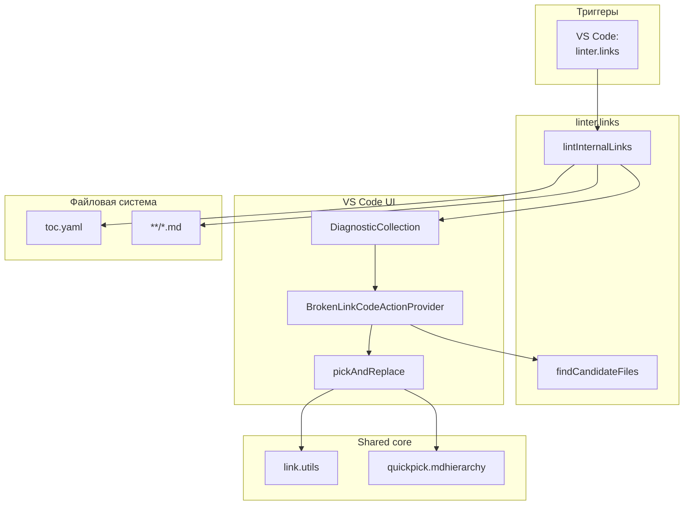

|               |                                                                                                                            |
| ------------- | -------------------------------------------------------------------------------------------------------------------------- |
| ID            | [7.1-019](../../%D0%A1%D0%BE%D0%B3%D0%BB%D0%B0%D1%88%D0%B5%D0%BD%D0%B8%D1%8F/index.md#identifikaciya-modulej)              |
| Идентификатор | `linter.links`                                                                                                             |
| Наименование  | Линтер ссылок                                                                                                              |
| Слой          | [vscode-ui](../%D0%A1%D0%BB%D0%BE%D0%B8layer/VsCodeUi/index.md#naznachenie)                                                  |
| Расположение  | `src/plugins/linter/linter.links.js`, `src/commands/diplodoc-helper.linter.links.js`, `src/commands/vscode.linter.links.*` |
| Точка входа   | `lintInternalLinks(rootDir)` (ядро), `ux_linter_links(uri)` (VS Code)                                                      |
| Версия        | `1.54.0`                                                                                                                   |
| Назначение    | Проверяет внутренние markdown-ссылки и якоря по `toc.yaml`, показывает диагностики и предлагает замену                     |

{: .page-legend }

## Назначение

`linter.links` — единственный из трёх линтеров, который работает через **`vscode.Diagnostic`** и **CodeAction**. Он обходит `.md`-файлы, перечисленные в `toc.yaml` (рекурсивно, включая `include`), парсит все markdown-ссылки `[text](url)` и проверяет две вещи:

1. **Существует ли файл** по относительному пути. Если `foo/bar.md` не найден — ищет `foo/bar/index.md` (соглашение Diplodoc: папка без файла = ссылка на `index.md`).
2. **Существует ли якорь** `#anchor` в целевом файле — простая regex-проверка `id="anchor"` / `name="anchor"`.

Результат — набор `Diagnostic`-ов в Problems для каждого «битого» места. На каждый `Diagnostic` навешивается `BrokenLinkCodeActionProvider` — при клике на лампочку пользователю предлагается список кандидатов на замену (ближайшие по имени файлы) и QuickPick для выбора нового пути и якоря. По клику на кандидата — мгновенная замена ссылки в документе.

Модуль намеренно **не проверяет** внешние ссылки (`http://…`), `mailto:`, `data:` и ссылки на `#anchor` внутри той же статьи — это не «внутренние ссылки проекта», а произвольные URL, которые Diplodoc не валидирует.

## Применение

**Когда использовать:** перед релизом или после массовых перемещений/переименований — проверить, что нет битых внутренних ссылок и потерянных якорей.

**Когда НЕ использовать:** маленький проект (5–10 статей) — быстрее пройтись глазами; нужен CI-гейт — модуль работает только в VS Code.

**Альтернативы:**
- `@diplodoc/cli` сам падает на битых ссылках при сборке — но без «перехода к файлу» и без QuickFix.
- `grep`/`rg` вручную — не проверяет якоря.

**Типичный сценарий:** в VS Code **Diplodoc → Очистка и проверки → Проверить ссылки** → Problems + Code Actions «Заменить на предполагаемый файл (⭐)».

## Как это работает



### Фаза 1. Сбор файлов (`collectMdFiles`)

```js
function collectMdFiles(entries, rootDir, currentPath = '', visited = new Set()) { … }
```

Обход `toc.yaml`:

- для каждого `item.href` → путь `rootDir/currentPath/href`. Если `href` не заканчивается `.md` — добавляется `/index.md`. Если файл существует — попадает в список.
- для каждого `item.include.path` → загружается `toc.yaml` по этому пути (рекурсивно). `visited` защищает от циклов.
- для каждого `item.items[]` — рекурсия.

На выходе — **полный список `.md`**, которые попали в навигацию. Файлы, не упомянутые в `toc.yaml` (и не попавшие в `include`), **не проверяются**. Это осознанно: «линтер проверяет навигацию», а не «все файлы в `docs/`». См. «Известные ограничения».

### Фаза 2. Проверка ссылок (`lintInternalLinks`)

Для каждого `.md`:

1. **Regex-парсинг ссылок.** `/\[([^14]]*)\]\(([^15]*)\)/g` — все markdown-ссылки в тексте.
2. **Фильтр.** Пропускаются:
   - пустые (`url === ''`);
   - `#anchor` — ссылки внутри той же статьи;
   - `http://`, `https://`, `ftp://`, `mailto:`, `www.`, `data:`;
   - ссылки, начинающиеся с `//` (протокол-относительные, фактически внешние).
3. **Разбор на path и anchor.** `split('#')` → `pathPart` + `anchor`. Если `pathPart === ''` (только `#anchor`) — пропуск (см. выше).
4. **URL-decode.** `decodeURIComponent(pathPart)` — чтобы `%20` превращался в пробел, `%D0%90` — в `А`. При ошибке декодирования — используется исходная строка.
5. **Резолв.** `path.resolve(path.dirname(mdFilePath), decodedPathPart)`. Если файл не существует и путь не заканчивается `.md` — пробуется `<path>/index.md`.
6. **Проверка anchor.** Если anchor есть и файл существует:
   - читается содержимое целевого файла (кеш `fileContentCache`);
   - `hasAnchor(content, anchor)` — regex `/(?:id|name)\s*=\s*["']<anchor>["']/i` — ищет атрибуты `id=` или `name=` с этим значением.

На выходе — `errors: [{ filePath, line, character, linkUrl, severity }]`:

- `severity: 'error'` — файл не найден;
- `severity: 'warning'` — файл найден, но anchor отсутствует.

Плюс `allMdFiles` — все проверенные `.md` (кешируются в UI-слое для CodeAction).

### Фаза 3. VS Code UI (`ux_linter_links`)

1. **`rootDir`.** Если передан `uri` — берётся `uri.fsPath` (папка) или `dirname(uri.fsPath)` (файл). Иначе — `workspaceFolders[0].uri.fsPath`. Если ничего — `showErrorMessage` и выход.
2. **`lintInternalLinks(rootDir)`.** Синхронный вызов.
3. **Кеш.** `cachedMdFiles = result.allMdFiles`, `cachedRootDir = rootDir` — глобальные переменные модуля. Читаются из `BrokenLinkCodeActionProvider` через `getLinterCachedMdFiles()` / `getLinterCachedRootDir()`.
4. **Diagnostics.** `diagnosticCollection.clear()`. Для каждой ошибки — `vscode.Diagnostic` с диапазоном `[line, character]–[line, character+1]` (один символ), severity из `err.severity`, source `'link-linter'`, message `«Битая ссылка: …»` или `«Невалидный якорь: …»`.
5. **Финал.** Если ошибок нет — `showInformationMessage('✅ Все ссылки и якоря валидны.')`. Иначе — `showWarningMessage('❌ Найдено ошибок: N, предупреждений: M.')` и `commands.executeCommand('workbench.action.problems.focus')` — фокус на панели Problems.

### Фаза 4. CodeAction (`BrokenLinkCodeActionProvider`)

Регистрируется в `extension.js` для `language: 'markdown'`. При лампочке в редакторе фильтрует `context.diagnostics` по `source === 'link-linter' && severity === Error`. Для каждой диагностики:

1. **Извлечь битую ссылку.** `diagnostic.message.match(/^Битая ссылка:\s*(.*)$/)` — регулярка **русскоязычная**, привязана к формату сообщения.
2. **`findCandidateFiles(brokenLink, currentFilePath, cachedMdFiles, cachedRootDir)`** — ищет «похожие» файлы:
   - `linkPath` = ссылка без `#hash`;
   - `segments = linkPath.split('/')`;
   - `lastSeg = 'index.md'` → `searchName` = предпоследний сегмент (имя папки); иначе — последний сегмент без `.md`;
   - ищет в `allMdFiles` файлы с `basename === searchName` (без учёта регистра);
   - если не найдено — идёт вверх по файловой системе от `currentDir` до `rootDir`, ищет папку или файл с таким именем;
   - сортирует по глубине от `currentDir` (ближайшие первыми).
3. **Три варианта CodeAction:**
   - **«Заменить на предполагаемый файл (⭐)»** — если `candidates.length > 0`;
   - **«Выбрать из всех файлов...»** — всегда;
   - **«Найти файл для замены...»** — если кандидатов нет (то же, что второе, но с другим текстом).

Все три ведут в `pickAndReplace`.

### Фаза 5. Замена (`pickAndReplace`)

1. **QuickPick с кандидатами.** `selectTargetDirectoryWithCandidates(currentFilePath, candidates)` — из `vscode.quickpick.mdhierarchy`. Строит список: сначала «⭐ Предполагаемые файлы», потом «─── Все разделы ───», потом все директории-разделы в проекте. Возвращает выбранный путь.
2. **`targetFile`.** Если выбран каталог — добавляется `/index.md`. Если файла нет — ошибка.
3. **Якоря.** `extractAnchorsFromMdFile(targetFile)` — заголовки `#`/`##`/…, `{#id}`, `id=`, `name=`. Через `promptAnchorSelection` — QuickPick с якорями + «Ввести вручную».
4. **Относительный путь.** `calculateRelativeMdPath(sourceFilePath, targetFile, addIndex)` — `../foo/bar/index.md` с percent-encoding.
5. **`replaceLinkInContent(document, diagnostic.range, relPath)`** — заменяет существующую `[text](old)` на `[text](new)`.

### Файлы модуля

| Файл                                                               | Ответственность                                                                          |
| ------------------------------------------------------------------ | ---------------------------------------------------------------------------------------- |
| `src/plugins/linter/linter.links.js`                               | `lintInternalLinks`, `loadTocYaml`, `collectMdFiles`, `hasAnchor`, `getLineAndCharacter` |
| `src/commands/diplodoc-helper.linter.links.js`                     | `ux_linter_links`, кеш `cachedMdFiles`/`cachedRootDir`, `diagnosticCollection`           |
| `src/commands/vscode.linter.links.brokenLinkCodeActionProvider.js` | `BrokenLinkCodeActionProvider`                                                           |
| `src/commands/vscode.linter.links.findCandidateFiles.js`           | `findCandidateFiles`                                                                     |
| `src/commands/vscode.linter.links.picker.js`                       | `pickAndReplace`, `getSelectedAnchor`                                                    |
| `src/commands/vscode.linter.links.replaceLinkInContent.js`         | `replaceLinkInContent`                                                                   |
| `src/plugins/utils/link.utils.js`                                  | `extractAnchorsFromMdFile`, `promptAnchorSelection`, `calculateRelativeMdPath`           |
| `src/commands/vscode.quickpick.mdhierarchy.js`                     | `selectTargetDirectoryWithCandidates`                                                    |

### Формат результата `lintInternalLinks`

```js
{
    success: true,
    totalErrors: 2,
    totalWarnings: 1,
    errors: [
        { filePath: '/abs/path/a.md', line: 5, character: 12, linkUrl: '../missing.md', severity: 'error' },
        { filePath: '/abs/path/a.md', line: 8, character: 3, linkUrl: '../b.md#wrong', severity: 'warning' },
        …
    ],
    allMdFiles: ['/abs/path/a.md', '/abs/path/b.md', …],
}
```

`success` — `true`, если `toc.yaml` удалось прочитать. Если `toc.yaml` нет или он битый — `success: false`, `reason: 'no_toc'` / `'parse_error'`, пустые `errors`.

## Режимы работы

### VS Code

| Команда                        | Заголовок        | Где появляется                           |
| ------------------------------ | ---------------- | ---------------------------------------- |
| `diplodoc-helper.linter.links` | Проверить ссылки | Explorer → Diplodoc → Очистка и проверки |

`BrokenLinkCodeActionProvider` регистрируется автоматически при активации расширения — не требует запуска команды. Но работает только на тех диагностиках, что лежат в `diagnosticCollection`; то есть **после** `ux_linter_links`.

### CLI

CLI-команды нет. Модуль — только VS Code.

### Сборочный пайплайн

В `docs-build.js` **не участвует**. Линтер — инструмент редактора, а не сборки. `docs-build.js` не блокируется на битых ссылках.

## Юнит-тесты





## Связи

`linter.links` — самый «VS Code-центричный» из линтеров: ядро (`linter.links.js`) — чистая функция над FS, но весь UI (Diagnostics, CodeAction, QuickPick) собран в `src/commands/`. Это даёт переиспользование: если понадобится CLI-версия, ядро можно вызвать напрямую, а CLI-обёртку написать отдельно.

С `vscode.quickpick.mdhierarchy` — переиспользует `selectTargetDirectoryWithCandidates`, тот же компонент, что и `Move section`. `link.utils` — общий с `link.Paste` (`extractAnchorsFromMdFile`, `promptAnchorSelection`, `calculateRelativeMdPath`).

Два других линтера (`linter.abbrs`, `linter.terms`) **не пересекаются** с этим:

| Модуль             | Что проверяет                     | Через что показывает      |
| ------------------ | --------------------------------- | ------------------------- |
| **`linter.links`** | Markdown-ссылки и якоря           | `Diagnostic` + CodeAction |
| `linter.abbrs`     | `<abbr>` без словаря              | `QuickPick`               |
| `linter.terms`     | `<abbr class="term">` без словаря | `QuickPick`               |

Все три зарегистрированы как команды в одном подменю `diplodoc.lint.explorer.context.menu` (Explorer → Diplodoc → Очистка и проверки), но логически независимы.






