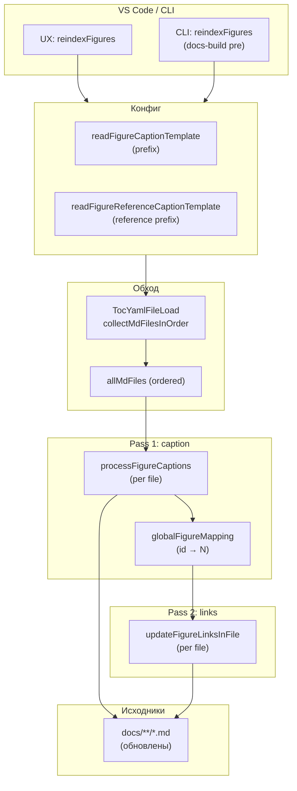
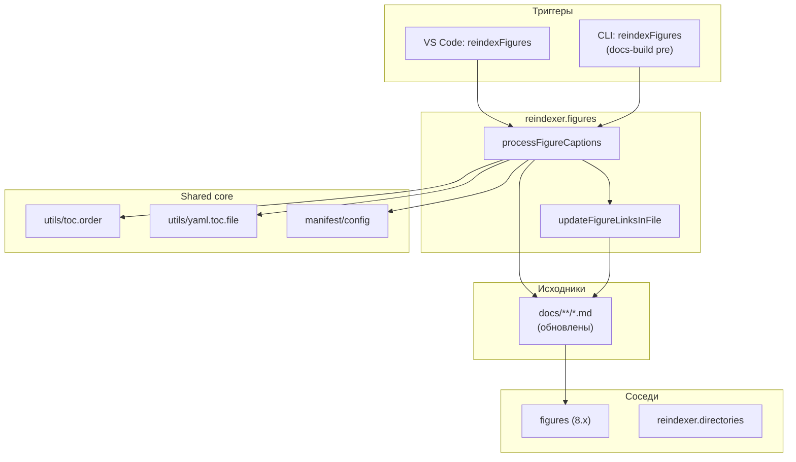

|               |                                                                                                               |
| ------------- | ------------------------------------------------------------------------------------------------------------- |
| ID            | [1.2-042](../../%D0%A1%D0%BE%D0%B3%D0%BB%D0%B0%D1%88%D0%B5%D0%BD%D0%B8%D1%8F/index.md#identifikaciya-modulej) |
| Идентификатор | `reindexer.figures`                                                                                           |
| Наименование  | Переиндексация рисунков                                                                                       |
| Слой          | [pre-processing](../%D0%A1%D0%BB%D0%BE%D0%B8layer/PreProcessing/index.md#naznachenie)                           |
| Расположение  | `src/plugins/reindexer/reindexer.figures.js`                                                                  |
| Точка входа   | `reindexFigures(rootDir, targetLocale, configJsonOrObj)`                                                      |
| Версия        | `1.54.0`                                                                                                      |
| Назначение    | Пересчитывает номера рисунков в `.md` (по порядку в `toc.yaml`) и обновляет текст ссылок на них               |

{: .page-legend }

## Назначение

`reindexer.figures` — «массовая» операция над рисунками. Пользователь вызывает **Diplodoc → Переиндексировать рисунки** на `docs/ru/` — и модуль:

1. **Читает `toc.yaml`** (рекурсивно через `include`) — получает список `.md` в **порядке чтения**.
2. **Идёт по файлам** в этом порядке, для каждого `<figcaption class="imageDescription" id="…">Рисунок 4. `:
   - очищает текущую подпись от `Рисунок N.` / `Figure N.` / `Рис. N.`;
   - ставит **сквозной** номер `<prefix> N. <текст>`;
   - запоминает `id → N` в глобальный `mapping`.
3. **Повторно идёт по файлам** — обновляет все ссылки `[текст](path#fig-<id>)`:
   - находит новый номер в `mapping` по `<path>` + `<id>`;
   - пересчитывает `(рис. N)` / `(fig. N)` по шаблону из настроек.

Ключевое отличие от [`figures`](../МодульИллюстрации/index.md): `figures` **собирает** иллюстрации в каталог `figures/index.md`, а `reindexer.figures` **меняет** `.md`-файлы — нумерует рисунки и ссылки.

Без модуля пришлось бы вручную:

- найти все `<figcaption>`;
- пронумеровать по порядку;
- найти все ссылки на рисунки (в том числе между статьями);
- пересчитать текст ссылки.

Для 100+ рисунков — часы. Модуль делает за секунды.

## Применение

**Когда использовать:** после добавления/удаления/перемещения рисунков — пересчитать номера в `<figcaption>` и обновить текст ссылок `[Рисунок N](…#fig-…)` по всему проекту.

**Когда НЕ использовать:** рисунков нет; нужен только каталог — `figures`.

**Альтернативы:**
- Ручная перенумерация — при 100+ рисунках ошибки неизбежны.
- Только `figures` без `reindexFigures` — каталог с устаревшими номерами.

**Типичный сценарий:** `docs-build.js` → `pre` → `reindexFigures` (первым шагом) → `createFigureContent` собирает каталог с актуальными номерами.

## Как это работает



### Фаза 1. Чтение конфига (префиксы)

```js
function readFigureCaptionTemplate(configJsonOrObj, targetLocale) {
    let config = DiplodocConfigFromJson(configJsonOrObj);
    const activeLocale = targetLocale || config.defaultLanguage || 'ru';
    return GetPrefixOrDefault(config, activeLocale, targetLocale);
}

function GetPrefixOrDefault(config, activeLocale, targetLocale) {
    return activeLocale !== targetLocale ? 'Figure' : config.figureCaptionPrefix || 'Figure';
}
```

- **`figureCaptionPrefix`** — из настроек `diplodoc-helper.figureCaptionPrefix` (по умолчанию `«Рисунок»`). Для `en` (если `targetLocale === 'en'`) — `«Figure»`.
- **`figureReferenceCaptionPrefix`** — шаблон для ссылок. По умолчанию `(рис. {0})` для `ru`, `(fig. {0})` для `en`.

`targetLocale` — из CLI/VS Code (обычно `'ru'` или `'en'`). Если `activeLocale` (из конфига) **≠** `targetLocale` — жёстко `«Figure»` (для смешанных конфигов).

### Фаза 2. Обход `toc.yaml`

```js
const tocPath = path.join(rootDir, 'toc.yaml');
if (!fs.existsSync(tocPath)) {
    console.warn('⚠️ toc.yaml не найден');
    return { success: false, reason: 'no_toc', total: 0 };
}

let tocDoc;
try {
    tocDoc = TocYamlFileLoad(tocPath);
} catch {
    return { success: false, reason: 'parse_error', total: 0 };
}

const entries = Array.isArray(tocDoc) ? tocDoc : tocDoc?.items || [];
const allMdFiles = collectMdFilesInOrder(entries, rootDir);

if (allMdFiles.length === 0) {
    return { success: true, total: 0, reason: 'no md-file found' };
}
```

- **`rootDir`** — корень языка (`docs/ru/`).
- **`collectMdFilesInOrder`** — из `utils/toc.order`, рекурсивно обходит `items`, `include`, `items[]`. Возвращает `.md` в порядке появления в `toc.yaml`.
- **Если `toc.yaml` нет** — `{ success: false, reason: 'no_toc' }`. Пользователь увидит `showWarningMessage` (см. `ux_reindex_figures`).

### Фаза 3. Pass 1 — нумерация подписей

```js
let globalFigureMapping = new Map();
let figureCounter = 1;

for (const mdFilePath of allMdFiles) {
    try {
        const content = fs.readFileSync(mdFilePath, 'utf8');
        const { newContent, newCounter, figureMapping } = processFigureCaptions(
            content,
            figureCounter,
            figureCaptionTemplate,
            mdFilePath
        );

        for (const [uniqueKey, num] of figureMapping) {
            globalFigureMapping.set(uniqueKey, num);
        }

        if (newContent !== content) {
            fs.writeFileSync(mdFilePath, newContent, 'utf8');
            console.log(`${path.relative(rootDir, mdFilePath)} — +${newCounter - figureCounter} рис.`);
        }
        figureCounter = newCounter;
    } catch (err) {
        console.error(`❌ Ошибка обработки ${mdFilePath}:`, err);
    }
}
```

**`processFigureCaptions(content, startCounter, prefix, mdFilePath)`**:

```js
const regex = /<figcaption\s+class="imageDescription"([^19]*?)\s+id="([^20]+)"([^19]*?)>([\s\S]*?)<\/figcaption>/gi;
let counter = startCounter;
const mapping = new Map();

const newContent = content.replace(regex, (match, beforeId, id, afterId, captionText) => {
    let cleaned = captionText
        .replace(/^(Рисунок|Figure|Fig\.|Рис\.)\s*\d+\.?\s*/i, '')
        .replace(/^\d+\.\s*/, '')
        .trim();

    const newCaption = `${prefix} ${counter}. ${cleaned}`;
    const replacement = `<figcaption class="imageDescription" id="${id}"${afterId}>${newCaption}</figcaption>`;

    const uniqueKey = `${path.resolve(mdFilePath)}::${id}`;
    mapping.set(uniqueKey, counter);

    counter++;
    return replacement;
});

return { newContent, newCounter: counter, figureMapping: mapping };
```

- **Regex** — ищет `<figcaption class="imageDescription" id="…">Рисунок 5. …</figcaption>` (многострочно).
- **`cleaned`** — удаляет старый префикс (`Рисунок N.` / `Figure N.` / `Fig. N.` / `Рис. N.`) и `N. ` в начале. Опционально.
- **`newCaption`** — `${prefix} ${counter}. ${cleaned}` (например, `Рисунок 42. Схема архитектуры`).
- **`uniqueKey`** — `${абсолютныйПуть}::${id}` — глобальный ключ для `mapping`. Нужен, потому что `id` могут совпадать в разных файлах.
- **`figureCounter`** — глобальный, продолжается между файлами.

**Возврат:**

- `newContent` — обновлённый текст;
- `newCounter` — новый счётчик (для следующего файла);
- `figureMapping` — `Map<uniqueKey, number>` для pass 2.

### Фаза 4. Pass 2 — обновление ссылок

```js
updateAllLinks(allMdFiles, globalFigureMapping, figureReferenceCaptionTemplate);
```

**`updateAllLinks(files, figureNumberMap, defaultPrefix)`**:

```js
for (const file of files) {
    try {
        updateFigureLinksInFile(file, figureNumberMap, defaultPrefix);
    } catch (err) {
        console.error(`❌ Ошибка обновления ссылок в ${file}:`, err);
    }
}
```

**`updateFigureLinksInFile(filePath, figureNumberMap, defaultTemplate)`**:

```js
const linkRegex = /\[([^21]]+)\]\(([^22]*?)(#fig-[^22]+)\)/g;

const newContent = content.replace(linkRegex, (match, linkText, pathPart, anchor) => {
    const figId = anchor.substring(1);  // '#fig-abc' → 'fig-abc'

    let targetMdPath;
    if (!pathPart || pathPart.trim() === '') {
        targetMdPath = path.resolve(filePath);   // same-file
    } else {
        targetMdPath = path.resolve(path.dirname(filePath), pathPart);
    }

    const uniqueKey = `${targetMdPath}::${figId}`;
    if (!figureNumberMap.has(uniqueKey)) return match;
    const newNumber = figureNumberMap.get(uniqueKey);

    let innerText = linkText;
    const formatPatterns = [
        { regex: /^(\*{1,2})(.*?)\1$/, wrapper: '$1' },  // *…* или **…**
        { regex: /^(_{1,2})(.*?)\1$/, wrapper: '$1' },   // _…_ или __…__
    ];
    for (const pattern of formatPatterns) {
        const matchFormat = linkText.match(pattern.regex);
        if (matchFormat) {
            innerText = matchFormat[2];
            break;
        }
    }

    let template = defaultTemplate;
    if (/(рис|Рисунок|Рис\.)/i.test(innerText)) {
        template = '(рис. {0})';
    } else if (/(fig|Figure|Fig\.)/i.test(innerText)) {
        template = '(fig. {0})';
    }

    const newLinkText = template.replace('{0}', (newNumber ?? '').toString());

    updated = true;
    return `[${newLinkText}](${pathPart}${anchor})`;
});
```

- **Regex** — `\[([^21]]+)\]\(([^22]*?)(#fig-[^22]+)\)`. Ищет `[text](path#fig-…)`.
- **`figId`** — `#fig-abc` → `fig-abc`.
- **`targetMdPath`** — резолвится от текущего файла + `pathPart`. Для same-file ссылок (`#fig-abc` без `pathPart`) — `path.resolve(filePath)`.
- **`uniqueKey`** — `${targetMdPath}::${figId}` — совпадает с pass 1.
- **`newNumber`** — из `mapping`. Если нет — ссылка остаётся как была (`return match`).
- **`innerText`** — `linkText` без обрамляющих `*`/`**`/`_`/`__` (чтобы искать `рис`/`fig` внутри).
- **`template`** — либо `defaultTemplate` (из настроек), либо жёстко `(рис. {0})` / `(fig. {0})` — если внутри `innerText` уже было `рис`/`fig`.
- **`newLinkText`** — `template.replace('{0}', newNumber)`.
- **`return \`[${newLinkText}](${pathPart}${anchor})\``** — пересобирает `[новый текст](тот же путь#fig-id)`.

### Файлы модуля

| Файл                                                   | Ответственность                                                                                                                                |
| ------------------------------------------------------ | ---------------------------------------------------------------------------------------------------------------------------------------------- |
| `src/plugins/reindexer/reindexer.figures.js`           | `reindexFigures`, `processFigureCaptions`, `updateFigureLinksInFile`, `updateAllLinks`, `readFigureCaptionTemplate` (4 helper-функции конфига) |
| `src/commands/diplodoc-helper.reindex.figures.js`      | `ux_reindex_figures` (VS Code)                                                                                                                 |
| `src/plugins/utils/toc.order.js`                       | `collectMdFilesInOrder`                                                                                                                        |
| `src/plugins/utils/yaml.toc.file.js`                   | `TocYamlFileLoad`                                                                                                                              |
| `src/plugins/manifest/config/diplodoc.config.js`       | `DiplodocConfigFromJson`                                                                                                                       |
| `src/plugins/manifest/config/vscode.config.manager.js` | `DiplodocConfigFromWorkspace`                                                                                                                  |

### Результат

```js
{ success: true, total: <число рисунков>, reason: '' }
```

- **`total`** — `figureCounter - 1` (изначально 1, поэтому `-1`).
- **`reason`** — `'no_toc'`, `'parse_error'`, `'no md-file found'`, или `''` при успехе.

## Режимы работы

### VS Code

| Команда                          | Заголовок                 | Где появляется                            |
| -------------------------------- | ------------------------- | ----------------------------------------- |
| `diplodoc-helper.reindexFigures` | Переиндексировать рисунки | Explorer → Diplodoc → Прочее → Индексация |

`ux_reindex_figures(uri)`:

```js
async function ux_reindex_figures(uri) {
    if (!uri) return;
    const targetDir = uri.fsPath;
    let result = { success: false, total: 0, reason: 'not started' };
    await vscode.window.withProgress(
        { location: vscode.ProgressLocation.Notification, title: translate(nls_ts.plugin.section.reindex.progress.text), cancellable: false },
        async () => {
            const configObj = DiplodocConfigFromWorkspace(CONFIG_KEY);
            const vscodeLocale = vscode.env.language;
            result = reindexFigures(targetDir, vscodeLocale, configObj);
        }
    );

    if (result.success) {
        vscode.window.showInformationMessage(translate(nls_ts.plugin.reindex.figures.info.successDetailed, result.total));
    } else {
        vscode.window.showWarningMessage(translate(nls_ts.plugin.reindex.figures.info.failDetailed, result.reason || 'unknown'));
    }
}
```

- **`targetDir`** — `uri.fsPath` (папка, на которой кликнули). Обычно `docs/ru/`.
- **`vscodeLocale`** — `vscode.env.language` (`'ru'`/`'en'`). Передаётся как `targetLocale`.
- **`configObj`** — `{ figureCaptionPrefix, figureReferenceCaptionPrefix, … }`.
- **`withProgress`** — индикатор, не отменяемый.
- **`showInformationMessage`** — `plugin.reindex.figures.info.successDetailed`: `«Переиндексация завершена: обработано {0} рис.»`.
- **`showWarningMessage`** — `plugin.reindex.figures.info.failDetailed`: `«Переиндексация остановлена по причине: {0}»`.

### CLI

```bash
node ./plugins/diplodoc-helper-cli.js reindexFigures --docsDir ./docs/ru
```

| Аргумент    | Обязателен | По умолчанию | Описание                                      |
| ----------- | ---------- | ------------ | --------------------------------------------- |
| `--docsDir` | нет        | `./docs`     | Корень языка (не `./docs`, а `./docs/<lang>`) |

CLI передаёт `targetLocale` и `configObj` из `DiplodocConfigFromCli` (env `CLI_LOCALE` / `CLI_CONFIG`).

### Сборочный пайплайн

В `docs-build.js`, фаза `pre`, **первый** содержательный шаг:

```js
cli('reindexFigures', '--docsDir', './docs/ru'),
```

Идёт **первым** (после `clean build`). До `reindexFootnotes`, `helpMap`, `contexts`. Логика: сначала нумерация рисунков, потом всё остальное, что читает эти `.md`.

Пропускается флагом `--skip=reindexFigures`.

**Только `ru`.** Для `en` не вызывается (как и `reindexFootnotes`). См. «Известные ограничения».

## Юнит-тесты





## Связи

`reindexer.figures` — «массовая» операция над рисунками. С [`figures`](../МодульИллюстрации/index.md) — **не** пересекается:

| Модуль                                     | Что делает | Вход           | Выход                        |
| ------------------------------------------ | ---------- | -------------- | ---------------------------- |
| **`reindexer.figures`**                    | Нумерует   | `docs/**/*.md` | `.md` (обновлены)            |
| [`figures`](../МодульИллюстрации/index.md) | Собирает   | `docs/**/*.md` | `figures/index.md` (каталог) |

`reindexer.figures` **должен** идти до `figures` (в `docs-build.js` порядок: `reindexFigures` → `createFigureContent`). Логически: сначала пересчитать номера, потом собрать каталог с актуальными номерами.

С `reindexer.directories` — независимы. С `reindexer.footnotes` — независимы (оба нумеруют, но разные сущности).

Общие зависимости: `utils/toc.order` (`collectMdFilesInOrder`), `utils/yaml.toc.file` (`TocYamlFileLoad`), `manifest/config` (для префиксов).






