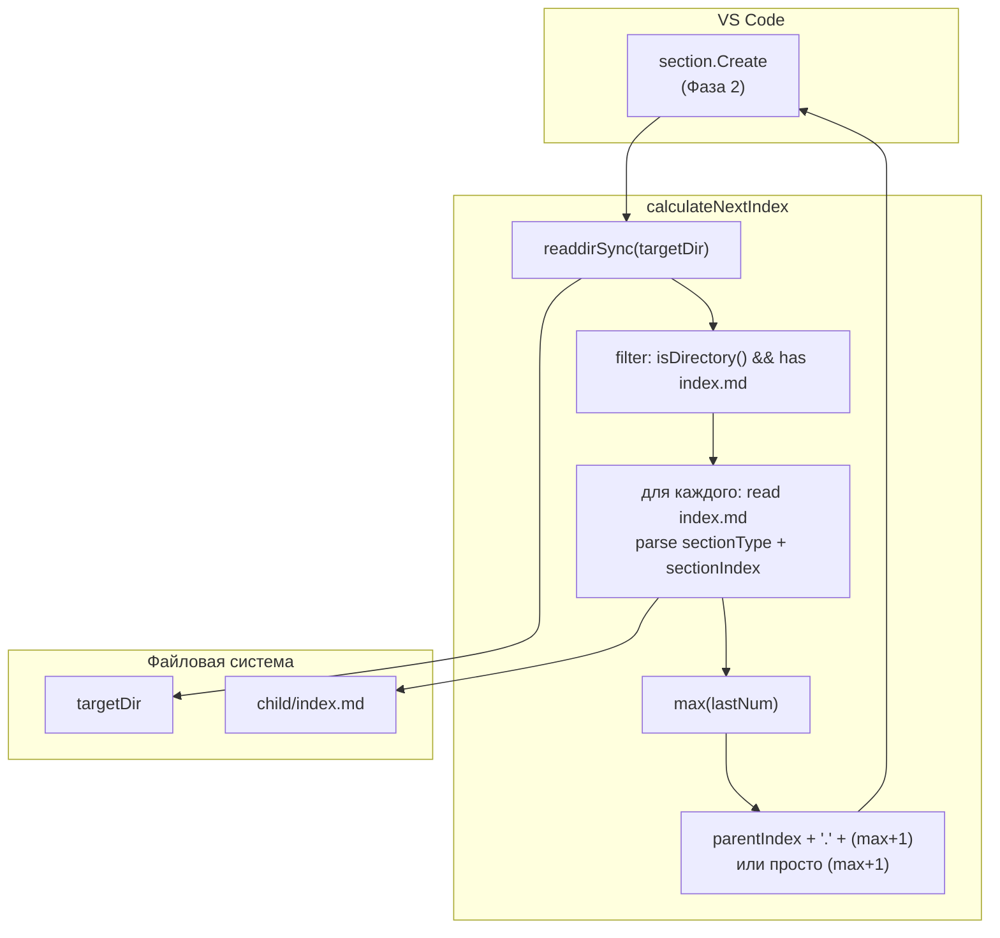
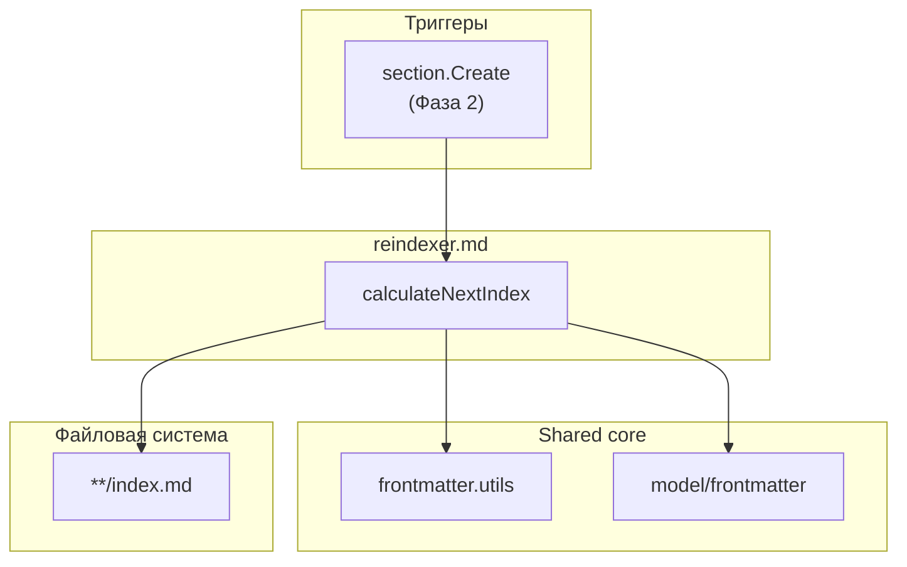

|               |                                                                                                               |
| ------------- | ------------------------------------------------------------------------------------------------------------- |
| ID            | [1.2-043](../../%D0%A1%D0%BE%D0%B3%D0%BB%D0%B0%D1%88%D0%B5%D0%BD%D0%B8%D1%8F/index.md#identifikaciya-modulej) |
| Идентификатор | `reindexer.md`                                                                                                |
| Наименование  | Переиндексация статей                                                                                         |
| Слой          | [pre-processing](../%D0%A1%D0%BB%D0%BE%D0%B8layer/PreProcessing/index.md#naznachenie)                           |
| Расположение  | `src/plugins/reindexer/reindexer.md.js`                                                                       |
| Точка входа   | `calculateNextIndex(targetDir)`                                                                               |
| Версия        | `1.54.0`                                                                                                      |
| Назначение    | Вычисляет следующий свободный `sectionIndex` для новой секции в указанной родительской папке                  |

{: .page-legend }

## Назначение

`reindexer.md` — самый маленький модуль семейства `reindexer`. Одна функция: `calculateNextIndex(targetDir)`. Используется в [`section.Create`](../МодульСозданиесекции/index.md), чтобы предложить пользователю **следующий свободный** `sectionIndex` в выбранной родительской папке.

Зачем это нужно. При создании новой секции пользователю предлагается ввести `sectionIndex` вручную (см. `section.Create`, Фаза 2). Правильное значение — «следующий после максимального среди детей». Например:

- в `docs/ru/` уже есть `Раздел1.Введение` (`sectionIndex: '1'`), `Раздел2.Архитектура` (`sectionIndex: '2'`) — следующий `3`;
- в `docs/ru/Раздел2.Архитектура/` есть `Глава1.Обзор` (`sectionIndex: '2.1'`), `Глава2.Детали` (`sectionIndex: '2.2'`) — следующий `2.3`.

Модуль обходит `targetDir`, читает `index.md` каждой дочерней папки, парсит `sectionIndex`, находит максимальный «последний номер» и возвращает `parentIndex.N+1`. Без модуля пользователь должен был бы сам смотреть в `index.md` каждого ребёнка и складывать в голове.

`reindexer.md` **не** переименовывает папки и **не** правит `index.md` — только вычисляет число. Вся «запись» — в `section.Create`.

## Применение

**Когда использовать:** внутри `section.Create` (для предзаполнения `InputBox` следующим свободным `sectionIndex`) — или в собственной команде, которой нужен «следующий номер».

**Когда НЕ использовать:** вы работаете через `section.Create` — модуль уже вызывается автоматически; нужна массовая переиндексация — `reindexer.directories`.

**Альтернативы:**
- Ручной пересчёт `max(sectionIndex) + 1` — легко ошибиться с дочерними.
- `reindexer.directories` — пересчитывает всё, избыточно для одной секции.

**Типичный сценарий:** в `section.Create` → `calculateNextIndex(targetDir)` → `'2.3'` в `InputBox` → пользователь подтверждает или меняет.

## Как это работает




### Единственная функция

```js
const fs = require('fs');
const path = require('path');
const { FrontMatterFiles, FrontMatterSectionTypesIndexed } = require('../model/frontmatter.model');
const { get } = require('../utils/frontmatter.utils');

function calculateNextIndex(targetDir) {
    const parentIndexPath = path.join(targetDir, FrontMatterFiles.INDEX_MD);
    if (!fs.existsSync(parentIndexPath)) return '1';

    const parentContent = fs.readFileSync(parentIndexPath, 'utf8');
    const parentIndex = String(get(parentContent, 'sectionIndex') || '');

    const items = fs.readdirSync(targetDir, { withFileTypes: true });
    const siblingIndices = [];

    for (const item of items) {
        if (!item.isDirectory()) continue;

        const indexPath = path.join(targetDir, item.name, FrontMatterFiles.INDEX_MD);
        if (!fs.existsSync(indexPath)) continue;

        try {
            const content = fs.readFileSync(indexPath, 'utf8');
            const sectionType = get(content, 'sectionType');
            const sectionIndex = String(get(content, 'sectionIndex') || '');

            if (sectionType && FrontMatterSectionTypesIndexed.includes(sectionType) && sectionIndex) {
                const parts = sectionIndex.split('.');
                const lastPart = parts[parts.length - 1];
                const lastNum = parseInt(lastPart, 10);

                if (!isNaN(lastNum)) {
                    siblingIndices.push(lastNum);
                }
            }
        } catch (e) {
            console.error(`❌ Ошибка при чтении ${indexPath}:`, e);
            continue;
        }
    }

    const maxIdx = siblingIndices.reduce((a, b) => Math.max(a, b), 0);
    const nextSubNumber = maxIdx + 1;

    return parentIndex === '' ? `${nextSubNumber}` : `${parentIndex}.${nextSubNumber}`;
}
```

### Шаги

**1. `parentIndex`** — `sectionIndex` родителя (из `targetDir/index.md`). Если `index.md` нет (например, `docs/ru/`) — `parentIndex = '1'` (немедленный возврат). Если есть, но без `sectionIndex` — `String(get(…) || '') = ''`.

**2. Обход детей** — `fs.readdirSync(targetDir, { withFileTypes: true })`. Для каждого:

- **не-папка** — пропуск;
- **папка без `index.md`** — пропуск;
- **иначе** — читает `index.md`, парсит `sectionType` и `sectionIndex`.

**3. Фильтр** — `if (sectionType && FrontMatterSectionTypesIndexed.includes(sectionType) && sectionIndex)`. Условия:

- `sectionType` — не пустой (не `null`/`''`);
- `sectionType` — в `FrontMatterSectionTypesIndexed` (включает `Page` — см. «Известные ограничения»);
- `sectionIndex` — не пустой (число).

**4. Парсинг номера** — `sectionIndex.split('.')`, берёт **последнюю** часть. `'2.5'` → `'5'` → `parseInt('5') = 5`. `'10.15.3'` → `3`. `'abc'` → `NaN` (пропуск).

**5. `maxIdx`** — `Math.max(…siblingIndices, 0)`. Изначально 0, чтобы `maxIdx = 0` при пустом массиве → `nextSubNumber = 1`.

**6. Возврат:**

- `parentIndex === ''` → `${nextSubNumber}` (например, `'3'`);
- иначе → `${parentIndex}.${nextSubNumber}` (например, `'2.3'`).

### Файлы модуля

| Файл                                     | Ответственность                                      |
| ---------------------------------------- | ---------------------------------------------------- |
| `src/plugins/reindexer/reindexer.md.js`  | `calculateNextIndex`                                 |
| `src/plugins/utils/frontmatter.utils.js` | `get` — парсинг frontmatter через `gray-matter`      |
| `src/plugins/model/frontmatter.model.js` | `FrontMatterFiles`, `FrontMatterSectionTypesIndexed` |

### Пример

**Структура:**

```
docs/ru/
    index.md (sectionIndex: '')
    Раздел1.Введение/
        index.md (sectionType: 'Section', sectionIndex: '1')
    Раздел2.Архитектура/
        index.md (sectionType: 'Section', sectionIndex: '2')
        Глава1.Обзор/
            index.md (sectionType: 'Chapter', sectionIndex: '2.1')
        Глава2.Детали/
            index.md (sectionType: 'Chapter', sectionIndex: '2.2')
```

**Вызовы:**

- `calculateNextIndex('docs/ru')` → `'3'` (maxIdx=2 среди `[1, 2]`);
- `calculateNextIndex('docs/ru/Раздел2.Архитектура')` → `'2.3'` (parentIndex=2, maxIdx=2 среди `[1, 2]`);
- `calculateNextIndex('docs/ru/Раздел1.Введение')` → `'1.1'` (parentIndex=1, детей нет).

## Режимы работы

### VS Code

`reindexer.md` — **не команда**, а утилита. Вызывается из [`section.Create`](../МодульСозданиесекции/index.md) (Фаза 2), функция `promptSectionIndex(sectionIndexCalculated)` предзаполняет `InputBox`.

### CLI

CLI-команды нет. Утилита используется только в VS Code-сценариях.

### Сборочный пайплайн

В `docs-build.js` не участвует. `reindexer.directories` (`1.2-041`) использует **свою** логику (`localCounter++`), не `calculateNextIndex`.

## Юнит-тесты





## Связи

`reindexer.md` — единственная функция. Используется в [`section.Create`](../МодульСозданиесекции/index.md) (при открытии `InputBox` для `sectionIndex`).

С `reindexer.directories` — **не** связан. `reindexer.directories` использует `localCounter++` (свой), а не `calculateNextIndex`. Дублирование логики — см. «Известные ограничения».

С `sections.core` — использует `utils/frontmatter.utils` (`get`), `model/frontmatter.model` (`FrontMatterFiles`, `FrontMatterSectionTypesIndexed`). Больше ничего.






