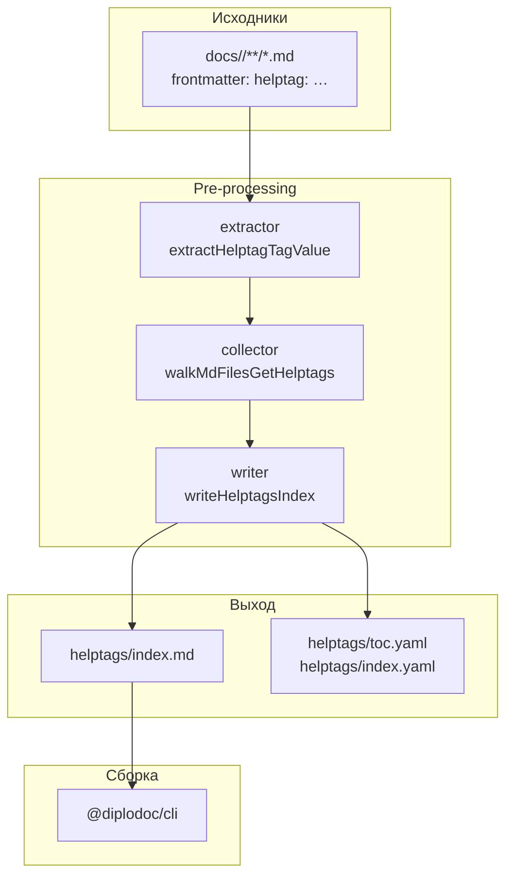
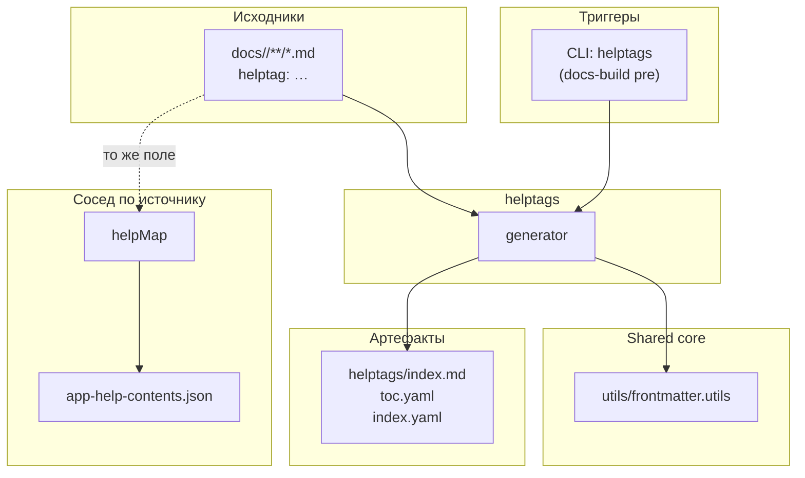

|               |                                                                                                               |
| ------------- | ------------------------------------------------------------------------------------------------------------- |
| ID            | [3.2-010](../../%D0%A1%D0%BE%D0%B3%D0%BB%D0%B0%D1%88%D0%B5%D0%BD%D0%B8%D1%8F/index.md#identifikaciya-modulej) |
| Идентификатор | `helptags`                                                                                                    |
| Наименование  | Справочные теги                                                                                               |
| Слой          | [pre-processing](../%D0%A1%D0%BB%D0%BE%D0%B8layer/PreProcessing/index.md#naznachenie)                           |
| Расположение  | `src/plugins/helptags/`                                                                                       |
| Точка входа   | `runGeneration(docsRoot)`                                                                                     |
| Версия        | `1.54.0`                                                                                                      |
| Назначение    | Собирает `helptag:`-теги из frontmatter и генерирует страницу-указатель с группировкой по тегам               |

{: .page-legend }

## Назначение

Модуль `helptags` проходит по `docs/<lang>/**/*.md`, извлекает из frontmatter поле `helptag:` (ключи, по которым фронтенд приложения находит статьи для подсказок), группирует страницы по тегам и генерирует страницу `docs/<lang>/helptags/index.md` — человекочитаемый «справочник тегов».

Задача — дать техническому писателю или редактору **обратный вид** на разметку `helptag:`. Тег задаётся в каждой статье по отдельности (`helptag: nomenclature, invoice`), а читателю бывает нужно обратное — «покажи все статьи, где встречается `invoice`». Без модуля это пришлось бы искать `grep`-ом.

Модуль работает только в `pre-processing`. Ни пост-обработки, ни клиентского скрипта, ни VS Code-команды генерации у него нет.

## Применение

**Когда использовать:** статьи размечены `helptag:` для интеграции с фронтендом, и нужно видеть «какие статьи привязаны к какому тегу» в одном списке.

**Когда НЕ использовать:** `helptag:` не используется; нужен JSON для фронтенда — это `helpMap`.

**Альтернативы:**
- `grep helptag:` по `docs/` — вручную.
- `helptagmap` — визуальная карта, но не список статей по тегу.

**Типичный сценарий:** `docs-build.js` → `pre` → `helptags` → `docs/<lang>/helptags/index.md` — алфавитный указатель тегов со ссылками на статьи.

## Как это работает



1. **Обход.** `walkMdFilesGetHelptags(langDir)` рекурсивно обходит `docs/<lang>/`, пропускает папки `helptags` и `contexts` (чтобы не индексировать собственный вывод и результаты соседнего генератора) и вызывает `extractHelptagTagValue` для каждого `.md`.

2. **Извлечение.** Для каждого файла:
   - читается frontmatter через `gray-matter`;
   - поле `data.helptag` разбивается по `[\s,]+`, приводится к нижнему регистру, дедуплицируется;
   - в `helptagMap` для каждого тега добавляется/обновляется запись `{ rank, pages[] }`:
     - `rank` увеличивается на 1, если статьи с этим `href` ещё не было (защита от повторного добавления одной и той же статьи);
     - `pages[]` пополняется `{ title, href }`, где `title` — **относительный путь** статьи (`foo/bar.md` или `foo` для `index.md`), а `href` — тот же путь относительно `langDir`.

3. **Запись.** `writeHelptagsIndex(outputDir, sortedTags, helptagMap, lang, title)`:
   - frontmatter `title: Справочные теги` (ru) / `Help Tags` (en) + `sectionType: Page`;
   - заголовок `# …`;
   - алфавитная группировка `## А`, `## Б`, …;
   - для каждого тега — `* **<tag>**`, ниже — вложенный список статей `* [<displayPath>](../<href>)`;
   - `toc.yaml` / `index.yaml` — заголовок и `href`.

`generateFilesForLang` пропускает язык, если `helptagMap` пуст (нет ни одной статьи с `helptag:`), и возвращает `false` — в `results.failed`.

### Файлы модуля

| Файл                    | Ответственность                                                         |
| ----------------------- | ----------------------------------------------------------------------- |
| `helptags.js`           | `runGeneration(docsRoot)`, `generateFilesForLang`                       |
| `helptags.collector.js` | `walkMdFilesGetHelptags` — обход `docs/`                                |
| `helptags.extractor.js` | `extractHelptagTagValue` — чтение и парсинг `helptag:`                  |
| `helptags.writer.js`    | `writeHelptagsIndex` — генерация `index.md` / `toc.yaml` / `index.yaml` |

Модуль минималистичен: 4 файла, никаких `shared/*`, никакого `paths.yaml`. Выходная папка `docs/<lang>/helptags/` захардкожена.

### Формат `helptag:` в frontmatter

```yaml
---
title: Модуль. Хлебные крошки
sectionType: Page
helptag: breadcrumb, navigation
---
```

Разделители — запятая или пробел (или их смесь), регистр не важен (`Breadcrumb` → `breadcrumb`). Дубликаты внутри одной статьи дедуплицируются. Пустое значение, отсутствие поля или не-строка (`helptag: 42`) — статья пропускается.

### Что попадает в `title` страницы

`displayPath` формируется так:

| Относительный путь  | `displayPath` |
| ------------------- | ------------- |
| `foo/index.md`      | `foo`         |
| `foo/bar.md`        | `foo/bar.md`  |
| `index.md` (корень) | `index.md`    |

То есть для `index.md` в подпапке теряется `/index.md` (остаётся имя папки), а для остальных `.md` — путь сохраняется полностью, с расширением. Ссылка в markdown — `[<displayPath>](../<href>)`, ведёт на `.md`-файл относительно `helptags/index.md`.

Это **техническое** имя, не человеческое. В отличие от `contexts` (где `buildTree` резолвит заголовки через `index.md`), `helptags` заголовок статьи не читает.

## Режимы работы

### CLI

```bash
node ./plugins/diplodoc-helper-cli.js helptags --docsDir ./docs
```

| Аргумент    | Обязателен | По умолчанию | Описание                                    |
| ----------- | ---------- | ------------ | ------------------------------------------- |
| `--docsDir` | нет        | `./docs`     | Корень документации (внутри — `ru/`, `en/`) |

Код возврата: `0` при успехе. Модуль не устанавливает `process.exitCode` при неудаче — даже если обе языковые папки упали, CLI завершится с `0`.

### Сборочный пайплайн

В `docs-build.js`, фаза `pre`:

```js
cli('helptags'),
```

Идёт после `contexts`, до `abbrs`, `terms`, `gosts`. Может быть пропущен флагом `--skip=helptags`.

### VS Code

**Собственной команды генерации у `helptags` нет.** В `package.json → contributes.commands` есть `diplodoc-helper.generateHelpMaps`, но это **другой** модуль — [`helpMap`](../МодульКартапомощи/index.md), он пишет `app-help-contents.json`, а не страницу.

Есть также команды `diplodoc-helper.helptag.Update` и `diplodoc-helper.helptag.Delete` (`src/commands/diplodoc-helper.helptag.Update.js` / `.Delete.js`). Они редактируют поле `helptag:` в **отдельном разделе** (диалог ввода / подтверждение удаления), а не генерируют страницу-указатель. Это команды «работы с разметкой», а не «работы с артефактом». Их место — в статье про редактор разделов, а не здесь.

## Юнит-тесты





## Связи

`helptags` — минималистичный генератор, не имеющий зависимостей от `shared-core`, кроме `utils/frontmatter.utils` (для чтения frontmatter через `parse`). Ни `abbrs`, ни `terms`, ни `gosts`, ни `contexts` в его коде не используются.

Ключевая особенность: поле `helptag:` в frontmatter — **общий вход** для двух независимых модулей:

- **`helptags`** (этот модуль) — генерирует человекочитаемую страницу «справочник тегов» в `docs/<lang>/helptags/`;
- **`helpMap`** — читает то же поле и складывает в `build/app-help-contents.json`, откуда его берёт фронтенд приложения.

Два потребителя одного поля, два независимых артефакта. Если поле `helptag:` изменилось — оба модуля нужно перегенерировать (`helpMap` идёт в `docs-build.js` раньше всех, `helptags` — после `contexts`). Пропуск `--skip=helpMap` не сломает `helptags`, но сломает всех потребителей `app-help-contents.json`; пропуск `--skip=helptags` не сломает ничего, кроме человекочитаемой страницы.






