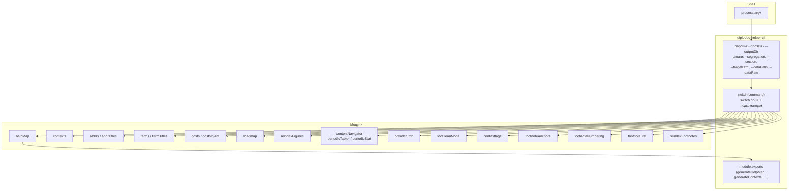
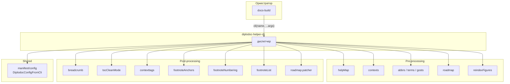

|               |                                                                                                                                                                                                                                                             |
| ------------- | ----------------------------------------------------------------------------------------------------------------------------------------------------------------------------------------------------------------------------------------------------------- |
| ID            | [6.2-046](../../../%D0%A1%D0%BE%D0%B3%D0%BB%D0%B0%D1%88%D0%B5%D0%BD%D0%B8%D1%8F/index.md#identifikaciya-modulej)                                                                                                                                               |
| Идентификатор | `diplodoc-helper-cli`                                                                                                                                                                                                                                       |
| Наименование  | CLI                                                                                                                                                                                                                                                         |
| Слой          | [CLI](../../%D0%A1%D0%BB%D0%BE%D0%B8layer/%D0%A1%D0%BB%D0%BE%D0%B9CLI/index.md#naznachenie)                                                                                                                                                                                            |
| Каталог       | [Инфраструктура](../../%D0%9A%D0%B0%D1%82%D0%B0%D0%BB%D0%BE%D0%B3Capabilitymap/%D0%9A%D0%B0%D1%82%D0%B0%D0%BB%D0%BE%D0%B3%D0%98%D0%BD%D1%84%D1%80%D0%B0%D1%81%D1%82%D1%80%D1%83%D0%BA%D1%82%D1%83%D1%80%D0%B0/index.md#infrastruktura)                                                                                                                                                                                                                                                            |
| Семейство     | [Инфраструктура](../../%D0%A1%D0%B5%D0%BC%D0%B5%D0%B9%D1%81%D1%82%D0%B2%D0%BEfamily/%D0%A1%D0%B5%D0%BC%D0%B5%D0%B9%D1%81%D1%82%D0%B2%D0%BE%D0%98%D0%BD%D1%84%D1%80%D0%B0%D1%81%D1%82%D1%80%D1%83%D0%BA%D1%82%D1%83%D1%80%D0%B0/index.md#fam-infrastructure) |
| Расположение  | `src/plugins/diplodoc-helper-cli.js`                                                                                                                                                                                                                        |
| Точка входа   | `node ./plugins/diplodoc-helper-cli.js <command> [options]`                                                                                                                                                                                                 |
| Версия        | `1.54.0`                                                                                                                                                                                                                                                    |
| Назначение    | Диспетчер CLI-подкоманд: принимает `argv`, маршрутизирует на модули pre- и post-обработки                                                                                                                                                                   |

{: .page-legend }

## Назначение

`diplodoc-helper-cli` — единая точка входа для всех CLI-операций расширения. Пользователь запускает `node ./plugins/diplodoc-helper-cli.js <command> [options]` в терминале или из CI — модуль:

1. **Парсит `process.argv`** — определяет `<command>` и общие аргументы (`--docsDir`, `--outputDir`, флаги).
2. **Маршрутизирует** на соответствующий модуль (`helpMap`, `contexts`, `abbrs`, `gosts`, `roadmap`, `reindexFigures`, `breadcrumb`, `tocCleanMode` и т.д.).
3. **Возвращает** код выхода (`0` / `1`) — для CI-интеграции.

Зачем это нужно. У расширения ~20 CLI-команд. Без диспетчера каждая была бы отдельным скриптом (`node ./plugins/helpMap/helpmap.js`, `node ./plugins/abbrs/abbrs.js`, …) — с разными соглашениями по аргументам. `diplodoc-helper-cli` унифицирует: один синтаксис, один `--help`-стиль, единые `--docsDir`/`--outputDir`.

Модуль — «фасад» (в шаблонах проектирования — Facade). Вся работа — в дочерних модулях. `diplodoc-helper-cli` только парсит и передаёт управление.

## Применение

**Когда использовать:** нужен доступ к операциям расширения **без VS Code** — из терминала, CI-пайплайна, npm-скриптов.

**Когда НЕ использовать:** работаете в VS Code — все команды доступны через палитру и контекстное меню без CLI.

**Альтернативы:**
- Отдельный скрипт на каждый модуль (`node ./plugins/helpMap/…`) — разные соглашения по аргументам.
- `docs-build.js` — оркестратор, но не для точечных операций.

**Типичный сценарий:** `node ./plugins/diplodoc-helper-cli.js helpMap` в CI → `build/app-help-contents.json` для внешней интеграции.

## Как это работает



### Фаза 1. Парсинг аргументов

```js
const args = process.argv.slice(2);
const command = args[0];

const docsDirIndex = args.indexOf('--docsDir');
const docsDir = docsDirIndex !== -1 ? args[docsDirIndex + 1] : './docs';

const outputDirIndex = args.indexOf('--outputDir');
const outputDir = outputDirIndex !== -1 ? args[outputDirIndex + 1] : './build';

const segregation = args.includes('--segregation');
```

- **`command`** — `args[0]`, первый позиционный аргумент.
- **`--docsDir`** — путь к `docs/` (или `docs/<lang>`, зависит от модуля), по умолчанию `./docs`.
- **`--outputDir`** — путь к `build/`, по умолчанию `./build`.
- **`--segregation`** — boolean-флаг (без значения), используется только в `helpMap`.

Если аргумент не найден — дефолт. Если найден, но **без значения** (`--docsDir` последним) — `args[docsDirIndex + 1]` будет `undefined`. Ошибки не будет, модуль получит `undefined` — большинство делают `?? default` или падают с `ENOENT`. См. «Известные ограничения».

### Фаза 2. Маршрутизация

Большой `if/else if` (не `switch` — из-за того, что некоторые команды делают дополнительный парсинг):

```js
if (command === 'helpMap') {
    generateHelpMap({ docsDir, outputDir, segregation });
} else if (command === 'periodicStat') {
    generateNavigationContent({ mapDir: outputDir, outputDir, command, docsDir });
} else if (command === 'periodicTable') {
    generateNavigationContent({ mapDir: outputDir, outputDir, command, docsDir });
} else if (command === 'periodicTableHelpTag') {
    generateNavigationContent({ mapDir: outputDir, outputDir, command, docsDir });
} else if (command === 'periodicTableContext') {
    generateNavigationContent({ mapDir: outputDir, outputDir, command, docsDir });
} else if (command === 'reindexFigures') {
    const { targetLocale, configObj } = DiplodocConfigFromCli(CONFIG_KEY);
    reindexFigures(docsDir, targetLocale, configObj);
} else if (command === 'createFigureContent') {
    generateFigures(docsDir);
} else if (command === 'abbrs') {
    generateAbbrs(docsDir);
} else if (command === 'abbrTitles') {
    injectAbbrTitles({ buildDir: outputDir, docsRoot: docsDir });
} else if (command === 'terms') {
    generateTerms(docsDir);
} else if (command === 'gosts') {
    generateGosts(docsDir);
} else if (command === 'gostsInject' || command === 'injectGosts') {
    // … парсинг --section и --targetHtml …
    const r = injectGostsTable({ langDir: resolvedDocsDir, targetHtml, lang });
    if (!r.success) process.exitCode = 1;
} else if (command === 'termTitles') {
    injectTermTitles({ buildDir: outputDir, docsRoot: docsDir });
} else if (command === 'contexts') {
    generateContexts(docsDir);
} else if (command === 'footnoteAnchors') {
    fixFootnoteAnchors(outputDir);
} else if (command === 'helptags') {
    generateHelptags(docsDir);
} else if (command === 'contexttags') {
    generateContexttags(outputDir);
} else if (command === 'breadcrumb') {
    generateBreadcrumb(outputDir);
} else if (command === 'tocCleanMode') {
    generateTocCleanMode(outputDir);
} else if (command === 'ganttFixScroll') {
    generateGanttFixScroll({ docsRoot: outputDir, engine: DiagramEngine.MERMAID });
} else if (command === 'reindexFootnotes') {
    reindexFootnotes(docsDir);
} else if (command === 'footnoteNumbering') {
    renumberFootnotes({ docsDir, outputDir });
} else if (command === 'roadMap') {
    // … парсинг --dataPath / --dataRaw …
    generateRoadMap({ docsRoot: docsDir, dataPath, dataRaw, engine: DiagramEngine.MERMAID });
} else if (command === 'footnoteList') {
    // … парсинг --section / --targetHtml …
    injectFootnoteList({ docsDir, targetHtml, langPrefix });
}
```

**Всего 24 команды.** Группировка по модулям:

| Модули              | Команды                                                                         |
| ------------------- | ------------------------------------------------------------------------------- |
| `helpMap`           | `helpMap`                                                                       |
| `contentNavigator`  | `periodicStat`, `periodicTable`, `periodicTableHelpTag`, `periodicTableContext` |
| `reindexer.figures` | `reindexFigures`, `createFigureContent`                                         |
| `abbrs`             | `abbrs`, `abbrTitles`                                                           |
| `terms`             | `terms`, `termTitles`                                                           |
| `gosts`             | `gosts`, `gostsInject` (= `injectGosts`)                                        |
| `contexts`          | `contexts`                                                                      |
| `footnotes`         | `reindexFootnotes`                                                              |
| `footnoteAnchors`   | `footnoteAnchors`                                                               |
| `footnoteNumbering` | `footnoteNumbering`                                                             |
| `footnoteList`      | `footnoteList`                                                                  |
| `helptags`          | `helptags`                                                                      |
| `context-tags`      | `contexttags`                                                                   |
| `breadcrumb`        | `breadcrumb`                                                                    |
| `tocCleanMode`      | `tocCleanMode`                                                                  |
| `roadmap`           | `roadMap`                                                                       |
| `roadmap.patcher`   | `ganttFixScroll`                                                                |

Обрати внимание: некоторые модули имеют **две** команды (`abbrs` + `abbrTitles`, `gosts` + `gostsInject`), некоторые — **одну**, некоторые — **ни одной** (`section.*`, `link.*`, `image.*` — только VS Code-команды).

### Фаза 3. Специальные аргументы

Некоторые команды требуют **дополнительных** аргументов (парсятся только для своей ветки, не глобально):

**`gostsInject`:**
```js
const sectionIdx = args.indexOf('--section');
const section = sectionIdx !== -1 ? args[sectionIdx + 1] : 'ГОСТы';
let targetHtml = null;
const targetHtmlIdx = args.indexOf('--targetHtml');
if (targetHtmlIdx !== -1) {
    targetHtml = path.resolve(args[targetHtmlIdx + 1]);
} else {
    targetHtml = findSectionIndexHtml(outputDir, section);
}
```

**`roadMap`:**
```js
const dataPathIndex = args.indexOf('--dataPath');
const dataPath = dataPathIndex !== -1 ? args[dataPathIndex + 1] : undefined;
const dataRawIndex = args.indexOf('--dataRaw');
const dataRaw = dataRawIndex !== -1 ? args[dataRawIndex + 1] : undefined;
```

**`footnoteList`:**
```js
const sectionIdx = args.indexOf('--section');
const section = sectionIdx !== -1 ? args[sectionIdx + 1] : null;
let targetHtml = null;
if (section) {
    targetHtml = findSectionIndexHtml(outputDir, section);
} else {
    const idx = args.indexOf('--targetHtml');
    targetHtml = path.resolve(args[idx + 1]);
}
```

### Фаза 4. `findSectionIndexHtml(rootDir, sectionName)`

Утилита, используемая в двух местах (`gostsInject`, `footnoteList`):

```js
function findSectionIndexHtml(rootDir, sectionName) {
    const stack = [rootDir];
    while (stack.length) {
        const dir = stack.pop();
        let entries;
        try {
            entries = fs.readdirSync(dir, { withFileTypes: true });
        } catch { continue; }

        for (const e of entries) {
            if (!e.isDirectory()) continue;
            const full = path.join(dir, e.name);

            if (e.name.toLowerCase() === sectionName.toLowerCase()) {
                const indexHtml = path.join(full, 'index.html');
                if (fs.existsSync(indexHtml)) return indexHtml;
            }
            if (e.name.startsWith('_') || e.name.startsWith('.')) continue;
            stack.push(full);
        }
    }
    return null;
}
```

DFS-обход `build/`, поиск папки с `index.html` внутри. Пропускает `_`- и `.`-папки.

### Фаза 5. `module.exports`

```js
module.exports = {
    generateHelpMap,
    generateContexts,
    generateBreadcrumb,
    generateTocCleanMode,
    fixFootnoteAnchors,
    reindexFigures,
    generateFigures,
    generateAbbrs,
    generateTerms,
    generateGosts,
};
```

**Внимание:** в `module.exports` — только **9** функций из **24** команд. Отсутствуют: `generateHelptags`, `generateRoadmap`, `generateContexttags`, `reindexFootnotes`, `renumberFootnotes`, `injectGostsTable`, `injectAbbrTitles`, `injectTermTitles`, `generateNavigationContent`, `injectFootnoteList`. Для внешних интеграций это неудобно, но `if (require.main === module)` ветка работает для всех команд. См. «Известные ограничения».

### Файлы модуля

| Файл                                 | Ответственность                                            |
| ------------------------------------ | ---------------------------------------------------------- |
| `src/plugins/diplodoc-helper-cli.js` | Весь модуль                                                |
| `src/plugins/docs-build.cmd`         | Windows-обёртка (`@echo off node "%~dp0docs-build.js" %*`) |

## Режимы работы

### CLI (единственный режим)

Синтаксис:

```bash
node ./plugins/diplodoc-helper-cli.js <command> [--options...]
```

Примеры:

```bash
# pre-processing
node ./plugins/diplodoc-helper-cli.js helpMap
node ./plugins/diplodoc-helper-cli.js contexts --docsDir ./docs
node ./plugins/diplodoc-helper-cli.js abbrs --docsDir ./docs
node ./plugins/diplodoc-helper-cli.js roadMap --dataPath ./plugins/roadMap/roadmap-data.json

# post-processing
node ./plugins/diplodoc-helper-cli.js breadcrumb ./build
node ./plugins/diplodoc-helper-cli.js contexttags ./build
node ./plugins/diplodoc-helper-cli.js tocCleanMode --outputDir ./build
node ./plugins/diplodoc-helper-cli.js gostsInject --section "ГОСТы"
```

**Команды без `--help`.** Если запустить `node ./plugins/diplodoc-helper-cli.js` без аргументов — `command = undefined`, все `if` пропускаются, скрипт завершается с `0` без сообщения. См. «Известные ограничения».

**Код возврата.** `0` при успехе, `1` только в `gostsInject` (если `injectGostsTable` вернул `{ success: false }`) и в `footnoteAnchors` (если `r.failed.length > 0`). Остальные команды всегда `0`, даже при ошибке. См. «Известные ограничения».

### VS Code

Не участвует. `diplodoc-helper-cli` — только CLI.

### Сборочный пайплайн

Используется из `docs-build.js` для каждого шага:

```js
cli('reindexFigures', '--docsDir', './docs/ru'),
```

где `cli` — обёртка:

```js
const cli = (name, ...args) => ({ name, cmd: 'node', args: [CLI, name, ...args] });
```

`CLI = './plugins/diplodoc-helper-cli.js'` — путь **относительно `docs-build.js`** (установленный шаблон проекта, где `docs-build.js` лежит в `plugins/`).

## Юнит-тесты





## Связи

`diplodoc-helper-cli` — «фасад» (Facade) над всеми модулями pre- и post-обработки. Зависит от **всех** 16 модулей, которые имеют CLI-команды:

| Модуль                                                           | Команда                          | Что вызывает                                                         |
| ---------------------------------------------------------------- | -------------------------------- | -------------------------------------------------------------------- |
| [`helpMap`](../МодульКартапомощи/index.md)                       | `helpMap`                        | `generateHelpMap({ docsDir, outputDir, segregation })`               |
| [`contentNavigator`](../МодульРазмерыстатей/index.md)            | `periodicStat`, `periodicTable*` | `generateNavigationContent({ mapDir, outputDir, command, docsDir })` |
| [`reindexer.figures`](../МодульПереиндексациярисунков/index.md)  | `reindexFigures`                 | `reindexFigures(docsDir, targetLocale, configObj)`                   |
| [`figures`](../МодульИллюстрации/index.md)                       | `createFigureContent`            | `generateFigures(docsDir)`                                           |
| [`abbrs`](../МодульАббревиатуры/index.md)                        | `abbrs`, `abbrTitles`            | `generateAbbrs(docsDir)` / `injectAbbrTitles(...)`                   |
| [`terms`](../МодульТермины/index.md)                             | `terms`, `termTitles`            | `generateTerms(docsDir)` / `injectTermTitles(...)`                   |
| [`gosts`](../МодульГОСТы/index.md)                               | `gosts`, `gostsInject`           | `generateGosts(docsDir)` / `injectGostsTable(...)`                   |
| [`contexts`](../МодульКонтексты/index.md)                        | `contexts`                       | `generateContexts(docsDir)`                                          |
| [`footnotes`](../МодульСноски/index.md)                          | `reindexFootnotes`               | `reindexFootnotes(docsDir)`                                          |
| [`footnoteAnchors`](../МодульЯкоряСносок/index.md)               | `footnoteAnchors`                | `fixFootnoteAnchors(outputDir)`                                      |
| [`footnoteNumbering`](../МодульСквознаянумерациясносок/index.md) | `footnoteNumbering`              | `renumberFootnotes({ docsDir, outputDir })`                          |
| [`footnoteList`](../МодульПереченьсносок/index.md)               | `footnoteList`                   | `injectFootnoteList({ docsDir, targetHtml, langPrefix })`            |
| [`helptags`](../МодульСправочныетеги/index.md)                   | `helptags`                       | `generateHelptags(docsDir)`                                          |
| [`context-tags`](../МодульКонтекстныеТеги/index.md)              | `contexttags`                    | `generateContexttags(outputDir)`                                     |
| [`breadcrumb`](../МодульХлебныеКрошки/index.md)                  | `breadcrumb`                     | `generateBreadcrumb(outputDir)`                                      |
| [`tocCleanMode`](../МодульРежимБезНавигации/index.md)            | `tocCleanMode`                   | `generateTocCleanMode(outputDir)`                                    |
| [`roadmap`](../МодульДорожнаякарта/index.md)                     | `roadMap`                        | `generateRoadMap({ docsRoot, dataPath, dataRaw, engine })`           |
| [`roadmap.patcher`](../МодульПатчерГанта/index.md)               | `ganttFixScroll`                 | `generateGanttFixScroll({ docsRoot, engine })`                       |

**Не участвуют в CLI:** `section.*`, `link.*`, `image.*`, `reindexer.directories`, `reindexer.md`, `file.*`, `smart.delete`, `linter.*` — они VS Code-only.

С `docs-build.js` — `diplodoc-helper-cli` вызывается **из** `docs-build.js` для каждого шага (кроме `@diplodoc/cli` и `run`-встроенных). `docs-build.js` знает про `CLI` и формирует `cmd: 'node', args: [CLI, name, ...args]`.

С `manifest` — не связан. `manifest` — про `package.json`, `diplodoc-helper-cli` — про CLI-вызовы.







