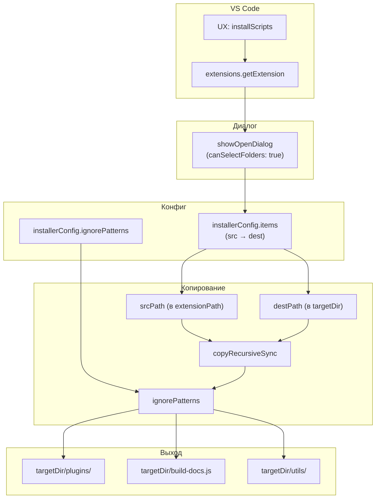
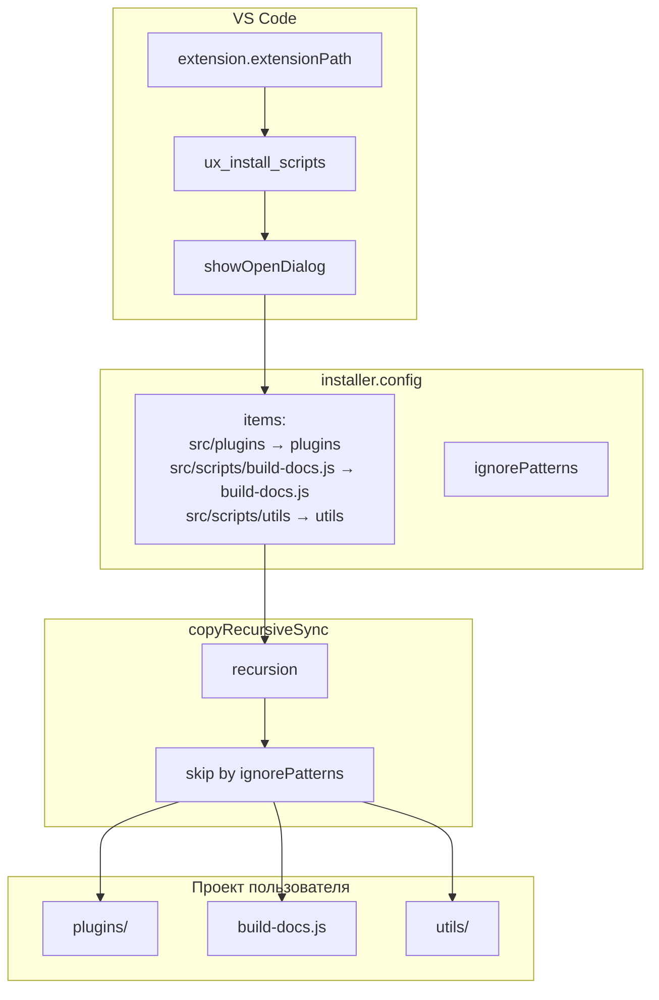



## Назначение

`installer` — «экспортёр» скриптов расширения в **пользовательский проект**. Пользователь кликает **Diplodoc → Установить скрипты сборки** на папке в Explorer — и модуль:

1. Спрашивает папку (`showOpenDialog` — выбор каталога).
2. Копирует `src/plugins/` расширения → `./plugins/` пользователя.
3. Копирует `src/scripts/build-docs.js` → `./build-docs.js` (в корень пользователя).
4. Копирует `src/scripts/utils` → `./utils`.
5. Пропускает файлы по `ignorePatterns` (`.test.js`, `.spec.js`, `node_modules`, `.git`).

Зачем это нужно. Расширение `diplodoc-helper` — это **инструмент внутри VS Code**. Но многие пользователи хотят запускать сборку из терминала (или из CI), без VS Code. Для этого нужны CLI-скрипты (`diplodoc-helper-cli.js`, `docs-build.js`) и их зависимости (`helpMap`, `contexts`, `abbrs`, …). Все они — в `src/plugins/`.

`installer` копирует всё это в проект пользователя. После установки:

- пользователь может запустить `node ./plugins/diplodoc-helper-cli.js helpMap` без VS Code;
- или `node ./build-docs.js` (обёртка над `docs-build.js`) — полная сборка;
- или добавить `plugins/` в git и использовать в CI.

То есть расширение работает не только в VS Code, но и «как набор CLI-скриптов».

## Применение

**Когда использовать:** хотите использовать скрипты расширения **без VS Code** — в терминале, CI, собственном проекте. `installer` копирует `plugins/`, `build-docs.js`, `utils/` в выбранную папку.

**Когда НЕ использовать:** вы всегда работаете в VS Code — команды уже доступны, копировать нечего.

**Альтернативы:**
- Клонировать репозиторий расширения и запускать `node ./plugins/diplodoc-helper-cli.js` — но без обновлений.
- npm-пакет (если бы был) — не реализовано.

**Типичный сценарий:** в Explorer ПКМ на папке → **Diplodoc → Прочее → Установить скрипты сборки** → выбрать целевую папку → `plugins/` + `build-docs.js` в проекте → `node ./build-docs.js`.

## Как это работает




### Фаза 1. Поиск расширения

```js
async function ux_install_scripts() {
    const extensionId = 'paulyestchick.diplodochelper';
    const extension = vscode.extensions.getExtension(extensionId);

    if (!extension) {
        vscode.window.showErrorMessage(`❌ Не удалось найти расширение с ID "${extensionId}".`);
        return;
    }

    const extensionPath = extension.extensionPath;
```

- **`extensionId = 'paulyestchick.diplodochelper'`** — захардкожен (`publisher.name` из `package.json`).
- **`getExtension`** — возвращает `Extension | undefined`. Если расширение не установлено (например, запуск из dev-режима без `--extensionDevelopmentPath`) — `undefined`.
- **`extensionPath`** — абсолютный путь к папке расширения. `src/plugins/` — там, где реальные скрипты.

### Фаза 2. Выбор папки

```js
const uri = await vscode.window.showOpenDialog({
    canSelectFiles: false,
    canSelectFolders: true,
    canSelectMany: false,
    openLabel: 'Выбрать папку для установки скриптов',
    title: 'Куда установить скрипты сборки?',
});

if (!uri || uri.length === 0) return;
const targetDir = uri[0].fsPath;
```

- **`showOpenDialog`** — стандартный диалог VS Code.
- **`canSelectFolders: true, canSelectFiles: false`** — только папки.
- **`canSelectMany: false`** — одна.
- **Если `Escape`** — `uri = undefined`, `return`.

### Фаза 3. Конфиг (`installer.config.js`)

```js
module.exports = {
    items: [
        {
            src: 'src/plugins',
            dest: './plugins',
        },
        {
            src: 'src/scripts/build-docs.js',
            dest: './build-docs.js',
        },
        {
            src: 'src/scripts/utils',
            dest: './utils',
        },
    ],

    ignorePatterns: [
        'node_modules',
        '.git',
        '.test.js',
        '.spec.js',
        'test',
    ],
};
```

**`items`** — что копировать:

| `src`                       | `dest`            | Что                                                         |
| --------------------------- | ----------------- | ----------------------------------------------------------- |
| `src/plugins`               | `./plugins`       | Все скрипты (helpMap, contexts, abbrs, …, manifest.builder) |
| `src/scripts/build-docs.js` | `./build-docs.js` | Обёртка над `docs-build.js`                                 |
| `src/scripts/utils`         | `./utils`         | Утилиты для пользователя (если есть)                        |

**`ignorePatterns`** — что **не** копировать:

- `node_modules` — тяжёлые зависимости.
- `.git` — история.
- `.test.js` / `.spec.js` — тесты.
- `test` — папки тестов.

**Внимание:** в `src/plugins/` **нет** `src/scripts/build-docs.js` и `src/scripts/utils`. См. «Известные ограничения» — эти `src` не существуют в расширении, копирование **пропускается** (с `console.warn`).

### Фаза 4. Копирование

```js
try {
    let copiedCount = 0;

    for (const item of installerConfig.items) {
        if (!item.src || !item.dest) {
            console.warn(`[Installer] Пропущен элемент конфига без src или dest`, item);
            continue;
        }

        const srcPath = path.join(extensionPath, item.src);
        const destPath = path.join(targetDir, item.dest);

        if (!fs.existsSync(srcPath)) {
            console.warn(`[Installer] Источник не найден: ${srcPath}`);
            continue;
        }

        copyRecursiveSync(srcPath, destPath, installerConfig.ignorePatterns);
        copiedCount++;
    }

    if (copiedCount > 0) {
        vscode.window.showInformationMessage(`✅ Скрипты успешно установлены в ${targetDir}`);
    } else {
        vscode.window.showWarningMessage('⚠️ Ни один скрипт не был скопирован. Проверьте конфигурацию.');
    }
} catch (err) {
    const msg = err instanceof Error ? err.message : String(err);
    vscode.window.showErrorMessage(`❌ Ошибка установки скриптов: ${msg}`);
}
```

- **Для каждого `item`** — проверка `src`/`dest`, проверка `fs.existsSync(srcPath)`, `copyRecursiveSync`.
- **`copiedCount`** — счётчик успешных копирований (по `item`, не по файлам).
- **`showInformationMessage` / `showWarningMessage` / `showErrorMessage`** — три исхода.

### Фаза 5. `copyRecursiveSync`

```js
function copyRecursiveSync(src, dest, ignorePatterns) {
    if (!src || !dest) {
        throw new Error(`Некорректные пути для копирования: src=${src}, dest=${dest}`);
    }

    const exists = fs.existsSync(src);
    const stats = fs.statSync(src);
    const isDirectory = exists && stats.isDirectory();

    if (isDirectory) {
        fs.mkdirSync(dest, { recursive: true });
        fs.readdirSync(src).forEach(childItemName => {
            const childPath = path.join(src, childItemName);

            if (ignorePatterns && ignorePatterns.some((pattern) => childItemName.includes(pattern))) {
                return;
            }

            copyRecursiveSync(childPath, path.join(dest, childItemName), ignorePatterns);
        });
    } else {
        fs.mkdirSync(path.dirname(dest), { recursive: true });
        fs.copyFileSync(src, dest);
    }
}
```

- **`fs.statSync(src)`** — бросает при отсутствии `src`. Но в цикле — `if (!fs.existsSync(srcPath)) continue;` перед вызовом. Значит, `src` существует.
- **Директория** — `mkdirSync(recursive: true)` + рекурсия.
- **Файл** — `mkdirSync(dirname, recursive: true)` + `copyFileSync`.
- **`ignorePatterns`** — `childItemName.includes(pattern)`. Простое `includes`, не regex. `'.test.js'` совпадёт с `'foo.test.js'`, `'foo.test.js.bak'`, `'.test.jsx'`. См. «Известные ограничения».

## Режимы работы

### VS Code

| Команда                          | Заголовок                 | Где появляется                                                                 |
| -------------------------------- | ------------------------- | ------------------------------------------------------------------------------ |
| `diplodoc-helper.installScripts` | Установить скрипты сборки | Explorer → Diplodoc → Прочее → Прочее (`diplodoc.other.explorer.context.menu`) |

`when`: `explorerResourceIsFolder`. Команда в подменю `other`, группа `5.diplodoc.generators@6`.

Пользователь кликает на папку (любую, не обязательно корень проекта) → выбирает **куда** копировать (`showOpenDialog`) → скрипты копируются в **выбранную** папку.

### CLI

Собственной CLI-команды нет. `installer` — VS Code-специфичен (использует `vscode.extensions.getExtension`, `showOpenDialog`).

## Юнит-тесты





## Связи

`installer` — «экспортёр» скриптов. Связан с:

| Модуль                            | Связь                                                                                            |
| --------------------------------- | ------------------------------------------------------------------------------------------------ |
| `diplodoc-helper-cli` (`6.2-046`) | Копируется в пользовательский проект как `plugins/diplodoc-helper-cli.js`                        |
| `docs-build` (`6.2-047`)          | Копируется как `plugins/docs-build.js`                                                           |
| Все pre-/post-processing модули   | Копируются как `plugins/<module>/`                                                               |
| `manifest` (`6.2-048`)            | **Не** копируется в пользовательский проект (build-time VS Code-расширения, не для пользователя) |
| `build.js` (`6.2-050`)            | **Не** копируется (esbuild расширения, не для пользователя)                                      |

`installer` — единственный модуль, который делает **расширение** portable за пределы VS Code.

Пользователь после `installer`:

```bash
# сборка документации целиком
node ./build-docs.js

# или отдельные шаги
node ./plugins/diplodoc-helper-cli.js helpMap
node ./plugins/diplodoc-helper-cli.js reindexFigures --docsDir ./docs/ru
node ./plugins/diplodoc-helper-cli.js breadcrumb ./build
```






