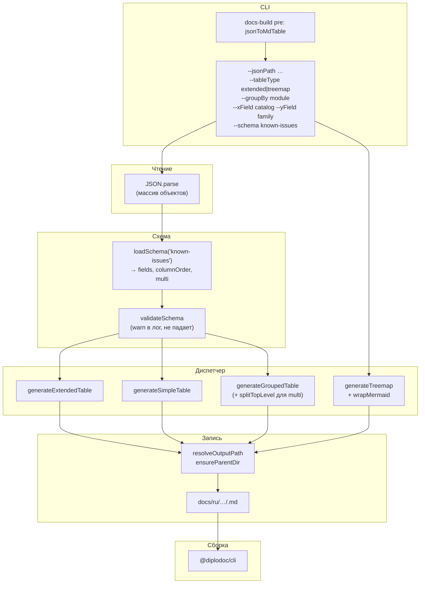
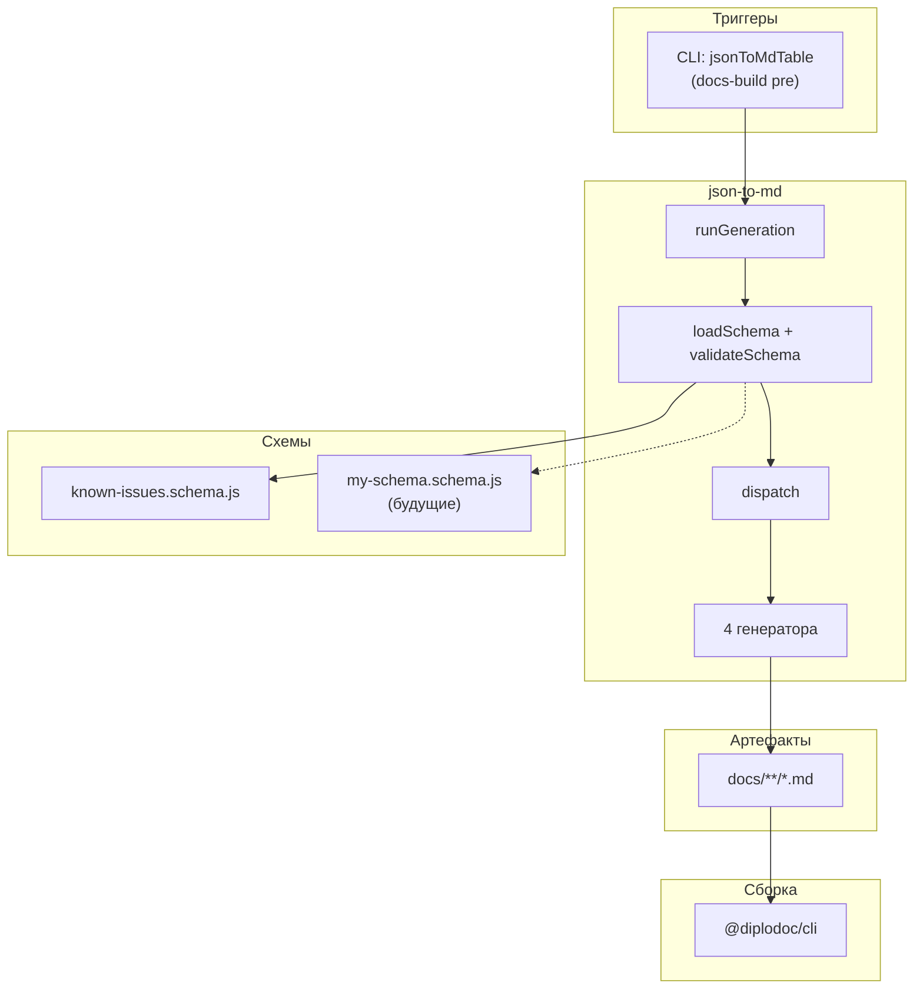

|               |                                                                                                                                                                                                                                                             |
| ------------- | ----------------------------------------------------------------------------------------------------------------------------------------------------------------------------------------------------------------------------------------------------------- |
| ID            | [8.2-054](../../Соглашения/index.md#identifikaciya-modulej)                                                                                                                                                                                                 |
| Идентификатор | `json-to-md`                                                                                                                                                                                                                                                |
| Наименование  | JSON → Markdown                                                                                                                                                                                                                                             |
| Слой          | [Pre-processing](../../Слоиlayer/СлойPreprocessing/index.md#naznachenie)                                                                                                                                                                                    |
| Каталог       | [Представление данных](../../%D0%9A%D0%B0%D1%82%D0%B0%D0%BB%D0%BE%D0%B3Capabilitymap/%D0%9A%D0%B0%D1%82%D0%B0%D0%BB%D0%BE%D0%B3%D0%9F%D1%80%D0%B5%D0%B4%D1%81%D1%82%D0%B0%D0%B2%D0%BB%D0%B5%D0%BD%D0%B8%D0%B5%D0%B4%D0%B0%D0%BD%D0%BD%D1%8B%D1%85/index.md) |
| Семейство     | [JSON-генераторы](../../%D0%A1%D0%B5%D0%BC%D0%B5%D0%B9%D1%81%D1%82%D0%B2%D0%BEfamily/%D0%A1%D0%B5%D0%BC%D0%B5%D0%B9%D1%81%D1%82%D0%B2%D0%BEJSON%D0%B3%D0%B5%D0%BD%D0%B5%D1%80%D0%B0%D1%82%D0%BE%D1%80%D1%8B/index.md#fam-json-generators)                   |
| Расположение  | `src/plugins/json-to-md/`                                                                                                                                                                                                                                   |
| Точка входа   | `runGeneration({ jsonPath, outputDir, tableType, ... })`                                                                                                                                                                                                    |
| Версия        | `1.54.0`                                                                                                                                                                                                                                                    |
| Назначение    | Конвертирует массив JSON-записей в Markdown-таблицу или Mermaid `treemap-beta`                                                                                                                                                                              |

{: .page-legend }

## Назначение

`json-to-md` — универсальный конвертер **«массив JSON-объектов → Markdown-артефакт»**. Читает плоский JSON, применяет схему (перечень ожидаемых полей), диспатчит на нужный генератор и пишет `.md`-файл.

Поддерживает четыре режима:

1. **`extended`** — расширенная Diplodoc-таблица `#\| … \|#`. Все колонки из схемы, «Подробности» рендерятся как ``.
2. **`simple`** — обычная Markdown-таблица `\| … \|` (Gfm). «Подробности» — inline (`<br>` вместо переносов).
3. **`extended` + `--groupBy <field>`** — таблица, в которой записи сгруппированы по значению поля. Между группами — сквозные строки заголовка и подвала. Если поле в схеме помечено `multi: true`, одна запись попадает в несколько групп (например, `module: "a, b"` → две группы).
4. **`treemap`** — Mermaid `treemap-beta`: оси X/Y задаются через `--xField`/`--yField`, листья — `--labelField`.

Зачем это нужно. Любой артефакт «список чего-то» (known-issues, реестр модулей, roadmap-этапы, статистика) вести руками в Markdown больно: при правке JSON надо синхронизировать структуру таблицы и содержимое, при добавлении колонки — править все строки, при смене схемы — искать все места.

`json-to-md` отделяет **данные** (JSON) от **представления** (Markdown). Один JSON — четыре разных артефакта из одной и той же схемы. Схема — тоже отдельный файл: новая структура JSON → новый `schemas/<name>.schema.js` → параметр `--schema <name>`.

## Применение

**Когда использовать:** есть JSON-массив объектов, из которого нужна Markdown-таблица или treemap-диаграмма; структура JSON стабильна и описываема.

**Когда НЕ использовать:** данные в YAML (используйте `yaml-парсер`), данные в иерархическом JSON с вложенными массивами (модуль ожидает плоский массив), нужна интерактивность в браузере (это статический Markdown).

**Альтернативы:**
- Ручная Markdown-таблица — часы на синхронизацию при каждом изменении JSON.
- `roadMap` — узкоспециализированный генератор с встроенной бизнес-логикой (группы → модули → функции, Gantt). Не подходит для произвольной структуры.
- `contexts`/`helptags` — тоже генерируют из JSON, но со своей жёсткой логикой. `json-to-md` — универсальная замена для «простых» случаев.

**Типичный сценарий:** JSON в `known-issues-summary.json` → шаг `jsonToMdTable` в `docs-build.js --phase=pre` → `runGeneration` → `docs/ru/Модули/Известныепроблемы/known-issues-summary.md`. Повторная сборка — перезапись.

## Как это работает



### Фаза 1. Чтение

```js
function runGeneration(opts) {
    const { jsonPath, outputDir, outputFile, schema: schemaName = 'known-issues', tableType = 'extended' } = opts;

    if (!fs.existsSync(jsonPath)) return { success: false };

    let issues;
    try {
        issues = JSON.parse(fs.readFileSync(jsonPath, 'utf8'));
    } catch (err) {
        console.error(`❌ [json-to-md] Ошибка чтения/парсинга JSON: ${err.message}`);
        return { success: false };
    }

    if (!Array.isArray(issues)) { /* … */ return { success: false }; }
```

Ожидается **плоский массив** объектов. Вложенные массивы / YAML / строки — не поддерживаются.

### Фаза 2. Валидация схемы

```js
const schema = loadSchema(schemaName);
const validation = validateSchema(issues, schema, console);
// ⚠️ [schema] Поле "severity" отсутствует в 3 из 54 записей
// ⚠️ [schema] Поле "module" отсутствует в 1 из 54 записей
```

`validateSchema` **не бросает** исключений — только логирует предупреждения. Сборка не падает из-за одной «дырявой» записи. Если поле помечено `required: true`, но в JSON его нет — в лог уйдёт `⚠️`, в ячейке окажется `—`.

Treemap-режим **не валидирует** схему — оси задаются параметрами, схема не нужна.

### Фаза 3. Диспетчеризация

| Условие                           | Генератор                         |
| --------------------------------- | --------------------------------- |
| `--tableType simple` / `standard` | `generateSimpleTable`             |
| `--tableType treemap`             | `generateTreemap` + `wrapMermaid` |
| `--groupBy <field>`               | `generateGroupedTable`            |
| (по умолчанию)                    | `generateExtendedTable`           |

### Фаза 4. Резолв и запись

```js
const outputPath = resolveOutputPath({ outputDir, outputFile, defaultFileName });
ensureParentDir(outputPath);
fs.writeFileSync(outputPath, content, 'utf8');
```

`resolveOutputPath` различает три формы `--outputFile`:

| `--outputFile`                  | Куда                                |
| ------------------------------- | ----------------------------------- |
| не передан                      | `<outputDir>/<defaultFileName>`     |
| `file.md` (без разделителя)     | `<outputDir>/file.md`               |
| `./a/b/file.md`, `../x`, `/abs` | `<cwd>/a/b/file.md`, `../x`, `/abs` |

`ensureParentDir` создаёт вложенные папки — `ENOENT` при вложенных путях не случается.

### Файлы модуля

| Файл                               | Ответственность                                                 |
| ---------------------------------- | --------------------------------------------------------------- |
| `run-generation.js`                | `runGeneration`, реэкспорт генераторов, CLI-точка входа         |
| `json-to-md-table.js`              | тонкий враппер — обратная совместимость по старому пути         |
| `lib/args.js`                      | `parseArgs`, presence-only флаги, дефолты                       |
| `lib/schema.js`                    | `loadSchema`, `validateSchema`, `getColumns`                    |
| `lib/escape.js`                    | `escMd`, `escMdLine`, `escMermaid`, `splitTopLevel`             |
| `lib/paths.js`                     | `resolveOutputPath`, `ensureParentDir`                          |
| `lib/generators/extended-table.js` | `generateExtendedTable`                                         |
| `lib/generators/simple-table.js`   | `generateSimpleTable`                                           |
| `lib/generators/grouped-table.js`  | `generateGroupedTable` (с `>`-merge и `{.cell-align-top-left}`) |
| `lib/generators/treemap.js`        | `generateTreemap`, `wrapMermaid`                                |
| `schemas/known-issues.schema.js`   | схема для `known-issues-summary.json`                           |

Модуль разбит на слои: escape/args/paths/schema — переиспользуемые утилиты, `lib/generators/*` — по одному генератору на режим, `run-generation.js` — диспетчер.

## Схема

Схема — единственное место, где перечислены поля JSON и их назначение. Для нового типа JSON — новый `schemas/<name>.schema.js`.

### `schemas/known-issues.schema.js`

```js
module.exports = {
    name: 'known-issues',
    fields: {
        id:       { label: 'ID',          type: 'string', required: true },
        type:     { label: 'Тип',         type: 'string', required: true },
        severity: { label: 'Severity',    type: 'string', required: true },
        module:   { label: 'Модуль',      type: 'string', required: true, multi: true, separator: ',' },
        title:    { label: 'Кратко',      type: 'string', required: true },
        details:  { label: 'Подробности', type: 'text',   required: false, isDetails: true },
    },
    columnOrder: ['id', 'type', 'severity', 'module', 'title', 'details'],
};
```

| Флаг схемы    | Что делает                                                            |
| ------------- | --------------------------------------------------------------------- |
| `required`    | `true` → `validateSchema` ругается в лог при отсутствии поля в записи |
| `label`       | Заголовок колонки в таблице                                           |
| `isDetails`   | В `extended` → ``; в `simple` → inline `<br>`   |
| `multi`       | В группировке — разбивать значение по `separator` на несколько групп  |
| `separator`   | Разделитель для `multi` (по умолчанию `,`)                            |
| `hidden`      | Не выводить колонку (полезно для служебных полей)                     |
| `columnOrder` | Порядок колонок; если не задан — `Object.keys(fields)`                |

### Пример: новая схема

Допустим, есть `known-issues-with-priority.json` со схемой `severity + priority`. Создаём `schemas/known-issues-with-priority.schema.js`:

```js
module.exports = {
    name: 'known-issues-with-priority',
    fields: {
        id:       { label: 'ID',          type: 'string', required: true },
        severity: { label: 'Severity',    type: 'string', required: true },
        priority: { label: 'Приоритет',   type: 'number', required: true },
        module:   { label: 'Модуль',      type: 'string', multi: true, separator: ',' },
        title:    { label: 'Кратко',      type: 'string', required: true },
        details:  { label: 'Подробности', type: 'text',   isDetails: true },
    },
    columnOrder: ['id', 'severity', 'priority', 'module', 'title', 'details'],
};
```

И вызов с `--schema known-issues-with-priority`.

## Режимы генерации

### extended (по умолчанию)

```bash
node ./plugins/json-to-md/json-to-md-table.js \
  --jsonPath  ./known-issues-summary.json \
  --outputDir ./docs/ru/Модули/Известныепроблемы \
  --tableType extended
```

Результат — `#| … |#` с колонками из схемы. `details` рендерится как ``.

### simple

```bash
node ./plugins/json-to-md/json-to-md-table.js … --tableType simple
```

Обычная Gfm-таблица `| … |`. Переносы строк в `details` заменяются на `<br>`.

### extended + groupBy

```bash
node ./plugins/json-to-md/json-to-md-table.js … \
  --groupBy module
```

Если в схеме `module.multi = true`, значение `"section.Rename, reindexer.directories"` разбивается на две группы (по `splitTopLevel`, который **не** рвёт запятые внутри `[…] (…)`). Одна запись попадает в обе группы.

Заголовок и подвал группы — сквозные строки:

```md
|| **Модуль: section.Rename** {.cell-align-top-left} | > | > | > | > ||
|| _Всего для section.Rename: **2**_ <br><br> {.cell-align-top-left} | > | > | > | > ||
```

Символ `>` — официальный синтаксис Diplodoc для горизонтального объединения ячеек; `{.cell-align-top-left}` — выравнивание текста по левому краю.

**Параметры группировки:**

| Флаг                      | Что делает                                               |
| ------------------------- | -------------------------------------------------------- |
| `--groupBy <field>`       | Поле-группа. Колонка этого поля исчезает из шапки        |
| `--no-groupSplit`         | Не разбивать `multi`-поле — каждая запись в одной группе |
| `--groupSeparator <char>` | Переопределить разделитель (по умолчанию — из схемы)     |
| `--no-groupFooter`        | Не показывать строку `_Всего для …: N_`                  |

### treemap

```bash
node ./plugins/json-to-md/json-to-md-table.js \
  --jsonPath    ./docs/ru/Модули/Реестр/registry.json \
  --outputDir   ./docs/ru \
  --tableType   treemap \
  --xField      catalog \
  --yField      family \
  --labelField  id \
  --classField  status \
  --outputFile  ./docs/ru/Модули/Реестр/registry-treemap.md
```

Даёт `treemap-beta`-диаграмму: `yField` → верхние секции, `xField` → вложенные, `labelField` → листья. `--flat` склеивает «Y / X» в один заголовок — ближе к «сеточному» виду.

**Параметры treemap:**

| Флаг           | Что делает                                            |
| -------------- | ----------------------------------------------------- |
| `--xField`     | Вложенная ось (2-й уровень секций)                    |
| `--yField`     | Верхняя ось (1-й уровень секций)                      |
| `--labelField` | Поле-имя листа                                        |
| `--valueField` | Числовое поле для размера листа (иначе — `1` на лист) |
| `--classField` | Поле, значение которого → `:::class` для `classDef`   |
| `--flat`       | Склеивать `"Y / X"` в один заголовок                  |

Схема **не используется** в treemap — оси задаются явно.

## Формат JSON

Ожидается плоский массив объектов:

```json
[
  {
    "id": "KI-004",
    "type": "bug",
    "severity": "critical",
    "module": "[`section.Rename`](…), [`reindexer.directories`](…)",
    "title": "section.Rename / reindexer.directories — возврат старого имени при ошибке",
    "details": "**Что происходит.** …"
  }
]
```

| Свойство | Тип      | Комментарий                                                       |
| -------- | -------- | ----------------------------------------------------------------- |
| массив   | `Array`  | Корневой элемент — всегда массив                                  |
| элементы | `Object` | Плоские объекты; вложенные массивы / объекты не поддерживаются    |
| значения | `string` | Все поля трактуются как строки; `null`/`undefined` → `—` в ячейке |

Специфика полей — в схеме (`schemas/<name>.schema.js`).

## Режимы работы

### CLI

```bash
node ./plugins/json-to-md/json-to-md-table.js \
  --jsonPath  ./…/known-issues-summary.json \
  --outputDir ./docs/ru/Модули/Известныепроблемы \
  --tableType extended \
  --groupBy   module
```

| Аргумент           | По умолчанию                  | Описание                                         |
| ------------------ | ----------------------------- | ------------------------------------------------ |
| `--jsonPath`       | `./known-issues-summary.json` | Путь к JSON                                      |
| `--outputDir`      | `./docs`                      | Папка вывода                                     |
| `--outputFile`     | `<outputDir>/<name>.md`       | Имя или полный путь к `.md`                      |
| `--schema`         | `known-issues`                | Имя схемы из `schemas/` или путь к `*.schema.js` |
| `--tableType`      | `extended`                    | `extended` / `simple` / `treemap`                |
| `--groupBy`        | —                             | Поле-группа для `extended`                       |
| `--groupSplit`     | из схемы (`multi`)            | Принудительно разбивать `multi`-значение         |
| `--no-groupSplit`  | —                             | Не разбивать `multi`                             |
| `--no-groupFooter` | —                             | Без подвала `_Всего для …_`                      |
| `--groupSeparator` | из схемы / `,`                | Разделитель для `multi`                          |
| `--xField` и др.   | `module` / `layer` / `id`     | Параметры treemap                                |

Прежние позиционные формы (`jsonPath`, `outputDir`, `tableType`) **сохранены** для обратной совместимости.

### Сборочный пайплайн

В `docs-build.js`, фаза `pre`:

```js
node(
    'jsonToMdTable',
    './plugins/json-to-md/json-to-md-table.js',
    '--jsonPath',  './docs/ru/Модули/Известныепроблемы/known-issues-summary.json',
    '--outputDir', './docs/ru/Модули/Известныепроблемы',
    '--tableType', 'extended',
    '--groupBy',   'module'
),
```

Пропускается флагом `--skip=jsonToMdTable`.

### VS Code

Собственной команды нет. Только через `docs-build.js` или прямой CLI.

## Связи

`json-to-md` — самостоятельный генератор, **не входит в строгие семейства**. В отличие от `roadmap` (пара `roadmap ↔ roadmap.patcher`) и `abbrs` (пара `abbrs ↔ abbrs.client`), у `json-to-md` нет клиентской части — результат использования (перегенерация `.md`) полностью решается на этапе `pre`.

**Внутренние связи** — через схему. Один модуль, несколько генераторов. Схема — единственное место, где перечислены поля; добавляя новую схему (`--schema my-schema`), вы переиспользуете весь пайплайн (escape, args, paths, диспетчеризацию).

**Внешние зависимости:** нет. `fs`, `path` — стандартная библиотека. Ни Java, ни `plantuml`, ни браузерных рантаймов.

**Что общего с `roadmap`:** оба — генераторы артефактов (группа 8), оба пишут `.md` из JSON, оба живут в `pre`. Но `roadmap` — специализированный (Gantt, группы/модули/функции, `plantuml.jar`), `json-to-md` — универсальный. Пересечения по коду нет.







## Расширение

Добавить новый тип JSON:

1. Создать `schemas/<name>.schema.js` по образцу `known-issues.schema.js` — поля, `columnOrder`, `multi`, `isDetails`.
2. Вызвать модуль с `--schema <name>`.
3. Если нужен новый **формат вывода** (не таблица и не treemap) — добавить `lib/generators/<name>.js`, ветку в `run-generation.js → if (mode === '<name>')`, реэкспорт в `module.exports`.
4. Если нужно новое **правило группировки** — параметр в `lib/generators/grouped-table.js`, флаг в `lib/args.js`.

Схема — контракт; генераторы — стратегии. Добавление схемы не требует правки генераторов; добавление генератора — только новой ветки диспетчера.