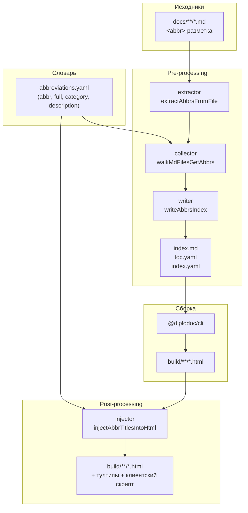
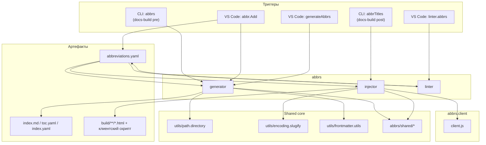



## Назначение

Модуль `abbrs` замыкает на себе всю работу с аббревиатурами в документации:

- **словарь** — единый YAML (`abbreviations.yaml`), где каждой аббревиатуре сопоставлены расшифровка, категория и произвольное описание;
- **разметка в статьях** — тег `<abbr>` (с опциональным `data-abbr`), который не мешает чтению исходника и не требует подключения внешних ресурсов;
- **страница-указатель** — генерируется из словаря + обхода `docs/`, с алфавитной навигацией и списком вхождений под ``;
- **тултипы в готовом HTML** — на этапе пост-обработки все `<abbr>` получают расшифровку и ссылку на анкор страницы-указателя;
- **линтер** — проверяет, что каждый `<abbr>` определён в словаре.

Клиентская часть (сворачивание длинных списков вхождений, позиционирование тултипов) описана в отдельной статье — [Модуль. Клиент аббревиатур](../../Модули/Модульabbrs.client/index.md).

## Применение

**Когда использовать:** в документации много сокращений (`АБВ`, `ИСО`, `ГОСТ Р`), и читателю нужна расшифровка в подсказке + единая страница «Список сокращений».

**Когда НЕ использовать:** 1–2 сокращения — хватит сноски или явной расшифровки в тексте; термины с определениями — это `terms`, не `abbrs`.

**Альтернативы:**
- `<abbr title="…">` — inline-расшифровка, но нет словаря, нет страницы-указателя, нет тултипов.
- Сноски (`[^1]`) — работают, но не масштабируются на десятки сокращений.

**Типичный сценарий:** `<abbr>АБВ</abbr>` в тексте → **Diplodoc → Сокращение: вставить / создать** → расшифровка + категория → `generateAbbrs` → `abbrTitles` в `post` → `abbrs.client` рисует тултипы.

 ## Как это работает



**Pre-processing** (генерация страницы-указателя):

1. **Словарь.** `loadAbbrDictionary(langDir)` читает `abbreviations.yaml` в массив и индексирует по `abbr`. Все записи сразу попадают в `abbrMap` с `definedInDictionary: true`.
2. **Извлечение.** `extractAbbrsFromFile` маскирует код-блоки (`maskCodeInMarkdown`) и находит `<abbr>` без `class=` (теги с `class=` считаются «чужими» — их обрабатывает модуль `terms`). Ключ — `data-abbr` или видимый текст. Возвращает `{ title, href, occurrences }`, где `href` — путь `.md` относительно `langDir`.
3. **Сбор.** `walkMdFilesGetAbbrs` обходит `langDir`, пропускает папки из `SKIP_DIRS` (`abbrs`, `terms`, `contexts`, `helptags`, `figures`, `roadmap`) и собственную выходную папку модуля. Мерджит результаты в `abbrMap`; для каждой аббревиатуры считает `rank` (число страниц с вхождениями) и `totalOccurrences`.
4. **Запись.** `writeAbbrsIndex` собирает `index.md`:
   - frontmatter `title: Список сокращений` + `sectionType: Page`;
   - баннер «Нет в словаре» (только если `showWarnings: true` в `abbrs.config.js`);
   - алфавитные разделы `## БУКВА`;
   - для каждой аббревиатуры — `<strong id="abbr-slug">АБВ</strong> — Расшифровка`;
   - под `` — список страниц с `[N]`-ссылками на конкретные вхождения (`abbr-slug-1`, `abbr-slug-2`, …).

**Post-processing** (тултипы):

5. `injectAbbrTitlesIntoHtml` читает ту же `abbreviations.yaml`, маскирует `<code>`/`<pre>` и заменяет каждый `<abbr>` на `<div class="dl-abbr">` с тултипом, кнопкой «см. Аббревиатуры» и стабильным `id` (`abbr-slug-N` — тот же, что в ссылках `[N]`).
6. В каждую HTML-страницу инжектится клиентский скрипт `abbrs.client.js` (см. отдельную статью).

### Файлы модуля

| Файл                                  | Ответственность                                                                                                                                                    |
| ------------------------------------- | ------------------------------------------------------------------------------------------------------------------------------------------------------------------ |
| `abbrs.js`                            | `runGeneration(docsRoot)` — генератор страницы-указателя                                                                                                           |
| `abbrs.collector.js`                  | `walkMdFilesGetAbbrs` — обход `docs/`                                                                                                                              |
| `abbrs.extractor.js`                  | `extractAbbrsFromFile`, `extractDataAbbr`                                                                                                                          |
| `abbrs.dictionary.js`                 | `loadAbbrDictionary`, `getAbbrDictionaryPath`                                                                                                                      |
| `abbrs.dictionary.writer.js`          | `appendAbbrToDictionary` — запись в YAML с сортировкой                                                                                                             |
| `abbrs.writer.js`                     | `writeAbbrsIndex` — рендер `index.md`                                                                                                                              |
| `abbrs.injector.js`                   | `injectAbbrTitlesIntoHtml`, `runGeneration({ buildDir, docsRoot })`                                                                                                |
| `abbrs.linter.js`                     | `lintAbbrs(docsRoot)`                                                                                                                                              |
| `abbrs.model.js`                      | `abbrAnchorId`, `abbrOccurrenceId`                                                                                                                                 |
| `abbrs.paths.js` + `abbrs.paths.yaml` | путь к папке модуля по языкам                                                                                                                                      |
| `abbrs.template.js` + `templates/*`   | MD-шаблоны `cut.md`, `entry.md`, `letter.md`, `occ.line.md`, `occ.link.md`, `occ.list.md`, `frontmatter.md`, `unused.md`, `entry.undefined.md`, `entry.warning.md` |
| `abbrs.textRange.js`                  | `findAbbrAroundOffset` — поиск `<abbr>` под курсором                                                                                                               |
| `abbrs.config.js`                     | `showWarnings`, `showUnused`, `usageCutTitle`, `usageVisibleCount`                                                                                                 |
| `shared/*`                            | общие с `terms`: маскирование кода, модель анкоров, шаблонизатор, `findAroundOffset`                                                                               |

### Формат `abbreviations.yaml`

```yaml
# ── А ──

- abbr: "АБВ"
  full: |-
    Абстрактный Базовый Вычислитель
  category: "architecture"
  description: |-
    Используется в разделе [Архитектура](../Архитектура/index.md)

# ── О ──

- abbr: "ОРФ"
  full: |-
    Организационно-распорядительная форма
  category: "documents"
```

| Поле          | Обязательность | Комментарий                                                   |
| ------------- | -------------- | ------------------------------------------------------------- |
| `abbr`        | да             | Уникальный ключ (проверяется в `appendAbbrToDictionary`)      |
| `full`        | да             | Расшифровка; допускает markdown-ссылки                        |
| `category`    | нет            | Группировка в словаре (в индексе не отображается)             |
| `description` | нет            | Дополнительное описание — попадает в тултип (post-processing) |

Ключи `full` и `description` пишутся через `|-` (literal block), чтобы сохранять markdown-ссылки на нескольких строках.

## Режимы работы

### VS Code

| Команда                         | Заголовок                           | Где появляется                            |
| ------------------------------- | ----------------------------------- | ----------------------------------------- |
| `diplodoc-helper.abbr.Add`      | Сокращение: вставить / создать      | Редактор → контекстное меню (выделение)   |
| `diplodoc-helper.generateAbbrs` | Сокращения: собрать/обновить список | Explorer → Diplodoc → Прочее → Сокращения |
| `diplodoc-helper.linter.abbrs`  | Сокращения: проверить определения   | Explorer → Diplodoc → Очистка и проверки  |

**`abbr.Add`** работает в три сценария:

- **создать** — пользователь впервые оборачивает слово: открывается промпт расшифровки и категории, запись пишется в словарь, слово оборачивается в `<abbr>`, происходит переиндексация;
- **вставить из словаря** — `QuickPick` со всеми записями (с `matchOnDescription`/`matchOnDetail` и подсказкой при совпадении без учёта регистра);
- **снять разметку** — если курсор внутри `<abbr>`, первым пунктом `QuickPick` предлагается «Снять разметку сокращения».

**`generateAbbrs`** — полная регенерация `index.md` для всех языков, найденных в `abbrs.paths.yaml`.

**`linter.abbrs`** — обходит `docs/`, ищет `<abbr>` без `class=` и без `title=`, проверяет наличие в словаре. Результат — `QuickPick` с переходами к файлам.

**Code actions** (при клике на лампочку в `.md`):

| Действие                          | Условие появления                      |
| --------------------------------- | -------------------------------------- |
| Показать расшифровку: `…`         | Курсор внутри `<abbr>`, есть в словаре |
| Добавить «X» в словарь сокращений | Курсор внутри `<abbr>`, нет в словаре  |
| Снять разметку сокращения         | Курсор внутри `<abbr>`                 |
| Обернуть в сокращение             | Выделен диапазон (не `<abbr>`)         |
| Обернуть слово в сокращение       | Курсор на слове без выделения          |

### CLI

Генерация страницы-указателя:

```bash
node ./plugins/diplodoc-helper-cli.js abbrs --docsDir ./docs
```

| Аргумент    | Обязателен | По умолчанию | Описание            |
| ----------- | ---------- | ------------ | ------------------- |
| `--docsDir` | нет        | `./docs`     | Корень документации |

Инъекция тултипов в готовый HTML:

```bash
node ./plugins/diplodoc-helper-cli.js abbrTitles --docsDir ./docs --outputDir ./build
```

| Аргумент      | Обязателен | По умолчанию | Описание                                    |
| ------------- | ---------- | ------------ | ------------------------------------------- |
| `--docsDir`   | нет        | `./docs`     | Корень документации (откуда читать словарь) |
| `--outputDir` | нет        | `./build`    | Корень сборки (куда писать тултипы)         |

### Сборочный пайплайн

В `docs-build.js` — два шага:

- **pre**: `cli('abbrs')` — перед `@diplodoc/cli`;
- **post**: `cli('abbrTitles', './build', '--docsDir', './docs')` — после сборки, до `gostsInject` и `breadcrumb`.

Оба шага пропускаются флагами `--skip=abbrs` и `--skip=abbrTitles` при вызове `docs-build.js`.

## Юнит-тесты





## Связи

Модуль `abbrs` живёт в двух слоях: генерирует страницу-указатель в `pre-processing`, внедряет тултипы в `post-processing`. С клиентским скриптом (`abbrs.client`) общается через готовую HTML-разметку — клиент видит уже подготовленные `<div class="dl-abbr">` и `<span class="dl-abbr-occ-list">`.

По структуре `abbrs` симметричен `terms` и `gosts` (словарь → генератор → инжектор → клиент), но пересечений по артефактам нет: каждый пишет в свою папку (`Дополнительнаяинформация/Списоксокращений`, `…/Терминыиопределения`, `…/ГОСТы`) и копирует собственный клиентский скрипт. Общие зависимости — `utils/path.directory`, `utils/encoding.slugify`, `utils/frontmatter.utils` (последнее — косвенно, через `getTitleFromMetadata` в коллекторе).

Линтер `abbrs.linter` формально живёт в модуле (та же папка, тот же словарь), но по природе относится к аналитике — отдельного ID не получает.








