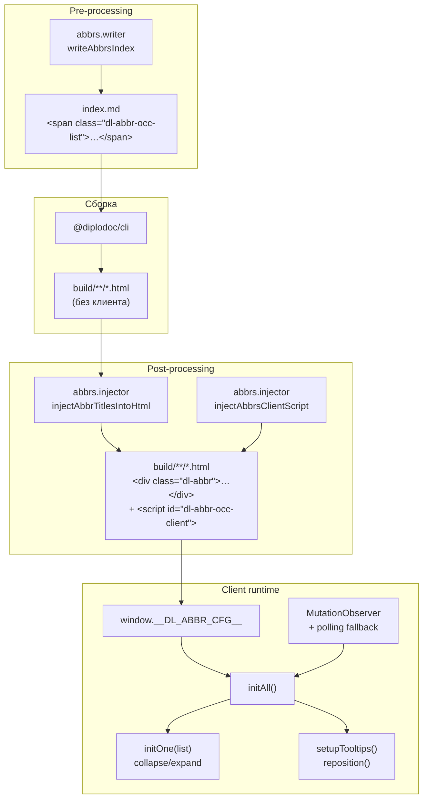
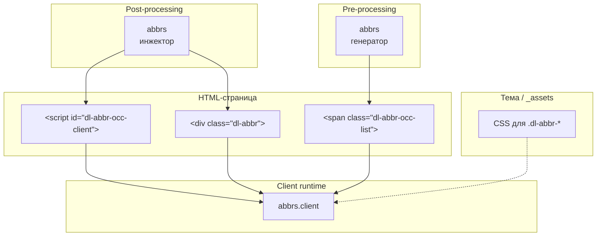

|               |                                                                                                               |
| ------------- | ------------------------------------------------------------------------------------------------------------- |
| ID            | [5.1-004](../../%D0%A1%D0%BE%D0%B3%D0%BB%D0%B0%D1%88%D0%B5%D0%BD%D0%B8%D1%8F/index.md#identifikaciya-modulej) |
| Идентификатор | `abbrs.client`                                                                                                |
| Наименование  | Клиент аббревиатур                                                                                            |
| Слой          | [client-runtime](../%D0%A1%D0%BB%D0%BE%D0%B8layer/ClientRuntime/index.md#naznachenie)                           |
| Расположение  | `src/plugins/abbrs/abbrs.client.js`                                                                           |
| Точка входа   | IIFE при загрузке страницы (после инъекции `<script id="dl-abbr-occ-client">`)                                |
| Версия        | `1.54.0`                                                                                                      |
| Назначение    | Оживляет разметку аббревиатур в браузере: сворачивает длинные списки вхождений и позиционирует тултипы        |

{: .page-legend }

## Назначение

`abbrs.client` — клиентская половина модуля `abbrs`. Пока `abbrs` (генератор + инжектор) готовит страницу-указатель и обогащает `<abbr>` расшифровками, `abbrs.client` доводит эту разметку до интерактивного состояния уже в браузере читателя:

- **сворачивает длинные списки вхождений** — под каждым `` показывает первые `usageVisibleCount` ссылок `[N]`, остальные скрывает за кнопкой «ещё N» / «свернуть»;
- **позиционирует тултипы** — у каждого `<div class="dl-abbr">` (создан инжектором) есть `<abbr>` и плавающая подсказка `.dl-abbr-tip`; клиент вычисляет координаты так, чтобы подсказка не выходила за границы окна, и переключает её между «сверху» и «снизу» от триггера;
- **переживает динамический рендер** — Diplodoc строит DOM из `diplodoc-state` уже после `DOMContentLoaded`, поэтому клиент инициализирует разметку не однократно, а по событию `MutationObserver` + коротким polling'ом на случай, если наблюдатель не поймал первичный рендер.

Сам по себе модуль бесполезен: без `abbrs.injector` в HTML нет ни `<script id="dl-abbr-occ-client">`, ни `<div class="dl-abbr">`. И без `abbrs` (генератора) нет страницы-указателя со списками вхождений. Это классическая пара «серверная часть + клиентская часть», обе описаны отдельными статьями.

## Применение

**Когда использовать:** всегда, когда используется [`abbrs`](../МодульАббревиатуры/index.md) — без клиента тултипы и сворачивание списков вхождений не работают.

**Когда НЕ использовать:** отдельно от `abbrs` не имеет смысла (ждёт `<div class="dl-abbr">` и `<span class="dl-abbr-occ-list">`, которых без генератора не будет).

**Альтернативы:**
- Нативный `<abbr title="…">` — работает без JS, но без стилизации, без мультитултипов, без списка вхождений.

**Типичный сценарий:** `abbrs.injector` встраивает `<script id="dl-abbr-occ-client">` → при открытии страницы клиент находит `.dl-abbr` → позиционирует тултип по `getBoundingClientRect` → сворачивает списки `[1][2][3]…` за «ещё N».

## Как это работает



### Фаза 1. Инъекция

Инжектор (`abbrs.injector.js`, `injectAbbrsClientScript`) вставляет в `</body>` каждой страницы:

```html
<script id="dl-abbr-occ-client">
window.__DL_ABBR_CFG__ = {"visible": 10, "more": "ещё", "collapse": "свернуть"};
/* …тело abbrs.client.js… */
</script>
```

Маркер `id="dl-abbr-occ-client"` — единственный признак идемпотентности: если скрипт уже вставлен, повторная инъекция ничего не делает. `__DL_ABBR_CFG__` собирается из `abbrs.config.js` (`usageVisibleCount`) и языка страницы (`more`/`collapse` — «ещё»/«свернуть» для `ru`, `more`/`collapse` для остальных).

Параллельно инжектор `injectAbbrTitlesIntoHtml` уже заменил все `<abbr>` на `<div class="dl-abbr">` с тултипом внутри (см. статью `abbrs`). Если на странице нет ни одного `<abbr>` и ни одного `.dl-abbr-occ-list` — скрипт загрузится, но `initAll()` вернёт `0`, и клиент уйдёт в polling-режим (см. ниже).

### Фаза 2. Инициализация

При загрузке выполняется IIFE:

1. **Защита от SSR.** `if (typeof window === 'undefined') return;` — на сервере (если скрипт случайно попадёт в Node-контекст) ничего не делает.
2. **Чтение конфига.** `window.__DL_ABBR_CFG__` → `{ visible, more, collapse }`. Дефолты: `visible = 10`, `more = 'more'`, `collapse = 'collapse'`.
3. **`initAll()`** — обходит все `.dl-abbr-occ-list` и вызывает `initOne(list)`, затем `setupTooltips()`. Возвращает число найденных списков.
4. **Если ничего не найдено** — запускает polling: до 120 попыток с интервалом 250 мс (около 30 секунд суммарно), пока `initAll()` не вернёт `> 0`. Это нужно на случай, если Diplodoc отрендерит контент позже, чем выполнится `<script>`.
5. **MutationObserver** — подписка на `document.body` (`childList: true, subtree: true`), при любом изменении снова вызывает `initAll()`. Так новые блоки (например, подгруженные при переключении табов) тоже оживают.

### Фаза 3. Сворачивание списков (`initOne`)

Для каждого `.dl-abbr-occ-list`:

1. Если у списка уже есть `data-dl-abbr-init="1"` — выход (идемпотентность).
2. Собирает `links = list.querySelectorAll('.dl-abbr-occ')` — это ссылки `[N]` на конкретные вхождения.
3. Если `links.length <= VISIBLE` — просто помечает последнюю видимую ссылку классом `dl-abbr-occ-last` (нужен CSS для отступа/разделителя) и ставит `data-dl-abbr-init="1"`.
4. Иначе:
   - начиная с индекса `VISIBLE` навешивает `dl-abbr-occ-hidden` (CSS: `display: none`);
   - создаёт `<button class="dl-abbr-occ-more">ещё N</button>`, где `N = links.length - VISIBLE`;
   - по клику — переключает `dl-abbr-occ-hidden` для скрытых, меняет текст кнопки на `collapse` («свернуть») и обратно;
   - после каждого переключения пересчитывает «последний видимый» (`updateLast`), потому что CSS-стили (разделитель `·`, отступ) могут зависеть от этого класса.

### Фаза 4. Тултипы (`setupTooltips`)

Для каждого `.dl-abbr`:

1. Если у блока уже есть `data-dl-abbr-tip="1"` — выход (идемпотентность).
2. Находит `abbr` (триггер) и `.dl-abbr-tip` (подсказку). Если одного из них нет — выход.
3. Вешает `reposition` на:
   - `mouseenter` на `abbr` (наведение),
   - `mouseenter` на весь `wrap` (чтобы подсказка не пропадала, когда курсор уходит с `abbr` на саму подсказку),
   - `focusin` на `abbr` (Tab-навигация).
4. `reposition()`:
   - временно ставит тултип в `top: -9999px; left: -9999px` и `visibility: hidden`, чтобы `getBoundingClientRect()` вернул корректные размеры без вспышки;
   - вычисляет `left = aRect.left`, при переполнении справа прижимает к правому краю окна (`window.innerWidth - tipWidth - 8`);
   - вычисляет `top = aRect.top - tipHeight - 10`. Если `top < 8` (не помещается сверху) — переключает `data-placement="bottom"` и ставит `top = aRect.bottom + 10`;
   - вычисляет `arrowLeft` — позицию стрелки тултипа, чтобы она указывала на центр `abbr`, но не вылезала за скругления (`Math.max(12, Math.min(…, tipWidth - 24))`), и записывает её в CSS-переменную `--dl-abbr-arrow-left`;
   - применяет `top`/`left`/`visibility` обратно.
5. Ставит `data-dl-abbr-tip="1"`.

Координаты считаются **относительно окна** (не документа) — это корректно, потому что тултип `position: fixed` (в CSS). При скролле тултип скрыт (показывается только на `mouseenter`), так что пересчёт при скролле не нужен.

### Классы и data-атрибуты

Ниже — контракт между инжектором и клиентом. Если переименовать что-то здесь, синхронно править `abbrs.injector.js`, `abbrs.writer.js`, `abbrs.client.js` и CSS темы.

| Класс / атрибут           | Источник                          | Назначение                                                |
| ------------------------- | --------------------------------- | --------------------------------------------------------- |
| `dl-abbr`                 | инжектор (`renderTooltipHtml`)    | Обёртка тултипа                                           |
| `dl-abbr-tip`             | инжектор                          | Сама подсказка                                            |
| `dl-abbr-occ-list`        | `writeAbbrsIndex` (`occ.list.md`) | Обёртка списка ссылок `[N]`                               |
| `dl-abbr-occ`             | `writeAbbrsIndex` (`occ.link.md`) | Ссылка на конкретное вхождение                            |
| `dl-abbr-occ-hidden`      | клиент                            | Скрытая ссылка (после `VISIBLE`)                          |
| `dl-abbr-occ-last`        | клиент                            | Последняя видимая ссылка (для CSS)                        |
| `dl-abbr-occ-more`        | клиент                            | Кнопка «ещё/свернуть»                                     |
| `data-dl-abbr-init`       | клиент                            | Маркер «список инициализирован»                           |
| `data-dl-abbr-tip`        | клиент                            | Маркер «тултип инициализирован»                           |
| `data-placement`          | клиент                            | `top` / `bottom` — сторона, с которой показывается тултип |
| `--dl-abbr-arrow-left`    | клиент                            | CSS-переменная — позиция стрелки                          |
| `id="dl-abbr-occ-client"` | инжектор                          | Маркер «клиентский скрипт вставлен»                       |

### Файлы модуля

| Файл              | Ответственность                                                                          |
| ----------------- | ---------------------------------------------------------------------------------------- |
| `abbrs.client.js` | Весь клиент: `initOne`, `setupTooltips`, `initAll`, polling-fallback, `MutationObserver` |

Стили тултипов и списков — **вне модуля**. Они подключаются темой Diplodoc или отдельным файлом `_assets/`. Клиент работает с классами, но не задаёт их вид. См. «Известные ограничения».

## Режимы работы

### Клиентский runtime

Модуль не имеет собственной точки запуска — ни VS Code-команды, ни CLI-шага. Он исполняется как часть HTML-страницы, куда его вставил `abbrs.injector` (`abbrs.injector.js`, функция `injectAbbrsClientScript`).

Проверить, что скрипт попал на страницу, можно в DevTools:

```js
document.getElementById('dl-abbr-occ-client')     // → <script id="dl-abbr-occ-client">…</script>
window.__DL_ABBR_CFG__                              // → { visible: 10, more: "ещё", collapse: "свернуть" }
document.querySelectorAll('.dl-abbr').length        // → > 0, если на странице есть <abbr>
document.querySelectorAll('.dl-abbr-occ-list').length  // → > 0 на странице-указателе
```

### Настройка

Единственный параметр, который виден клиенту — `usageVisibleCount` в `abbrs.config.js`. Значение попадает в `__DL_ABBR_CFG__.visible` при инъекции, поэтому **изменение требует пересборки** `build/` (просто поправить CSS недостаточно).

Подписи `more` / `collapse` фиксированы: «ещё»/«свернуть» для `ru`, `'more'`/`'collapse'` для всех остальных языков. Отдельной локализации (например, `en` с другим текстом) нет — если понадобится, добавляется правкой `injectAbbrsClientScript` (см. статью `abbrs`).

## Юнит-тесты





## Связи

`abbrs.client` — чистый клиент: ни FS, ни VS Code API, ни зависимостей от `shared-core`. Всё, что ему нужно, приходит в готовом HTML:

- **инжектор** вставляет сам скрипт и разметку `<div class="dl-abbr">`;
- **генератор** создаёт списки `.dl-abbr-occ-list` на странице-указателе;
- **тема** предоставляет CSS для всех классов (`.dl-abbr-tip`, `.dl-abbr-occ-hidden` и т.д.).

Модуль — «листовая» часть пары `abbrs` / `abbrs.client`. Симметричная пара — `terms` / `terms.client`, но пересечений по классам нет: у `terms` свои `.dl-term-*` и маркер `id="dl-term-occ-client"`. Обе пары инициализируются независимо друг от друга.






