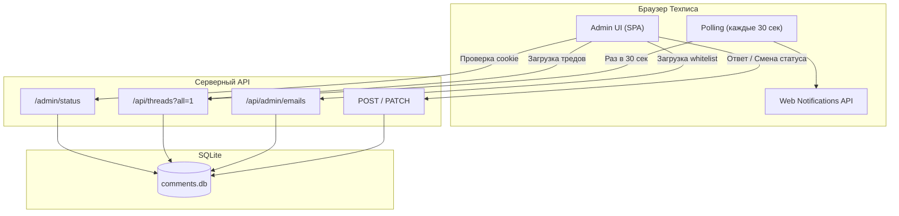

|               |                                                                                                                                                                                                                                                                                                                        |
| ------------- | ---------------------------------------------------------------------------------------------------------------------------------------------------------------------------------------------------------------------------------------------------------------------------------------------------------------------- |
| ID            | [5.1-053](../../Соглашения/index.md#identifikaciya-modulej)                                                                                                                                                                                                                                                            |
| Идентификатор | `comments.admin`                                                                                                                                                                                                                                                                                                       |
| Наименование  | Админ-панель комментариев                                                                                                                                                                                                                                                                                              |
| Слой          | [Client runtime](../Слоиlayer/ClientRuntime/index.md#naznachenie)                                                                                                                                                                                                                                                      |
| Каталог       |                                                                                                                                                                                                                                                                                                                        |
| Семейство     | [Комментарии пользователей](../../%D0%A1%D0%B5%D0%BC%D0%B5%D0%B9%D1%81%D1%82%D0%B2%D0%BEfamily/%D0%A1%D0%B5%D0%BC%D0%B5%D0%B9%D1%81%D1%82%D0%B2%D0%BE%D0%9A%D0%BE%D0%BC%D0%BC%D0%B5%D0%BD%D1%82%D0%B0%D1%80%D0%B8%D0%B8%D0%BF%D0%BE%D0%BB%D1%8C%D0%B7%D0%BE%D0%B2%D0%B0%D1%82%D0%B5%D0%BB%D0%B5%D0%B9/index.md#moduli) |
| Расположение  | `server/admin/`                                                                                                                                                                                                                                                                                                        |
| Точка входа   | Браузер: `http://<host>/admin`                                                                                                                                                                                                                                                                                         |
| Версия        | `1.0.0`                                                                                                                                                                                                                                                                                                                |
| Назначение    | Интерфейс модерации тредов, ответов на комментарии и управления Whitelist (списком читателей)                                                                                                                                                                                                                          |

{: .page-legend }

## Назначение

Изолированный интерфейс для технического писателя. В отличие от выезжающей панели на публичной странице (которая нужна для быстрой реакции), Админ-панель — это полноценное рабочее место.

Она позволяет:
- Читать все треды, группируя их по статусу (Открытые, Разрешённые, Архив, Сироты).
- Переходить по кликабельной ссылке прямо к документу, на котором оставлен комментарий.
- Отвечать читателям с обязательным указанием «Основание» (ТЗ, ГОСТ).
- Управлять списком читателей (добавлять email, банить, сбрасывать сессии).
- Получать уведомления о новых сообщениях.

## Как это работает

### Архитектура

Админка отдается сервером как статика по пути `/admin/`. Она не требует сборки через `Diplodoc` и состоит из чистых HTML, CSS и Vanilla JS.

- **`server/admin/index.html`** — скелет приложения (формы, вкладки).
- **`server/admin/admin.css`** — стили (включая карточки, таблицы, модальные окна).
- **`server/admin/admin.js`** — вся логика (API-запросы, рендеринг, polling).
- **`server/admin/templates/*.html`** — HTML-шаблоны (карточки тредов, строки таблиц), которые загружаются на старте.

### Механика уведомлений (Polling)

Так как мы отказались от WebSockets в пользу простоты, Админка использует **Long Polling**:
1. Скрипт делает запрос `GET /api/threads?all=1` каждые 30 секунд (если вкладка активна).
2. При получении новых тредов (которых не было в `localStorage`), он:
   - Меняет заголовок вкладки: `(1) Комментарии — Админ`.
   - Играет короткий звук через Web Audio API.
   - Показывает системное уведомление ОС (если админ дал разрешение через кнопку «Уведомления: вкл»).
3. Клик по системному уведомлению фокусирует вкладку и скроллит к нужному треду (Deep-link через `#thread-id`).

### Вкладка «Комментарии»

Центральная часть интерфейса.
- **Фильтры:** Все, Открытые, Разрешённые, Архив, Сироты (те, чей текст был удалён из документа).
- **Карточка треда:**
  - Статус (цветовой код).
  - Кликабельная ссылка на страницу (открывается в новой вкладке).
  - Цитата текста.
  - История сообщений (с бейджами `⚠️ Несоответствие документу` и блоком `Основание`, если они есть).
  - **Форма ответа:** поле для текста, обязательное поле «Основание» (ссылка на ТЗ/ГОСТ), чекбокс «Разрешить после ответа».

### Вкладка «Комментаторы»

Управление Whitelist (списком тех, кому разрешено писать).
- **Добавление:** форма, которая генерирует уникальный `claim-code` для нового email.
- **Сброс (Reset):** снимает claim (отзывает все сессии) и генерирует новый код. Используется, если пользователь потерял доступ к браузеру.
- **Бан (Ban):** блокирует email и отзывает все его сессии. При попытке написать комментарий пользователь получит ошибку.

## Файлы модуля

| Файл                             | Ответственность                         |
| -------------------------------- | --------------------------------------- |
| `index.html`                     | Точка входа, каркас интерфейса          |
| `admin.css`                      | Оформление (карточки, таблицы, модалки) |
| `admin.js`                       | Логика работы SPA, запросы, polling     |
| `templates/card.html`            | Шаблон карточки треда                   |
| `templates/msg.html`             | Шаблон одного сообщения                 |
| `templates/email-row.html`       | Шаблон строки в таблице пользователей   |
| `templates/modal-add-email.html` | Модальное окно добавления пользователя  |

## Связи

Модуль `comments.admin` полностью зависит от серверной части (`comments.server`).
- Он не имеет прямого доступа к БД, а работает только через REST API.
- Авторизация происходит через `HttpOnly` cookie `gulf_admin`, которая выдается сервером при успешном вводе `MODERATOR_TOKEN`.
- При каждом запросе к API (например, `PATCH /api/threads/:id`) сервер проверяет HMAC-подпись cookie. Если она невалидна (например, токен был сротирован), админка выкидывает пользователя на экран логина.