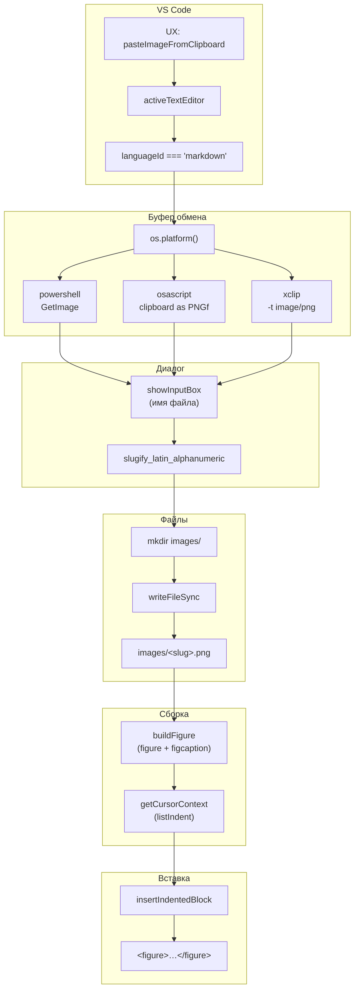
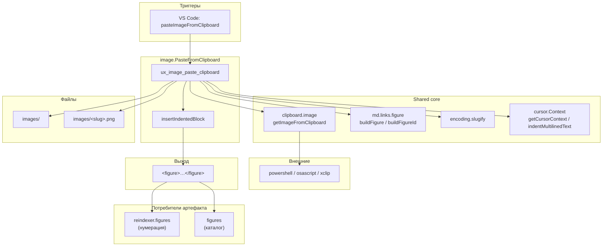

|               |                                                                                                               |
| ------------- | ------------------------------------------------------------------------------------------------------------- |
| ID            | [2.2-030](../../%D0%A1%D0%BE%D0%B3%D0%BB%D0%B0%D1%88%D0%B5%D0%BD%D0%B8%D1%8F/index.md#identifikaciya-modulej) |
| Идентификатор | `image.PasteFromClipboard`                                                                                    |
| Наименование  | Вставка изображения из буфера                                                                                 |
| Слой          | [vscode-ui](../%D0%A1%D0%BB%D0%BE%D0%B8layer/VsCodeUi/index.md#naznachenie)                                     |
| Расположение  | `src/commands/diplodoc-helper.image.PasteFromClipboard.js`                                                    |
| Точка входа   | `ux_image_paste_clipboard()`                                                                                  |
| Версия        | `1.54.0`                                                                                                      |
| Назначение    | Сохраняет растровое изображение из буфера обмена в `images/` и вставляет в `.md` готовый `<figure>`-блок      |

{: .page-legend }

## Назначение

`image.PasteFromClipboard` — команда для быстрой вставки скриншота в `.md`. Пользователь делает снимок экрана в буфер (`Win+Shift+S` / `Cmd+Ctrl+Shift+4` / `PrintScreen`), переходит в редактор markdown и вызывает **Diplodoc → Вставить рисунок из буфера обмена**. Модуль:

1. Извлекает растровое изображение из системного буфера (`PowerShell` на Windows, `osascript` на macOS, `xclip` на Linux).
2. Спрашивает имя файла (`InputBox` с предзаполненным `<timestamp>_Скриншот`).
3. Сохраняет картинку в `images/` рядом с текущим `.md` (создаёт папку, если нет).
4. Вставляет в текст готовый `<figure>`-блок с `<figcaption class="imageDescription" id="fig-…">Рисунок 1. `.

Без модуля пришлось бы:

1. Сохранить скриншот в файл (через системный редактор).
2. Найти нужную папку `images/`, перенести файл, придумать имя.
3. Открыть `.md`, написать ``.
4. Обернуть в `<figure>` + `<figcaption class="imageDescription" id="fig-…">` — иначе `reindexer.figures` не пронумерует, `figures` не соберёт в каталог, тултипы не появятся.

Модуль делает это за одно действие. Ограничение — работает только при наличии графической сессии (без `DISPLAY`/`SESSIONNAME` — `getImageFromClipboard` вернёт `null`).

## Применение

**Когда использовать:** в буфере — свежий скриншот, и нужно вставить его в `.md` как `<figure>` с превью и `<figcaption>` для `figures`/`reindexer.figures`.

**Когда НЕ использовать:** буфер содержит текст; Linux без `xclip`; нужна ссылка на уже существующую картинку — `image.PasteFromList`.

**Альтернативы:**
- Сохранить скриншот в файл, потом `` + `<figure>` вручную — долго.
- `image.PasteFromList` — не работает с буфером, только с существующими.

**Типичный сценарий:** сделать скриншот → в `.md` **Diplodoc → Вставить рисунок из буфера обмена** → ввести имя → картинка в `images/` + `<figure>`-блок.

## Как это работает



### Фаза 1. Проверка контекста

```js
const editor = vscode.window.activeTextEditor;
if (!editor) {
    vscode.window.showErrorMessage(translate(nls_ts.paste.image.error.noactiveeditor));
    return;
}

const document = editor.document;
if (document.languageId !== 'markdown') {
    vscode.window.showWarningMessage(translate(nls_ts.paste.image.warning.mdfileonly));
    return;
}
```

Две проверки:

1. **Редактор** — если `undefined`, ошибка `«Нет активного редактора»`. В норме недостижимо: команда видна только при `editorTextFocus`.
2. **Язык** — `markdown`. На других языках — предупреждение `«Команда может использоваться только в .md файлах»`.

### Фаза 2. Чтение буфера (`getImageFromClipboard`)

```js
const clipboardImage = await getImageFromClipboard();
if (!clipboardImage) {
    vscode.window.showWarningMessage(translate(nls_ts.paste.image.warning.emptybuffer));
    return;
}
```

`getImageFromClipboard` (из `utils/clipboard.image.js`) — `Promise<Buffer | null>`:

1. **`os.platform()`** — определяет ОС.
2. **Temp-файл** — `path.join(os.tmpdir(), \`vscode_clip_${Date.now()}.png\`)`.
3. **OS-команда** (через `cp.execFile`):
   - **Windows**: `powershell -NoProfile -NonInteractive -Command "Add-Type … GetImage(); $image.Save(tempPath, PNG); exit 0"`;
   - **macOS**: `osascript -e 'write (the clipboard as «class PNGf») to (open for access POSIX file "tempPath" with write permission)'`;
   - **Linux**: `xclip -selection clipboard -t image/png -o > tempPath`.
4. **Ожидание** — `execFile` запускает команду, ждёт `callback`.
5. **Чтение** — если `error` → удалить temp, `resolve(null)`; иначе `fs.readFileSync(tempPath)`, `fs.unlinkSync(tempPath)`, `resolve(buffer)`.

Внешние зависимости — `xclip` (Linux), `osascript` (macOS), `powershell` (Windows). На любой ошибке (нет `xclip`, буфер пуст, нет `DISPLAY`, таймаут) — `resolve(null)`.

### Фаза 3. Диалог имени файла

```js
const mdDir = path.dirname(document.uri.fsPath);
const imagesDir = path.join(mdDir, 'images');

if (!fs.existsSync(imagesDir)) {
    fs.mkdirSync(imagesDir, { recursive: true });
}

const timestamp = new Date().toISOString().replace(/[:.]/g, '-').replace('T', '_').slice(0, 19);
const defaultFilename = translate(nls_ts.screenshot.name.prompt, timestamp);

const userInput = await vscode.window.showInputBox({
    prompt: translate(nls_ts.screenshot.name.prompt),
    placeHolder: translate(nls_ts.screenshot.description.placeholder),
    value: defaultFilename,
    validateInput: value => { … },
});

if (!userInput) return;
```

1. **`mdDir`** — папка текущего `.md`.
2. **`imagesDir`** — `<mdDir>/images/`. Создаётся, если нет (`fs.mkdirSync(recursive: true)`).
3. **`timestamp`** — `new Date().toISOString()` (`2024-01-15T12:30:45.123Z`) → замена `:`/`.` на `-` → замена `T` на `_` → `slice(0, 19)` → `2024-01-15_12-30-45`.
4. **`defaultFilename`** — `translate(screenshot.name.prompt, timestamp)` — подставляет `{0}` → `2024-01-15_12-30-45_Скриншот` (ru) или `2024-01-15_12-30-45_Screenshot` (en).
5. **`InputBox`**:
   - `prompt: translate(screenshot.name.prompt)` — **без** подстановки → `"{0}_Скриншот"` (литерально);
   - `placeHolder: translate(screenshot.description.placeholder)` — `«Описание_скриншота»`;
   - `value: defaultFilename` — предзаполненное;
   - `validateInput` — три правила (см. ниже).

`validateInput`:

```js
validateInput: value => {
    if (!value || value.trim().length === 0) {
        return 'Имя не может быть пустым';
    }
    const cleanName = slugify_latin_alphanumeric(value);
    if (cleanName.length === 0) {
        return translate(nls_ts.screenshot.name.error.wrongcharacters);
    }
    const testPath = path.join(imagesDir, `${cleanName}${imageExtension}`);
    if (fs.existsSync(testPath)) {
        return translate(nls_ts.filename.error.alreadyexists);
    }
    return null;
},
```

- пустое → `«Имя не может быть пустым»` (захардкожено, не NLS);
- `slugify_latin_alphanumeric(value) === ''` → `«Имя содержит недопустимые символы»`;
- файл `images/<cleanName>.png` уже существует → `«Файл с таким именем уже существует»`.

`imageExtension = '.png'` — константа в начале файла.

### Фаза 4. Запись файла

```js
const cleanName = slugify_latin_alphanumeric(userInput);
const fileName = `${cleanName}.png`;
const imagePath = path.join(imagesDir, fileName);

try {
    if (fs.existsSync(imagePath)) {
        throw new Error(translate(nls_ts.screenshot.error.alreadyexists.async));
    }

    fs.writeFileSync(imagePath, clipboardImage);

    let relativePath = path.relative(mdDir, imagePath).replace(/\\/g, '/');
    if (!relativePath.startsWith('.')) {
        relativePath = './' + relativePath;
    }
    // …
```

1. **`cleanName`** — slugify от `userInput` (`Привет Мир!` → `privet_mir`).
2. **`fileName`** — `${cleanName}.png` (жёстко `.png`, а не `imageExtension`).
3. **`imagePath`** — `images/<slug>.png`.
4. **Проверка на существование** — если файл уже есть (race condition после `validateInput`), `throw` `«Файл был создан параллельно и уже существует»`.
5. **`fs.writeFileSync`** — запись буфера.
6. **`relativePath`** — `path.relative(mdDir, imagePath)` (`images/foo.png` или `../foo/images/foo.png`), нормализация `\` → `/`, добавление `./`-префикса.

### Фаза 5. Сборка `<figure>`

```js
const altText = userInput.trim();
const customId = buildFigureId(cleanName);
const figureBlock = buildFigure(relativePath, altText, customId);
```

- **`altText`** — `userInput.trim()`, **не** `cleanName`. То есть alt в markdown-ссылке — с кириллицей и пробелами (`Привет Мир!`), а `id` — на латинице (`fig-privet_mir`). См. «Известные ограничения».
- **`customId`** — `fig-<slug>` (не `<slug>`, а `fig-<slug>`).
- **`figureBlock`** — `<figure>\n\n\n\n<figcaption class="imageDescription" id="fig-…">alt</figcaption>\n\n</figure>\n\n`.

### Фаза 6. Вставка в редактор

```js
const cursorContext = getCursorContext(editor);
await insertIndentedBlock(editor, figureBlock, cursorContext.listIndent);
```

`getCursorContext` (из `diplodoc-helper.cursor.Context.js`) — определяет контекст курсора:

- `isHtml` — внутри HTML-тега;
- `isList` / `listIndent` — внутри списка (глубина отступа);
- `isTable` — внутри таблицы;
- `isCustomBlock` — внутри ``.

**Используется только `listIndent`** — для отступа внутри списка. Остальные поля игнорируются. См. «Известные ограничения».

`insertIndentedBlock`:

```js
async function insertIndentedBlock(editor, textToInsert, targetIndentSize) {
    const position = editor.selection.active;
    const line = editor.document.lineAt(position.line);
    const formattedText = indentMultilinedText(textToInsert, targetIndentSize);
    const rangeToReplace = new vscode.Range(new vscode.Position(position.line, 0), position);
    await editor.edit(editBuilder => {
        editBuilder.replace(rangeToReplace, formattedText);
    });
}
```

- **`formattedText`** — `indentMultilinedText(figureBlock, listIndent)` — добавляет `'  '.repeat(listIndent)` к каждой непустой строке.
- **`rangeToReplace`** — **от начала строки до курсора**. Это ключевая странность — заменяет **всё**, что было на строке левее курсора. Если пользователь вызвал команду на строке `Some text|` (курсор в конце), `Some text` будет **удалено** и заменено на `<figure>`. См. «Известные ограничения» — критический баг.
- **`editor.edit`** — результат не проверяется.

Сообщение об успехе:

```js
vscode.window.showInformationMessage(translate(nls_ts.screenshot.saved.info, fileName));
```

`«Картинка сохранена: <cleanName>.png»`.

### Файлы модуля

| Файл                                                       | Ответственность                                      |
| ---------------------------------------------------------- | ---------------------------------------------------- |
| `src/commands/diplodoc-helper.image.PasteFromClipboard.js` | `ux_image_paste_clipboard`, `insertIndentedBlock`    |
| `src/plugins/utils/clipboard.image.js`                     | `getImageFromClipboard` (PowerShell/osascript/xclip) |
| `src/plugins/utils/md.links.figure.js`                     | `buildFigure`, `buildFigureId`                       |
| `src/plugins/utils/encoding.slugify.js`                    | `slugify_latin_alphanumeric`                         |
| `src/commands/diplodoc-helper.cursor.Context.js`           | `getCursorContext`, `indentMultilinedText`           |

### Формат результата

При вставке на пустую строку внутри `.md`:

```md
<figure>


<figcaption class="imageDescription" id="fig-skrinshot_nastrojki">Рисунок 2. Скриншот настройки</figcaption>

</figure>

```

- `` — markdown-ссылка (внутри `<figure>`);
- `<figcaption class="imageDescription" id="fig-…">` — обёртка с id, которую ищет `reindexer.figures` и `figures` для нумерации и каталога;
- `class="imageDescription"` — маркер, по которому `figures.extractor` распознаёт «это подпись рисунка».

Файл `images/skrinshot_nastrojki.png` в той же папке, что и `.md`.

## Режимы работы

### VS Code

| Команда                                   | Заголовок                         | Где появляется                                          |
| ----------------------------------------- | --------------------------------- | ------------------------------------------------------- |
| `diplodoc-helper.pasteImageFromClipboard` | Вставить рисунок из буфера обмена | Редактор → Diplodoc → Вставить рисунок из буфера обмена |

`when` (`package.json`):

```json
{
    "command": "diplodoc-helper.pasteImageFromClipboard",
    "when": "editorTextFocus && resourceExtname == .md",
    "group": "7.diplodoc.section@3"
}
```

Только в `.md` и только при фокусе в редакторе.

### CLI

CLI-команды нет. Модуль — только VS Code.

### Сборочный пайплайн

В `docs-build.js` не участвует.

## Юнит-тесты





## Связи

`image.PasteFromClipboard` — один из двух модулей «семейства изображений». Второй — [`image.PasteFromList`](../МодульВставкаизображенияизСписка/index.md): он не работает с буфером, а показывает `QuickPick` по всем картинкам проекта.

| Модуль                                                                                               | Источник             | Сценарий                                           |
| ---------------------------------------------------------------------------------------------------- | -------------------- | -------------------------------------------------- |
| **`image.PasteFromClipboard`**                                                                       | Буфер обмена (растр) | Скриншот → `images/` → `<figure>`                  |
| [`image.PasteFromList`](../МодульВставкаизображенияизСписка/index.md)                                | FS + `QuickPick`     | Уже есть картинка → вставить ссылку                |
| [`link.Copy`](../%D0%A0%D0%B5%D0%B5%D1%81%D1%82%D1%80/%D0%9C%D0%BE%D0%B4%D1%83%D0%BB%D1%8C%D0%9A%D0%BE%D0%BF%D0%B8%D1%80%D0%BE%D0%B2%D0%B0%D0%BD%D0%B8%D0%B5%D1%81%D1%81%D1%8B%D0%BB%D0%BA%D0%B8/index.md) + [`link.Paste`](../%D0%A0%D0%B5%D0%B5%D1%81%D1%82%D1%80/%D0%9C%D0%BE%D0%B4%D1%83%D0%BB%D1%8C%D0%92%D1%81%D1%82%D0%B0%D0%B2%D0%BA%D0%B0%D1%81%D1%81%D1%8B%D0%BB%D0%BA%D0%B8/index.md) | JSON                 | Скопировать ссылку → вставить (в т.ч. на картинку) |
| [`figures`](../%D0%A0%D0%B5%D0%B5%D1%81%D1%82%D1%80/%D0%9C%D0%BE%D0%B4%D1%83%D0%BB%D1%8C%D0%98%D0%BB%D0%BB%D1%8E%D1%81%D1%82%D1%80%D0%B0%D1%86%D0%B8%D0%B8/index.md)                                                           | `docs/` → каталог    | Собрать все иллюстрации проекта                    |

Контракт с `figures`:

- `buildFigure` пишет `<figcaption class="imageDescription" id="fig-…">` — по этому маркеру `figures.extractor` находит запись для каталога;
- `buildFigureId(altText)` = `fig-<slug>` — совпадает с `id`, который ожидает `reindexer.figures` (при нумерации ищет `<figcaption … id="…">`);
- относительный путь `./images/foo.png` — резолвится `figures` при сборке превью (`path.resolve(langDir, sourceDir, rawPath)`).

С `utils/md.links.figure` — `buildFigure` и `buildFigureId` используются **только** здесь и в [`link.Paste`](../%D0%A0%D0%B5%D0%B5%D1%81%D1%82%D1%80/%D0%9C%D0%BE%D0%B4%D1%83%D0%BB%D1%8C%D0%92%D1%81%D1%82%D0%B0%D0%B2%D0%BA%D0%B0%D1%81%D1%81%D1%8B%D0%BB%D0%BA%D0%B8/index.md) (для `buildImageLink`). Общий контракт.

С `utils/clipboard.image` — `getImageFromClipboard` — единственный вызывающий в расширении. Публично экспортируется, но используется только здесь.

С [`diplodoc-helper.cursor.Context`](../МодульКонтексткурсора/index.md) — `getCursorContext` (только `listIndent`) и `indentMultilinedText`.






