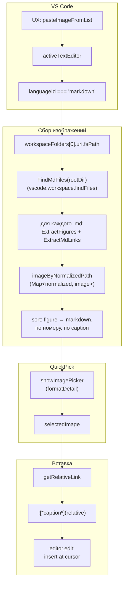
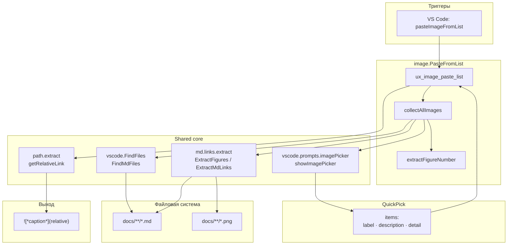

|               |                                                                                                               |
| ------------- | ------------------------------------------------------------------------------------------------------------- |
| ID            | [2.2-031](../../%D0%A1%D0%BE%D0%B3%D0%BB%D0%B0%D1%88%D0%B5%D0%BD%D0%B8%D1%8F/index.md#identifikaciya-modulej) |
| Идентификатор | `image.PasteFromList`                                                                                         |
| Наименование  | Вставка изображения из списка                                                                                 |
| Слой          | [vscode-ui](../%D0%A1%D0%BB%D0%BE%D0%B8layer/VsCodeUi/index.md#naznachenie)                                     |
| Расположение  | `src/commands/diplodoc-helper.image.PasteFromList.js`                                                         |
| Точка входа   | `ux_image_paste_list()`                                                                                       |
| Версия        | `1.54.0`                                                                                                      |
| Назначение    | Показывает список всех изображений проекта и вставляет ссылку на выбранное в текущий `.md`                    |

{: .page-legend }

## Назначение

`image.PasteFromList` — второй модуль «семейства изображений». Если [`image.PasteFromClipboard`](../МодульВставкаизображения/index.md) работает с **новыми** скриншотами из буфера, то `image.PasteFromList` — с **уже существующими** картинками проекта. Пользователь вызывает **Diplodoc → Вставить ссылку на рисунок из списка**, видит `QuickPick` со всеми картинками из `docs/`, выбирает одну — и в текущий `.md` вставляется готовая markdown-ссылка ``.

Сценарии использования:

- **Повторная ссылка на рисунок.** Пользователь уже использовал картинку в другой статье — хочет сослаться на неё же;
- **Ссылка на `<figure>`.** Если в целевом `.md` есть `<figcaption class="imageDescription" id="fig-…">`, ссылка ведёт на `path#fig-…` (на конкретную подпись), а не на файл картинки;
- **Быстрый поиск по проекту.** Пользователь не помнит путь к нужной картинке — `QuickPick` с поиском по имени.

Модуль не копирует файлы и не создаёт `images/`. Он только находит уже существующие изображения и вставляет относительную ссылку. Для новой картинки — [`image.PasteFromClipboard`](../МодульВставкаизображения/index.md) или стандартный drag-and-drop в VS Code.

## Применение

**Когда использовать:** картинка уже есть в проекте (в другой статье), и нужна ссылка на неё — `QuickPick` со всеми изображениями и поиском.

**Когда НЕ использовать:** картинка новая (в буфере) — `image.PasteFromClipboard`; нужен каталог всех иллюстраций — `figures`.

**Альтернативы:**
- `link.Copy` на конкретную картинку → `link.Paste` — работает, но нужен путь.
- `grep`/`rg` по `docs/` — не даёт QuickPick.

**Типичный сценарий:** в `.md` **Diplodoc → Вставить ссылку на рисунок из списка** → QuickPick → выбор → вставка ``.

## Как это работает



### Фаза 1. Проверка контекста

```js
const editor = vscode.window.activeTextEditor;
if (!editor || editor.document.languageId !== 'markdown') {
    vscode.window.showWarningMessage('Команду можно использовать только в Markdown-файлах');
    return;
}
```

Объединённая проверка: **нет редактора ИЛИ не markdown**. Сообщение — «Команду можно использовать только в Markdown-файлах». То есть если редактора нет, пользователь видит сообщение про markdown, а не про «нет активного редактора». См. «Известные ограничения».

### Фаза 2. `workspaceFolders[0]`

```js
const currentFilePath = editor.document.uri.fsPath;
const workspaceFolders = vscode.workspace.workspaceFolders;
if (!workspaceFolders) return;

const rootDir = workspaceFolders[0].uri.fsPath;
```

- **`currentFilePath`** — абсолютный путь текущего `.md`.
- **`rootDir`** — корень **первой** папки workspace. В мульти-workspace (несколько папок в VS Code) — берётся первая, не та, где `currentFilePath`. См. «Известные ограничения».

### Фаза 3. Сбор изображений (`collectAllImages`)

```js
const images = await collectAllImages(rootDir);
```

`collectAllImages(rootDir)`:

**3.1. Найти все `.md`:**

```js
const mdFiles = await FindMdFiles(rootDir);
```

`FindMdFiles` (из `vscode.FindFiles.js`):

```js
return await vscode.workspace.findFiles(
    new vscode.RelativePattern(rootDir, '**/*.md'),
    '**/node_modules/**'
);
```

Через `vscode.workspace.findFiles` — стандартный API VS Code, автоматически учитывает `.gitignore`-подобные исключения и не лезет в `node_modules`. Возвращает `Uri[]`.

**3.2. Для каждого `.md` — `ExtractFigures` и `ExtractMdLinks`:**

```js
for (const fileUri of mdFiles) {
    await ExtractFigures(fileUri.fsPath, (key, image) => {
        if (!imageByNormalizedPath.has(key)) {
            images.push(image);
            imageByNormalizedPath.set(key, image);
        }
    });
    await ExtractMdLinks(fileUri.fsPath, (key, image) => {
        if (!imageByNormalizedPath.has(key)) {
            images.push(image);
            imageByNormalizedPath.set(key, image);
        }
    });
}
```

Два экстрактора (из `utils/md.links.extract.js`):

- **`ExtractFigures`** — находит `<figcaption class="imageDescription" … id="…">` и связанное markdown-изображение **слева** от него (максимальное расстояние 400 символов). Возвращает `{ id, caption, filePath, targetPath, label, type: 'figure' }`. `targetPath` — абсолютный путь к файлу картинки.
- **`ExtractMdLinks`** — находит **все** `` без `<figcaption>`. Возвращает `{ id: basename, caption, filePath, targetPath, label, type: 'markdown' }`.

Оба используют `normalizePathForKey(image.path)` как ключ дедупликации — `path.toLowerCase().replace(/\\/g, '/')`. То есть одно и то же физическое изображение, встреченное в двух `.md` или в `<figure>` + `` одного `.md`, попадёт в `Map` **один раз**.

**Порядок важен:** `ExtractFigures` вызывается первым. Если картинка уже зарегистрирована как `figure` — `ExtractMdLinks` её пропустит (через `if (!imageByNormalizedPath.has(key))`). Итог: одна и та же картинка, использованная и как `<figure>`, и как простое ``, попадёт в список **как figure**, не как markdown.

**3.3. Сортировка:**

```js
images.sort((a, b) => {
    if (a.type !== b.type) {
        return a.type === 'figure' ? -1 : 1;
    }
    const numA = extractFigureNumber(a.caption);
    const numB = extractFigureNumber(b.caption);
    if (numA !== numB) {
        return numA - numB;
    }
    const captionA = a.caption ?? '';
    const captionB = b.caption ?? '';
    return captionA.localeCompare(captionB);
});
```

Три уровня сортировки:

1. **`type`** — `figure` перед `markdown` (все `<figure>` в начале, все простые `` в конце).
2. **`extractFigureNumber`** — число из `Рисунок N` / `Figure N` в caption. Если нет — `0`. Фигуры с `0` идут перед фигурами с `1, 2, …` (см. «Известные ограничения»).
3. **`caption.localeCompare`** — алфавитный по `caption` (по умолчанию локаль системы, обычно `en-US` в VS Code, `ru-RU` если явно).

### Фаза 4. QuickPick (`showImagePicker`)

```js
const formatDetail = (img) => {
    return img.type === 'figure'
        ? `Figure • ${img.id}`
        : `Изображение • ${path.basename(img.targetPath)}`;
};

const selectedImage = await showImagePicker(images, rootDir, {
    placeHolder: 'Выберите изображение для ссылки...',
    formatDetail: formatDetail,
});
```

`showImagePicker` (из `vscode.prompts.imagePicker.js`):

```js
const pickerItems = images.map(img => ({
    label: img.caption || 'Без названия',
    description: path.relative(workspaceRoot, img.filePath),
    detail: formatDetail(img),
    image: img,
}));

const selected = await vscode.window.showQuickPick(pickerItems, {
    placeHolder: options.placeHolder ?? 'Выберите изображение...',
    matchOnDescription: options.matchOnDescription ?? true,
    matchOnDetail: options.matchOnDetail ?? true,
});

return selected?.image;
```

Каждый item:

- **`label`** — `img.caption` (для `<figure>` — текст из `<figcaption>`, для `markdown` — `basename` файла без расширения). Fallback — `'Без названия'`.
- **`description`** — путь к `.md`, где встретилось изображение (`path.relative(rootDir, filePath)`). Для одной картинки, использованной в нескольких `.md`, — только первый `.md` (дедупликация).
- **`detail`** — от `formatDetail`: `Figure • fig-…` или `Изображение • foo.png`.
- **`image`** — сам объект (для возврата после выбора).

`matchOnDescription: true` — поиск по пути `.md` (пользователь может набрать `foo` и найти все картинки, использованные в `foo/index.md`). `matchOnDetail: true` — поиск по `Figure`/`Изображение` и по id/basename.

Если пользователь нажал `Escape` — `selected = undefined`, `showImagePicker` возвращает `undefined`, `if (!selectedImage) return;`.

### Фаза 5. Относительный путь (`getRelativeLink`)

```js
const relativeLink = getRelativeLink(currentFilePath, selectedImage);
```

`getRelativeLink` (из `utils/path.extract.js`):

```js
function getRelativeLink(currentFilePath, image) {
    const target = image.type === 'figure'
        ? `${image.filePath}#${image.id}`
        : image.targetPath;
    let relative = path.relative(path.dirname(currentFilePath), target).replace(/\\/g, '/');
    if (!relative.startsWith('.')) {
        relative = './' + relative;
    }
    return relative;
}
```

- **Для `figure`** — target = `<путь к .md>#<id>`. Например, `docs/ru/Модули/МодульХлебныеКрошки/index.md#fig-…`. Относительный путь — `../Модули/МодульХлебныеКрошки/index.md#fig-…`. Ссылка ведёт на конкретную подпись в другой статье.
- **Для `markdown`** — target = `<путь к картинке>`. Например, `docs/ru/foo/images/bar.png`. Относительный — `./images/bar.png` или `../foo/images/bar.png`.

Нормализация — `\` → `/` для Windows. `./`-префикс добавляется, если путь не начинается с `.` (нормализация для markdown).

**Важно:** `relativeLink` **не** кодируется через `encodeURIComponent`. Кириллица в пути (`../Модули/МодульХлебныеКрошки/index.md`) — как есть. `@diplodoc/cli` нормализует при сборке. Но в тексте `.md` ссылка выглядит нечитаемо для отладки.

### Фаза 6. Формирование markdown и вставка

```js
const markdownLink = ``;

await editor.edit(editBuilder => {
    editBuilder.insert(editor.selection.active, markdownLink);
});

vscode.window.showInformationMessage(`Вставлена ссылка: ${selectedImage.caption}`);
```

- **`markdownLink`** — ``. Caption в **курсиве** (`*…*`). См. «Известные ограничения» — если в caption есть `*` или `]`, markdown сломается.
- **`editor.edit`** — `insert` в `selection.active` (курсор). Если у пользователя есть выделение — оно **не** заменяется, ссылка вставляется **до** курсора (в `active`). См. «Известные ограничения».
- **`insert`** без `indentMultilinedText` — если курсор внутри списка, отступ не добавляется. См. «Известные ограничения».
- **`editor.edit`** возвращает `Promise<boolean>`, не проверяется.
- **Сообщение** — `«Вставлена ссылка: <caption>»` (без NLS-ключа, захардкожено на русском). См. «Известные ограничения».

### Файлы модуля

| Файл                                                  | Ответственность                                                  |
| ----------------------------------------------------- | ---------------------------------------------------------------- |
| `src/commands/diplodoc-helper.image.PasteFromList.js` | `ux_image_paste_list`, `collectAllImages`, `extractFigureNumber` |
| `src/commands/vscode.prompts.imagePicker.js`          | `showImagePicker` — общий QuickPick для списка изображений       |
| `src/commands/vscode.FindFiles.js`                    | `FindMdFiles` — обёртка `vscode.workspace.findFiles`             |
| `src/plugins/utils/md.links.extract.js`               | `ExtractFigures`, `ExtractMdLinks`                               |
| `src/plugins/utils/path.extract.js`                   | `getRelativeLink`                                                |

### Формат `image` (элемент `images[]`)

```js
// type: 'figure'
{
    id: 'fig-opisanie',
    caption: 'Рисунок 1. Описание',
    filePath: '/abs/docs/ru/foo/index.md',
    targetPath: '/abs/docs/ru/foo/images/opisanie.png',
    label: 'Рисунок 1. Описание',
    type: 'figure',
}

// type: 'markdown'
{
    id: 'bar.png',
    caption: 'bar',
    filePath: '/abs/docs/ru/baz.md',
    targetPath: '/abs/docs/ru/baz/images/bar.png',
    label: 'bar',
    type: 'markdown',
}
```

## Режимы работы

### VS Code

| Команда                              | Заголовок                            | Где появляется                                             |
| ------------------------------------ | ------------------------------------ | ---------------------------------------------------------- |
| `diplodoc-helper.pasteImageFromList` | Вставить ссылку на рисунок из списка | Редактор → Diplodoc → Вставить ссылку на рисунок из списка |

`when` (`package.json`):

```json
{
    "command": "diplodoc-helper.pasteImageFromList",
    "when": "editorTextFocus && resourceExtname == .md",
    "group": "7.diplodoc.section@4"
}
```

Только в `.md` и только при фокусе в редакторе.

### CLI

CLI-команды нет. Модуль — только VS Code.

### Сборочный пайплайн

В `docs-build.js` не участвует.

## Юнит-тесты





## Связи

`image.PasteFromList` — sibling [`image.PasteFromClipboard`](../МодульВставкаизображения/index.md). Оба работают с изображениями, но по-разному:

| Модуль                                                                                               | Источник данных | Что делает                                                       |
| ---------------------------------------------------------------------------------------------------- | --------------- | ---------------------------------------------------------------- |
| [`image.PasteFromClipboard`](../МодульВставкаизображения/index.md)                                   | Буфер (растр)   | Создаёт `images/<slug>.png`, вставляет `<figure>`                |
| **`image.PasteFromList`**                                                                            | `.md` проекта   | Вставляет `` — без создания файла          |
| [`link.Copy`](../%D0%A0%D0%B5%D0%B5%D1%81%D1%82%D1%80/%D0%9C%D0%BE%D0%B4%D1%83%D0%BB%D1%8C%D0%9A%D0%BE%D0%BF%D0%B8%D1%80%D0%BE%D0%B2%D0%B0%D0%BD%D0%B8%D0%B5%D1%81%D1%81%D1%8B%D0%BB%D0%BA%D0%B8/index.md) + [`link.Paste`](../%D0%A0%D0%B5%D0%B5%D1%81%D1%82%D1%80/%D0%9C%D0%BE%D0%B4%D1%83%D0%BB%D1%8C%D0%92%D1%81%D1%82%D0%B0%D0%B2%D0%BA%D0%B0%D1%81%D1%81%D1%8B%D0%BB%D0%BA%D0%B8/index.md) | JSON из буфера  | Вставляет ссылку на **один** предварительно скопированный объект |
| [`figures`](../%D0%A0%D0%B5%D0%B5%D1%81%D1%82%D1%80/%D0%9C%D0%BE%D0%B4%D1%83%D0%BB%D1%8C%D0%98%D0%BB%D0%BB%D1%8E%D1%81%D1%82%D1%80%D0%B0%D1%86%D0%B8%D0%B8/index.md)                                                           | `.md` проекта   | Собирает каталог `figures/index.md` (не для вставки в текст)     |

**Разница между `image.PasteFromList` и `link.Paste`:**

- `image.PasteFromList` — **живой список всех картинок**, `QuickPick` с поиском, вставка ``.
- `link.Paste` — **одна конкретная ссылка** из буфера, может быть на папку/файл/картинку, вставка `[text](path)`, `` или ``.

То есть `image.PasteFromList` удобнее, когда пользователь **не знает**, что копировать, и хочет выбрать из списка. `link.Paste` — когда он уже скопировал конкретную цель.

**Связь с `figures`:**

`figures.extractor` и `ExtractFigures` (здесь) — разные реализации одной задачи (найти `<figure>` + связанный ``). `figures` собирает **все** фигуры для каталога, `image.PasteFromList` — только для `QuickPick`. Дублирование логики (см. «Известные ограничения»).

**Связь с `link.utils`:**

`link.Paste` содержит **свою** реализацию `extractAnchorsFromMdFile` (не из `link.utils`), и она **не** используется здесь. `image.PasteFromList` не извлекает якоря — ссылка на `<figure>` идёт с `#id`, но без выбора из списка якорей.






