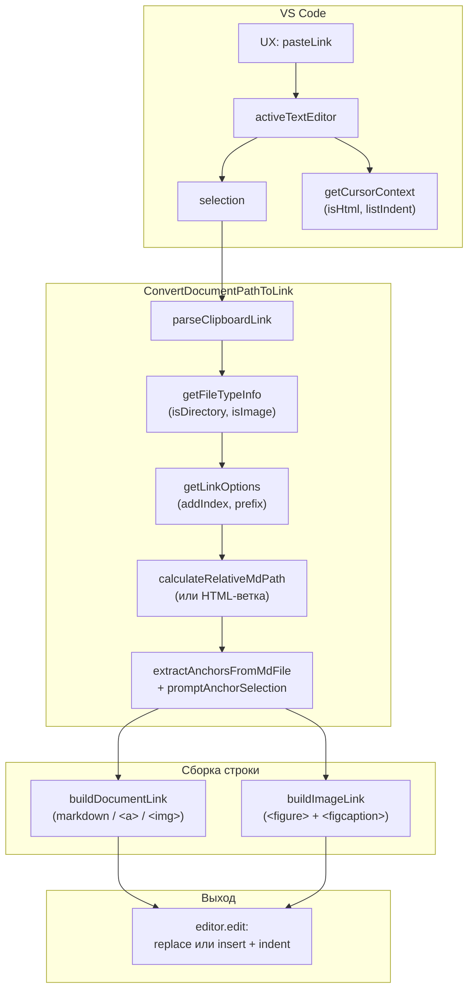
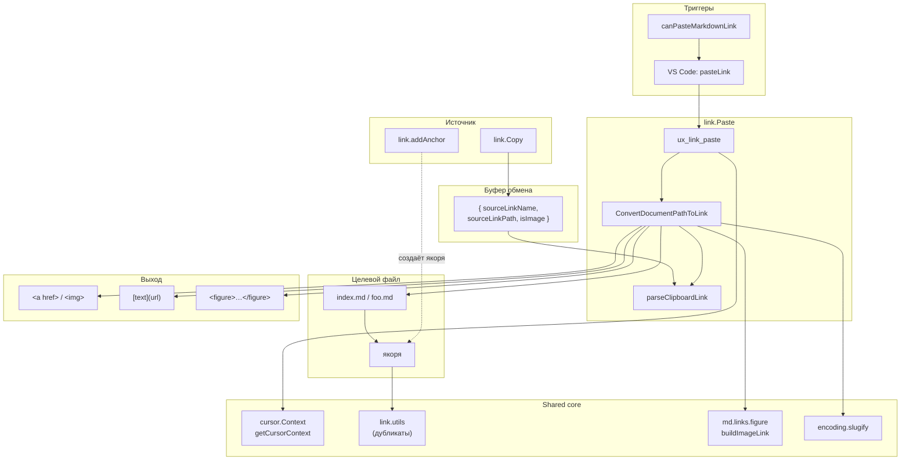

|               |                                                                                                                                        |
| ------------- | -------------------------------------------------------------------------------------------------------------------------------------- |
| ID            | [2.2-029](../../%D0%A1%D0%BE%D0%B3%D0%BB%D0%B0%D1%88%D0%B5%D0%BD%D0%B8%D1%8F/index.md#identifikaciya-modulej)                          |
| Идентификатор | `link.Paste`                                                                                                                           |
| Наименование  | Вставка ссылки                                                                                                                         |
| Слой          | [vscode-ui](../%D0%A1%D0%BB%D0%BE%D0%B8layer/%D0%A1%D0%BB%D0%BE%D0%B9VSCodeUI/index.md#naznachenie/index.md#naznachenie)                                                              |
| Каталог       | [Ссылки](../../%D0%9A%D0%B0%D1%82%D0%B0%D0%BB%D0%BE%D0%B3Capabilitymap/%D0%9A%D0%B0%D1%82%D0%B0%D0%BB%D0%BE%D0%B3%D0%A1%D1%81%D1%8B%D0%BB%D0%BA%D0%B8/index.md#ssylki)                                                                                                                                                                                |
| Семейство     | [Ссылки](../../%D0%A1%D0%B5%D0%BC%D0%B5%D0%B9%D1%81%D1%82%D0%B2%D0%BEfamily/%D0%A1%D0%B5%D0%BC%D0%B5%D0%B9%D1%81%D1%82%D0%B2%D0%BE%D0%A1%D1%81%D1%8B%D0%BB%D0%BA%D0%B8/index.md#fam-link)                                                                                                                                                                                                                                                                                                                                                                |
| Расположение  | `src/commands/diplodoc-helper.link.Paste.js`                                                                                           |
| Точка входа   | `ux_link_paste()` (VS Code), `parseClipboardLink(clipboardText)` (утилита)                                                             |
| Версия        | `1.54.0`                                                                                                                               |
| Назначение    | Читает JSON из буфера и вставляет в `.md`-документ готовую ссылку (markdown или HTML) с корректным относительным путём и выбором якоря |

{: .page-legend }

## Назначение

`link.Paste` — вторая половина «умного» копирования ссылок. Пользователь вызывает **Diplodoc → Вставить ссылку на документ из буфера обмена** в редакторе `.md` — и модуль читает JSON (оставленный [`link.Copy`](../%D0%A0%D0%B5%D0%B5%D1%81%D1%82%D1%80/%D0%9C%D0%BE%D0%B4%D1%83%D0%BB%D1%8C%D0%9A%D0%BE%D0%BF%D0%B8%D1%80%D0%BE%D0%B2%D0%B0%D0%BD%D0%B8%D0%B5%D1%81%D1%81%D1%8B%D0%BB%D0%BA%D0%B8/index.md)), вычисляет корректный **относительный** путь от текущего файла к целевому, кодирует кириллицу, при необходимости предлагает выбрать якорь в целевом документе и вставляет готовую ссылку.

Ключевые сценарии:

- **выделение есть** — заменяет выделенный текст на ссылку (`[выделенное](url)` или `` для картинки);
- **выделения нет** — вставляет ссылку с именем из JSON;
- **курсор внутри списка** — добавляет отступы (по `cursorContext.listIndent`);
- **курсор внутри HTML-тега** — вставляет `<a href="…">…</a>` или `` вместо markdown;
- **целевой файл — папка с `index.md`** — предлагает список якорей (заголовки, `id=`, `<a name=>`).

Без модуля для той же операции пришлось бы:

1. Открыть целевой документ, посмотреть его путь.
2. Вычислить относительный путь от текущего `.md`.
3. Закодировать кириллицу и пробелы.
4. Если цель — папка, открыть `index.md`, найти `id`/`name`/заголовок и дописать `#anchor`.
5. Решить, нужна ли markdown-ссылка или HTML (по контексту).
6. Написать `[]()`, `` или `<a href>`.

Модуль делает всё это по одной команде, реагируя на текущий контекст курсора.

## Применение

**Когда использовать:** в буфере — JSON от [`link.Copy`](../%D0%A0%D0%B5%D0%B5%D1%81%D1%82%D1%80/%D0%9C%D0%BE%D0%B4%D1%83%D0%BB%D1%8C%D0%9A%D0%BE%D0%BF%D0%B8%D1%80%D0%BE%D0%B2%D0%B0%D0%BD%D0%B8%D0%B5%D1%81%D1%81%D1%8B%D0%BB%D0%BA%D0%B8/index.md), и вы хотите вставить готовую markdown/HTML-ссылку с корректным относительным путём.

**Когда НЕ использовать:** буфер пуст или содержит не JSON — команда не видна (проверка `canPasteMarkdownLink`); вставка картинки из буфера — `image.PasteFromClipboard`.

**Альтернативы:**
- Ручной `[]()` с пересчётом пути — работает, но с риском ошибки.
- `link.addAnchor` — создаёт якорь, а не вставляет ссылку.

**Типичный сценарий:** после `link.Copy` → открыть целевой `.md` → **Diplodoc → Вставить ссылку на документ** → (опционально) QuickPick с якорями → вставка.

## Как это работает



### Фаза 1. Контекст

```js
const editor = vscode.window.activeTextEditor;
if (!editor) return;

const doc = editor.document;
const selection = editor.selection;
const selectionRange = new vscode.Range(selection.start, selection.end);
const selectedText = selection.isEmpty ? '' : doc.getText(selectionRange);
const hasSelection = selectedText.length > 0;
const insertPosition = selection.active;
const sourceFilePath = doc.uri.fsPath;
const cursorContext = getCursorContext(editor);
```

- **Редактор** — если `undefined`, тихий `return` (без сообщения). Команда видна только при `editorTextFocus` (см. `when` в `package.json`), поэтому на практике этого не происходит.
- **Выделение** — может быть пустым.
- **`getCursorContext(editor)`** (из `diplodoc-helper.cursor.Context.js`) — stack-based парсер HTML (определяет `isHtml`), поиск соседних строк (определяет `listIndent`), проверка ``-контекста (не используется здесь).
- **`sourceFilePath`** — абсолютный путь текущего `.md`.

В отличие от [`link.Copy`](../%D0%A0%D0%B5%D0%B5%D1%81%D1%82%D1%80/%D0%9C%D0%BE%D0%B4%D1%83%D0%BB%D1%8C%D0%9A%D0%BE%D0%BF%D0%B8%D1%80%D0%BE%D0%B2%D0%B0%D0%BD%D0%B8%D0%B5%D1%81%D1%81%D1%8B%D0%BB%D0%BA%D0%B8/index.md) и [`link.addAnchor`](../%D0%A0%D0%B5%D0%B5%D1%81%D1%82%D1%80/%D0%9C%D0%BE%D0%B4%D1%83%D0%BB%D1%8C%D0%94%D0%BE%D0%B1%D0%B0%D0%B2%D0%BB%D0%B5%D0%BD%D0%B8%D0%B5%D1%8F%D0%BA%D0%BE%D1%80%D1%8F/index.md), `link.Paste` **не** проверяет `languageId` (может быть `.yaml`, если команда вызывается через `resourceFilename =~ /^(gosts|abbreviations)\.yaml$/` — см. `when`), **не** проверяет пустоту выделения (пустое — валидный сценарий).

### Фаза 2. Чтение буфера

```js
const clipboardText = await vscode.env.clipboard.readText();
```

Просто читает строку. `parseClipboardLink` внутри `ConvertDocumentPathToLink` разберёт её.

### Фаза 3. `ConvertDocumentPathToLink` — основная логика

```js
const linkText = await ConvertDocumentPathToLink(
    clipboardText,
    sourceFilePath,
    cursorContext.isHtml,
    hasSelection ? selectedText : null
);
```

**Валидация JSON**:

```js
const data = parseClipboardLink(clipboardText);
if (data === null || !data.sourceLinkPath || !data.sourceLinkName) {
    throw new Error(translate('plugin.link.paste.error.emptybuffer'));
}
```

Если буфер не JSON или без `sourceLinkPath`/`sourceLinkName` — `throw`. Внешний `catch` в `ux_link_paste` поймает и покажет `plugin.link.paste.error.critical: <msg>`.

**`linkName`**:

```js
const linkName = overrideLinkName ?? data.sourceLinkName;
```

`overrideLinkName` — текст из выделения (если было). То есть выделение меняет **только видимый текст** ссылки, не путь и не якорь.

**Тип цели**:

```js
const { isDirectory, isImage } = await getFileTypeInfo(targetFilePath);
const { addIndex, prefix } = getLinkOptions(targetFilePath, isDirectory);
```

`getFileTypeInfo`:

```js
async function getFileTypeInfo(targetFilePath) {
    let isDirectory = false;
    let isImage = false;
    const ext = path.extname(targetFilePath);
    try {
        const stat = await fs.stat(targetFilePath);
        isDirectory = stat.isDirectory();
        if (!isDirectory) {
            isImage = ext !== 'md';   // ← реальный баг: ext = '.md'
        }
    } catch {
        if (!ext) isDirectory = true;
    }
    return { isDirectory, isImage };
}
```

`isImage` возвращает `true` для **любого файла** (потому что `path.extname` возвращает `.md` с точкой, а `.md !== 'md'` всегда `true`). См. «Известные ограничения» — это критический баг.

`getLinkOptions`:

| Ситуация      | `addIndex` | `prefix` |
| ------------- | ---------- | -------- |
| Папка         | `true`     | `''`     |
| `.md`-файл    | `false`    | `''`     |
| Всё остальное | `false`    | `'!'`    |

**Путь**:

```js
let mdPath;
if (shouldRenderAsHtml) {
    const workspaceRoot = vscode.workspace.workspaceFolders?.[0]?.uri.fsPath;
    if (workspaceRoot) {
        let relativeFromRoot = path.relative(workspaceRoot, targetFilePath);
        const docsPrefix = 'docs' + path.sep;
        if (relativeFromRoot.startsWith(docsPrefix)) {
            relativeFromRoot = relativeFromRoot.slice(docsPrefix.length);
        } else if (relativeFromRoot === 'docs') {
            relativeFromRoot = '';
        }
        if (isDirectory) {
            relativeFromRoot = path.join(relativeFromRoot, 'index.html');
        } else if (targetFilePath.endsWith('.md')) {
            relativeFromRoot = relativeFromRoot.replace(/\.md$/, '.html');
        }
        const segments = relativeFromRoot.split(path.sep);
        mdPath = segments.map(s => encodeURIComponent(s)).join('/');
    } else {
        mdPath = calculateRelativeMdPath(sourceFilePath, targetFilePath, addIndex);
    }
} else {
    mdPath = calculateRelativeMdPath(sourceFilePath, targetFilePath, addIndex);
}
```

Две ветки:

- **`shouldRenderAsHtml = true`** (курсор внутри HTML-тега) — путь **от корня сайта**, без `docs/`-префикса, `.md` → `.html`. Например, `ru/foo/bar.html`. См. «Известные ограничения» — без ведущего `/`.
- **`shouldRenderAsHtml = false`** — относительный путь от текущего `.md`, с `encodeURIComponent` по сегментам, с `./`-префиксом, если путь не начинается с `..`.

**Якоря** (только для не-картинок):

```js
if (!isImage) {
    const targetMdFile = getTargetMdFile(targetFilePath, isDirectory);
    if (targetMdFile) {
        const anchors = await extractAnchorsFromMdFile(targetMdFile);
        if (anchors.length > 0) {
            const selectedAnchor = await promptAnchorSelection(anchors);
            if (selectedAnchor) {
                mdPath += `#${selectedAnchor}`;
            }
        }
    }
}
```

- `getTargetMdFile` — для папки `folder/index.md`, для `.md` — сам файл, иначе `null`.
- `extractAnchorsFromMdFile` — заголовки (`## Заголовок {#id}`), `id="…"`, `<a name="…">`.
- `promptAnchorSelection` — `QuickPick` с якорями и «Ввести свой».
- Если пользователь выбрал якорь — `mdPath` получает `#anchor`.

Из-за бага `isImage = ext !== 'md'` эта ветка **не выполняется** для `.md`-файлов (`isImage = true`). Только для папок.

**Сборка финальной строки**:

```js
if (isImage) {
    return shouldRenderAsHtml
        ? buildDocumentLink('!', linkName, mdPath, true)
        : buildImageLink(linkName, mdPath);
}
return buildDocumentLink(prefix, linkName, mdPath, shouldRenderAsHtml);
```

- **Картинка + HTML** → ``;
- **Картинка + markdown** → `<figure><figcaption>alt</figcaption></figure>`;
- **Остальное + HTML** → `<a href="…">text</a>`;
- **Остальное + markdown** → `[text](url)` (с `prefix = '!'` для не-`.md`-файлов, но эта ветка не достигается из-за бага).

### Фаза 4. Вставка в редактор

```js
const applied = await editor.edit(editBuilder => {
    if (hasSelection) {
        editBuilder.replace(selectionRange, linkText);
    } else {
        const indentedText = indentMultilinedText(linkText, cursorContext.listIndent);
        editBuilder.insert(insertPosition, indentedText);
    }
});

if (!applied) {
    vscode.window.showWarningMessage(translate(nls_ts.plugin.link.paste.error.critical));
}
```

- **Выделение есть** — `replace` (без indent). Пользователь выделил, ожидает замену.
- **Выделения нет** — `insert` в позицию курсора, с indent (если внутри списка).

`indentMultilinedText` (из `diplodoc-helper.cursor.Context.js`) — `'  '.repeat(listIndent)` для каждой непустой строки. Для `listIndent = 0` — без изменений.

Если `editor.edit` вернул `false` — `showWarningMessage` с общим текстом `plugin.link.paste.error.critical` («Не удалось вставить ссылку: проверьте, что вы её скопировали.»).

### Фаза 5. Ошибки

```js
} catch (error) {
    let msg = error instanceof Error ? error.message : String(error);
    let template = `${translate(nls_ts.plugin.link.paste.error.critical)}: ${msg}`;
    vscode.window.showErrorMessage(template);
}
```

Любая ошибка внутри `ConvertDocumentPathToLink` (невалидный JSON, `fs.stat` на несуществующем файле, `extractAnchorsFromMdFile` упал) → `showErrorMessage` с префиксом и сообщением.

### Файлы модуля

| Файл                                             | Ответственность                                                                                                                                                                                                                                                                    |
| ------------------------------------------------ | ---------------------------------------------------------------------------------------------------------------------------------------------------------------------------------------------------------------------------------------------------------------------------------- |
| `src/commands/diplodoc-helper.link.Paste.js`     | `ux_link_paste`, `ConvertDocumentPathToLink`, `parseClipboardLink`, `getFileTypeInfo`, `getLinkOptions`, `getTargetMdFile`, `buildDocumentLink`, `promptAnchorSelection`, `extractAnchorsFromMdFile`, `generateSlug`, `calculateRelativeMdPath`, `isCursorInsideHtmlTag` (мёртвая) |
| `src/plugins/utils/md.links.figure.js`           | `buildImageLink`, `buildFigure`, `buildFigureId`                                                                                                                                                                                                                                   |
| `src/plugins/utils/encoding.slugify.js`          | `slugify_diplodoc_reference`                                                                                                                                                                                                                                                       |
| `src/commands/diplodoc-helper.cursor.Context.js` | `getCursorContext`, `indentMultilinedText`                                                                                                                                                                                                                                         |
| `src/plugins/utils/link.utils.js`                | `extractAnchorsFromMdFile`, `promptAnchorSelection`, `calculateRelativeMdPath` — **дубликаты** (не используются этим модулем, но используются линтером)                                                                                                                            |

### Формат JSON в буфере (вход)

```json
{
    "sourceLinkName": "Введение",
    "sourceLinkPath": "C:\\projects\\docs\\ru\\Раздел1.Введение",
    "isImage": false
}
```

`sourceLinkName` — текст ссылки по умолчанию. `sourceLinkPath` — абсолютный путь. `isImage` — **не используется** (см. «Известные ограничения»).

## Режимы работы

### VS Code

| Команда                     | Заголовок                                    | Где появляется                                                     |
| --------------------------- | -------------------------------------------- | ------------------------------------------------------------------ |
| `diplodoc-helper.pasteLink` | Вставить ссылку на документ из буфера обмена | Редактор → Diplodoc → Вставить ссылку на документ из буфера обмена |

Условие появления:

```json
{
    "command": "diplodoc-helper.pasteLink",
    "when": "editorTextFocus && !editorReadonly && (diplodoc-helper:canPasteMarkdownLink || resourceFilename =~ /^(gosts|abbreviations)\\.yaml$/)",
    "group": "7.diplodoc.section@2"
}
```

- **`editorTextFocus`** — только в редакторе;
- **`!editorReadonly`** — не в readonly;
- **`diplodoc-helper:canPasteMarkdownLink`** — контекстный ключ, который проверяет содержимое буфера (через `parseClipboardLink` в `extension.js`);
- **`resourceFilename =~ /^(gosts|abbreviations)\.yaml$/`** — дополнительное разрешение для YAML-словарей (там тоже можно вставлять markdown-ссылки, например, в поле `description` у ГОСТа или `full` у аббревиатуры).

### `canPasteMarkdownLink` — контекстный ключ

В `extension.js`:

```js
contextManager.registerContextKey('diplodoc-helper:canPasteMarkdownLink', async () => {
    try {
        const clipboardText = await vscode.env.clipboard.readText();
        const link = parseClipboardLink(clipboardText);
        return link !== null;
    } catch (error) {
        console.error('Ошибка при проверке ссылки:', error);
        return false;
    }
});
```

`ContextManager` обновляет этот ключ через polling (по `contextPollingInterval` из `.yfm`, по умолчанию 800–1800 мс) или по событиям (`onDidChangeActiveTextEditor`, `onDidChangeTextDocument`, `onDidChangeWindowState`). После `link.Copy` ключ станет `true` через N мс, и `pasteLink` появится в контекстном меню.

### CLI

CLI-команды нет. Модуль — только VS Code.

### Сборочный пайплайн

В `docs-build.js` не участвует.

## Юнит-тесты





## Связи

`link.Paste` — центральный модуль «семейства ссылок». Связан с:

| Модуль                                                             | Роль                                                                                                                                                             |
| ------------------------------------------------------------------ | ---------------------------------------------------------------------------------------------------------------------------------------------------------------- |
| [`link.Copy`](../%D0%A0%D0%B5%D0%B5%D1%81%D1%82%D1%80/%D0%9C%D0%BE%D0%B4%D1%83%D0%BB%D1%8C%D0%9A%D0%BE%D0%BF%D0%B8%D1%80%D0%BE%D0%B2%D0%B0%D0%BD%D0%B8%D0%B5%D1%81%D1%81%D1%8B%D0%BB%D0%BA%D0%B8/index.md)                 | Кладёт JSON в буфер — **источник данных для `link.Paste`**                                                                                                       |
| [`link.addAnchor`](../%D0%A0%D0%B5%D0%B5%D1%81%D1%82%D1%80/%D0%9C%D0%BE%D0%B4%D1%83%D0%BB%D1%8C%D0%94%D0%BE%D0%B1%D0%B0%D0%B2%D0%BB%D0%B5%D0%BD%D0%B8%D0%B5%D1%8F%D0%BA%D0%BE%D1%80%D1%8F/index.md)              | Создаёт якоря, которые `link.Paste` потом предлагает в QuickPick                                                                                                 |
| `extension.js`                                                     | Регистрирует `canPasteMarkdownLink` (вызывает `parseClipboardLink`) — от него зависит видимость `pasteLink`                                                      |
| `link.utils`                                                       | Дубликаты `extractAnchorsFromMdFile`, `promptAnchorSelection`, `calculateRelativeMdPath` — **своя версия** в `link.Paste`, но `link.utils` используется линтером |
| [`image.PasteFromClipboard`](../МодульВставкаизображения/index.md) | Другой сценарий вставки — из растрового буфера, не из JSON                                                                                                       |
| [`image.PasteFromList`](../МодульВставкаизображения/index.md)      | Другой сценарий — QuickPick по всем картинкам проекта                                                                                                            |

**Полный сценарий**:

1. `link.Copy` — пользователь копирует ссылку на папку-секцию.
2. `link.Paste` — открывает QuickPick с якорями из `index.md` этой папки.
3. Пользователь выбирает якорь → ссылка вставляется с `#anchor`.

Если якоря не нужны (например, пользователь копирует картинку) — QuickPick не показывается (`if (!isImage)`).

С `utils/md.links.figure` — `buildImageLink` собирает `<figure>` с `` и `<figcaption>`. Используется для вставки картинки с автоматическим alt.

С `utils/encoding.slugify` — `slugify_diplodoc_reference` для `generateSlug` (авто-слаг заголовков). Используется в `extractAnchorsFromMdFile`.

С `diplodoc-helper.cursor.Context` — `getCursorContext` и `indentMultilinedText` для определения HTML-контекста и отступов в списках.






