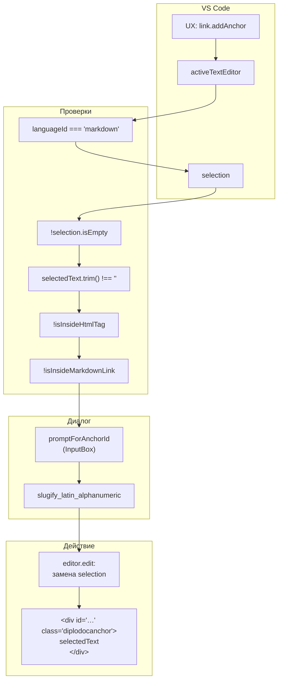
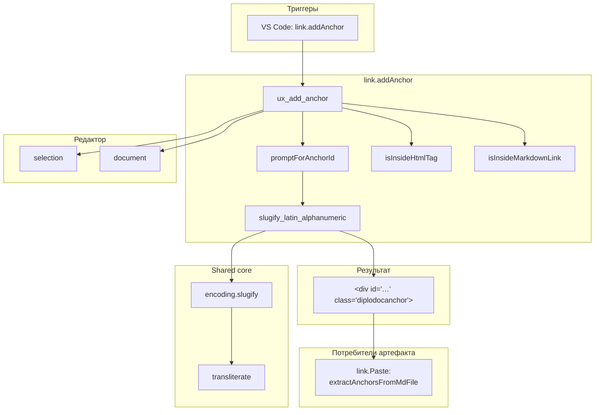

|               |                                                                                                               |
| ------------- | ------------------------------------------------------------------------------------------------------------- |
| ID            | [2.1-028](../../../%D0%A1%D0%BE%D0%B3%D0%BB%D0%B0%D1%88%D0%B5%D0%BD%D0%B8%D1%8F/index.md#identifikaciya-modulej) |
| Идентификатор | `link.addAnchor`                                                                                              |
| Наименование  | Добавление якоря                                                                                              |
| Слой          | [vscode-ui](../%D0%A1%D0%BB%D0%BE%D0%B8layer/%D0%A1%D0%BB%D0%BE%D0%B9VSCodeUI/index.md#naznachenie/index.md#naznachenie)                                     |
| Каталог       | [Ссылки](../../%D0%9A%D0%B0%D1%82%D0%B0%D0%BB%D0%BE%D0%B3Capabilitymap/%D0%9A%D0%B0%D1%82%D0%B0%D0%BB%D0%BE%D0%B3%D0%A1%D1%81%D1%8B%D0%BB%D0%BA%D0%B8/index.md#ssylki)                                                                                                                                                                                |
| Семейство     | [Ссылки](../../%D0%A1%D0%B5%D0%BC%D0%B5%D0%B9%D1%81%D1%82%D0%B2%D0%BEfamily/%D0%A1%D0%B5%D0%BC%D0%B5%D0%B9%D1%81%D1%82%D0%B2%D0%BE%D0%A1%D1%81%D1%8B%D0%BB%D0%BA%D0%B8/index.md#fam-link)                                                                                                                                                                                                                                                                                                                                                                |
| Расположение  | `src/commands/diplodoc-helper.link.AddAnchor.js`                                                              |
| Точка входа   | `ux_add_anchor()`                                                                                             |
| Версия        | `1.54.0`                                                                                                      |
| Назначение    | Оборачивает выделенный текст в `<div id='…' class='diplodocanchor'>`, создавая стабильный якорь               |

{: .page-legend }

## Назначение

`link.addAnchor` — команда для создания **стабильного якоря** на произвольный фрагмент текста (не на заголовок). Пользователь выделяет слово или фразу в `.md`, вызывает **Diplodoc → Бросить якорь**, вводит желаемый идентификатор — и модуль оборачивает выделение в `<div id='…' class='diplodocanchor'>текст</div>`.

Зачем это нужно. В Diplodoc автоматические якоря генерируются из заголовков (`## Введение` → `#vvedenie`). Но:

- если заголовок переименовать — якорь изменится, все ссылки сломаются;
- не у каждого важного фрагмента есть свой заголовок (например, «см. формулу расчёта» — это часть параграфа);
- якорь на заголовок может быть «занят» (две статьи с одинаковым заголовком — при транслитерации коллизия).

Стабильный якорь решает всё это: `<div id='formula-rascheta' class='diplodocanchor'>формула расчёта</div>` — id фиксирован, текст вокруг можно менять, ссылки на `#formula-rascheta` не сломаются.

Альтернативы:

- `{#custom-id}` после заголовка — работает только для заголовков;
- `<a name="…">` — устаревший HTML;
- `<div id='…'>` без класса — работает, но не стилизуется темой;
- **модуль `link.addAnchor`** — оборачивает в `<div>` с классом `diplodocanchor`, тема может стилизовать (например, пунктирное подчёркивание или иконку).

Без модуля пришлось бы вручную писать:

```html
<div id='formula-rascheta' class='diplodocanchor'>формула расчёта</div>
```

— с риском забыть класс, ошибиться в кавычках, забыть транслитерацию (Diplodoc не поддерживает кириллицу в `id`).

## Применение

**Когда использовать:** нужен **стабильный** якорь на фрагмент текста (не на заголовок) — например, на формулу или абзац, которые не хочется «привязывать» к заголовку (переименование заголовка сломает автоякорь).

**Когда НЕ использовать:** якорь на заголовок — используйте `## Заголовок {#custom-id}`; якорь на внешний URL — стандартный markdown.

**Альтернативы:**
- `{#custom-id}` — только для заголовков.
- `<a name="…">` — устаревший HTML, без стилизации.

**Типичный сценарий:** выделить фразу в `.md` → **Diplodoc → Бросить якорь** → ввести `formula-rascheta` (транслитерируется) → `<div id='formula_rascheta' class='diplodocanchor'>формула расчёта</div>`.

## Как это работает



### Фаза 1. Проверка контекста

```js
async function ux_add_anchor() {
    const editor = vscode.window.activeTextEditor;
    if (!editor) {
        vscode.window.showErrorMessage(translate(nls_ts.plugin.link.addAnchor.error.noEditor));
        return;
    }

    if (editor.document.languageId !== 'markdown') {
        vscode.window.showErrorMessage(translate(nls_ts.plugin.link.addAnchor.error.notMarkdown));
        return;
    }

    const selection = editor.selection;
    if (selection.isEmpty) {
        vscode.window.showErrorMessage(translate(nls_ts.plugin.link.addAnchor.error.noSelection));
        return;
    }

    const selectedText = editor.document.getText(selection);
    if (!selectedText || selectedText.trim().length === 0) {
        vscode.window.showErrorMessage(translate(nls_ts.plugin.link.addAnchor.error.emptySelection));
        return;
    }
```

Пять последовательных проверок:

1. **Редактор** — `activeTextEditor` не `undefined`. Если команда вызвана из палитры без открытого редактора — ошибка `«Нет активного редактора»`.
2. **Язык** — `languageId === 'markdown'`. На `.yaml`, `.json`, `.js` — ошибка `«Эта команда может использоваться только в Markdown-файлах»`.
3. **Выделение** — `!selection.isEmpty`. Без выделения — ошибка `«Текст не выделен»`. Якорь ставится только на выделенное.
4. **Непустое** — `selectedText.trim() !== ''`. Выделение из одних пробелов — ошибка `«Выделенный текст пуст»`.
5. **Контекст** — отдельная проверка (см. Фазу 2).

В отличие от большинства других `link.*`/`section.*` команд, `link.addAnchor` **не** молчит при `undefined` — все пять проверок сопровождаются `showErrorMessage`. Это сознательно: пользователь вызвал команду **из контекстного меню** (`when: editorLangId == markdown && editorHasSelection`), поэтому без выделения он попадёт в ошибку только при программном вызове (например, через `commands.executeCommand`).

### Фаза 2. Проверка контекста (HTML и markdown-ссылки)

```js
if (isInsideHtmlTag(editor.document, selection) || isInsideMarkdownLink(editor.document, selection)) {
    vscode.window.showErrorMessage(translate(nls_ts.plugin.link.addAnchor.error.invalidContext));
    return;
}
```

Две функции, обе работают только с **текущей строкой** и позицией `selection.start`.

**`isInsideHtmlTag(document, selection)`**:

```js
function isInsideHtmlTag(document, selection) {
    const startPos = selection.start;
    const line = document.lineAt(startPos.line).text;
    const charIndex = startPos.character;

    let lastLt = -1;
    for (let i = charIndex - 1; i >= 0; i--) {
        if (line[i] === '<') { lastLt = i; break; }
    }
    if (lastLt === -1) return false;

    let nextGt = -1;
    for (let i = charIndex; i < line.length; i++) {
        if (line[i] === '>') { nextGt = i; break; }
    }
    if (nextGt === -1) return false;

    return lastLt < charIndex && charIndex < nextGt;
}
```

Логика: ищет `<` слева и `>` справа на текущей строке. Если оба есть и позиция курсора между ними — «внутри HTML-тега». Это **не** парсер HTML, а эвристика «между `<` и `>`».

Примеры:

| Текст              | Позиция                   | `isInsideHtmlTag`                    |
| ------------------ | ------------------------- | ------------------------------------ |
| `<div>foo</div>`   | между `<` и `>` (в `div`) | `true`                               |
| `<div>foo</div>`   | в `foo`                   | `false` (между `>` и `<`)            |
| `x < y > z`        | в `y`                     | `true` (эвристика ложно срабатывает) |
| `<!-- коммент -->` | в `коммент`               | `true`                               |
| пустая строка      | любая                     | `false`                              |

**`isInsideMarkdownLink(document, selection)`**:

```js
function isInsideMarkdownLink(document, selection) {
    const startPos = selection.start;
    const line = document.lineAt(startPos.line).text;
    const charIndex = startPos.character;

    let lastBracket = -1;
    for (let i = charIndex - 1; i >= 0; i--) {
        if (line[i] === '[') { lastBracket = i; break; }
    }
    if (lastBracket === -1) return false;

    let nextClosingBracket = -1;
    for (let i = charIndex; i < line.length; i++) {
        if (line[i] === ']') { nextClosingBracket = i; break; }
    }
    if (nextClosingBracket === -1) return false;

    if (nextClosingBracket + 1 < line.length && line[nextClosingBracket + 1] === '(') {
        return true;
    }
    return false;
}
```

Логика: ищет `[` слева и `]` справа, и проверяет, что **сразу после `]`** идёт `(` — то есть это markdown-ссылка `[text](url)`, а не просто квадратные скобки.

Примеры:

| Текст                | Позиция   | `isInsideMarkdownLink`             |
| -------------------- | --------- | ---------------------------------- |
| `[текст](url)`       | в `текст` | `true`                             |
| `[текст](url)`       | в `url`   | `false` (внутри `()`, не в `[]`)   |
| `[1] сноска`         | в `1`     | `false` (после `]` пробел, не `(`) |
| `массив[0]`          | в `0`     | `false` (после `]` конец строки)   |
| `[a]` в конце строки | в `a`     | `false`                            |

Зачем эти проверки. Если пользователь выделит `href` внутри `<a href="…">` или `text` внутри `[text](url)` и применит `addAnchor`, то получится:

- `<a href="<div id='…' class='diplodocanchor'>…</div>">` — сломанный HTML, Diplodoc не отрендерит;
- `[<div id='…' class='diplodocanchor'>text</div>](url)` — что-то непонятное.

Модуль отсекает оба случая через `error.invalidContext` — `«Нельзя добавить якорь внутри HTML-тега или Markdown-ссылки»`.

### Фаза 3. Диалог ввода

```js
const rawId = await promptForAnchorId();
if (!rawId) return;
```

`promptForAnchorId()`:

```js
async function promptForAnchorId() {
    const id = await vscode.window.showInputBox({
        prompt: translate(nls_ts.plugin.link.addAnchor.input.prompt),
        placeHolder: translate(nls_ts.plugin.link.addAnchor.input.placeHolder),
        validateInput: value => {
            if (!value || value.trim().length === 0) {
                return translate(nls_ts.plugin.link.addAnchor.input.error.empty);
            }
            if (/[^22]/.test(value)) {
                return translate(nls_ts.plugin.link.addAnchor.input.error.invalidChars);
            }
            return null;
        },
    });
    return id;
}
```

`InputBox` с:

- **`prompt`** — `«Введите идентификатор якоря (будет транслитерирован)»`;
- **`placeHolder`** — `«например, moj-yakor»`;
- **`validateInput`** — три правила:
  - пустое → `«Идентификатор якоря не может быть пустым»`;
  - содержит символы вне `[a-zA-Z0-9а-яА-Я\-_]` → `«Разрешены только буквы, цифры, дефисы и подчёркивания»`;
  - иначе `null`.

То есть на этапе `InputBox` **разрешена кириллица** (диапазон `\u0400-\u04FF`). Это сознательно: пользователь вводит осмысленный идентификатор на русском, а `slugify_latin_alphanumeric` дальше транслитерирует его в латиницу.

Если пользователь нажал `Escape` — `id = undefined`, `if (!rawId) return;` — тихий выход без сообщения. Разумно: отмена.

### Фаза 4. Транслитерация и валидация

```js
const sanitizedId = slugify_latin_alphanumeric(rawId);
if (!sanitizedId) {
    vscode.window.showErrorMessage(translate(nls_ts.plugin.link.addAnchor.error.invalidId));
    return;
}
```

`slugify_latin_alphanumeric(rawId)` (из `utils/encoding.slugify.js`):

1. `transliterate(text)` — кириллица → латиница (`diplodocTransliterate`).
2. `.toLowerCase()`.
3. `replace(/[^23]+/g, '_')` — всё, что не латиница/цифра, → `_`.
4. `replace(/_+/g, '_')` — схлопывание `__` в `_`.
5. `replace(/^_+|_+$/g, '')` — трим подчёркиваний.

Примеры:

| `rawId`            | `sanitizedId`          |
| ------------------ | ---------------------- |
| `formula-rascheta` | `formula_rascheta`     |
| `формула-расчёта`  | `formula_rascheta`     |
| `Formula_Rascheta` | `formula_rascheta`     |
| `якорь 1`          | `yakor_1`              |
| `*****`            | `''` (пустая — ошибка) |

Пункт 4 (`-` не сохраняется) важен: `validateInput` пропускает `-` (дефис), но `slugify_latin_alphanumeric` его заменяет на `_`. То есть пользователь может ввести `my-anchor`, а получит `my_anchor`. См. «Известные ограничения» — несоответствие валидации и транслитерации.

Если после slugify получилась пустая строка (например, `rawId = '---'`), `error.invalidId` — `«Неверный идентификатор якоря»`.

### Фаза 5. Замена

```js
const wrappedText = `<div id='${sanitizedId}' class='diplodocanchor'>${selectedText}</div>`;

await editor.edit(editBuilder => {
    editBuilder.replace(selection, wrappedText);
});
```

Собирается HTML-строка с **одинарными** кавычками для атрибутов (`id='…'`, `class='diplodocanchor'`). Это допустимо в HTML, но в `.md` внутри `<div>…</div>` обычно используют двойные. Одинарные выбраны, вероятно, чтобы не конфликтовать с экранированием в JS-строках.

Итоговый HTML:

```html
<div id='formula_rascheta' class='diplodocanchor'>формула расчёта</div>
```

Заменяет выделение целиком. Если пользователь выделил `формула расчёта` — получит обёртку вокруг этих слов, каждая буква которых теперь внутри `<div>`. Diplodoc/YFM рендерит это как inline-блок (тема стилизует `.diplodocanchor`).

`editor.edit` возвращает `Promise<boolean>`. Результат **не проверяется**: если `editor.edit` вернёт `false` (например, документ стал readonly между `getText` и `edit`), пользователь не узнает о неудаче. См. «Известные ограничения».

### Файлы модуля

| Файл                                             | Ответственность                                                                 |
| ------------------------------------------------ | ------------------------------------------------------------------------------- |
| `src/commands/diplodoc-helper.link.AddAnchor.js` | `ux_add_anchor`, `promptForAnchorId`, `isInsideHtmlTag`, `isInsideMarkdownLink` |
| `src/plugins/utils/encoding.slugify.js`          | `slugify_latin_alphanumeric`                                                    |
| `src/plugins/utils/transliterate.js`             | `diplodocTransliterate` (используется косвенно)                                 |

### Формат результата

До:

```md
Это формула расчёта: E = mc².
```

После применения (выделено `формула расчёта`, введён id `formula`):

```md
Это <div id='formula' class='diplodocanchor'>формула расчёта</div>: E = mc².
```

## Режимы работы

### VS Code

| Команда                          | Заголовок     | Где появляется                                      |
| -------------------------------- | ------------- | --------------------------------------------------- |
| `diplodoc-helper.link.addAnchor` | Бросить якорь | Редактор → контекстное меню (при выделении в `.md`) |

Условие появления (`when`):

```json
{
    "command": "diplodoc-helper.link.addAnchor",
    "when": "editorLangId == markdown && editorHasSelection",
    "group": "7.diplodoc.section@1"
}
```

- **`editorLangId == markdown`** — только в `.md`;
- **`editorHasSelection`** — только при выделении.

То есть команда видна в контекстном меню редактора **только** когда есть выделение в markdown. Без выделения — скрыта.

### CLI

CLI-команды нет. Модуль — только VS Code.

### Сборочный пайплайн

В `docs-build.js` не участвует.

## Юнит-тесты





## Связи

`link.addAnchor` — третья часть «семейства ссылок» (после [`link.Copy`](../%D0%A0%D0%B5%D0%B5%D1%81%D1%82%D1%80/%D0%9C%D0%BE%D0%B4%D1%83%D0%BB%D1%8C%D0%9A%D0%BE%D0%BF%D0%B8%D1%80%D0%BE%D0%B2%D0%B0%D0%BD%D0%B8%D0%B5%D1%81%D1%81%D1%8B%D0%BB%D0%BA%D0%B8/index.md) и [`link.Paste`](../МодульВставкассылки/index.md)). По смыслу — родственник [`link.Paste`](../МодульВставкассылки/index.md): там тоже выбирается якорь, но для **ссылки на существующий якорь**. `link.addAnchor` создаёт якорь, `link.Paste` использует.

| Модуль                                                             | Роль                | Работает с          |
| ------------------------------------------------------------------ | ------------------- | ------------------- |
| [`link.Copy`](../%D0%A0%D0%B5%D0%B5%D1%81%D1%82%D1%80/%D0%9C%D0%BE%D0%B4%D1%83%D0%BB%D1%8C%D0%9A%D0%BE%D0%BF%D0%B8%D1%80%D0%BE%D0%B2%D0%B0%D0%BD%D0%B8%D0%B5%D1%81%D1%81%D1%8B%D0%BB%D0%BA%D0%B8/index.md)                 | Кладёт JSON в буфер | Только буфер        |
| [`link.Paste`](../МодульВставкассылки/index.md)                    | Вставляет ссылку    | Буфер + редактор    |
| **`link.addAnchor`**                                               | Создаёт якорь       | Только редактор     |
| [`image.PasteFromClipboard`](../МодульВставкаизображения/index.md) | Картинка из буфера  | Буфер (изображение) |
| [`image.PasteFromList`](../МодульВставкаизображения/index.md)      | Картинка из списка  | Редактор + FS       |

Функционально `link.addAnchor` независим: он не читает буфер, не пишет в него, не взаимодействует с другими модулями. Результат — HTML-разметка внутри `.md`.

С `extension.js` — команда регистрируется в общем `commandHandlers`:

```js
'diplodoc-helper.link.addAnchor': ux_add_anchor,
```

С `link.utils` (`extractAnchorsFromMdFile` в `link.Paste`) — **не** пересекается напрямую, но логически связан: если пользователь создал якорь через `addAnchor`, `extractAnchorsFromMdFile` его **найдёт** (через `idRegex = /\bid\s*=\s*(["']?)([^24]+)\1/gi`), и `link.Paste` предложит его в QuickPick при выборе якоря для ссылки.

То есть:

1. `link.addAnchor` → создаёт `<div id='my-anchor'>…</div>`.
2. `link.Copy` → копирует JSON ссылки на этот документ.
3. `link.Paste` → при вставке открывает QuickPick с якорями, среди которых есть `my-anchor`.
4. Пользователь выбирает `my-anchor` → получает `[text](path#my-anchor)`.

Полный сценарий: «создал якорь → скопировал ссылку на документ → вставил в другой документ с выбором якоря».






