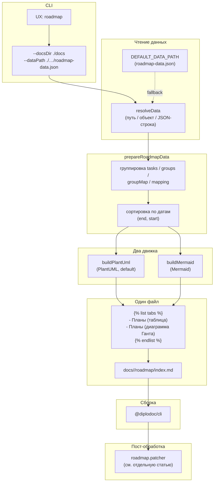
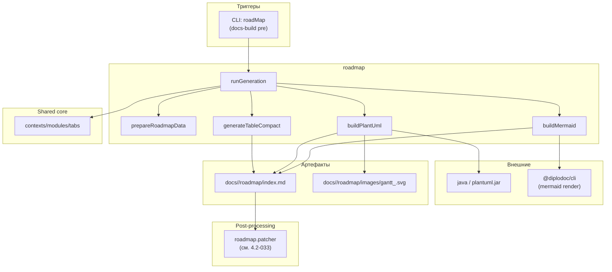



## Назначение

`roadmap` — генератор страницы «Дорожная карта» (`docs/<lang>/roadmap/index.md`). Читает JSON с описанием **групп / модулей / функций** (кто, что, когда, с какими зависимостями), строит **две визуализации** одного и того же плана:

1. **Таблица** — компактная markdown-таблица с иерархией (`Группа → Модуль → Функция`), с колонками «Начало», «Конец», «Зависимости».
2. **Диаграмма Ганта** — на движке **PlantUML** (по умолчанию) или **Mermaid** (опционально). В обоих случаях — с интерактивностью в браузере: pan/zoom, клики по узлам (переход на страницу модуля).

Обе визуализации показываются в одной статье через ``: первая вкладка — таблица, вторая — диаграмма.

Зачем это нужно. Дорожная карта (roadmap) — типовой артефакт технической документации. Если вести её вручную в Markdown:

- при добавлении нового модуля надо править и таблицу, и диаграмму;
- при сдвиге дат — пересчитывать длительности;
- при переименовании модуля — искать все упоминания;
- иерархия и зависимости (кто от кого зависит) — самая сложная часть, легко «разъезжается».

`roadmap` решает это через единый источник данных: один JSON, две визуализации. Правка JSON → повторная сборка → обе визуализации обновлены.

## Применение

**Когда использовать:** нужна «дорожная карта» (roadmap) с диаграммой Ганта и таблицей этапов из единого JSON — для планов релизов, этапов разработки, планов внедрения.

**Когда НЕ использовать:** нет данных в JSON; нужен только PlantUML/Mermaid без интерактивности — используйте напрямую.

**Альтернативы:**
- Ручной `index.md` с `` + Mermaid — часы на обновление при сдвиге дат.
- Только таблица без Ганта — теряется визуальная «временная ось».

**Типичный сценарий:** заполнить `roadmap-data.json` → `docs-build.js` → `pre` → `roadMap` генерирует `roadmap/index.md` с таблицей + Гантом; `roadmap.patcher` в `post` оживляет.

## Как это работает



### Фаза 1. Чтение данных

```js
async function runGeneration(options) {
    const docsRoot = typeof options === 'string' ? options : options?.docsRoot || './docs';
    const dataSource = typeof options === 'object' ? options.data : null;
    const engine = (typeof options === 'object' && options.engine) || CURRENT_ENGINE;

    let data = null;
    try {
        data = resolveData(dataSource);
    } catch (err) {
        console.error('❌ [Roadmap] Ошибка парсинга данных:', err.message);
    }

    if (!data) {
        cleanupRoadmapPages(docsRoot);
        return;
    }
```

**`CURRENT_ENGINE = DiagramEngine.PLANTUML`** — захардкожено в `roadmap.js`. PlantUML по умолчанию. Для переключения на Mermaid — либо `options.engine`, либо правка `CURRENT_ENGINE`.

**`resolveData(dataSource)`**:

```js
function resolveData(dataSource) {
    if (typeof dataSource === 'object' && dataSource !== null) {
        return dataSource;
    }
    if (typeof dataSource === 'string') {
        if (fs.existsSync(dataSource)) {
            const raw = fs.readFileSync(dataSource, 'utf8');
            return JSON.parse(raw);
        }
        if (looksLikePath(dataSource)) {
            console.warn(`[Roadmap] Файл данных не найден: ${dataSource}`);
            return null;
        }
        return JSON.parse(dataSource);
    }
    if (fs.existsSync(DEFAULT_DATA_PATH)) {
        const raw = fs.readFileSync(DEFAULT_DATA_PATH, 'utf8');
        return JSON.parse(raw);
    }
    return null;
}
```

Порядок:

1. **Объект** — используется как есть (если вызов из кода, а не из CLI).
2. **Строка** — если путь существует → читается, если путь выглядит как путь (но не существует) → `null` с `console.warn`, иначе — `JSON.parse` (это JSON-строка).
3. **`dataSource = null`** (CLI без `--dataPath`) → fallback на `DEFAULT_DATA_PATH` (`src/plugins/roadMap/roadmap-data.json`).
4. **Ничего не нашли** → `null`.

**`looksLikePath(s)`**:

```js
function looksLikePath(s) {
    if (!s) return false;
    if (/\.json$/i.test(s)) return true;
    if (/^[./\\]/.test(s)) return true;
    if (/[\\/]/.test(s)) return true;
    return false;
}
```

Отличает «путь к файлу» от «JSON-строки». JSON начинается с `{` или `[` — не матчит ни один паттерн. Путь `./data.json`, `/abs/data.json`, `C:\…\data.json` — матчит.

**`cleanupRoadmapPages(docsRoot)`** — если данные не найдены:

- обходит `docs/ru/` и `docs/en/`;
- удаляет `roadmap/images/gantt_<lang>.svg` (если есть);
- перезаписывает `roadmap/index.md` на «*Данные временно недоступны.*».

Так «пустая» дорожная карта не остаётся висеть с устаревшими данными.

### Фаза 2. Подготовка данных (`prepareRoadmapData`)

```js
const { tasks, groups, groupNames, groupMap, mapping, parseDateToNumber } =
    prepareRoadmapData(data, sortDirection);
```

`prepareRoadmapData` (из `builders/roadmap.data.js`):

**Шаг 1. Фильтр задач.** `data.filter(item => item.type === 'function' && item.start && item.end)`. Только функции (не группы, не модули) с заполненными датами начала и конца.

**Шаг 2. `moduleMap`.** Для каждой записи `type === 'module'` → `moduleMap[item.id] = item.dependencies[0]` — карта «модуль → группа».

**Шаг 3. `groupMap`.** Для каждой `type === 'group'` → `groupMap[item.id] = item` — карта «группа → запись».

**Шаг 4. `groups`.** Группирует задачи по имени группы:

```js
tasks.forEach(task => {
    const moduleId = task.dependencies[0];
    const groupId = moduleMap[moduleId];
    const groupObj = groupMap[groupId];
    const groupName = groupObj ? groupObj.name : 'Без группы';
    if (!groups[groupName]) groups[groupName] = { tasks: [], groupId: groupId };
    groups[groupName].tasks.push(task);
});
```

Цепочка `task → moduleId → groupId → groupName`. Задачи «сироты» (moduleId не найден в `moduleMap`) → `'Без группы'`.

**Шаг 5. `mapping`.** `mapping[task.id] = task.url` — карта «id задачи → URL модуля». Используется на клиенте (после сборки) для клика по узлу Ганта.

**Шаг 6. Сортировка.** Каждая группа сортируется по `end`, потом по `start` (`multiplier = asc ? 1 : -1`).

**Шаг 7. `groupNames`.** Сортирует имена групп по дате (asc — по минимальному `start`, desc — по максимальному `end`).

Итог:

```js
{
    tasks,         // функции с датами
    groups,        // { groupName: { tasks, groupId } }
    groupNames,    // отсортированные имена групп
    groupMap,      // { groupId: <запись группы> }
    mapping,       // { taskId: url }
    parseDateToNumber,
}
```

### Фаза 3. Построение таблицы (`generateTableCompact`)

```js
const tableContent = generateTableCompact(data);
```

`generateTableCompact` (из `builders/table.generator.js`) — **независимо** от `prepareRoadmapData`, работает с исходным `data`:

1. Собирает `groups`, `modules` (по `type`).
2. `funcByModule` — группирует функции по `moduleId`.
3. Для каждой группы (в порядке, в котором они в `data`):
   - строка **«Группа»** — `name`, `start`, `end` группы;
   - для каждого модуля группы:
     - строка **«Модуль»** — с `&nbsp;×4` отступом, `name`, `start`, `end`;
     - для каждой функции модуля:
       - строка **«Функция»** — с `&nbsp;×8` отступом, `name`, `start`, `end`, `dependencies` (кроме самого модуля).

Markdown-таблица:

```md
|                                                                 | Начало  | Конец   | Зависимости     |
| --------------------------------------------------------------- | ------- | ------- | --------------- |
| Планирование                                                    | 01-2024 | 03-2024 |                 |
| &nbsp;&nbsp;&nbsp;&nbsp;Модуль «Бюджет»                         | 01-2024 | 02-2024 |                 |
| &nbsp;&nbsp;&nbsp;&nbsp;&nbsp;&nbsp;&nbsp;&nbsp;Бюджетирование  | 01-2024 | 02-2024 |                 |
| &nbsp;&nbsp;&nbsp;&nbsp;&nbsp;&nbsp;&nbsp;&nbsp;Прогнозирование | 02-2024 | 03-2024 | budget-planning |
```

Иерархия через `&nbsp;`-отступы (4 на уровень) — потому что Markdown-таблицы не поддерживают вложенность.

### Фаза 4. Построение диаграммы (`buildPlantUml` или `buildMermaid`)

**`buildPlantUml(data, lang, outputDir, ROADMAP_CSS)`** — по умолчанию.

1. **Проверка окружения** (`checkEnvironment`): `PLANTUML_JAR_PATH` в env → OK; `java -version` → OK; `plantuml -version` → OK; иначе — `console.error('❌ [PlantUML Builder Error]…')` и возврат строки `«*Ошибка сборки диаграммы…*»`.

2. **`generatePlantUmlScript(data, lang)`**:

   ```puml
   @startgantt
   skinparam svgDimensionStyle false
   scale 1200 width
   printscale monthly
   title "План релизов"

   Project starts 2024-01-01

   '--- Группа 1 ---
   [Планирование] happens at 2024-01-01
   [Планирование] links to [[url Планирование]]

   [Бюджетирование] starts 2024-01-01 and lasts 30 days
   [Бюджетирование] links to [[url Бюджетирование]]
   ...
   @endgantt
   ```

3. **`buildPlantUmlSvg(script, outputDir, lang)`**:

   - `getPlantUmlImagePath(outputDir, lang)` → `outputDir/images/gantt_<lang>.svg`;
   - `renderPlantUmlToSvg(script, outputPath)`:
     - пишет `script` во временный `.puml` рядом с целевым `.svg`;
     - определяет команду: `java -jar $PLANTUML_JAR_PATH` или `java -jar <project>/docs/_assets/jar/plantuml.jar` или `plantuml`;
     - `exec(command, callback)`:
       - удаляет `.puml` (в `finally`-подобной логике);
       - если `error` — `reject`;
       - если `svg` не создан — `reject`;
       - иначе `resolve(dataPath)`;
   - читает `svg`, удаляет `<?xml…?>`, возвращает `{ svgContent, legend: '' }`.

4. **`wrapSvgContainer(svgContent, { cssContent, legend })`** — оборачивает в:

   ```html
   <style>/* ROADMAP_CSS */</style>
   <div class="gantt-wrapper">
     <div class="gantt-toolbar">
       <button class="gantt-toggle-btn js-toggle-pan">🖐️ Перемещение (Pan)</button>
       <button class="gantt-toggle-btn js-toggle-zoom">🔍 Зум (Zoom)</button>
     </div>
     <div class="gantt-raw-container">
       <svg>…</svg>
     </div>
   </div>
   ```

**`buildMermaid(data, lang)`** — альтернатива.

1. **`generateMermaidScript(data, lang)`**:

   ````
   ```mermaid
   gantt
       title План релизов
       dateFormat MM-YYYY
       axisFormat %m-%Y
       section Группа 1
       Планирование :milestone, milestone_0, 01-2024, 01-2024
       Бюджетирование :active, budget-task, 01-2024, 02-2024
       ...
   ```
   ````

   `mapping` (id → url) возвращается отдельно.

2. **`wrapMermaidContainer(script, { cssContent, mappingJson })`** — оборачивает в `<div class="gantt-wrapper">…</div>` + `<div class="js-gantt-mapping" data-mapping='…'></div>`.

Возвращает markdown-строку с ` ```mermaid … ``` `-блоком внутри HTML-обёртки.

### Фаза 5. Сборка `index.md` через вкладки

```js
const tabs = [
    { title: lang === 'ru' ? 'Планы (таблица)' : 'Plans (table)', content: tableContent },
    { title: lang === 'ru' ? 'Планы (диаграмма Ганта)' : 'Plans (Gantt chart)', content: ganttContent },
];
const tabsMarkup = generateTabsMarkup({ tabs, selectedIndex: 0 });

const title = lang === 'ru' ? 'Планы' : 'Roadmap';
const frontmatter = `---\ntitle: ${title}\nsectionType: Page\n---\n\n`;
const content = frontmatter + tabsMarkup;

const indexPath = path.join(outputDir, 'index.md');
fs.writeFileSync(indexPath, content, 'utf8');
```

`generateTabsMarkup` (из `contexts/modules/tabs.js` — переиспользуется). Итог:

```md
---
title: Планы
sectionType: Page
---



- Планы (таблица){selected}

  |     | Начало | Конец | Зависимости |
  | --- | ------ | ----- | ----------- |
  | …   |

- Планы (диаграмма Ганта)

  <style>…</style>
  <div class="gantt-wrapper">…</div>


```

### Фаза 6. Запись по языкам

```js
const languages = fs.readdirSync(docsRoot).filter(dir => {
    const fullPath = path.join(docsRoot, dir);
    return fs.statSync(fullPath).isDirectory() && (dir === 'ru' || dir === 'en');
});

if (languages.length === 0) {
    console.warn('Нет языковых папок (ru/en) в docsRoot');
    return;
}

for (const lang of languages) {
    const langDir = path.join(docsRoot, lang);
    const outputDir = path.join(langDir, 'roadmap');
    if (!fs.existsSync(outputDir)) fs.mkdirSync(outputDir, { recursive: true });

    // …builders…
    // …writeFileSync…
    console.log(`[${lang}] Roadmap создан (${engine}): ${indexPath}`);
}
```

Для каждого языка из `['ru', 'en']` (захардкожено) — отдельная папка `docs/<lang>/roadmap/`.

### Файлы модуля

| Файл                                                      | Ответственность                                                        |
| --------------------------------------------------------- | ---------------------------------------------------------------------- |
| `src/plugins/roadMap/roadmap.js`                          | `runGeneration`, `resolveData`, `cleanupRoadmapPages`, `looksLikePath` |
| `src/plugins/roadMap/builders/roadmap.data.js`            | `prepareRoadmapData`, `parseDateToNumber`                              |
| `src/plugins/roadMap/builders/table.generator.js`         | `generateTableCompact`, `generateTableContent`                         |
| `src/plugins/roadMap/builders/plantuml.builder.js`        | `buildPlantUml`, `getPlantUmlImagePath`, `checkEnvironment`            |
| `src/plugins/roadMap/builders/plantuml.script.builder.js` | `generatePlantUmlScript`                                               |
| `src/plugins/roadMap/builders/plantuml.svg.builder.js`    | `renderPlantUmlToSvg`, `buildPlantUmlSvg`                              |
| `src/plugins/roadMap/builders/mermaid.builder.js`         | `buildMermaid`                                                         |
| `src/plugins/roadMap/builders/mermaid.script.builder.js`  | `generateMermaidScript`                                                |
| `src/plugins/roadMap/builders/mermaid.svg.builder.js`     | `buildMermaidSvg` (заглушка — `svgContent: null`)                      |
| `src/plugins/roadMap/builders/controls.builder.js`        | `wrapSvgContainer`, `wrapMermaidContainer`, `buildGanttControls`       |
| `src/plugins/roadMap/enums/DiagramEngine.js`              | `DiagramEngine = { PLANTUML, MERMAID }`                                |
| `src/plugins/roadMap/assets/roadmap.css`                  | CSS для диаграммы                                                      |
| `src/plugins/roadMap/roadmap-data.json`                   | Дефолтный JSON (fallback)                                              |
| `src/plugins/roadMap/patchers/*`                          | Клиентские патчеры — **см. отдельную статью** `roadmap.patcher`        |

### Формат `roadmap-data.json`

```json
[
    { "id": "g-planning", "type": "group", "name": "Планирование", "start": "01-2024", "end": "03-2024" },
    { "id": "m-budget", "type": "module", "name": "Модуль «Бюджет»", "dependencies": ["g-planning"], "start": "01-2024", "end": "02-2024" },
    { "id": "f-budgeting", "type": "function", "name": "Бюджетирование", "dependencies": ["m-budget"], "start": "01-2024", "end": "02-2024", "url": "/ru/Модули/МодульБюджет/index.html" },
    { "id": "f-forecasting", "type": "function", "name": "Прогнозирование", "dependencies": ["m-budget", "f-budgeting"], "start": "02-2024", "end": "03-2024", "url": "…" }
]
```

| Поле            | Обязательно         | Комментарий                                                                  |
| --------------- | ------------------- | ---------------------------------------------------------------------------- |
| `id`            | да                  | Уникальный идентификатор                                                     |
| `type`          | да                  | `group` / `module` / `function`                                              |
| `name`          | да                  | Отображаемое имя                                                             |
| `dependencies`  | да (массив)         | Для `module` — `[groupId]`; для `function` — `[moduleId, ...functionDeps]`   |
| `start` / `end` | да (для `function`) | Формат `MM-YYYY`                                                             |
| `url`           | нет                 | Ссылка на страницу модуля. Используется в `mapping` и в PlantUML-`links to`. |

## Режимы работы

### CLI

```bash
node ./plugins/diplodoc-helper-cli.js roadmap --docsDir ./docs --dataPath ./plugins/roadMap/roadmap-data.json
```

| Аргумент     | Обязателен | По умолчанию                            | Описание                                |
| ------------ | ---------- | --------------------------------------- | --------------------------------------- |
| `--docsDir`  | нет        | `./docs`                                | Корень документации                     |
| `--dataPath` | нет        | `src/plugins/roadMap/roadmap-data.json` | Путь к JSON                             |
| `--dataRaw`  | нет        | —                                       | JSON-строка (приоритетнее `--dataPath`) |

Порядок приоритетов в CLI:

```js
const dataPath = args.indexOf('--dataPath') !== -1 ? args[args.indexOf('--dataPath') + 1] : undefined;
const dataRaw = args.indexOf('--dataRaw') !== -1 ? args[args.indexOf('--dataRaw') + 1] : undefined;

generateRoadMap({
    docsRoot: docsDir,
    dataPath,
    dataRaw,
    engine: DiagramEngine.MERMAID,
});
```

**Стоп.** Здесь `engine: DiagramEngine.MERMAID` — жёстко Mermaid, **не** `CURRENT_ENGINE` из `roadmap.js`. Расхождение: `runGeneration` в `roadmap.js` использует `CURRENT_ENGINE = PLANTUML`, а CLI-обёртка принудительно ставит `MERMAID`. См. «Известные ограничения».

### Сборочный пайплайн

В `docs-build.js`, фаза `pre`:

```js
cli('roadMap', '--dataPath', './plugins/roadMap/roadmap-data.json'),
```

Идёт последним в `pre`-фазе (после `createFigureContent`, перед `@diplodoc/cli`). Пропускается флагом `--skip=roadMap`.

### VS Code

Собственной команды нет. Только через `docs-build.js` или прямой CLI.

## Юнит-тесты





## Связи

`roadmap` — единственный модуль в расширении, который делает **и** диаграмму (визуализация), **и** таблицу (текст), **и** зависит от внешнего движка (`java` / `plantuml` / `mermaid`).

С `roadmap.patcher` (следующая статья, `4.2-033`) — связан через **два механизма**:

1. **PlantUML**: `buildPlantUml` возвращает `<style>…</style><div class="gantt-wrapper">…<svg>…</svg></div>`. `patcher` вставляет `<script>` в HTML **после** сборки, который находит `.gantt-wrapper` и делает SVG интерактивным (pan/zoom через `svg-pan-zoom`).
2. **Mermaid**: `buildMermaid` возвращает `<div class="gantt-wrapper">…<div class="js-gantt-mapping" data-mapping='…'></div></div>`. `patcher` вставляет `<script>`, который находит `.gantt-wrapper`, ждёт появления `svg` (Mermaid рендерит клиентом), и добавляет обработчики кликов по узлам + pan/zoom.

**То есть `roadmap` без `patcher`** — статичная диаграмма (видна, но без интерактива). **`patcher` без `roadmap`** — нечего патчить. Оба обязательны для полного функционала.

С `contexts/modules/tabs.js` — переиспользует `generateTabsMarkup`. Это **единственный** общий модуль между `contexts` и `roadmap`. Логично: и там, и там — ``-разметка с несколькими вкладками.

С `utils/toc.order` — **не** использует (у `roadmap` нет обхода `docs/` — только запись в известную папку `roadmap/`).

С `md.links.figure` — **не** использует.

**Внешние зависимости:**

| Модуль                    | Назначение                | Условие                                 |
| ------------------------- | ------------------------- | --------------------------------------- |
| `plantuml.jar` / `java`   | Рендер PlantUML           | Только для `PLANTUML`-движка            |
| `@diplodoc/cli` (mermaid) | Рендер Mermaid в браузере | Только для `MERMAID`-движка, клиентский |
| `svg-pan-zoom`            | Pan/zoom для PlantUML     | Клиентский, CDN в `patcher`             |








