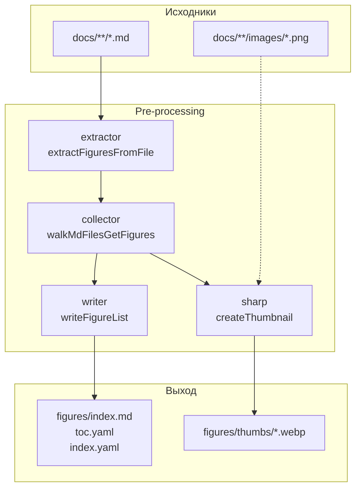
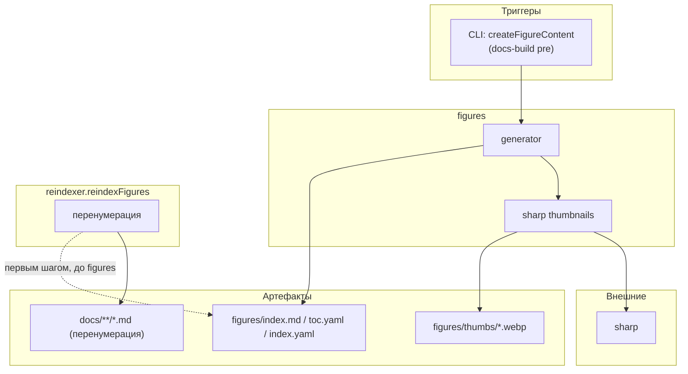



## Назначение

Модуль `figures` обходит документацию, собирает все блоки `<figure>` (по маркеру `<figcaption class="imageDescription" id="…">Рисунок 1. `), генерирует уменьшенные превью каждого изображения через `sharp` и строит страницу-каталог с таблицей иллюстраций: номер, название, мини-превью, ссылка на полноразмерный оригинал.

Практический смысл: техписатель или читатель видит все иллюстрации в одной таблице с быстрым переходом к исходной статье и полноразмерному изображению. Номера иллюстраций идут в порядке появления в документе — совпадают с нумерацией, которую проставляет `reindexFigures` (отдельный модуль `reindexer/reindexer.figures.js`).

Модуль работает исключительно в `pre-processing` — генерирует `docs/**/figures/index.md` с встроенной HTML-разметкой. Клиентской части нет: переключатель list/grid и лайтбокс подразумеваются разметкой, но требуют внешних скриптов темы (см. «Известные ограничения»).

## Применение

**Когда использовать:** в документации десятки+ иллюстраций, и нужен каталог «все рисунки в одном месте» с превью, номерами и ссылками на исходные статьи.

**Когда НЕ использовать:** 2–3 картинки — хватит обычного списка; нужен только список для вставки — используйте `image.PasteFromList` (не генерирует каталог).

**Альтернативы:**
- Ручной `figures/index.md` — рассинхронизируется.
- Только `reindexer.figures` — нумерует, но не собирает каталог.

**Типичный сценарий:** `docs-build.js` → `pre` → `reindexFigures` (нумерация) → `createFigureContent` (`figures` собирает каталог с превью через `sharp`).

## Как это работает



1. **Извлечение.** `extractFiguresFromFile` читает `.md`, находит все `<figcaption class="imageDescription" … id="…">`, ищет ближайшее markdown-изображение **слева** от каждого `<figcaption>`. Возвращает `{ id, caption, imagePath, imageAlt, sourcePath, figureNumber }`, где `figureNumber` вытаскивается из `Рисунок N` / `Figure N` / `Fig. N` в тексте подписи.

2. **Сбор.** `walkMdFilesGetFigures` обходит `langDir`, пропускает `SKIP_DIRS` (`figures`, `contexts`, `helptags`). Собирает плоский массив записей по всем статьям.

3. **Превью.** `processThumbnails` для каждой записи с `imagePath` (не `http:`, не `data:`, не `//`):
   - резолвит абсолютный путь от директории `.md` + `imagePath`;
   - проверяет существование через `toExtendedPath` (обход MAX_PATH на Windows);
   - считает `md5`-хеш относительного пути (первые 12 символов) для имени превью;
   - через `sharp` ресайзит до ширины 360px с `fit: 'inside'` (без увеличения) и сохраняет `figures/thumbs/<name>_<hash>.webp` (quality 80);
   - пропускает, если превью уже существует;
   - записывает в `fig.thumbPath` абсолютный URL вида `/ru/figures/thumbs/<name>_<hash>.webp`.

4. **Запись.** `writeFigureList` сортирует по `figureNumber` (или алфавитно по `caption`, если номера нет), генерирует `index.md`:
   - frontmatter `title: Перечень иллюстраций` (`List of figures` для `en`);
   - переключатель `<div class="figures-view-switch">` (кнопки `Список` / `Сетка`);
   - `<table class="figures-table">` — по умолчанию видима (`data-view="list"`);
   - `<div class="figures-grid">` — второй вид того же набора;
   - каждая запись — `<tr>` с номером, названием (ссылка на `article.html#fig-…`) и ``;
   - `toc.yaml` / `index.yaml` — заголовок и `href`.

### Файлы модуля

| Файл                   | Ответственность                                 |
| ---------------------- | ----------------------------------------------- |
| `figures.js`           | `runGeneration(docsRoot)` — оркестратор (async) |
| `figures.collector.js` | `walkMdFilesGetFigures` — обход `docs/`         |
| `figures.extractor.js` | `extractFiguresFromFile`, `extractFigureNumber` |
| `figures.writer.js`    | `writeFigureList` — генерация `index.md`        |
| `figures.model.js`     | пустой (`module.exports = {}`)                  |

### Ожидаемая разметка в `.md`

```html
<figure>


<figcaption class="imageDescription" id="fig-opisanie">Рисунок 1. Описание</figcaption>

</figure>
```

Требования:

- `<figcaption>` должен иметь **оба** атрибута: `class="imageDescription"` и `id="…"`. Без `class="imageDescription"` — запись в каталог не попадёт.
- Атрибуты — **только в двойных кавычках**. Одинарные не сработают (regex жёстко ждёт `"`).
- Тег должен быть на **одной строке** (`[^5]*?` не проглатывает `\n` до `>`).
- Markdown-изображение — **до** `<figcaption>`, не после. Связка «изображение → подпись» однонаправленная.

### Формат имени файла превью

`<baseName>_<md5-12>.webp`, где `md5-12` — первые 12 символов `md5` от `<sourceDir>/<imagePath>` (нормализованного `\\` → `/`). Пример: `foo_5f3b8a9c2d1e.webp`.

Хешируется путь (не содержимое) — чтобы избежать коллизий между разными папками с одинаковыми `foo.png`.

### Сортировка

`sortFigures`:
- если у обоих `figureNumber == null` — `localeCompare` по `caption` (`ru`);
- если у одного `null` — тот уходит в конец;
- иначе — числовое сравнение `figureNumber`.

То есть: сначала нумерованные по порядку, потом безымянные по алфавиту.

## Режимы работы

### CLI

```bash
node ./plugins/diplodoc-helper-cli.js createFigureContent --docsDir ./docs
```

| Аргумент    | Обязателен | По умолчанию | Описание            |
| ----------- | ---------- | ------------ | ------------------- |
| `--docsDir` | нет        | `./docs`     | Корень документации |

VS Code-команды **нет**. Команда `diplodoc-helper.reindexFigures` — это **другой модуль** (`reindexer/reindexer.figures.js`), он пересчитывает номера иллюстраций в тексте, а не собирает каталог.

### Сборочный пайплайн

В `docs-build.js`, фаза `pre`:

```js
cli('createFigureContent'),
```

Идёт после `gosts` и `terms`. Может быть пропущен флагом `--skip=createFigureContent`.

## Юнит-тесты





## Связи

Модуль `figures` — чистый генератор страницы, ничего не инжектит в HTML. По структуре напоминает `abbrs`/`terms`/`gosts` (генерация каталога из разметки), но без post-processing-фазы и без клиентского скрипта.

Внешние зависимости: `sharp` (нативный модуль для ресайза), `crypto` (встроенный — для `md5`). Пересечений с `reindexFigures` нет: тот нумерует иллюстрации в текстах, `figures` собирает каталог. Оба работают в фазе `pre`, порядок шагов в `docs-build.js` важен: `reindexFigures` → `createFigureContent` (сначала нумерация, потом сбор).








