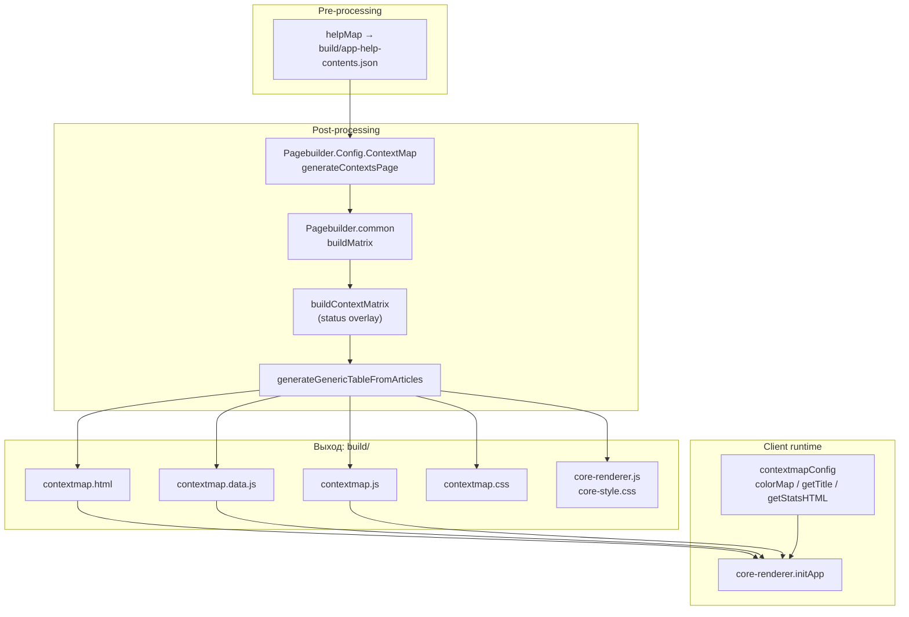
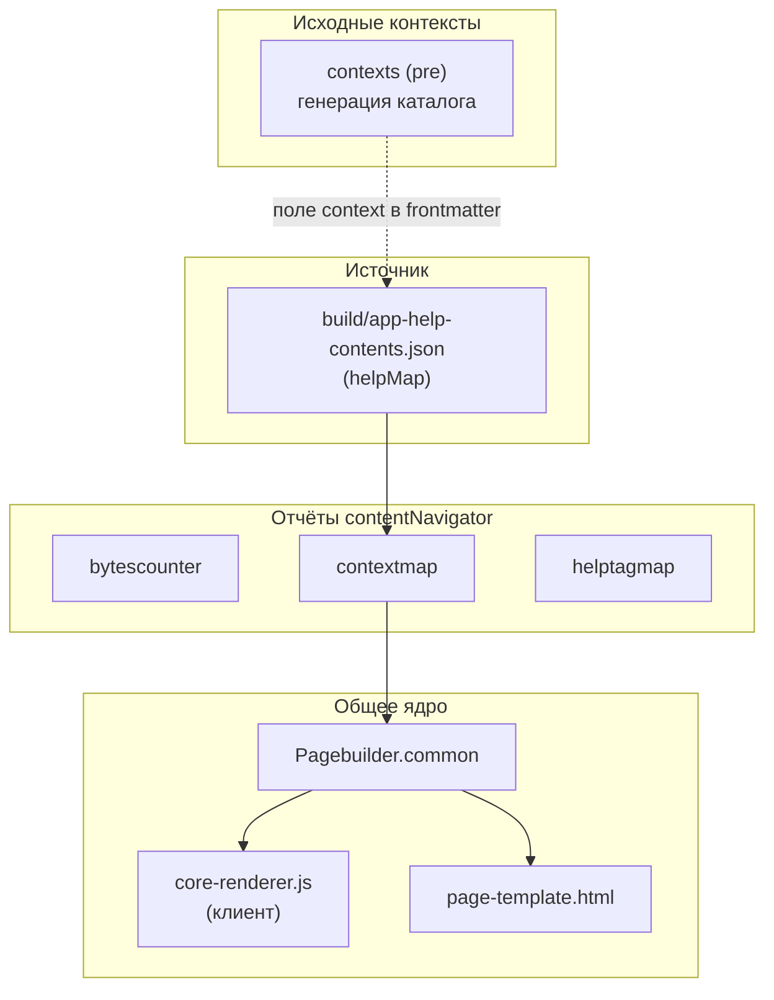

|               |                                                                                                                                                                             |
| ------------- | --------------------------------------------------------------------------------------------------------------------------------------------------------------------------- |
| ID            | [4.2-016](../../%D0%A1%D0%BE%D0%B3%D0%BB%D0%B0%D1%88%D0%B5%D0%BD%D0%B8%D1%8F/index.md#identifikaciya-modulej)                                                               |
| Идентификатор | `contextmap`                                                                                                                                                                |
| Наименование  | Карта контекстов                                                                                                                                                            |
| Слой          | [post-processing](../%D0%A1%D0%BB%D0%BE%D0%B8layer/PostProcessing/index.md#naznachenie) / [client-runtime](../%D0%A1%D0%BB%D0%BE%D0%B8layer/ClientRuntime/index.md#naznachenie) |
| Расположение  | `src/plugins/contentNavigator/Pagebuilder.Config.ContextMap.js`, `contextmap.js`, `contextmap.css`                                                                          |
| Точка входа   | `generateContextsPage({ mapDir, outputDir, lang })`                                                                                                                         |
| Версия        | `1.54.0`                                                                                                                                                                    |
| Назначение    | Генерирует страницу с тепловой картой количества `context`-тегов по разделам и главам                                                                                       |

{: .page-legend }

## Назначение

`contextmap` — второй отчёт семейства `contentNavigator` (после [`bytescounter`](../%D0%A0%D0%B5%D0%B5%D1%81%D1%82%D1%80/%D0%9C%D0%BE%D0%B4%D1%83%D0%BB%D1%8C%D0%A0%D0%B0%D0%B7%D0%BC%D0%B5%D1%80%D1%8B%D1%81%D1%82%D0%B0%D1%82%D0%B5%D0%B9/index.md)). Читает `app-help-contents.json` (создан [`helpMap`](../%D0%A0%D0%B5%D0%B5%D1%81%D1%82%D1%80/%D0%9C%D0%BE%D0%B4%D1%83%D0%BB%D1%8C%D0%9A%D0%B0%D1%80%D1%82%D0%B0%D0%BF%D0%BE%D0%BC%D0%BE%D1%89%D0%B8/index.md)), группирует статьи по разделам и главам и рисует таблицу-карту: по вертикали — главы, по горизонтали — разделы, в ячейках — плитки статей, цвет плитки — количество `context`-тегов в статье.

Задача — дать редактору «взгляд сверху» на **насыщенность статей контекстами**:

- `color-empty` (`0`) — статья не привязана ни к одному контексту. Либо это «служебная» страница (`index.md` раздела, лендинг), либо забыли разметить;
- `color-low` (1–3) — статья попадает в узкий круг поисковых запросов;
- `color-normal` (4–6) — сбалансированный охват;
- `color-excess` (>6) — возможно, переизбыток (статья «обо всём» или кто-то скопировал контексты из соседней статьи).

Страница полностью статична, но клиентский `core-renderer.js` (общий для всех отчётов) оживляет её: переключатель языков, легенда, `preferredLang` в `localStorage`.

## Применение

**Когда использовать:** нужно «взглядом сверху» увидеть, где статей с контекстами много, где мало, где совсем нет — для ревью перед релизом.

**Когда НЕ использовать:** контекстов в проекте нет (тогда карта пустая); нужен только поиск — хватит `context-search.client`.

**Альтернативы:**
- Ручной обход `docs/` — не даёт визуальной картины.
- `bytescounter` — про размеры, не про контексты.

**Типичный сценарий:** `docs-build.js` → `post` → `periodicTableContext` → `contextmap.html` с тепловой картой; читается через `contentNavigator`-навигацию.

## Как это работает



### Фаза 1. Конфиг модуля

`Pagebuilder.Config.ContextMap.js` — единственное, что отличает этот отчёт от `bytescounter` и `helptagmap`. Имена файлов захардкожены прямо в вызове `generateGenericTableFromArticles`:

```js
return generateGenericTableFromArticles({
    mapDir, outputDir, lang,
    htmlFileName: 'contextmap.html',
    cssFileName: 'contextmap.css',
    jsFileName: 'contextmap.js',
    dataFileName: 'contextmap.data.js',
    title: 'Распределение context по разделам и главам',
    legendItems,           // см. ниже
    matrixBuilder: buildContextMatrix,
    navLinks: [
        { label: 'Хэлптэги', url: 'helptagmap.html' },
        { label: 'Размеры', url: 'bytescounter.html' },
    ],
});
```

`legendItems`:

```js
const legendItems = [
    { color: 'color-excess', description: 'Избыток (>6)' },
    { color: 'color-normal', description: 'Норма (4–6)' },
    { color: 'color-low',    description: 'Мало (1–3)' },
    { color: 'color-empty',  description: 'Нет context (0)' },
    { color: 'chapter-article', description: 'Текст главы' },
];
```

### Фаза 2. Сбор матрицы

`buildContextMatrix(jsonData, lang)` — двухшаговая обёртка:

1. **Базовая матрица.** `buildMatrix(jsonData, lang)` из `Pagebuilder.common.js` — та же, что у `bytescounter`: парсинг URL, группировка по разделам и главам, средний размер. На выходе — матрица, где в ячейке массив статей с полем `status`, посчитанным по **размеру** (`empty`/`minimum`/`partial`/`full`/`excess`). На этом шаге `status` нам не нужен — он будет перезаписан.

2. **Overlay контекстов.** `matrixData.matrix.map(row => row.map(cell => cell.map(art => ({ ...art, status: getContextStatus(art).status }))))`. То есть для каждой статьи вычисляется **новый** `status` по полю `context`, и он заменяет «размерный».

`getContextStatus(art)`:

```js
const context = art.context || '';
const parts = context.split(',').map(s => s.trim()).filter(s => s !== '');
const count = parts.length;
if (count === 0) return { status: 'empty',  label: 'Нет context' };
if (count <= 3)  return { status: 'low',    label: 'Мало (1–3)' };
if (count <= 6)  return { status: 'normal', label: 'Норма (4–6)' };
return               { status: 'excess', label: 'Избыток (>6)' };
```

Ключевая деталь: `context` в `app-help-contents.json` — это **строка** (`"breadcrumb, post-processing"`), а не массив. `helpMap` не разбивает её на массив, `contextmap` делает это при рендере. Разделитель — **только запятая** (`split(',')`), пробелы и другие разделители не учитываются. `helpMap` собирает значение «как есть», а `contexts` (pre-обработка) режет и по пробелам — расхождение между модулями (см. «Известные ограничения»).

Возвращает `{ matrix, rows, cols, totalArticles }` — без `avgSize`, потому что средний размер для контекстной карты нерелевантен.

### Фаза 3. Запись артефактов

Всё — через `generateGenericTableFromArticles` из `Pagebuilder.common.js`. Отчёт получает в `outputDir`:

1. **`contextmap.data.js`** — данные для клиента:
   ```js
   const periodicData = {
       matrixData: { ru: { matrix, rows, cols, totalArticles }, en: {…} },
       legendItems: [...],
       navLinks: [...],
   };
   ```
2. **Копии клиентских файлов** из `src/plugins/contentNavigator/`:
   - `contextmap.css` (стили плиток и цветовых классов);
   - `contextmap.js` (конфиг + `renderAll` → `initApp`);
   - `core-renderer.js` (общий рендерер);
   - `core-style.css` (общие стили).
3. **`contextmap.html`** — из `page-template.html` с подстановкой <code>&#123;&#123;CSS_LINK&#125;&#125;</code>, <code>&#123;&#123;DATA_LINK&#125;&#125;</code>, <code>&#123;&#123;JS_LINK&#125;&#125;</code>, <code>&#123;&#123;TITLE&#125;&#125;</code>.

### Фаза 4. Клиентский рендер

`contextmap.js` — минимальный файл:

```js
const contextmapConfig = {
    colorMap: {
        empty:  'color-empty',
        low:    'color-low',
        normal: 'color-normal',
        excess: 'color-excess',
    },
    getTitle(art) {
        let title = art.title;
        if (art.context && art.context.trim() !== '') {
            title += '\n' + art.context.trim();
        }
        return title;
    },
    getStatsHTML(lang, matrixData, t) {
        // считает статусы, склеивает в "Без контекста: N; Нормально: M; …"
    },
};

function renderAll(matrixDataMap, navLinks) {
    initApp(matrixDataMap, navLinks, contextmapConfig);
}
```

Ключевые отличия от `bytescounterConfig`:

- **`getTitle`** — добавляет в `title`-подсказку плитки **список контекстов** через `\n`. Пользователь наводит на плитку и видит: «Модуль. Хлебные крошки» + перенос строки + «breadcrumb, post-processing, html». `bytescounter` показывает «(1234 байт)».
- **`getStatsHTML`** — вместо «средний размер» показывает **распределение по статусам** (`Без контекста: 42; Нормально: 318; Мало контекстов: 87; Избыточно: 40`). Считает по всем статьям в матрице.
- **`colorMap`** — 4 ключа (`empty`/`low`/`normal`/`excess`), а не 5 (`bytescounter` использует `minimum` и `full`, которые у `contextmap` не встречаются).
- **`ARTICLE_STATUS_I18N_TEXTS`** — словарь локализованных подписей статусов. Функция `ARTICLE_STATUS_I18N(status)` берёт `document.documentElement.lang` (его выставляет `core-renderer` через `renderLang`) и возвращает подпись на нужном языке.

`core-renderer.js` — общий. `renderArticles` сортирует статьи, строит grid, ставит `title` из `config.getTitle`. `renderTable` создаёт таблицу с `<div id="cell-R-C">` для каждой ячейки, которые потом заполняются.

### Файлы модуля

| Файл                                                            | Ответственность                                                                                     |
| --------------------------------------------------------------- | --------------------------------------------------------------------------------------------------- |
| `src/plugins/contentNavigator/Pagebuilder.Config.ContextMap.js` | `generateContextsPage`, `buildContextMatrix`, `getContextStatus`, `LEGEND_ITEMS`                    |
| `src/plugins/contentNavigator/Pagebuilder.common.js`            | **Общее ядро**: `generateGenericTableFromArticles`, `buildMatrix`, `buildSectionsMap`, `renderFile` |
| `src/plugins/contentNavigator/page-template.html`               | HTML-шаблон                                                                                         |
| `src/plugins/contentNavigator/core-renderer.js`                 | **Клиент:** общий рендерер                                                                          |
| `src/plugins/contentNavigator/core-style.css`                   | Общие стили                                                                                         |
| `src/plugins/contentNavigator/contextmap.js`                    | **Клиент:** конфиг + `renderAll` + `ARTICLE_STATUS_I18N_TEXTS`                                      |
| `src/plugins/contentNavigator/contextmap.css`                   | Стили, специфичные для `contextmap`                                                                 |

### Формат `contextmap.data.js`

```js
const periodicData = {
    matrixData: {
        ru: {
            matrix: [ [ [ { title, context, url, status, isChapterArticle }, … ], … ], … ],
            rows: ['Текст раздела', '01', '02', …, 'Прочее'],
            cols: [ { key: 'Раздел 1', displayName: 'Раздел 1. Введение' }, … ],
            totalArticles: 487,
        },
        en: { … },
    },
    legendItems: [ … ],
    navLinks: [ … ],
};
```

## Режимы работы

### CLI

```bash
node ./plugins/diplodoc-helper-cli.js periodicTableContext
```

| Аргумент | Обязателен | По умолчанию | Описание       |
| -------- | ---------- | ------------ | -------------- |
| —        | —          | —            | Аргументов нет |

`docsDir` / `outputDir` парсятся на уровне CLI, но `generateContextsPage` использует только `outputDir` (через `mapDir`).

Команда называется `periodicTableContext` — «периодическая карта контекстов». Как и `periodicTable` у `bytescounter`, историческое имя.

### Сборочный пайплайн

В `docs-build.js`, фаза `post`:

```js
cli('periodicTableContext'),
```

Идёт после `periodicTable`, `periodicTableHelpTag`. Порядок между отчётами не важен. Пропускается флагом `--skip=periodicTableContext`.

### VS Code

**Особая ситуация:** для `contextmap` есть VS Code-команда `diplodoc-helper.generateContextmap`, **но** её хендлер (`ux_contextmap_generate` в `diplodoc-helper.contextmap.Generate.js`) — это отладочный «мультигенератор»:

```js
async function ux_contextmap_generate() {
    // …определение корней…
    runGeneration({ mapDir: BUILD_ROOT, outputDir: BUILD_ROOT, command: 'periodicTable', … });
    runGeneration({ mapDir: BUILD_ROOT, outputDir: BUILD_ROOT, command: 'periodicTableContext', … });
    runGeneration({ mapDir: BUILD_ROOT, outputDir: BUILD_ROOT, command: 'periodicTableHelpTag', … });
}
```

То есть одна команда генерирует сразу три отчёта: `bytescounter` + `contextmap` + `helptagmap`. Вызывается из подменю `diplodoc-helper → Очистка и проверки?` — нет, из **Debug** (`diplodoc.debug.explorer.context.menu`). То есть по смыслу это «сгенерировать все отчёты для отладки», а не «сгенерировать только contextmap».

Имя команды (`generateContextmap`) не отражает её поведение (генерирует три отчёта). См. «Известные ограничения».

## Юнит-тесты





## Связи

`contextmap` — второй из четырёх отчётов `contentNavigator`. Отличается от `bytescounter` только тремя вещами:

| Аспект                             | `bytescounter`                                  | `contextmap`                        |
| ---------------------------------- | ----------------------------------------------- | ----------------------------------- |
| **Логика статуса**                 | `getArticleStatus(size, avg)`                   | `getContextStatus(art.context)`     |
| **Ключи `colorMap`**               | 5 (`empty`/`minimum`/`partial`/`full`/`excess`) | 4 (`empty`/`low`/`normal`/`excess`) |
| **`getTitle`**                     | `title (size байт)`                             | `title\ncontext`                    |
| **`getStatsHTML`**                 | «Средний размер»                                | «Распределение по статусам»         |
| **`totalArticles` в `matrixData`** | Да                                              | Да                                  |
| **`avgSize` в `matrixData`**       | Да                                              | Нет                                 |

Всё остальное — общее через `Pagebuilder.common.js` и `core-renderer.js`.

**Зависимость от `contexts` (pre-обработки).** `contextmap` показывает, **сколько контекстов** у статьи, но не проверяет, **какие** и **валидны ли** они. Полноценная работа с контекстами — это [`contexts`](../%D0%A0%D0%B5%D0%B5%D1%81%D1%82%D1%80/%D0%9C%D0%BE%D0%B4%D1%83%D0%BB%D1%8C%D0%9A%D0%BE%D0%BD%D1%82%D0%B5%D0%BA%D1%81%D1%82%D1%8B/index.md) (генератор страницы) и клиентский поиск (`context-search.client.js`). `contextmap` — про «сколько», не про «какие».

**Зависимость от `helpMap`** — через `app-help-contents.json`. Поле `context` берётся «как есть» из frontmatter.






