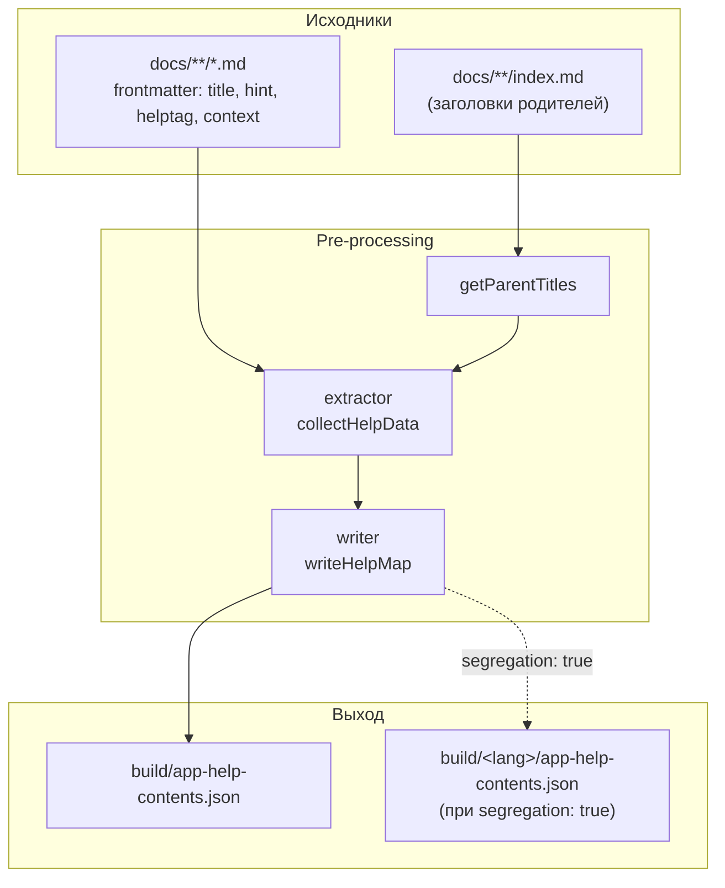
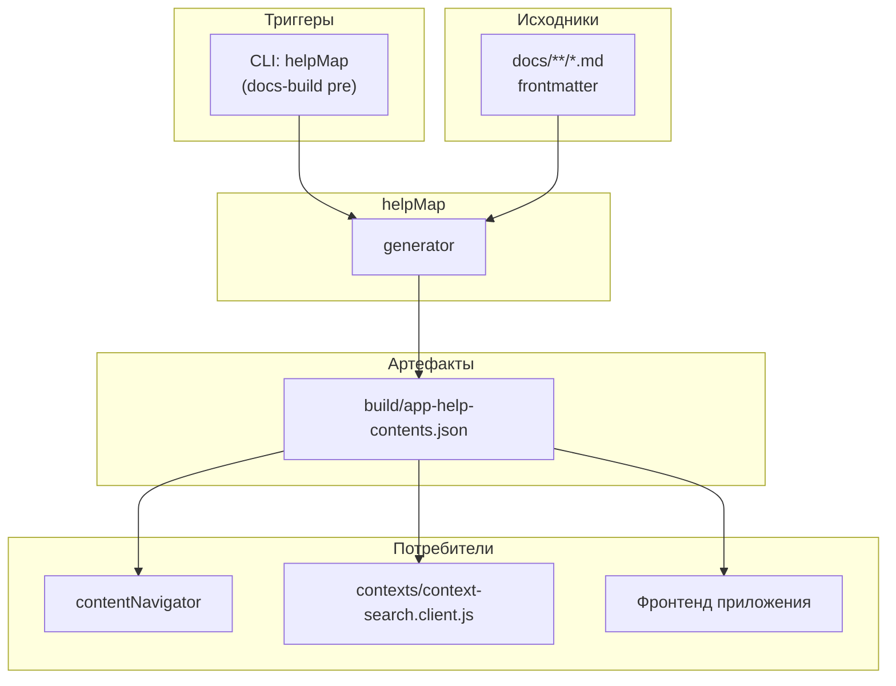

|               |                                                                                                               |
| ------------- | ------------------------------------------------------------------------------------------------------------- |
| ID            | [8.2-008](../../%D0%A1%D0%BE%D0%B3%D0%BB%D0%B0%D1%88%D0%B5%D0%BD%D0%B8%D1%8F/index.md#identifikaciya-modulej) |
| Идентификатор | `helpMap`                                                                                                     |
| Наименование  | Карта помощи                                                                                                  |
| Слой          | [pre-processing](../%D0%A1%D0%BB%D0%BE%D0%B8layer/PreProcessing/index.md#naznachenie)                           |
| Расположение  | `src/plugins/helpMap/`                                                                                        |
| Точка входа   | `runGeneration({ docsDir, outputDir, segregation })`                                                          |
| Версия        | `1.54.0`                                                                                                      |
| Назначение    | Собирает метаданные всех статей в `app-help-contents.json` — источник для фронтенда, отчётов и поиска         |

{: .page-legend }

## Назначение

Модуль `helpMap` проходит по `docs/**/*.md`, извлекает из frontmatter каждой статьи поля `title`, `hint`, `helptag`, `context`, добавляет `url`, `lang`, `parents` (заголовки родительских папок) и `size` (размер `.md`) — и складывает всё в единый JSON.

Этот JSON (`app-help-contents.json`) — центральный артефакт «данных о документации»: его читают:

- **`contentNavigator`** — строит отчёты (таблица размеров, контекстные карты, helptag-карты);
- **клиентский поиск контекстов** (`contexts/context-search.client.js`) — по нему ищет статьи по контекстам;
- **фронтенд приложения** — по `helptag` подтягивает тултипы для пользователя (то, ради чего поле вообще существует).

Модуль работает только в `pre-processing` и не имеет клиентской или VS Code-части (см. «Режимы работы»).

## Применение

**Когда использовать:** нужен структурированный JSON со всеми статьями (заголовок, размер, `context`, `helptag`, `hint`, `parents`) — для отчётов, клиентского поиска или интеграции с внешним приложением.

**Когда НЕ использовать:** если не запускаются `contentNavigator`-отчёты и не нужен клиентский поиск — JSON не потребляется.

**Альтернативы:**
- `grep`/`rg` по `docs/` — не собирает `parents`, `size`, frontmatter в один файл.
- Ручное ведение JSON — рассинхронизируется с `.md`.

**Типичный сценарий:** `docs-build.js` → `pre` → `helpMap` создаёт `build/app-help-contents.json` → его читают `presetsStat`, `contexts`, `context-search.client`, `bytescounter`, `contextmap`, `helptagmap`.

## Как это работает



1. **Обход.** `collectHelpData(docsDir)` рекурсивно обходит `docs/`, пропускает файлы и папки, начинающиеся с `.`, и вызывает `mdFlow` для каждого `.md`.

2. **Извлечение.** Для каждого файла:
   - читается содержимое через `gray-matter`;
   - `title` — приоритет `data.title` → `data.pureTitle` → `''`;
   - `hint`, `helptag`, `context` — как есть из frontmatter (или `''`);
   - `url` — относительный путь `.md` → `.html`, с особым правилом для `index.md`;
   - `lang` — первый сегмент относительного пути (`ru` / `en`);
   - `size` — `fs.statSync(fullPath).size` (размер **исходного .md**, не HTML);
   - `parents` — через `getParentTitles` (см. ниже).

3. **`getParentTitles`.** Для статьи `docs/ru/foo/bar/index.md` возвращает массив `['<title foo>', '<title bar>']`, читая frontmatter `index.md` в каждой родительской папке. Если `index.md` нет или в нём нет `title` — в массив попадает имя папки.

4. **Запись.** `writeHelpMap`:
   - `segregation: false` (по умолчанию) → один файл `build/app-help-contents.json` со всеми языками в одном массиве;
   - `segregation: true` → `build/ru/app-help-contents.json` и `build/en/app-help-contents.json`, по одному на язык.

### Файлы модуля

| Файл                   | Ответственность                                                        |
| ---------------------- | ---------------------------------------------------------------------- |
| `helpmap.js`           | `runGeneration({ docsDir, outputDir, segregation })` — оркестратор     |
| `helpmap.extractor.js` | `collectHelpData`, `getParentTitles`, `mdFlow`                         |
| `helpmap.writer.js`    | `writeHelpMap` — запись JSON (с опцией `segregation`)                  |
| `helpmap.config.js`    | `outputFileName`, `outputFolderName`, `docsFolderName`, дефолты полей  |
| `helpmap.types.js`     | пустой (`module.exports = []`) — декларация типа `HelpEntry` для JSDoc |

### Формат `app-help-contents.json`

```json
[
  {
    "url": "ru/Модули/МодульХлебныеКрошки/index.html",
    "title": "Модуль. Хлебные крошки",
    "size": 4512,
    "hint": "",
    "helptag": "breadcrumb",
    "context": "breadcrumb, post-processing, html",
    "lang": "ru",
    "parents": ["Модули"]
  }
]
```

| Поле      | Источник                                    | Комментарий                                         |
| --------- | ------------------------------------------- | --------------------------------------------------- |
| `url`     | Путь `.md` → `.html` относительно `docsDir` | Особое правило для `index.md`                       |
| `title`   | `data.title` или `data.pureTitle`           | `''`, если оба пусты                                |
| `size`    | `fs.statSync`                               | Размер исходного `.md`                              |
| `hint`    | `data.hint`                                 | Пользовательский, `''` по умолчанию                 |
| `helptag` | `data.helptag`                              | Ключ для тултипов во фронтенде, `''` по умолчанию   |
| `context` | `data.context`                              | Контексты для поиска, `''` по умолчанию             |
| `lang`    | Первый сегмент `url`                        | `ru` / `en`                                         |
| `parents` | `getParentTitles`                           | Заголовки родительских папок, от верхнего к нижнему |

### Правило преобразования `url`

```js
let relativePath = path.relative(docsDir, fullPath).replace(/\.md$/, '').replace(/\\/g, '/');
if (relativePath.endsWith('/index') || relativePath === 'index') {
    relativePath += '.html';
} else if (!relativePath.endsWith('.html')) {
    relativePath += '.html';
}
```

То есть `index.md` → `…/index.html` (не `…/`), и `foo.md` → `foo.html`. Никаких исключений для `toc.yaml` и `index.yaml` — их здесь и нет (модуль читает только `.md`).

## Режимы работы

### CLI

```bash
node ./plugins/diplodoc-helper-cli.js helpMap --docsDir ./docs --outputDir ./build
```

| Аргумент        | Обязателен | По умолчанию | Описание                                       |
| --------------- | ---------- | ------------ | ---------------------------------------------- |
| `--docsDir`     | нет        | `./docs`     | Корень документации                            |
| `--outputDir`   | нет        | `./build`    | Куда писать `app-help-contents.json`           |
| `--segregation` | нет        | `false`      | Флаг: раскладывать по языкам в `build/<lang>/` |

### Сборочный пайплайн

В `docs-build.js` — первая фаза (`pre`), первый содержательный шаг:

```js
cli('helpMap'),
```

Идёт после `reindexFigures` и `reindexFootnotes`, но до `contexts`, `abbrs`, `terms`, `gosts` и тем более до `@diplodoc/cli`. Порядок важен: без готового `app-help-contents.json` не смогут работать `periodicStat`, `periodicTable`, `periodicTableHelpTag`, `periodicTableContext`, а также поиск контекстов на клиенте.

Может быть пропущен флагом `--skip=helpMap` — но тогда упадёт вся цепочка потребителей (в «Известных ограничениях»).

### VS Code

Команда `diplodoc-helper.generateHelpMaps` **зарегистрирована в `package.json`**, но **хендлер отсутствует**. Файл `src/commands/diplodoc-helper.helpMap.Generate.js` содержит только `require`-блок (`nls_ts`, `path`, `vscode`) и **не экспортирует** `ux_helpmap_generate`. В `src/commands/index.js` вызов:

```js
const { ux_helpmap_generate } = require('./diplodoc-helper.helpMap.Generate');
```

даёт `undefined`, и команда регистрируется с `undefined` в качестве хендлера. При попытке вызова — ошибка в консоли расширения. См. «Известные ограничения».

## Юнит-тесты





## Связи

`helpMap` — «поставщик данных» для нескольких потребителей, сам ничего не читает, кроме `docs/**/*.md`. Прямых зависимостей от `shared-core` почти нет: `frontmatter.utils` не используется — модуль работает с `gray-matter` напрямую и читает `index.md` своими руками. Это единственный генератор, у которого нет папки `shared/`.

Потребители:

- **`contentNavigator`** — `periodicStat`, `periodicTable`, `periodicTableHelpTag`, `periodicTableContext` читают `build/app-help-contents.json`;
- **клиентский поиск контекстов** (`contexts/context-search.client.js`) — через `fetch('../app-help-contents.json')`;
- **фронтенд приложения** — читает `helptag` и `context` из JSON напрямую (внешний потребитель, не часть расширения).






