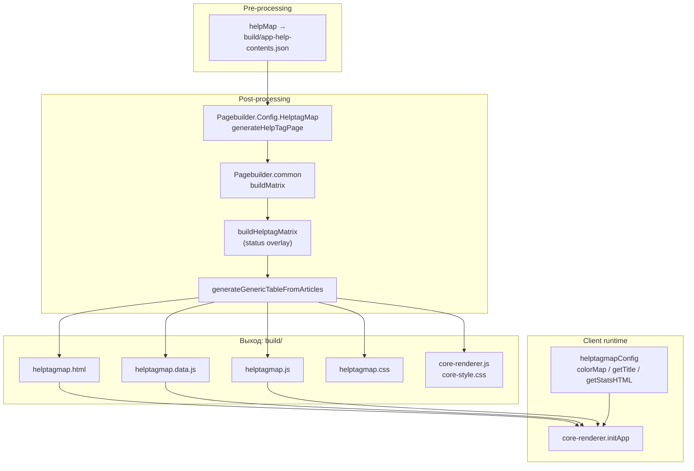
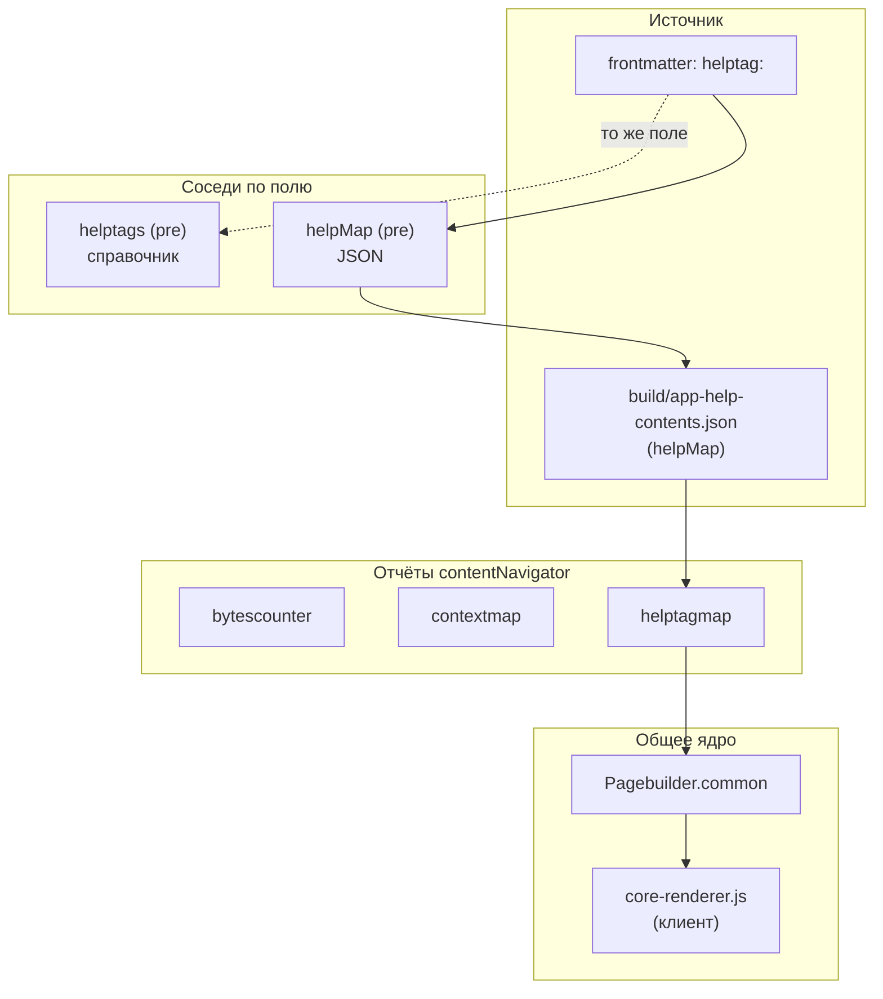

|               |                                                                                                                                                                                                                                                                                                                                                                    |
| ------------- | ------------------------------------------------------------------------------------------------------------------------------------------------------------------------------------------------------------------------------------------------------------------------------------------------------------------------------------------------------------------ |
| ID            | [4.2-017](../../%D0%A1%D0%BE%D0%B3%D0%BB%D0%B0%D1%88%D0%B5%D0%BD%D0%B8%D1%8F/index.md#identifikaciya-modulej)                                                                                                                                                                                                                                                      |
| Идентификатор | `helptagmap`                                                                                                                                                                                                                                                                                                                                                       |
| Наименование  | Карта справочных тегов                                                                                                                                                                                                                                                                                                                                             |
| Слой          | [Post-processing](../../%D0%A1%D0%BB%D0%BE%D0%B8layer/%D0%A1%D0%BB%D0%BE%D0%B9Postprocessing/index.md#naznachenie) / [client-runtime](../%D0%A1%D0%BB%D0%BE%D0%B8layer/ClientRuntime/index.md#naznachenie)                                                                                                                                                                                    |
| Каталог       | [Отчёты](../../%D0%9A%D0%B0%D1%82%D0%B0%D0%BB%D0%BE%D0%B3Capabilitymap/%D0%9A%D0%B0%D1%82%D0%B0%D0%BB%D0%BE%D0%B3%D0%9E%D1%82%D1%87%D1%91%D1%82%D1%8B/index.md#otchety)                                                                                                                                                                                                                                                                                                                                                                   |
| Семейство     | [Helptags](../../%D0%A1%D0%B5%D0%BC%D0%B5%D0%B9%D1%81%D1%82%D0%B2%D0%BEfamily/%D0%A1%D0%B5%D0%BC%D0%B5%D0%B9%D1%81%D1%82%D0%B2%D0%BEHelptags/index.md#fam-helptags) / [Отчёты](../../%D0%A1%D0%B5%D0%BC%D0%B5%D0%B9%D1%81%D1%82%D0%B2%D0%BEfamily/%D0%A1%D0%B5%D0%BC%D0%B5%D0%B9%D1%81%D1%82%D0%B2%D0%BE%D0%9E%D1%82%D1%87%D1%91%D1%82%D1%8B/index.md#fam-reports) |
| Расположение  | `src/plugins/contentNavigator/Pagebuilder.Config.HelptagMap.js`, `helptagmap.js`, `helptagmap.css`                                                                                                                                                                                                                                                                 |
| Точка входа   | `generateHelpTagPage({ mapDir, outputDir, lang })`                                                                                                                                                                                                                                                                                                                 |
| Версия        | `1.54.0`                                                                                                                                                                                                                                                                                                                                                           |
| Назначение    | Генерирует страницу с тепловой картой наличия `helptag` по разделам и главам                                                                                                                                                                                                                                                                                       |

{: .page-legend }

## Назначение

`helptagmap` — третий отчёт семейства `contentNavigator` (после [`bytescounter`](../%D0%A0%D0%B5%D0%B5%D1%81%D1%82%D1%80/%D0%9C%D0%BE%D0%B4%D1%83%D0%BB%D1%8C%D0%A0%D0%B0%D0%B7%D0%BC%D0%B5%D1%80%D1%8B%D1%81%D1%82%D0%B0%D1%82%D0%B5%D0%B9/index.md) и [`contextmap`](../МодульКартаконтекстов/index.md)). Читает `app-help-contents.json` (создан [`helpMap`](../МодульКартапомощи/index.md)), группирует статьи по разделам и главам и рисует таблицу-карту: по вертикали — главы, по горизонтали — разделы, в ячейках — плитки статей, цвет плитки — **есть ли у статьи `helptag`**.

Практический смысл. Поле `helptag:` — это ключ, по которому фронтенд приложения находит статью для тултипа (см. [`helpMap`](../МодульКартапомощи/index.md) и [`helptags`](../%D0%A0%D0%B5%D0%B5%D1%81%D1%82%D1%80/%D0%9C%D0%BE%D0%B4%D1%83%D0%BB%D1%8C%D0%A1%D0%BF%D1%80%D0%B0%D0%B2%D0%BE%D1%87%D0%BD%D1%8B%D0%B5%D1%82%D0%B5%D0%B3%D0%B8/index.md)). Если у статьи нет `helptag`:

- она **не появится** в подсказках приложения (пользователь не сможет кликнуть на «?» у поля и попасть в справку);
- её легко забыть добавить в интеграцию.

`helptagmap` показывает «сверху»: где `helptag` есть, где нет. Хороший инструмент для ревью перед релизом — «у нас 400 статей, а тег есть только у 200; остальные в приложении не появятся».

## Применение

**Когда использовать:** нужно «взглядом сверху» увидеть, у каких статей `helptag:` есть, у каких нет — для ревью перед релизом («в приложении появятся только эти 200 статей»).

**Когда НЕ использовать:** `helptag:` не используется; нужен только список — хватит `helptags`.

**Альтернативы:**
- `grep helptag:` — не даёт визуальной картины.
- `helpMap` — только JSON, без визуализации.

**Типичный сценарий:** `docs-build.js` → `post` → `periodicTableHelpTag` → `helptagmap.html` с тепловой картой.

## Как это работает



### Фаза 1. Конфиг модуля

`Pagebuilder.Config.HelptagMap.js` — минимальный конфиг, отличающийся от соседей только именами файлов, легендой и `matrixBuilder`:

```js
return generateGenericTableFromArticles({
    mapDir, outputDir, lang,
    htmlFileName: 'helptagmap.html',
    cssFileName: 'helptagmap.css',
    jsFileName: 'helptagmap.js',
    dataFileName: 'helptagmap.data.js',
    title: 'Распределение helptag по разделам и главам',
    legendItems: [
        { color: 'color-excess', description: '&gt;1 helptag' },
        { color: 'color-normal', description: 'Один helptag' },
        { color: 'color-empty',  description: 'Нет helptag (0)' },
        { color: 'chapter-article', description: 'Текст главы' },
    ],
    matrixBuilder: buildHelptagMatrix,
    navLinks: [
        { label: 'Размеры',   url: 'bytescounter.html' },
        { label: 'Контексты', url: 'contextmap.html' },
    ],
});
```

Обрати внимание: в легенде три статуса (`excess`/`normal`/`empty`), а в `getHelptagStatus` — фактически используются только два (см. «Известные ограничения»).

### Фаза 2. Сбор матрицы

`buildHelptagMatrix(jsonData, lang)` — двухшаговая обёртка:

1. **Базовая матрица.** `buildMatrix(jsonData, lang)` из `Pagebuilder.common.js` — группировка по разделам и главам, средний размер, статус по размеру.
2. **Overlay `helptag`.** `matrixData.matrix.map(row => row.map(cell => cell.map(art => ({ ...art, status: getHelptagStatus(art).status }))))` — для каждой статьи вычисляется новый `status` по полю `helptag`, он заменяет «размерный».

`getHelptagStatus(art)`:

```js
const hasHelptag = art.helptag && art.helptag.trim() !== '';
const count = hasHelptag ? 1 : 0;
if (count === 0) return { status: 'empty',  label: 'Нет helptag' };
if (count === 1) return { status: 'normal', label: 'Один helptag' };
return               { status: 'excess', label: '>1 helptag' };
```

`count` — **бинарный** (0 или 1), независимо от количества тегов в строке. То есть `helptag: "nomenclature, invoice"` (два тега) даст `count = 1` и статус `normal`, а не `excess`. Ветка `excess` в этой функции недостижима (см. «Известные ограничения»).

Возвращает `{ matrix, rows, cols, totalArticles }` — без `avgSize` (как и `contextmap`).

### Фаза 3. Запись артефактов

Всё — через `generateGenericTableFromArticles`. В `outputDir`:

1. **`helptagmap.data.js`** — данные для клиента:
   ```js
   const periodicData = {
       matrixData: { ru: { matrix, rows, cols, totalArticles }, en: {…} },
       legendItems: [...],
       navLinks: [...],
   };
   ```
2. **Копии клиентских файлов** из `src/plugins/contentNavigator/`:
   - `helptagmap.css`, `helptagmap.js`;
   - `core-renderer.js`, `core-style.css` (общие).
3. **`helptagmap.html`** — из `page-template.html`.

### Фаза 4. Клиентский рендер

`helptagmap.js`:

```js
const helptagmapConfig = {
    colorMap: {
        'empty':  'color-empty',
        'normal': 'color-normal',
        'excess': 'color-excess',
    },
    getTitle(art) {
        let title = art.title;
        if (art.helptag && art.helptag.trim() !== '') {
            title += '\n' + art.helptag.trim();
        }
        return title;
    },
    getStatsHTML(lang, matrixData, t) {
        // распределение по статусам, склейка через '; '
    },
};

const ARTICLE_STATUS_I18N_TEXTS = {
    ru: { empty: 'Без тэгов',  normal: 'Один тэг',  excess: 'Избыточно' },
    en: { empty: 'No tags',    normal: 'Single tag', excess: 'Excess' },
};

function ARTICLE_STATUS_I18N(status) {
    const uiLang = document.documentElement.lang || 'ru';
    const t = ARTICLE_STATUS_I18N_TEXTS[uiLang] || ARTICLE_STATUS_I18N_TEXTS.ru;
    return t[status] || status;
}

function renderAll(matrixDataMap, navLinks) {
    initApp(matrixDataMap, navLinks, helptagmapConfig);
}
```

Отличия от `contextmapConfig`:

| Аспект                          | `contextmap`                                                    | `helptagmap`                           |
| ------------------------------- | --------------------------------------------------------------- | -------------------------------------- |
| **`getTitle`**                  | `title\ncontext`                                                | `title\nhelptag`                       |
| **`colorMap`**                  | 4 ключа (`empty`/`low`/`normal`/`excess`)                       | 3 ключа (`empty`/`normal`/`excess`)    |
| **`ARTICLE_STATUS_I18N_TEXTS`** | «Без контекста» / «Мало контекстов» / «Нормально» / «Избыточно» | «Без тэгов» / «Один тэг» / «Избыточно» |
| **Логика статуса**              | Считает контексты по запятой                                    | Бинарно: есть/нет                      |

`core-renderer.js` — общий, ничего не знает про `helptag`. `renderArticles` рисует плитки с `title`-подсказкой из `config.getTitle`, цвет из `colorMap`.

### Файлы модуля

| Файл                                                            | Ответственность                                                   |
| --------------------------------------------------------------- | ----------------------------------------------------------------- |
| `src/plugins/contentNavigator/Pagebuilder.Config.HelptagMap.js` | `generateHelpTagPage`, `buildHelptagMatrix`, `getHelptagStatus`   |
| `src/plugins/contentNavigator/Pagebuilder.common.js`            | **Общее ядро**: `generateGenericTableFromArticles`, `buildMatrix` |
| `src/plugins/contentNavigator/page-template.html`               | HTML-шаблон                                                       |
| `src/plugins/contentNavigator/core-renderer.js`                 | **Клиент:** общий рендерер                                        |
| `src/plugins/contentNavigator/core-style.css`                   | Общие стили                                                       |
| `src/plugins/contentNavigator/helptagmap.js`                    | **Клиент:** конфиг + `renderAll` + `ARTICLE_STATUS_I18N_TEXTS`    |
| `src/plugins/contentNavigator/helptagmap.css`                   | Стили, специфичные для `helptagmap`                               |

### Формат `helptagmap.data.js`

```js
const periodicData = {
    matrixData: {
        ru: {
            matrix: [ [ [ { title, helptag, url, status, isChapterArticle }, … ], … ], … ],
            rows: ['Текст раздела', '01', '02', …, 'Прочее'],
            cols: [ { key: 'Раздел 1', displayName: 'Раздел 1. Введение' }, … ],
            totalArticles: 487,
        },
        en: { … },
    },
    legendItems: [ … ],
    navLinks: [ … ],
};
```

## Режимы работы

### CLI

```bash
node ./plugins/diplodoc-helper-cli.js periodicTableHelpTag
```

| Аргумент | Обязателен | По умолчанию | Описание       |
| -------- | ---------- | ------------ | -------------- |
| —        | —          | —            | Аргументов нет |

`docsDir` / `outputDir` парсятся на уровне CLI, но `generateHelpTagPage` использует только `outputDir` (через `mapDir`).

Команда `periodicTableHelpTag` — «периодическая карта helptag». Как и соседи, историческое имя.

### Сборочный пайплайн

В `docs-build.js`, фаза `post`:

```js
cli('periodicTableHelpTag'),
```

Идёт после `periodicTable`, `periodicTableContext`. Пропускается флагом `--skip=periodicTableHelpTag`.

### VS Code

Собственной команды нет. `diplodoc-helper.generateContextmap` (в меню `Debug`) генерирует все три отчёта подряд — включая `helptagmap`. Отдельной команды «сгенерировать только helptagmap» нет.

## Юнит-тесты





## Связи

`helptagmap` — третий из четырёх отчётов `contentNavigator`:

| Модуль           | Логика статуса                          | Число ключей `colorMap` |
| ---------------- | --------------------------------------- | ----------------------- |
| `bytescounter`   | `size / avg` → 5 статусов               | 5                       |
| `contextmap`     | `count(context.split(','))` → 4 статуса | 4                       |
| **`helptagmap`** | `helptag ? 1 : 0` → **2 статуса**       | 3                       |
| `presetsStat`    | — (нет клиента)                         | —                       |

Отличие `helptagmap` от `contextmap` — только в `getHelptagStatus` и `getTitle`. Всё остальное (структура данных, клиентский рендер, шаблон) идентично.

**Связь с `helptag` как полем.** Поле `helptag:` в frontmatter — **общий вход** для трёх модулей:

- **[`helptags`](../%D0%A0%D0%B5%D0%B5%D1%81%D1%82%D1%80/%D0%9C%D0%BE%D0%B4%D1%83%D0%BB%D1%8C%D0%A1%D0%BF%D1%80%D0%B0%D0%B2%D0%BE%D1%87%D0%BD%D1%8B%D0%B5%D1%82%D0%B5%D0%B3%D0%B8/index.md)** (pre) — генерирует страницу-справочник тегов;
- **[`helpMap`](../МодульКартапомощи/index.md)** (pre) — складывает `helptag` в `app-help-contents.json` (для фронтенда);
- **`helptagmap`** (post) — показывает «у кого есть, у кого нет» в виде карты.

Каждый работает независимо, источник один — frontmatter. Правка `helptag` в статье должна приводить к перегенерации всех трёх артефактов.






