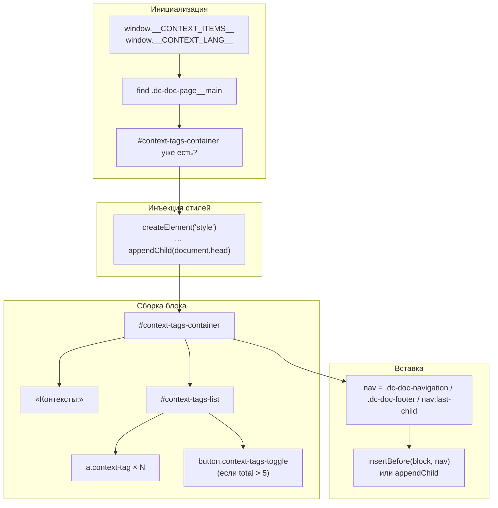
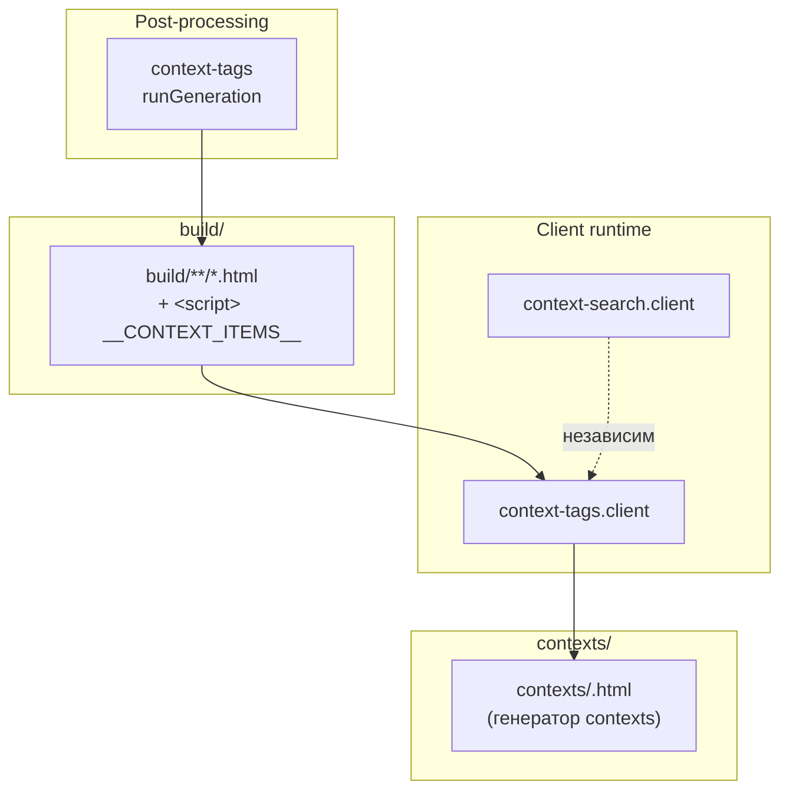



## Назначение

`context-tags.client` — клиентская часть модуля [`context-tags`](../МодульКонтекстныеТеги/index.md). Инжектор `context-tags.js` вставляет `<script>` в каждую HTML-страницу с `window.__CONTEXT_ITEMS__`:

```js
window.__CONTEXT_ITEMS__ = [
    { label: 'breadcrumb', slug: 'breadcrumb' },
    { label: 'post-processing', slug: 'post-processing' },
    { label: 'html', slug: 'html' },
];
window.__CONTEXT_LANG__ = 'ru';
```

`context-tags.client` подхватывает и рисует **в конце статьи** (перед навигацией) блок:

```
Контексты:
[breadcrumb] [post-processing] [html] [ещё 3]
```

- **чипы** — ссылки на `/ru/contexts/<slug>.html`;
- **«ещё N» / «свернуть»** — если контекстов больше 5, показываются первые 5, остальные скрываются.

Зачем это нужно. В каждой статье уже есть `context: …` во frontmatter, но читатель её не видит (это метаданные). `context-tags` показывает их в конце статьи — как «теги» — чтобы читатель мог:

1. увидеть, к какой предметной области относится статья;
2. кликнуть на контекст и перейти на страницу `contexts/<slug>.html` — где список **всех** статей с этим контекстом (создан [`contexts`](../%D0%A0%D0%B5%D0%B5%D1%81%D1%82%D1%80/%D0%9C%D0%BE%D0%B4%D1%83%D0%BB%D1%8C%D0%9A%D0%BE%D0%BD%D1%82%D0%B5%D0%BA%D1%81%D1%82%D1%8B/index.md));
3. через эту страницу — найти смежные статьи.

Это «перекрёстная навигация по контекстам» в конце статьи.

## Применение

**Когда использовать:** всегда вместе с [`context-tags`](../%D0%A0%D0%B5%D0%B5%D1%81%D1%82%D1%80/%D0%9C%D0%BE%D0%B4%D1%83%D0%BB%D1%8C%D0%9A%D0%BE%D0%BD%D1%82%D0%B5%D0%BA%D1%81%D1%82%D0%BD%D1%8B%D0%B5%D1%82%D0%B5%D0%B3%D0%B8/index.md) — рисует чипы контекстов в конце статьи, ссылается на страницы `contexts/<slug>.html`.

**Когда НЕ использовать:** без `context-tags` в HTML нет `window.__CONTEXT_ITEMS__`.

**Альтернативы:**
- Ручной список контекстов в каждой статье — рассинхронизируется.
- `context-search.client` — поиск, а не показ тегов в конце статьи.

**Типичный сценарий:** `context-tags` встраивает `<script>` с `__CONTEXT_ITEMS__` → клиент создаёт `#context-tags-container` перед `.dc-doc-navigation`.

## Как это работает



### Фаза 1. Поиск контейнера

```js
function insertContextTags() {
    var container = document.querySelector('.dc-doc-page__main');
    if (!container) {
        setTimeout(insertContextTags, 300);
        return;
    }
    if (document.getElementById('context-tags-container')) return;
    // …
}
```

- **`.dc-doc-page__main`** — контейнер статьи в Diplodoc.
- **Если нет** — retry через 300 мс (бесконечно, пока не появится).
- **Если уже есть `#context-tags-container`** — выход (идемпотентность).

### Фаза 2. Инъекция стилей

```js
var style = document.createElement('style');
style.textContent = [
    '.context-tags-container { margin-top: 2rem; padding: 1rem 0; border-top: 1px solid #eaecef; }',
    '.context-tags-title { font-size: 0.9rem; color: #586069; margin-bottom: 0.5rem; }',
    '.context-tags-list { display: flex; flex-wrap: wrap; gap: 0.5rem; align-items: center; }',
    '.context-tag { … background-color: #f1f8ff; color: #0366d6; … border: 1px solid #c8e1ff; … }',
    '.context-tag:hover { background-color: #dcecff; … }',
    '.context-tag-hidden { display: none !important; }',
    '.context-tags-toggle { … }',
    '.context-tags-toggle:hover { … }',
].join('\n');
document.head.appendChild(style);
```

Стили **инжектятся из скрипта** (не из отдельного `.css`). 8 правил, ~1500 символов. При каждом вызове — новый `<style>` в `<head>`. Если на странице один вызов — ок, но при повторных (например, гипотетическая SPA) — дублирование.

### Фаза 3. Сборка блока

```js
var block = document.createElement('div');
block.id = 'context-tags-container';
block.className = 'context-tags-container';

var title = document.createElement('div');
title.className = 'context-tags-title';
title.textContent = currentLang === 'ru' ? 'Контексты:' : 'Contexts:';
block.appendChild(title);

var list = document.createElement('div');
list.className = 'context-tags-list';

var total = items.length;
var hasMore = total > visibleCount;
var visibleCount = 5;

var sortedItems = items.slice().sort(function (a, b) {
    return a.label.localeCompare(b.label, currentLang, { sensitivity: 'base' });
});

sortedItems.forEach(function (item, index) {
    var a = document.createElement('a');
    var targetQuery = encodeURIComponent(item.label);
    a.href = '/' + currentLang + `/contexts/${targetQuery}.html`;
    a.textContent = item.label;
    a.className = 'context-tag';
    if (index >= visibleCount) a.classList.add('context-tag-hidden');
    list.appendChild(a);
});

if (hasMore) {
    var moreButtonsCount = total - visibleCount;
    var moreButtonCaption = currentLang === 'ru' ? 'ещё' : 'more';
    var collapseButtonCaption = currentLang === 'ru' ? 'свернуть' : 'collapse';
    var button = document.createElement('button');
    button.textContent = `${moreButtonCaption} ${moreButtonsCount}`;
    button.className = 'context-tags-toggle';
    button.addEventListener('click', function () {
        var hidden = list.querySelectorAll('.context-tag-hidden');
        if (hidden.length > 0) {
            hidden.forEach(function (el) { el.classList.remove('context-tag-hidden'); });
            button.textContent = collapseButtonCaption;
        } else {
            var allTags = list.querySelectorAll('.context-tag');
            allTags.forEach(function (el, idx) {
                if (idx >= visibleCount) el.classList.add('context-tag-hidden');
            });
            button.textContent = `${moreButtonCaption} ${moreButtonsCount}`;
        }
    });
    list.appendChild(button);
}

block.appendChild(list);
```

**3.1. Сортировка** — `label.localeCompare(..., currentLang, { sensitivity: 'base' })`. Контексты сортируются алфавитно в текущей локали.

**3.2. Чипы** — `<a href="/ru/contexts/<slug>.html">`. `encodeURIComponent(item.label)` — ссылка на страницу контекста. **Стоп**: `item.label` — это **видимое имя** (например, `breadcrumb`), а `item.slug` — слагифицированное имя файла. В `context-tags.js` (серверная часть) `contextItems` содержит **оба** поля:

```js
const contextItems = contexts.map(c => {
    const context = c.toLowerCase();
    const slug = context.replace(/\s+/g, '');
    return { label: context, slug: slug };
});
```

То есть `slug = label.replace(/\s+/g, '')` — только удаляет пробелы, без транслитерации. `encodeURIComponent('пост-обработка')` → `%D0%BF%D0%BE%D1%81%D1%82-%D0%BE%D0%B1%D1%80%D0%B0%D0%B1%D0%BE%D1%82%D0%BA%D0%B0`. Совпадает ли это с реальным именем файла в `contexts/`?

В `contexts.writer.writeTermFiles`:

```js
const slug = slugify_filename(term);
// slugify_filename: replace(/[^12]/gu, '_')
```

`slugify_filename` сохраняет кириллицу (`\p{L}` — все буквы Unicode). То есть `пост-обработка` → `пост-обработка` (без изменений). `encodeURIComponent` кодирует в `%D0%BF…`. Файл `contexts/пост-обработка.md` → `contexts/пост-обработка.html`. `href` с `%D0%BF…` — работает (браузер декодирует).

Но: `slug` в `context-tags.client` = `label.replace(/\s+/g, '')`. `label` = `context.toLowerCase()`. Пробелы удаляются, но **не заменяются** на дефисы/подчёркивания. То есть `пост обработка` (с пробелом) → `постобработка` (слиплось). А `writeTermFiles` использует `slugify_filename(term)` = `пост_обработка` (заменил пробел на `_`).

**Расхождение**: ссылка `contexts/постобработка.html`, файл `contexts/пост_обработка.html`. 404.

Стоп, но `slug` в `context-tags.client` вообще не используется — используется `label`:

```js
var targetQuery = encodeURIComponent(item.label);
a.href = '/' + currentLang + `/contexts/${targetQuery}.html`;
```

Значит URL — `contexts/<label>.html`, где `<label>` — исходный (lowercase) контекст. `writeTermFiles` создаёт `contexts/<slugify_filename(term)>.html`. Если `label` = `term` (без пробелов) — совпадает. Если `label` содержит пробел — расходятся.

**Реальный баг**: контексты с пробелом (`context: "product catalog"`) → `label = "product catalog"`, ссылка `contexts/product%20catalog.html`, файл `contexts/product_catalog.html`. 404.

Для контекстов без пробелов (`breadcrumb`, `post-processing`) — совпадает (только `encodeURIComponent`).

### Фаза 4. Вставка

```js
var nav = container.querySelector('.dc-doc-navigation, .dc-doc-footer, nav:last-child');
if (nav) {
    container.insertBefore(block, nav);
} else {
    container.appendChild(block);
}
```

- **Если есть навигация** (`.dc-doc-navigation` / `.dc-doc-footer` / `nav:last-child`) — вставляем **перед** ней.
- **Иначе** — в конец контейнера.

То есть блок «Контексты» появляется **между** статьёй и навигацией.

### Фаза 5. Что делает `MutationObserver`?

**Ничего.** В коде нет `MutationObserver`. Есть только `setTimeout(insertContextTags, 300)` при отсутствии `.dc-doc-page__main`. Если контейнер появился через 300 мс — инициализация сработает. Если позже — нет.

### Файлы модуля

| Файл                                              | Ответственность                                                           |
| ------------------------------------------------- | ------------------------------------------------------------------------- |
| `src/plugins/context-tags/context-tags.client.js` | Весь клиент (со стилями inline)                                           |
| `src/plugins/context-tags/context-tags.js`        | Инжектор (генерирует `<script>` с `__CONTEXT_ITEMS__` и вставляет в HTML) |

### Данные

```js
window.__CONTEXT_ITEMS__ = [{ label, slug }];
window.__CONTEXT_LANG__ = 'ru' | 'en';
```

`label` — lowercase контекст (после `toLowerCase()` и `.trim()`), `slug` — `label` без пробелов (не используется).

## Режимы работы

### Клиентский runtime

Внедряется в каждую HTML-страницу, где есть `<meta name="context">` (Diplodoc генерирует из frontmatter). `context-tags.js` (`runGeneration(buildDir)`) обходит все `*.html`, читает `<meta>`, если контексты есть — вставляет `<script>`.

### Проверка в DevTools

```js
window.__CONTEXT_ITEMS__                                  // → [{ label, slug }, …]
document.getElementById('context-tags-container')         // → <div>
document.querySelectorAll('.context-tag').length          // → число контекстов
document.querySelectorAll('.context-tag-hidden').length   // → скрытые (после 5)
```

## Юнит-тесты





## Связи

`context-tags.client` — «листовая» часть пары `context-tags` / `context-tags.client`. Зависимости через готовый HTML:

- **`context-tags.runGeneration(buildDir)`** — обходит `build/*.html`, читает `<meta name="context">`, вставляет `<script>`;
- **`context-tags.generateContextScript(contexts, htmlPath, buildDir)`** — формирует inline-скрипт с `__CONTEXT_ITEMS__`.

Независим от `context-search.client` (тот на странице `contexts/index.html`, работает с вводом контекстов; этот — в конце каждой статьи, показывает чипы). Оба используют общее понятие «контекст», но разные задачи:

- **`context-tags.client`** — «показать контексты этой статьи + навигация на страницу контекста»;
- **`context-search.client`** — «найти статьи по комбинации контекстов».








