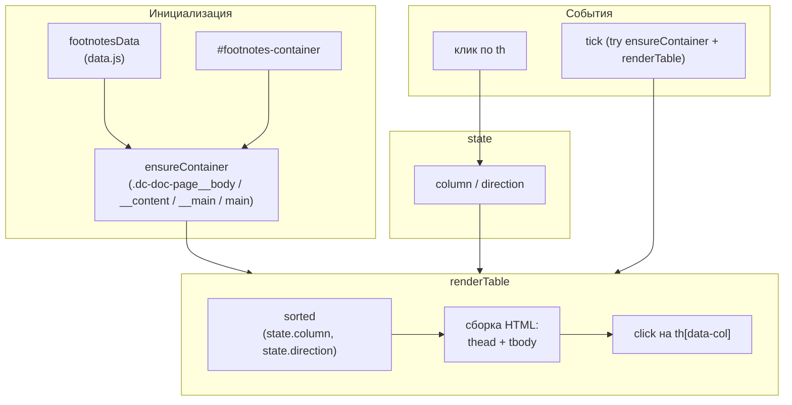
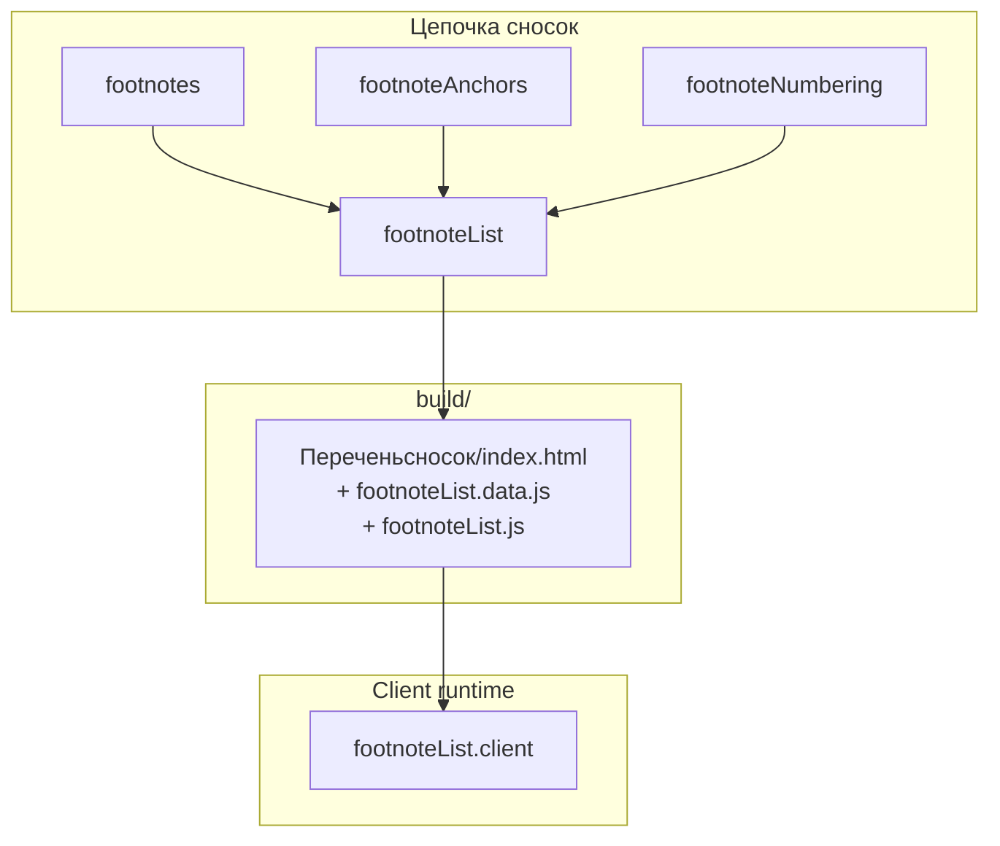

|               |                                                                                                                                                                                                                                                                 |
| ------------- | --------------------------------------------------------------------------------------------------------------------------------------------------------------------------------------------------------------------------------------------------------------- |
| ID            | [5.1-036](../../../%D0%A1%D0%BE%D0%B3%D0%BB%D0%B0%D1%88%D0%B5%D0%BD%D0%B8%D1%8F/index.md#identifikaciya-modulej)                                                                                                                                                   |
| Идентификатор | `footnoteList.client`                                                                                                                                                                                                                                           |
| Наименование  | Клиент перечня сносок                                                                                                                                                                                                                                           |
| Слой          | [Клиентский runtime](../../%D0%A1%D0%BB%D0%BE%D0%B8layer/%D0%A1%D0%BB%D0%BE%D0%B9%D0%9A%D0%BB%D0%B8%D0%B5%D0%BD%D1%82%D1%81%D0%BA%D0%B8%D0%B9runtime/index.md#naznachenie)                                                                                      |
| Каталог       | [Навигация](../../%D0%9A%D0%B0%D1%82%D0%B0%D0%BB%D0%BE%D0%B3Capabilitymap/%D0%9A%D0%B0%D1%82%D0%B0%D0%BB%D0%BE%D0%B3%D0%9D%D0%B0%D0%B2%D0%B8%D0%B3%D0%B0%D1%86%D0%B8%D1%8F/index.md#navigaciya)                                                                                          |
| Семейство     | [Сноски](../../%D0%A1%D0%B5%D0%BC%D0%B5%D0%B9%D1%81%D1%82%D0%B2%D0%BEfamily/%D0%A1%D0%B5%D0%BC%D0%B5%D0%B9%D1%81%D1%82%D0%B2%D0%BE%D0%A1%D0%BD%D0%BE%D1%81%D0%BA%D0%B8/index.md#fam-footnote)                                                                   |
| Расположение  | `src/plugins/contentNavigator/footnoteList.js` (копируется модулем [`footnoteList`](../%D0%A0%D0%B5%D0%B5%D1%81%D1%82%D1%80/%D0%9C%D0%BE%D0%B4%D1%83%D0%BB%D1%8C%D0%9F%D0%B5%D1%80%D0%B5%D1%87%D0%B5%D0%BD%D1%8C%D1%81%D0%BD%D0%BE%D1%81%D0%BE%D0%BA/index.md)) |
| Точка входа   | IIFE на странице «Перечень сносок»                                                                                                                                                                                                                              |
| Версия        | `1.54.0`                                                                                                                                                                                                                                                        |
| Назначение    | Рисует сводную таблицу сносок из `footnotesData` с сортировкой по колонкам                                                                                                                                                                                      |

{: .page-legend }

## Назначение

`footnoteList.client` — клиентская часть модуля [`footnoteList`](../%D0%A0%D0%B5%D0%B5%D1%81%D1%82%D1%80/%D0%9C%D0%BE%D0%B4%D1%83%D0%BB%D1%8C%D0%9F%D0%B5%D1%80%D0%B5%D1%87%D0%B5%D0%BD%D1%8C%D1%81%D0%BD%D0%BE%D1%81%D0%BE%D0%BA/index.md). Инжектор `injectFootnoteList` вставляет в `index.html` страницы «Перечень сносок»:

- `<link rel="stylesheet" href="…/footnoteList.css">` — стили;
- `<script src="…/footnoteList.data.js" defer>` — `const footnotesData = { items, lang }`;
- `<script src="…/footnoteList.js" defer>` — этот модуль.

`footnoteList.client` подхватывает `footnotesData` и строит таблицу из трёх колонок:

| Номер | Текст сноски           | Применяемость сноски   |
| ----- | ---------------------- | ---------------------- |
| 1     | См. раздел «Установка» | Модуль. Хлебные крошки |
| 2     | Введён в версии 2.1    | Модуль. ГОСТы          |
| …     | …                      | …                      |

- **Номер** — сквозной по проекту (создан `footnoteList` через `collectFootnotes`, после `footnoteNumbering`).
- **Текст** — из `[^N]: …` определения, очищенный от markdown-ссылок.
- **Применяемость** — заголовок статьи (из frontmatter `title`/`pureTitle`), ссылка на статью.

Оба «применения» (текст и статья) — кликабельны: клик по тексту открывает статью на `#fnrefN` (конкретное вхождение), клик по статье — на её начало.

Зачем это нужно. Сноски «размазаны» по всему руководству. Чтобы ревьюер мог проверить: «все ли сноски актуальны, нет ли дубликатов по смыслу, все ли ссылаются на правильные статьи» — нужен сводный список в одном месте.

Модуль работает **только в браузере**. На сервере не исполняется.

## Применение

**Когда использовать:** всегда вместе с [`footnoteList`](../%D0%A0%D0%B5%D0%B5%D1%81%D1%82%D1%80/%D0%9C%D0%BE%D0%B4%D1%83%D0%BB%D1%8C%D0%9F%D0%B5%D1%80%D0%B5%D1%87%D0%B5%D0%BD%D1%8C%D1%81%D0%BD%D0%BE%D1%81%D0%BE%D0%BA/index.md) — рисует таблицу сносок из `footnotesData`, навешивает сортировку по колонкам.

**Когда НЕ использовать:** без `injectFootnoteList` данных нет.

**Альтернативы:**
- Ручная страница «Перечень сносок» — рассинхронизируется.
- Статичная markdown-таблица — без сортировки.

**Типичный сценарий:** `injectFootnoteList` встраивает `<script src="footnoteList.data.js">` + `<script src="footnoteList.js">` → клиент рендерит таблицу.

## Как это работает



### Фаза 1. Проверка `footnotesData`

```js
(function () {
  if (typeof footnotesData === 'undefined') return;
  var items = (footnotesData && footnotesData.items) || [];
  var state = { column: null, direction: null };
  // …
})();
```

Если `data.js` не подключён (или `<script defer>` ещё не выполнился) — выход. `state` — состояние сортировки.

### Фаза 2. `ensureContainer()`

```js
function findArticleBody() {
    return document.querySelector('.dc-doc-page__body')
        || document.querySelector('.dc-doc-page__content')
        || document.querySelector('.dc-doc-page__main')
        || document.querySelector('main');
}

function ensureContainer() {
    var body = findArticleBody();
    if (!body) return null;

    var c = document.getElementById('footnotes-container');
    if (c) return c;

    c = document.createElement('div');
    c.id = 'footnotes-container';
    body.appendChild(c);
    return c;
}
```

- **`findArticleBody`** — ищет контейнер Diplodoc по четырём селекторам, от специфичного к общему.
- **`#footnotes-container`** — если уже есть (например, вставлен через `injectContainerIntoState` — но тот не вызывается), возвращает его. Иначе создаёт и добавляет в конец `<body>`-контейнера.
- **Если `<body>` не найден** — `null`. `tick()` возвращает `false`, retry.

### Фаза 3. `renderTable()`

**3.1. `sorted()`** — возвращает `items.slice()` (копию) или отсортированный:

```js
function sorted() {
    if (!state.column || !state.direction) return items.slice();
    var dir = state.direction === 'asc' ? 1 : -1;
    var col = state.column;
    return items.slice().sort(function (a, b) {
        if (col === 'number') return (a.number - b.number) * dir;
        return String(a[col] || '').localeCompare(String(b[col] || ''), 'ru') * dir;
    });
}
```

- `number` — числовое сравнение;
- `text`/`article` — `localeCompare('ru')`.

**3.2. HTML:**

```js
var html = '<div class="footnote-meta">Всего сносок: ' + rows.length + '</div>';
html += '<table class="footnote-table"><thead><tr>';
for (var i = 0; i < COLUMNS.length; i++) {
    var c = COLUMNS[i];
    var cls = state.column === c.key ? c.className + ' is-active' : c.className;
    html += '<th class="' + cls + '" data-col="' + c.key + '">' +
        esc(c.label) +
        '<span class="sort-indicator">' + indicator(c.key) + '</span>' +
        '</th>';
}
html += '</tr></thead><tbody>';

for (var j = 0; j < rows.length; j++) {
    var it = rows[j];
    var textCell = formatCellContent(it.refUrl, it.text);
    var articleCell = formatCellContent(it.url, it.article);
    html += '<tr>' +
        '<td class="col-number">' + esc(it.number) + '</td>' +
        '<td class="col-text">' + textCell + '</td>' +
        '<td class="col-article">' + articleCell + '</td>' +
        '</tr>';
}
html += '</tbody></table>';
container.innerHTML = html;
```

- **`footnote-meta`** — `«Всего сносок: N»`.
- **`COLUMNS`** — `[{ key: 'number', label: 'Номер', className: 'col-number' }, { key: 'text', label: 'Текст сноски', className: 'col-text' }, { key: 'article', label: 'Применяемость сноски', className: 'col-article' }]`.
- **`formatCellContent(url, text)`** — если `url` задан, обёртка в `<a class="cell-link" href="${url}">${stripLinks(text)}</a>`. `stripLinks` удаляет `<a>` из текста (защита от вложенных ссылок).
- **Сортировка** — по клику на `<th data-col>`:
  - первый → `'asc'`, второй → `'desc'`, третий → сброс.

**3.3. Индикаторы** — `▲` / `▼` через `indicator(colKey)`.

### Фаза 4. `tick()` и retry

```js
function tick() {
    var c = ensureContainer();
    if (!c) return false;
    if (!c.querySelector('.footnote-table')) renderTable();
    return true;
}

if (!tick()) {
    var attempts = 0;
    var timer = setInterval(function () {
        attempts++;
        if (tick() || attempts > 60) clearInterval(timer);
    }, 250);
}

var obs = new MutationObserver(function () {
    if (!document.getElementById('footnotes-container')) tick();
});
obs.observe(document.body, { childList: true, subtree: true });
```

- **`tick()`** — `ensureContainer` + рендер, если таблицы ещё нет.
- **Retry** — 60 попыток по 250 мс (15 сек).
- **`MutationObserver`** — если контейнер **пропал** (например, Diplodoc перерисовал `<body>`), вызывает `tick()` снова. Если контейнер **есть**, но таблицы нет — `tick()` не сработает (потому что `if (!document.getElementById('footnotes-container'))` — контейнер есть). См. «Известные ограничения».

### Файлы модуля

| Файл                                            | Ответственность                                                              |
| ----------------------------------------------- | ---------------------------------------------------------------------------- |
| `src/plugins/contentNavigator/footnoteList.js`  | Весь клиент                                                                  |
| `src/plugins/contentNavigator/footnoteList.css` | Стили (`.footnote-table`, `.cell-link`, `.sort-indicator`, `.footnote-meta`) |

### Данные

`window.footnotesData = { items: [{ number, text, article, url, refUrl }], lang }` — создан `injectFootnoteList`.

| Поле      | Что                                       |
| --------- | ----------------------------------------- |
| `number`  | Сквозной номер (1, 2, …)                  |
| `text`    | Текст определения (без ссылок)            |
| `article` | Заголовок статьи                          |
| `url`     | URL статьи (`../../../ru/foo/index.html`) |
| `refUrl`  | URL статьи + `#fnrefN`                    |

## Режимы работы

### Клиентский runtime

Внедряется автоматически в `build/<lang>/Дополнительнаяинформация/Переченьсносок/index.html` через `injectFootnoteList`.

### Проверка в DevTools

```js
typeof footnotesData                                  // → 'object'
document.getElementById('footnotes-container')        // → <div>
document.querySelectorAll('.footnote-table').length  // → 1
document.querySelectorAll('.footnote-table tbody tr').length // → число сносок
```

## Юнит-тесты





## Связи

`footnoteList.client` — «листовая» часть пары `footnoteList` / `footnoteList.client`. Зависимости через готовый HTML:

- **`footnoteList.injectFootnoteList`** — вставляет `<link>`, `<script>`, `footnoteList.data.js`;
- **`footnoteList.collectFootnotes`** — собирает данные (`items`).

В цепочке сносок (`footnotes` → `footnoteAnchors` → `footnoteNumbering` → `footnoteList`) клиент стоит **последним**: он рендерит таблицу из данных, которые уже пересчитаны (сквозные номера в `footnoteNumbering`).






