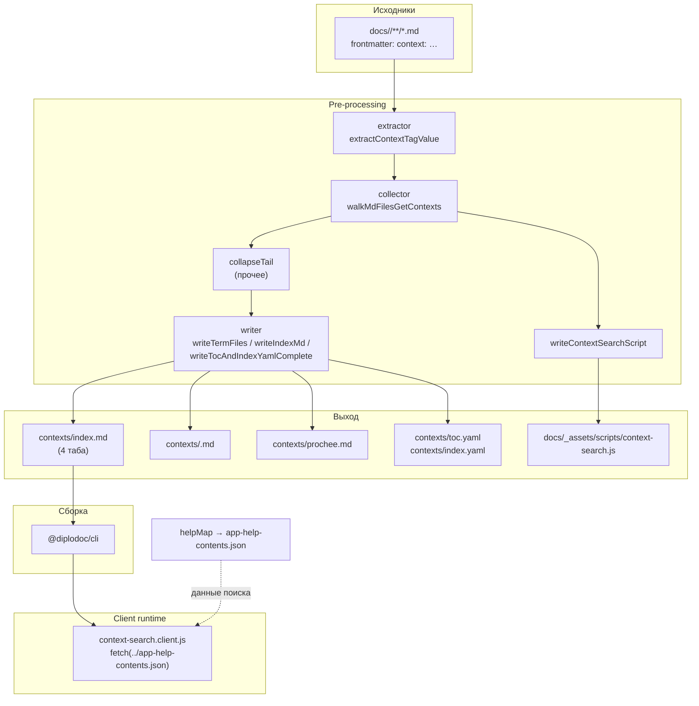
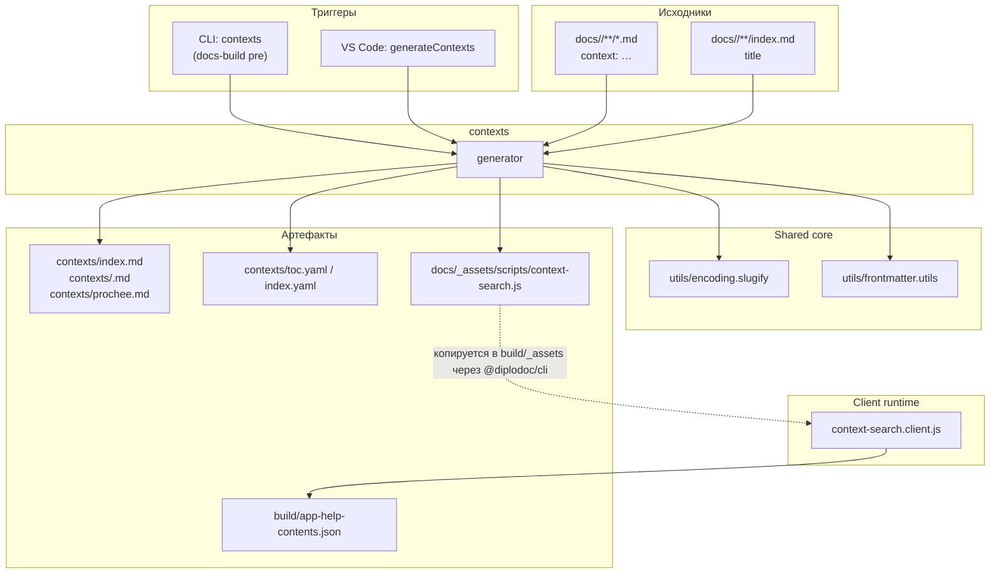

|               |                                                                                                                                                                                                                    |
| ------------- | ------------------------------------------------------------------------------------------------------------------------------------------------------------------------------------------------------------------ |
| ID            | [3.2-009](../../%D0%A1%D0%BE%D0%B3%D0%BB%D0%B0%D1%88%D0%B5%D0%BD%D0%B8%D1%8F/index.md#identifikaciya-modulej)                                                                                                      |
| Идентификатор | `contexts`                                                                                                                                                                                                         |
| Наименование  | Контексты                                                                                                                                                                                                          |
| Слой          | [Pre-processing](../../%D0%A1%D0%BB%D0%BE%D0%B8layer/%D0%A1%D0%BB%D0%BE%D0%B9Preprocessing/index.md#naznachenie) / [client-runtime](../%D0%A1%D0%BB%D0%BE%D0%B8layer/ClientRuntime/index.md#naznachenie)                                      |
| Каталог       | [Навигация](../../%D0%9A%D0%B0%D1%82%D0%B0%D0%BB%D0%BE%D0%B3Capabilitymap/%D0%9A%D0%B0%D1%82%D0%B0%D0%BB%D0%BE%D0%B3%D0%9D%D0%B0%D0%B2%D0%B8%D0%B3%D0%B0%D1%86%D0%B8%D1%8F/index.md#navigaciya)                                                                                                                                                                                                                   |
| Семейство     | [Контексты](../../%D0%A1%D0%B5%D0%BC%D0%B5%D0%B9%D1%81%D1%82%D0%B2%D0%BEfamily/%D0%A1%D0%B5%D0%BC%D0%B5%D0%B9%D1%81%D1%82%D0%B2%D0%BE%D0%9A%D0%BE%D0%BD%D1%82%D0%B5%D0%BA%D1%81%D1%82%D1%8B/index.md#fam-contexts) |
| Расположение  | `src/plugins/contexts/`                                                                                                                                                                                            |
| Точка входа   | `runGeneration(docsRoot)`                                                                                                                                                                                          |
| Версия        | `1.54.0`                                                                                                                                                                                                           |
| Назначение    | Собирает `context:`-теги из frontmatter и генерирует каталог «Контексты» с алфавитным указателем, картой, рейтингом и поиском                                                                                      |

{: .page-legend }

## Назначение

Модуль `contexts` превращает поле `context:` из frontmatter каждой статьи в **самостоятельный каталог**. Он проходит по `docs/<lang>/**/*.md`, собирает все уникальные контексты, группирует по ним страницы — и генерирует в `docs/<lang>/contexts/`:

- `index.md` — лендинг с четырьмя вкладками (``): **алфавитный указатель**, **карта** (treemap-heatmap по объёму/частоте), **рейтинг** (горизонтальная диаграмма) и **поиск** (клиентский, по контекстам);
- `<slug>.md` — отдельная страница на каждый контекст со списком статей, где он встречается (дерево папок и файлов);
- `prochee.md` (ru) / `other.md` (en) — «Прочее», куда сворачиваются контексты, встречающиеся реже 3 раз;
- `toc.yaml` / `index.yaml` — навигация;
- в `docs/_assets/scripts/context-search.js` — копия клиентского скрипта поиска (её потом `@diplodoc/cli` переносит в `build/_assets/`).

Модуль работает в двух слоях: генерация файлов — `pre-processing`, живой поиск на странице — `client-runtime` (скрипт `context-search.client.js` лежит в папке модуля и копируется в `_assets/`).

## Применение

**Когда использовать:** у статей есть `context:` во frontmatter, и читателю нужна страница «все контексты → все статьи с этим контекстом» с поиском и картой.

**Когда НЕ использовать:** нет `context:` в статьях — генерировать нечего; нужен только JSON для внешнего приложения — хватит `helpMap`.

**Альтернативы:**
- `grep` по `context:` — вручную, не масштабируется.
- Только `context-search.client` без `contexts` — не будет страницы-приёмника.

**Типичный сценарий:** проставить `context:` в статьях → `docs-build.js` → `pre` → `contexts` → `contextmap`/`context-search.client`/`context-tags` читают результат.

## Как это работает



### Фаза 1. Сбор

1. **`walkMdFilesGetContexts(langDir)`** рекурсивно обходит `docs/<lang>/`, пропускает папку `contexts` (чтобы не индексировать собственный вывод) и для каждого `.md` вызывает `extractContextTagValue`.

2. **`extractContextTagValue`** читает frontmatter через `gray-matter` (`parse(content)`), вытаскивает `data.context`, режет по `[\s,]+`, приводит к нижнему регистру, дедуплицирует. Для каждого терма добавляет запись в `contextMap`:
   - `rank` — число статей с этим контекстом;
   - `totalSize` — суммарный размер `.md` (в байтах);
   - `avgSize` — средний размер;
   - `density` — число вхождений на килобайт (для метрики «плотность»);
   - `pages[]` — массив `{ title, href, size }` для каждой статьи, где встречается терм.

3. **Сборка общая.** `buildAllContexts` вызывает `walkMdFilesGetContexts` для `ru` и `en` (захардкожено) и для каждого языка запускает `generateFilesForLang`.

### Фаза 2. Сворачивание «Прочего»

`collapseTail(sortedTerms, contextMap, lang, { sizeMetric: 'totalSize', colorMetric: 'rank' })`:

- контексты с `rank >= 3` — в основную часть (`head`);
- контексты с `rank < 3` — в `tail`;
- для `tail` создаётся одна «сводная» запись с метриками `sizeDisplay` и `colorDisplay`, чтобы на treemap она занимала осмысленную площадь (0.4 от максимального размера head);
- на странице — отдельный `prochee.md` со списком всех «мелких» контекстов.

Если `tail` пуст — `collapseTail` возвращает только `head`, `prochee.md` не создаётся.

### Фаза 3. Запись

`generateFilesForLang` вызывает по очереди:

1. **`writeTermFiles(outputDir, sortedTerms, contextMap, langDir)`** — для каждого контекста:
   - `buildTree(pages, langDir)` строит дерево папок и статей (от `pages[i].href`);
   - `resolveFolderTitle` читает `index.md` каждой родительской папки и берёт `title` → `pureTitle`, чтобы в дереве были человеческие имена, а не имена папок;
   - `renderTree(tree, 0)` рендерит markdown-список с отступами (2 пробела на уровень), сортирует через `Intl.Collator('ru', { numeric: true })`, для каждой статьи — `[title](../href) (size)`;
   - пишет `contexts/<slugify_filename(term)>.md` с заголовком `# <TERM>` и деревом.

2. **`writeIndexMd(...)`** — генерирует `index.md` с 4 табами через `generateTabsMarkup`:
   - `generateListContent` (`modules/list.js`) — алфавитный указатель с группировкой `## А`, `## Б`, …;
   - `generateMapContent` (`modules/map.js`) — treemap-SVG с heatmap. Размер ячейки от `totalSize`, цвет от `rank`. Метрики в `modules/metrics.js` (сейчас `sizeMetric = 'totalSize'`, `colorMetric = 'rank'`). Плейсхолдеры скобок экранируются (`{` → `&#123;`), чтобы `@diplodoc/cli` не интерпретировал их как переменные;
   - `generateRankingContent` (`modules/map.js`) — горизонтальная столбчатая диаграмма с топом контекстов по `rank`;
   - `generateSearchContent` (`modules/search.js`) — div-обёртка `#context-search-container` с полем ввода; сам поиск делается клиентским скриптом.

3. **`writeTocAndIndexYamlComplete(outputDir, ...)`** — `toc.yaml` с заголовком и навигацией (`logo`, `header.leftItems/rightItems`, ссылка на `contexts/index.html`), `index.yaml` со списком ссылок на все `<slug>.md` и записью «Прочее».

4. **`writeTailFile(outputDir, tailMeta, contextMap, lang)`** — генерирует `prochee.md` (если `tail` непуст).

5. **`writeContextSearchScript(docsRoot)`** — копирует `context-search.client.js` в `docs/_assets/scripts/context-search.js`.

### Фаза 4. Клиентский поиск

`context-search.client.js`:

1. `document.querySelectorAll('.yfm-tab-panel')` → находит панель с `data-title === 'Поиск'` (ru) или `'Search'` (en);
2. создаёт в ней `#context-search-container`, если его нет;
3. грузит `app-help-contents.json` (относительно расположения скрипта — `../../app-help-contents.json`);
4. строит `data[lang]` из массива `app-help-contents.json`: фильтрует по `entry.lang`, разбивает `entry.context` по запятой, готовит `href` (`.md` → `.html`, срезает `/`);
5. инициализирует поиск: поле ввода, чипы-подсказки по мере набора, отфильтрованный список статей по `terms.every(...)`.

Клиентский скрипт ожидает, что `helpMap` уже отработал и `app-help-contents.json` есть в `build/`. Если файла нет — поиск тихо не работает (`console.error` в DevTools).

### Файлы модуля

| Файл                       | Ответственность                                                                                                    |
| -------------------------- | ------------------------------------------------------------------------------------------------------------------ |
| `сontexts.js`              | `runGeneration(docsRoot)`, `buildAllContexts`, `collapseTail` (обратите внимание: в имени файла кириллическая `с`) |
| `сontexts.collector.js`    | `walkMdFilesGetContexts` (тоже кириллическая `с`)                                                                  |
| `contexts.extractor.js`    | `extractContextTagValue`, `getTitleFromMDMetadata`                                                                 |
| `contexts.writer.js`       | `writeTermFiles`, `writeIndexMd`, `writeTocAndIndexYamlComplete`, `writeContextSearchScript`, `writeTailFile`      |
| `contexts.template.js`     | шаблоны для `index.md`, `toc.yaml`, `index.yaml`                                                                   |
| `contexts.generator.js`    | **устаревший** (`main()`), не импортируется ниоткуда                                                               |
| `context-search.client.js` | клиентский поиск по контекстам                                                                                     |
| `modules/list.js`          | `generateListContent` — алфавитный указатель                                                                       |
| `modules/map.js`           | `generateMapContent`, `generateRankingContent`, `computeTreemap`, `generateSvgHeatmap`                             |
| `modules/metrics.js`       | `METRICS` (`rank`, `totalSize`, `avgSize`, `density`), `resolveMetric`, `pickLocalized`                            |
| `modules/search.js`        | `generateSearchContent` — div-обёртка для клиентского поиска                                                       |
| `modules/tabs.js`          | `generateTabsMarkup` — общий ``                                                                     |

### Формат `context:` в frontmatter

```yaml
---
title: Модуль. Хлебные крошки
sectionType: Page
context: breadcrumb, post-processing, html
---
```

Разделители: запятая или пробел (или их смесь). Регистр не важен (`breadcrumb`, `Breadcrumb`, `BREADCRUMB` дадут один контекст `breadcrumb`). Дубликаты внутри одной статьи дедуплицируются: `context: breadcrumb, breadcrumb` даст один терм `breadcrumb` и `rank +1`.

## Режимы работы

### VS Code

| Команда                            | Заголовок                   | Где появляется                          |
| ---------------------------------- | --------------------------- | --------------------------------------- |
| `diplodoc-helper.generateContexts` | Создать страницу контекстов | Explorer → Diplodoc → Прочее → Контекст |

Реализация — `src/commands/diplodoc-helper.context.Generate.js`:

```js
async function ux_context_run_generation() {
    const projectRoot = vscode.workspace.workspaceFolders[0].uri.fsPath;
    const DOCS_ROOT = path.join(projectRoot, 'docs');
    const results = runGeneration(DOCS_ROOT);
    // …сообщение об успехе / ошибке
}
```

Путь к `docs/` берётся от корня воркспейса. Ошибка — только если `results.success.length === 0`.

### CLI

```bash
node ./plugins/diplodoc-helper-cli.js contexts --docsDir ./docs
```

| Аргумент    | Обязателен | По умолчанию | Описание                                          |
| ----------- | ---------- | ------------ | ------------------------------------------------- |
| `--docsDir` | нет        | `./docs`     | Корень документации (внутри — папки `ru/`, `en/`) |

### Сборочный пайплайн

В `docs-build.js`, фаза `pre`:

```js
cli('contexts'),
```

Идёт после `periodicStat` и до `helptags`, `abbrs`, `terms`, `gosts`. Порядок важен: `contexts` читает `app-help-contents.json` (создан шагом `helpMap`) и генерирует файлы, которые `@diplodoc/cli` потом соберёт в HTML.

Может быть пропущен флагом `--skip=contexts`.

## Юнит-тесты





## Связи

`contexts` — генератор, который читает frontmatter (`data.context`) и `index.md` родительских папок (`title` для дерева), а на выходе пишет папку `contexts/`. Потребитель его артефактов — `@diplodoc/cli` (собирает HTML) и клиентский поиск (`context-search.client.js`).

С `helpMap` — односторонняя зависимость: `helpMap` создаёт `app-help-contents.json`, `contexts` **не** читает его в pre-фазе, но клиентский поиск читает. То есть при неудаче `helpMap` страницы контекстов всё равно сгенерируются, а поиск — нет.

С `abbrs` / `terms` / `gosts` — структурное сходство (генератор страницы из словаря), но у `contexts` нет post-processing-фазы: клиентский скрипт не «оживляет» уже готовую разметку, а самостоятельно строит интерфейс поиска в `#context-search-container`.

Единственная зависимость от `shared-core` — `slugify_filename` из `utils/encoding.slugify` (для имён `.md`-файлов контекстов) и `parse` из `utils/frontmatter.utils` (для чтения `title` родительских папок в `resolveFolderTitle`).






