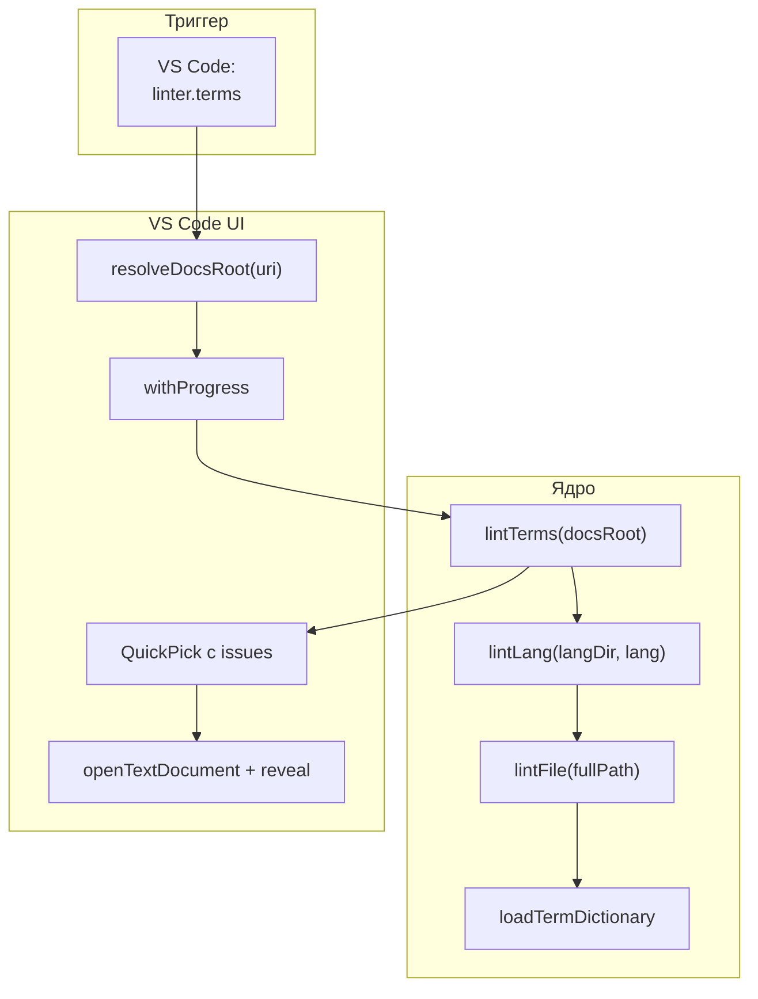
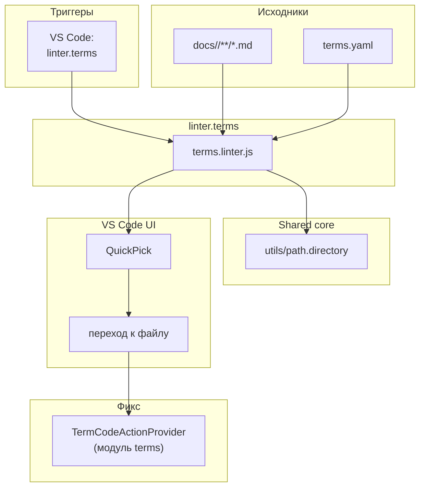

|               |                                                                                                                                                                                                     |
| ------------- | --------------------------------------------------------------------------------------------------------------------------------------------------------------------------------------------------- |
| ID            | [7.1-021](../../%D0%A1%D0%BE%D0%B3%D0%BB%D0%B0%D1%88%D0%B5%D0%BD%D0%B8%D1%8F/index.md#identifikaciya-modulej)                                                                                       |
| Идентификатор | `linter.terms`                                                                                                                                                                                      |
| Наименование  | Линтер терминов                                                                                                                                                                                     |
| Слой          | [vscode-ui](../%D0%A1%D0%BB%D0%BE%D0%B8layer/%D0%A1%D0%BB%D0%BE%D0%B9VSCodeUI/index.md#naznachenie/index.md#naznachenie)                                                                                                                         |
| Каталог       | [Линтеры](../../%D0%9A%D0%B0%D1%82%D0%B0%D0%BB%D0%BE%D0%B3Capabilitymap/%D0%9A%D0%B0%D1%82%D0%B0%D0%BB%D0%BE%D0%B3%D0%9B%D0%B8%D0%BD%D1%82%D0%B5%D1%80%D1%8B/index.md#lintery)                                                                                                                                                                                                    |
| Семейство     | [Линтеры](../../%D0%A1%D0%B5%D0%BC%D0%B5%D0%B9%D1%81%D1%82%D0%B2%D0%BEfamily/%D0%A1%D0%B5%D0%BC%D0%B5%D0%B9%D1%81%D1%82%D0%B2%D0%BE%D0%9B%D0%B8%D0%BD%D1%82%D0%B5%D1%80%D1%8B/index.md#fam-linters) |
| Расположение  | `src/plugins/terms/terms.linter.js`, `src/commands/diplodoc-helper.linter.terms.js`                                                                                                                 |
| Точка входа   | `lintTerms(docsRoot, options)` (ядро), `ux_linter_terms(uri)` (VS Code)                                                                                                                             |
| Версия        | `1.54.0`                                                                                                                                                                                            |
| Назначение    | Находит `<abbr class="term"></abbr>` без определения в `terms.yaml` и предлагает перейти к файлу                                                                                                           |

{: .page-legend }

## Назначение

`linter.terms` — зеркало [`linter.abbrs`](../МодульЛинтераббревиатур/index.md), но для терминов. Проверяет, что каждый `<abbr class="term">` определён в `terms.yaml`. 
Находит все `<abbr>` **только с `class="term"`** (без этого класса — игнорирует, это зона `abbrs`), без `title=` (без inline-override).

Практический смысл такой же: если в статье `<abbr class="term">Абстракция</abbr>`, а в словаре нет — на странице «Список терминов» запись не появится, тултипа не будет, пользователь увидит «просто underlined-текст без подсказки».

Кроме того, `linter.terms` — единственный способ быстро проверить **обратное**: «есть ли в словаре термины, которые не используются?» Не напрямую — линтер ищет «используется, но нет в словаре», а не «есть в словаре, но не используется». Обратная задача решается в `terms.writer` (баннер «Не используется», если включён `showUnused`), но в VS Code это не видно без открытия страницы-указателя.

## Применение

**Когда использовать:** после добавления новых `<abbr class="term">` — проверить, все ли они определены в `terms.yaml`.

**Когда НЕ использовать:** терминов мало; нужен автофикс — модуль только показывает список.

**Альтернативы:**
- `grep '<abbr class="term"'` вручную.
- `linter.abbrs` — для сокращений без `class`, не для терминов.

**Типичный сценарий:** в VS Code **Diplodoc → Очистка и проверки → Термины: проверить определения** → QuickPick → переход к файлу → Code Action «Добавить в словарь терминов».

## Как это работает



### Фаза 1. `resolveDocsRoot(uri)`

Идентична `linter.abbrs`. Из `src/commands/diplodoc-helper.linter.terms.js` — своя копия функции (не общая с `linter.abbrs`).

### Фаза 2. `lintTerms(docsRoot, options)`

1. **Список языков.** `options.languages || ['ru', 'en']`.
2. **Для каждого языка** — `lintLang(langDir, lang)`.
3. **`lintLang`**:
   - `dictionary = loadTermDictionary(langDir)` — словарь терминов;
   - `skipFullPaths = new Set([path.resolve(getTermOutputDir(langDir, lang))])` — выходная папка `terms`;
   - обход `langDir`:
     - пропускаются `SKIP_DIRS` (`terms`, `abbrs`, `contexts`, `helptags`, `figures`, `roadmap`, `node_modules`);
     - пропускаются папки, начинающиеся с `_` или `.`;
     - для каждого `.md` — `lintFile(fullPath)`.
4. **`lintFile`**:
   - regex `<abbr(\b[^14]*\bclass\s*=\s*["'][^15]*\bterm\b[^15]*["'][^14]*)>([^16]+)<\/abbr>` — находит только `<abbr class="…term…">`;
   - пропускает `title=` (inline-override);
   - `lookupTerm = data-term || innerText`;
   - если `dictionary.has(lookupTerm)` — ок;
   - иначе — `issues.push({ filePath, line, character, term, innerText, lang })`.
5. **Сортировка**, **возврат** — плоский список.

### Фаза 3. VS Code UI (`ux_linter_terms`)

Идентична `linter.abbrs`:

1. `resolveDocsRoot(uri)` → `withProgress('Проверка терминов…')` → `lintTerms`.
2. Если `issues.length === 0` — `showInformationMessage('Все термины определены в terms.yaml')`.
3. Иначе — `QuickPick`:
   - `label: $(warning) <term>`
   - `description: — <relative path>:<line+1>`
   - `placeHolder: 'Не определено в словаре: N. Выберите, чтобы перейти к файлу.'`
4. При выборе — `openTextDocument` + `revealRange`.

### Файлы модуля

| Файл                                           | Ответственность                                                            |
| ---------------------------------------------- | -------------------------------------------------------------------------- |
| `src/plugins/terms/terms.linter.js`            | `lintTerms`, `lintLang`, `lintFile`, `extractDataTerm`, `offsetToPosition` |
| `src/commands/diplodoc-helper.linter.terms.js` | `resolveDocsRoot`, `ux_linter_terms`                                       |

### Формат `issues[]`

```js
[
    { filePath: '/abs/path/foo.md', line: 5, character: 8, term: 'Абстракция', innerText: 'Абстракция', lang: 'ru' },
]
```

`term` = `data-term || innerText`. `line`/`character` — позиция начала `<abbr>`.

## Режимы работы

### VS Code

| Команда                        | Заголовок                      | Где появляется                           |
| ------------------------------ | ------------------------------ | ---------------------------------------- |
| `diplodoc-helper.linter.terms` | Термины: проверить определения | Explorer → Diplodoc → Очистка и проверки |

### CLI

CLI-команды нет. Только VS Code.

### Сборочный пайплайн

В `docs-build.js` не участвует.

### Code Actions

`TermCodeActionProvider` (из модуля [`terms`](../%D0%A0%D0%B5%D0%B5%D1%81%D1%82%D1%80/%D0%9C%D0%BE%D0%B4%D1%83%D0%BB%D1%8C%D0%A2%D0%B5%D1%80%D0%BC%D0%B8%D0%BD%D1%8B/index.md)) — тот же набор действий, что `AbbrCodeActionProvider`, но для `<abbr class="term">`:

| Действие                        | Условие                                   |
| ------------------------------- | ----------------------------------------- |
| Показать определение: …         | `<abbr class="term">` есть в `terms.yaml` |
| Добавить «X» в словарь терминов | `<abbr class="term">` нет в `terms.yaml`  |
| Снять разметку термина          | Курсор внутри `<abbr class="term">`       |
| Обернуть в термин               | Выделен диапазон                          |
| Обернуть слово в термин         | Курсор на слове                           |

## Юнит-тесты





## Связи

`linter.terms` работает с тем же словарём, что [`terms`](../%D0%A0%D0%B5%D0%B5%D1%81%D1%82%D1%80/%D0%9C%D0%BE%D0%B4%D1%83%D0%BB%D1%8C%D0%A2%D0%B5%D1%80%D0%BC%D0%B8%D0%BD%D1%8B/index.md) (`terms.yaml`), использует `getTermOutputDir` / `loadTermDictionary`. Код `lintFile` перекликается с `extractTermsFromFile` из `terms.extractor`, но написан заново.

Три линтера и их зоны:

| Модуль             | Область               | Что ищет                             |
| ------------------ | --------------------- | ------------------------------------ |
| `linter.links`     | `.md`-ссылки          | Битые файлы и якоря                  |
| `linter.abbrs`     | `<abbr>` без `class=` | Отсутствующие в `abbreviations.yaml` |
| **`linter.terms`** | `<abbr class="term">` | Отсутствующие в `terms.yaml`         |

`linter.terms` — точное зеркало `linter.abbrs`:

- `resolveDocsRoot` — идентична (скопирована);
- обход `docs/` — идентичен (свой `SKIP_DIRS`, порядок тот же);
- `lintFile` — regex отличается только фильтром `class="term"`;
- UI (`withProgress` + `QuickPick` + `revealRange`) — идентичен.

Если менять что-то в одном, второе надо править синхронно. См. «Известные ограничения».






