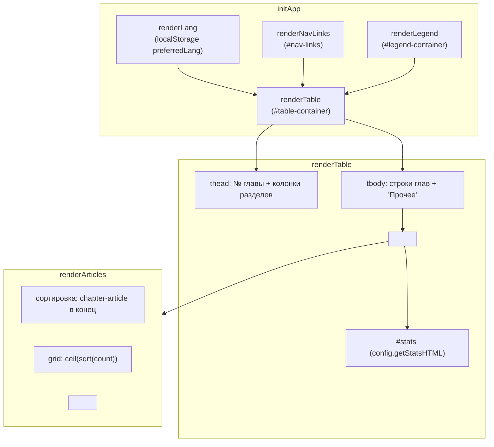
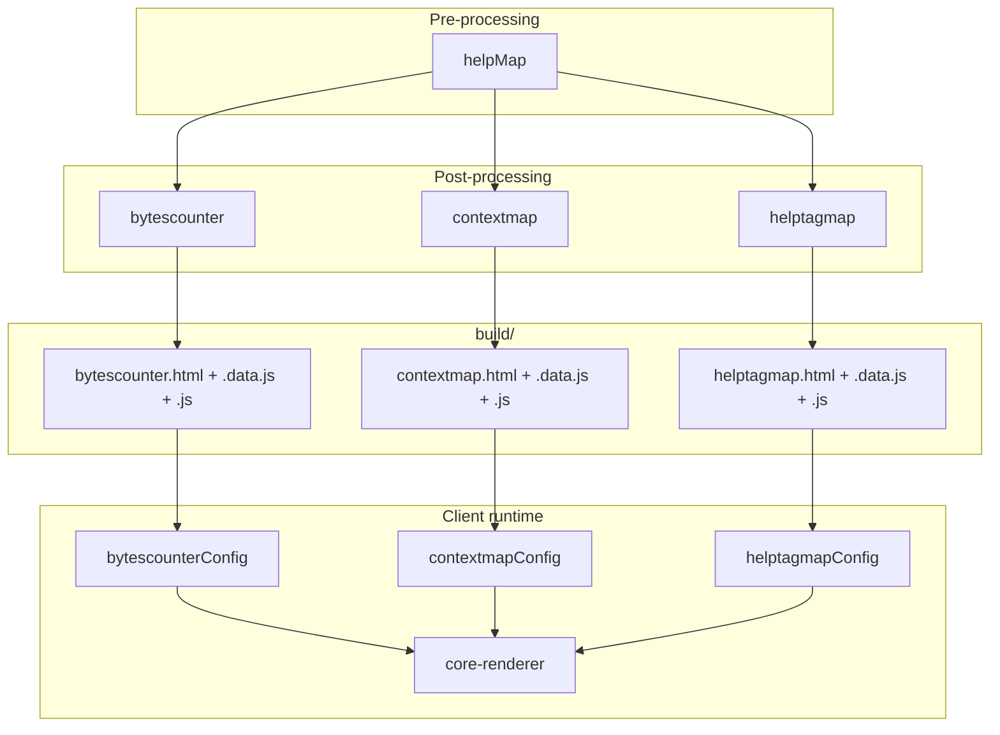



## Назначение

`core-renderer` — технический модуль, который «под капотом» рисует **три** отчёта `contentNavigator`:

- [`bytescounter`](../%D0%9C%D0%BE%D0%B4%D1%83%D0%BB%D1%8C%D0%A0%D0%B0%D0%B7%D0%BC%D0%B5%D1%80%D1%8B%D1%81%D1%82%D0%B0%D1%82%D0%B5%D0%B9/index.md#naznachenie) — тепловая карта размеров статей;
- [`contextmap`](../МодульКартаконтекстов/index.md) — карта контекстов;
- [`helptagmap`](../МодульКартасправочныхтегов/index.md) — карта helptags.

Все три отчёта имеют **одинаковую структуру**: таблица «раздел × глава», в ячейках — плитки статей, цвет плитки зависит от статуса (`empty` / `low` / `normal` / `excess` / …). Отличаются только:

1. **Правилом статуса** (`getArticleStatus` / `getContextStatus` / `getHelptagStatus`) — реализовано в `matrixBuilder` соответствующего модуля;
2. **Цветовой картой** (`colorMap`) — 5 цветов у `bytescounter`, 4 у `contextmap`, 3 у `helptagmap`;
3. **Тултипом плитки** (`getTitle`) — размер / контексты / helptag;
4. **Заголовком статистики** (`getStatsHTML`) — средний размер / распределение статусов.

Всё остальное — общее: переключатель языков, навигационные ссылки, легенда, таблица, плитки, сортировка глав.

`core-renderer` выносит общее в один файл. Модули передают конфиг — `bytescounter.js` вызывает `initApp(matrixDataMap, navLinks, bytescounterConfig)`.

Зачем это нужно. Без общего рендерера `bytescounter.js`, `contextmap.js`, `helptagmap.js` были бы на 90% скопированы (что и было до рефакторинга — вероятно). Сейчас — 5% кода в конфиге, 95% в `core-renderer`.

## Применение

**Когда использовать:** вы пишете новый отчёт по `contentNavigator` (по аналогии с `bytescounter`/`contextmap`/`helptagmap`) — `core-renderer` даёт готовую таблицу-карту, вам остаётся только конфиг.

**Когда НЕ использовать:** вы не пишете новый отчёт — модуль уже работает «под капотом» в трёх существующих.

**Альтернативы:**
- Свой рендерер с нуля — дублирует 90% кода.
- `d3`/`chart.js` — другой формат, не «периодическая таблица».

**Типичный сценарий:** новый отчёт `coverage` → в `Pagebuilder.Config.Coverage.js` передать `colorMap`/`getTitle`/`getStatsHTML` → вызвать `initApp(matrixDataMap, navLinks, coverageConfig)`.

## Как это работает



### Фаза 1. `initApp(matrixDataMap, navLinks, config)`

```js
function initApp(matrixDataMap, navLinks, config) {
    const savedLang = localStorage.getItem('preferredLang');
    let currentLang = renderLang(matrixDataMap, config, savedLang);
    document.documentElement.lang = currentLang;
    renderNavLinks(navLinks);
    renderTable(currentLang, matrixDataMap[currentLang], config);
}
```

- **`matrixDataMap`** — `{ ru: {…}, en: {…} }` (данные из `*.data.js`).
- **`navLinks`** — `[{ label: 'Контексты', url: 'contextmap.html' }, …]`.
- **`config`** — объект с `colorMap`, `getTitle`, `getStatsHTML`.

**`renderLang`** — читает `localStorage.preferredLang`, если язык есть в `matrixDataMap` — использует его, иначе первый. Если языков больше одного — рисует кнопки `RU`/`EN` в `#lang-selector`. Клик по кнопке — обновляет `localStorage.preferredLang`, вызывает `renderTable(lang, …)`.

**`document.documentElement.lang = currentLang`** — используется `ARTICLE_STATUS_I18N` в `contextmap.js`/`helptagmap.js` (читают `document.documentElement.lang` для локализации статусов).

**`renderNavLinks`** — кнопки-ссылки в `#nav-links`:

```js
container.innerHTML = navLinks.map(link => `<a href="${link.url}">${link.label}</a>`).join('');
```

**`renderLegend`** — легенда в `#legend-container`:

```js
let html = '<div class="legend">';
for (const item of legendItems) {
    html += `<div class="legend-item"><span class="legend-color ${item.color}"></span> ${item.description}</div>`;
}
html += '</div>';
```

Цвет — через CSS-класс `color-empty`/`color-low`/`…`. Описание — текст из `legendItems` соответствующего модуля.

### Фаза 2. `renderTable(lang, matrixData, config)`

```js
function renderTable(lang, matrixData, config) {
    const container = document.getElementById('table-container');
    if (!matrixData) {
        container.innerHTML = `<p>${t.noData}</p>`;
        return;
    }

    const { matrix, rows, cols } = matrixData;
    const statsEl = document.getElementById('stats');

    if (statsEl) {
        statsEl.innerHTML = config.getStatsHTML(lang, matrixData, t);
    }

    if (matrixData.totalArticles === 0) {
        container.innerHTML = `<p>${t.noArticles}</p>`;
        return;
    }

    let html = '<div class="table-wrapper"><table>';
    html += `<thead><tr><th><div class="th-text-clamp" style="--line-count: 2;">${t.chapterHeader}</div></th>`;
    for (const col of cols) {
        html += `<th title="${col.displayName}"><div class="th-text-clamp" style="--line-count: 2;">${col.displayName}</div></th>`;
    }
    html += '</tr></thead><tbody>';

    for (let r = 0; r < rows.length; r++) {
        html += `<tr><td class="rowHeader">${rows[r]}</td>`;
        const rowData = matrix[r];
        for (let c = 0; c < rowData.length; c++) {
            html += `<td><div id="cell-${r}-${c}"></div></td>`;
        }
        html += '</tr>';
    }
    html += '</tbody></table></div>';
    container.innerHTML = html;

    for (let r = 0; r < rows.length; r++) {
        const rowData = matrix[r];
        for (let c = 0; c < rowData.length; c++) {
            const cellDiv = document.getElementById(`cell-${r}-${c}`);
            if (cellDiv) renderArticles(rowData[c], cellDiv, config);
        }
    }

    document.querySelectorAll('#lang-selector button').forEach(btn => {
        btn.classList.toggle('active', btn.dataset.lang === lang);
    });
}
```

- **`t`** — I18N-объект (`t.chapterHeader` = «№ главы<br/> в разделе», `t.noData` = «Нет данных», `t.noArticles` = «Нет статей»).
- **`#stats`** — `config.getStatsHTML(lang, matrixData, t)`.
- **`<thead>`** — первая колонка «№ главы», остальные — разделы (`cols`).
- **`<tbody>`** — по строке на каждую главу. В каждой ячейке — `<div id="cell-R-C">` (пустой, заполнится позже).
- **Заполнение ячеек** — отдельным проходом, через `renderArticles(rowData[c], cellDiv, config)`.
- **`lang-selector`** — активация кнопки текущего языка.

### Фаза 3. `renderArticles(articles, container, config)`

```js
function renderArticles(articles, container, config) {
    if (!articles || articles.length === 0) {
        container.innerHTML = '·';
        return;
    }

    articles.sort((a, b) => (b.isChapterArticle ? 1 : 0) - (a.isChapterArticle ? 1 : 0));

    const count = articles.length;
    const cols = Math.max(1, Math.ceil(Math.sqrt(count)));
    let html = `<div style="display:grid; grid-template-columns: repeat(${cols}, 3ch); gap:3px; justify-content:center; align-content:start; width:100%; height:100%;">`;

    for (const art of articles) {
        const colorClass = config.colorMap[art.status] || 'color-empty';
        const title = config.getTitle(art, t);
        const borderClass = art.isChapterArticle ? 'chapter-article' : '';
        html += `<a href="${art.url}" target="_blank" class="article-block ${colorClass} ${borderClass}" title="${title}"></a>`;
    }
    html += '</div>';
    container.innerHTML = html;
}
```

- **Пустая ячейка** — `·` (точка).
- **Сортировка** — `isChapterArticle` (текст главы) — в конец, чтобы плитки-статьи были сверху.
- **Grid** — `cols = ceil(sqrt(count))`. Для 1 статьи — 1 колонка, для 4 — 2, для 9 — 3.
- **`article-block`** — квадратик `3ch × 3ch`. Цвет — `color-${status}`. `isChapterArticle` — рамка (`chapter-article`).
- **`title`** — `config.getTitle(art, t)`. Содержимое — из `config`.
- **`href`** — `art.url` (из `matrixData`).

### Фаза 4. I18N

```js
const I18N = {
    ru: {
        noData: 'Нет данных для этого языка.',
        noArticles: 'Нет статей для этого языка.',
        chapterHeader: '№ главы<br/> в разделе',
        langLabel: 'Язык',
        totalArticlesLabel: 'Всего статей',
        avgSizeLabel: 'Средний размер',
        bytes: 'байт',
    },
    en: { … },
};

const uiLang = document.documentElement.lang || 'ru';
const t = I18N[uiLang] || I18N.ru;
```

`t` — глобальная переменная модуля. Используется в `renderTable` и передаётся в `config.getTitle(art, t)` / `config.getStatsHTML(lang, matrixData, t)`.

### Файлы модуля

| Файл                                              | Ответственность                                                                                 |
| ------------------------------------------------- | ----------------------------------------------------------------------------------------------- |
| `src/plugins/contentNavigator/core-renderer.js`   | Весь клиент                                                                                     |
| `src/plugins/contentNavigator/core-style.css`     | Общие стили (`.article-block`, `.legend`, `.th-text-clamp`, `.rowHeader`)                       |
| `src/plugins/contentNavigator/page-template.html` | HTML-шаблон с `#lang-selector`, `#nav-links`, `#stats`, `#legend-container`, `#table-container` |

## Режимы работы

### Клиентский runtime

Внедряется в три HTML-страницы через `generateGenericTableFromArticles` (`Pagebuilder.common.js`):

```html
<script src="core-renderer.js" defer></script>
<script src="<module>.js" defer></script>
```

`<module>.js` (например, `bytescounter.js`) вызывает `initApp(periodicData.matrixData, periodicData.navLinks, <module>Config)`.

### Конфиг (что передаёт модуль)

```js
// bytescounter.js
initApp(matrixDataMap, navLinks, {
    colorMap: { excess, full, partial, minimum, empty },
    getTitle(art, t) { return `${art.title} (${art.size} ${t.bytes})`; },
    getStatsHTML(lang, matrixData, t) { return `…${t.totalArticlesLabel}…`; },
});
```

| Ключ           | Обязательность | Что                                                          |
| -------------- | -------------- | ------------------------------------------------------------ |
| `colorMap`     | да             | `status → css-class`                                         |
| `getTitle`     | да             | `(art, t) → string` — тултип плитки                          |
| `getStatsHTML` | да             | `(lang, matrixData, t) → string` — верхняя панель статистики |

### Проверка в DevTools

```js
document.getElementById('lang-selector')            // → <div id="lang-selector">
document.getElementById('nav-links')                 // → <div id="nav-links">
document.getElementById('stats')                     // → <div id="stats">
document.getElementById('table-container')           // → <div id="table-container">
document.querySelectorAll('.article-block').length   // → число плиток
document.documentElement.lang                        // → 'ru' или 'en'
```

## Юнит-тесты





## Связи

`core-renderer` — «общий движок» для трёх модулей:

| Модуль                                                                                                                                                                                | Что передаёт в `core-renderer`                 |
| ------------------------------------------------------------------------------------------------------------------------------------------------------------------------------------- | ---------------------------------------------- |
| [`bytescounter`](../%D0%A0%D0%B5%D0%B5%D1%81%D1%82%D1%80/%D0%9C%D0%BE%D0%B4%D1%83%D0%BB%D1%8C%D0%A0%D0%B0%D0%B7%D0%BC%D0%B5%D1%80%D1%8B%D1%81%D1%82%D0%B0%D1%82%D0%B5%D0%B9/index.md) | `bytescounterConfig` (5 цветов, размер статьи) |
| [`contextmap`](../МодульКартаконтекстов/index.md)                                                                                                                                     | `contextmapConfig` (4 цвета, контексты)        |
| [`helptagmap`](../МодульКартасправочныхтегов/index.md)                                                                                                                                | `helptagmapConfig` (3 цвета, helptag)          |

Все три — «отчёты `contentNavigator`». `core-renderer` — их общая клиентская база.

Не связан с:

- [`footnoteList.client`](../МодульКлиентаперечнясносок/index.md) — отдельный клиент, не использует `core-renderer`;
- [`context-search.client`](../МодульКлиентскогопоиска/index.md) — тоже отдельный;
- [`abbrs.client`](../МодульКлиентаббревиатур/index.md) / [`terms.client`](../МодульКлиентатерминов/index.md) — отдельные.








