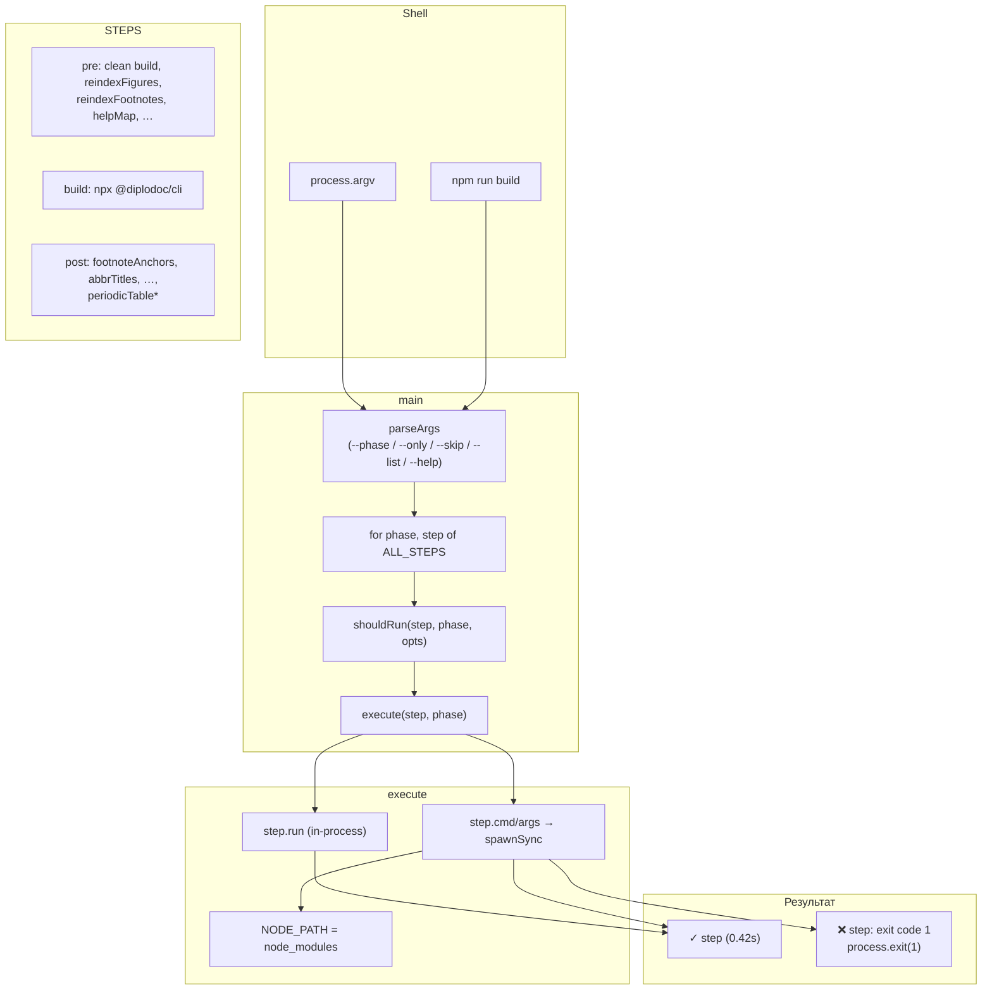
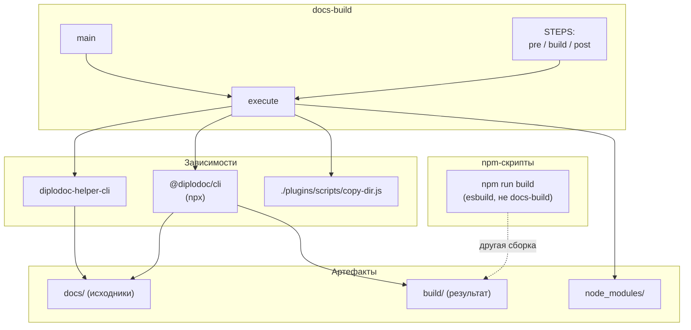

|               |                                                                                                                                                                                                                                                             |
| ------------- | ----------------------------------------------------------------------------------------------------------------------------------------------------------------------------------------------------------------------------------------------------------- |
| ID            | [6.2-047](../../%D0%A1%D0%BE%D0%B3%D0%BB%D0%B0%D1%88%D0%B5%D0%BD%D0%B8%D1%8F/index.md#identifikaciya-modulej)                                                                                                                                               |
| Идентификатор | `docs-build`                                                                                                                                                                                                                                                |
| Наименование  | Оркестратор сборки                                                                                                                                                                                                                                          |
| Слой          | [CLI](../../%D0%A1%D0%BB%D0%BE%D0%B8layer/%D0%A1%D0%BB%D0%BE%D0%B9CLI/index.md#naznachenie) / [Build](../../%D0%A1%D0%BB%D0%BE%D0%B8layer/%D0%A1%D0%BB%D0%BE%D0%B9Build/index.md#build)                                                                                                                                 |
| Каталог       | [Инфраструктура](../../%D0%9A%D0%B0%D1%82%D0%B0%D0%BB%D0%BE%D0%B3Capabilitymap/%D0%9A%D0%B0%D1%82%D0%B0%D0%BB%D0%BE%D0%B3%D0%98%D0%BD%D1%84%D1%80%D0%B0%D1%81%D1%82%D1%80%D1%83%D0%BA%D1%82%D1%83%D1%80%D0%B0/index.md#infrastruktura)                                                                                                                                                                                                                                                            |
| Семейство     | [Инфраструктура](../../%D0%A1%D0%B5%D0%BC%D0%B5%D0%B9%D1%81%D1%82%D0%B2%D0%BEfamily/%D0%A1%D0%B5%D0%BC%D0%B5%D0%B9%D1%81%D1%82%D0%B2%D0%BE%D0%98%D0%BD%D1%84%D1%80%D0%B0%D1%81%D1%82%D1%80%D1%83%D0%BA%D1%82%D1%83%D1%80%D0%B0/index.md#fam-infrastructure) |
| Расположение  | `src/plugins/docs-build.js`                                                                                                                                                                                                                                 |
| Точка входа   | `node ./plugins/docs-build.js [--phase=...] [--only=...] [--skip=...] [--list] [--help]`                                                                                                                                                                    |
| Версия        | `1.54.0`                                                                                                                                                                                                                                                    |
| Назначение    | Оркестратор полного пайплайна сборки документации: `pre` → `@diplodoc/cli` → `post`                                                                                                                                                                         |

{: .page-legend }

## Назначение

`docs-build` — «главный» скрипт сборки документации. Пользователь запускает `npm run build` (или `node ./plugins/docs-build.js`) — и модуль последовательно выполняет **~20 шагов** в трёх фазах:

1. **`pre`** — препроцессинг `.md` (переиндексация, helpMap, контексты, abbrs, terms, gosts, figures, roadmap).
2. **`build`** — `@diplodoc/cli -i ./docs -o ./build`.
3. **`post`** — пост-обработка `.html` (footnoteAnchors, abbrTitles, termTitles, footnoteNumbering, footnoteList, gostsInject, breadcrumb, contexttags, tocCleanMode, ganttFixScroll, periodicTable*).

Порядок и состав шагов — центральное место всего расширения. Именно здесь решается, **что** и **в каком порядке** запускается.

Плюс — гибкость: пользователь может запустить только одну фазу (`--phase=pre`), пропустить шаги (`--skip=breadcrumb,gostsInject`), запустить только перечисленные (`--only=reindexFigures,helpMap`), получить список шагов (`--list`).

Без модуля пришлось бы писать вручную цепочку `node plugins/diplodoc-helper-cli.js <command>` × 20 + `npx @diplodoc/cli` + ещё 10 команд. `docs-build` делает это за одну команду.

## Применение

**Когда использовать:** нужна полная сборка документации (`docs/` → `build/`) — с препроцессингом, `@diplodoc/cli`, пост-обработкой. Одна команда вместо 30 вручную.

**Когда НЕ использовать:** нужен один шаг (например, только `helpMap`) — используйте `diplodoc-helper-cli`; отлаживаете конкретный шаг — тоже CLI.

**Альтернативы:**
- Ручная цепочка `node cli.js … && npx @diplodoc/cli && …` — забывается, порядок легко нарушить.
- npm-скрипты в `package.json` — не поддерживают фазы/флаги.

**Типичный сценарий:** `npm run build` (для шаблона) или `node ./plugins/docs-build.js` → все три фазы по порядку → `build/` готов.

## Как это работает



### Фаза 1. Определение шагов

`STEPS` — объект с тремя массивами:

```js
const STEPS = {
    pre: [
        run('clean build', () => { fs.rmSync(buildDir, { recursive: true, force: true }); }),
        cli('reindexFigures', '--docsDir', './docs/ru'),
        cli('reindexFootnotes', '--docsDir', './docs/ru'),
        cli('helpMap'),
        cli('tocCleanMode'),             // ← ошибка, должно быть в post
        cli('periodicStat'),
        cli('contexts'),
        cli('helptags'),
        cli('abbrs'),
        cli('terms'),
        cli('gosts'),
        cli('createFigureContent'),
        cli('roadMap', '--dataPath', './plugins/roadMap/roadmap-data.json'),
    ],
    build: [
        npx('diplodoc build', '@diplodoc/cli', '-i', './docs', '-o', './build', '--allow-custom-resources', '--apply-presets', '--quiet', 'internal'),
    ],
    post: [
        cli('footnoteAnchors', './build'),
        cli('abbrTitles', './build', '--docsDir', './docs'),
        cli('termTitles', './build', '--docsDir', './docs'),
        cli('footnoteNumbering', '--docsDir', './docs/ru', '--outputDir', './build'),
        cli('footnoteList', '--docsDir', './docs/ru', '--targetHtml', './build/ru/Дополнительнаяинформация/Переченьсносок/index.html'),
        cli('gostsInject', '--docsDir', './docs/ru'),
        node('copy mdedit_fixes', './plugins/scripts/copy-dir.js', './plugins/mdedit_fixes', './build/plugins/mdedit_fixes'),
        cli('breadcrumb', './build'),
        cli('contexttags', './build'),
        cli('ganttFixScroll', './build'),
        cli('periodicTable'),
        cli('periodicTableHelpTag'),
        cli('periodicTableContext'),
        run('cleanup service files', () => {
            for (const f of ['.yfm', '.yfmignore', '.yfmlint']) {
                fs.rmSync(path.join(buildDir, f), { recursive: true, force: true });
            }
        }),
    ],
};
```

**Три фазы:**

- **`pre` (13 шагов)** — препроцессинг `.md`. Порядок критичен:
  1. `clean build` — удалить `build/`.
  2. `reindexFigures` — нумерация рисунков (до `createFigureContent`, чтобы каталог был с актуальными номерами).
  3. `reindexFootnotes` — нумерация сносок (до `helpMap`, чтобы `size` был актуален).
  4. `helpMap` — `app-help-contents.json` (нужен `periodicStat`, `contexts`).
  5. `tocCleanMode` — **ОШИБКА** (должен быть в `post` — см. «Известные ограничения»).
  6. `periodicStat` — `presets.yaml` (до `@diplodoc/cli`, чтобы `--apply-presets` работал).
  7. `contexts` — генерация `contexts/`.
  8. `helptags` — генерация `helptags/`.
  9. `abbrs` — генерация `abbrs/`.
  10. `terms` — генерация `terms/`.
  11. `gosts` — генерация `gosts/`.
  12. `createFigureContent` — генерация `figures/`.
  13. `roadMap` — генерация `roadmap/`.

- **`build` (1 шаг)** — `npx @diplodoc/cli -i ./docs -o ./build --allow-custom-resources --apply-presets --quiet internal`. Флаги:
  - `--allow-custom-resources` — разрешить нестандартные ассеты.
  - `--apply-presets` + `internal` — подставить <code>&#123;&#123; &#125;&#125;</code> из `presets.yaml → internal`.
  - `--quiet` — меньше вывода.

- **`post` (14 шагов)** — пост-обработка `.html`. Порядок:
  1. `footnoteAnchors` — абсолютные якоря (до `footnoteNumbering`).
  2. `abbrTitles` — тултипы для `<abbr>`.
  3. `termTitles` — тултипы для `<abbr class="term">`.
  4. `footnoteNumbering` — сквозная нумерация (после `footnoteAnchors`).
  5. `footnoteList` — сводный перечень (после `footnoteNumbering`).
  6. `gostsInject` — таблица ГОСТов.
  7. `copy mdedit_fixes` — копирование ассетов mdedit.
  8. `breadcrumb` — хлебные крошки.
  9. `contexttags` — теги контекстов.
  10. `ganttFixScroll` — pan/zoom Ганта.
  11. `periodicTable`, `periodicTableHelpTag`, `periodicTableContext` — три отчёта `contentNavigator`.
  12. `cleanup service files` — удаление `.yfm`, `.yfmignore`, `.yfmlint` из `build/`.

**Обёртки:**

- **`cli(name, ...args)`** — `{ name, cmd: 'node', args: [CLI, name, ...args] }`. `CLI = './plugins/diplodoc-helper-cli.js'`.
- **`npx(name, ...args)`** — `{ name, cmd: 'npx', args }`. Для `@diplodoc/cli`.
- **`node(name, scriptPath, ...args)`** — `{ name, cmd: 'node', args: [scriptPath, ...args] }`. Для `.js`-скриптов.
- **`run(name, fn, opts)`** — `{ name, run: fn, ...opts }`. Для in-process функций (без spawn).

### Фаза 2. `parseArgs`

```js
function parseArgs(argv) {
    const out = { only: null, skip: new Set(), phase: null, list: false, help: false };
    for (const a of argv) {
        if (a === '--list') out.list = true;
        else if (a === '--help' || a === '-h') out.help = true;
        else if (a.startsWith('--only=')) out.only = new Set(a.slice(7).split(',').filter(Boolean));
        else if (a.startsWith('--skip=')) out.skip = new Set(a.slice(7).split(',').filter(Boolean));
        else if (a.startsWith('--phase=')) out.phase = a.slice(8).split(',').filter(Boolean);
    }
    return out;
}
```

- **`--only=a,b,c`** — только эти шаги (по имени).
- **`--skip=a,b,c`** — пропустить эти шаги.
- **`--phase=pre,build`** — только указанные фазы.
- **`--list`** — вывести список всех шагов и выйти.
- **`--help` / `-h`** — справка.

Формат — `--arg=value` (через `=`). `--arg value` (через пробел) **не поддерживается** (`a.startsWith('--only=')`). См. «Известные ограничения».

### Фаза 3. `main`

```js
async function main() {
    const opts = parseArgs(process.argv.slice(2));

    if (opts.help) {
        console.log(`
Использование: node ./plugins/docs-build.js [флаги]

  --phase=pre,build,post     только указанные фазы
  --only=step1,step2         только перечисленные шаги
  --skip=step1,step2         пропустить перечисленные шаги
  --list                     показать все шаги и выйти
  --help                     эта справка
`);
        return;
    }

    if (opts.list) {
        for (const phase of PHASES) {
            console.log(`\n[${phase}]`);
            for (const s of STEPS[phase]) {
                const off = s.enabled === false ? '  (disabled)' : '';
                console.log(`  - ${s.name}${off}`);
            }
        }
        return;
    }

    console.log('▶ docs-build: старт');
    for (const { phase, step } of ALL_STEPS) {
        if (!shouldRun(step, phase, opts)) {
            if (opts.only || opts.phase || opts.skip.size) {
                console.log(`↷ [${phase}] ${step.name} — пропущен`);
            }
            continue;
        }
        await execute(step, phase);
    }
    console.log('\n✅ docs-build: готово');
}
```

**`ALL_STEPS`** — плоский массив:

```js
const PHASES = ['pre', 'build', 'post'];
const ALL_STEPS = PHASES.flatMap(phase =>
    STEPS[phase].map(step => ({ phase, step }))
);
```

**`shouldRun(step, phase, opts)`:**

```js
function shouldRun(step, phase, opts) {
    if (step.enabled === false) return false;
    if (step.when && !step.when()) return false;
    if (opts.phase && !opts.phase.includes(phase)) return false;
    if (opts.only && !opts.only.has(step.name)) return false;
    if (opts.skip.has(step.name)) return false;
    return true;
}
```

**`step.enabled: false`** — отключённый шаг (не выполняется никогда). `step.when()` — условная проверка (например, `when: () => fs.existsSync('…')`). Ни один шаг сейчас не использует `enabled`/`when`.

**Порядок проверок:**

1. `enabled === false` → skip.
2. `when()` → если `false` → skip.
3. `--phase` задан и текущая фаза не в нём → skip.
4. `--only` задан и текущего шага нет в нём → skip.
5. `--skip` содержит шаг → skip.

Если `--only` и `--skip` одновременно — **both** должны пропустить. То есть `--only=a,b --skip=a` → выполнится только `b`.

### Фаза 4. `execute(step, phase)`

```js
async function execute(step, phase) {
    const startedAt = Date.now();
    console.log(`\n▶ [${phase}] ${step.name}`);

    try {
        if (step.run) {
            await step.run();
        } else {
            const opts = {
                cwd: step.cwd || projectRoot,
                stdio: 'inherit',
                env: {
                    ...process.env,
                    NODE_PATH: process.env.NODE_PATH || path.join(projectRoot, 'node_modules'),
                    ...step.env,
                },
            };

            let result;
            if (isWin) {
                const cmdLine = buildShellCommand(step.cmd, step.args);
                result = spawnSync(cmdLine, [], { ...opts, shell: true });
            } else {
                result = spawnSync(step.cmd, step.args, { ...opts, shell: false });
            }

            if (result.error) throw result.error;
            if (result.status !== 0) throw new Error(`exit code ${result.status}`);
        }

        const secs = ((Date.now() - startedAt) / 1000).toFixed(2);
        console.log(`✓ ${step.name} (${secs}s)`);
    } catch (e) {
        console.error(`❌ ${step.name}: ${e.message}`);
        process.exit(1);
    }
}
```

- **`step.run`** — in-process (например, `clean build` → `fs.rmSync`).
- **Иначе** — `spawnSync` с `cwd`, `env`, `stdio: 'inherit'`. На Windows — через `shell: true` + `buildShellCommand` (обёртка кавычек), на Unix — прямой `spawnSync`.
- **`NODE_PATH`** — `node_modules` проекта (для require внешних пакетов в дочернем процессе).
- **`process.exit(1)`** — при ошибке. Не `process.exitCode`, а именно `exit` — **немедленно**. См. «Известные ограничения».

### Фаза 5. `buildShellCommand` и `quoteShellArg`

```js
function quoteShellArg(arg) {
    const s = String(arg);
    if (s === '') return isWin ? '""' : "''";
    if (/^[a-zA-Z0-9._\-=:,/\\@+]+$/.test(s)) return s;
    if (isWin) return '"' + s.replace(/"/g, '""') + '"';
    return "'" + s.replace(/'/g, "'\\''") + "'";
}

function buildShellCommand(cmd, args) {
    return [cmd, ...args].map(quoteShellArg).join(' ');
}
```

Только для Windows — `cmd.exe` требует escape для спецсимволов (`&`, `|`, `<`, `>`, `^`, `%`, `!`). Функция обёртывает аргументы в двойные кавычки, если есть спецсимволы.

На Unix — не нужна (spawn без shell).

### Файлы модуля

| Файл                         | Ответственность |
| ---------------------------- | --------------- |
| `src/plugins/docs-build.js`  | Весь модуль     |
| `src/plugins/docs-build.cmd` | Windows-обёртка |

## Режимы работы

### CLI

```bash
node ./plugins/docs-build.js
```

Запускает все три фазы последовательно.

```bash
node ./plugins/docs-build.js --phase=pre
```

Только `pre` (препроцессинг).

```bash
node ./plugins/docs-build.js --skip=breadcrumb,gostsInject
```

Пропускает указанные шаги.

```bash
node ./plugins/docs-build.js --only=reindexFigures,helpMap
```

Только эти два шага (из любых фаз).

```bash
node ./plugins/docs-build.js --list
```

Выводит список всех шагов по фазам.

```bash
node ./plugins/docs-build.js --help
```

Справка.

### npm

```bash
npm run build        # = npm run compile = node build.js (esbuild)
npm run build:prod   # NODE_ENV=production node build.js
npm run build:dev    # NODE_ENV=development node build.js
```

**Внимание:** `npm run build` в `package.json` — это **не** `docs-build.js`. Это `node build.js` (esbuild-сборка **расширения**, а не документации). См. `build.js` (`6.2-050`).

`docs-build.js` — **другой** скрипт, для сборки **документации** (`docs/` → `build/`). Запускается отдельно.

### VS Code

Не участвует. `docs-build.js` — только CLI / npm.

## Юнит-тесты





## Связи

`docs-build` — «главный» оркестратор. Зависит от:

- **`diplodoc-helper-cli`** (через `cli(name, ...args)`) — для каждого шага;
- **`@diplodoc/cli`** (через `npx`) — фаза `build`;
- **`./plugins/scripts/copy-dir.js`** (через `node`) — шаг `copy mdedit_fixes`.

С `diplodoc-helper-cli` — прямой: `docs-build` формирует argv, `diplodoc-helper-cli` маршрутизирует.

С `build.js` — **не связан**. `build.js` собирает **расширение** (esbuild → `dist/extension.js`), `docs-build.js` собирает **документацию** (`docs/` → `build/`). Разные вещи.

С `manifest` — **не связан**. `manifest` — про `package.json → contributes`, `docs-build` — про документацию.

С `installer` — **связан косвенно**: `installer` копирует `docs-build.js` в **шаблон проекта пользователя** (через `src/scripts/build-docs.js`). То есть пользователь запускает `docs-build.js` из **своего** проекта, а не из расширения.






