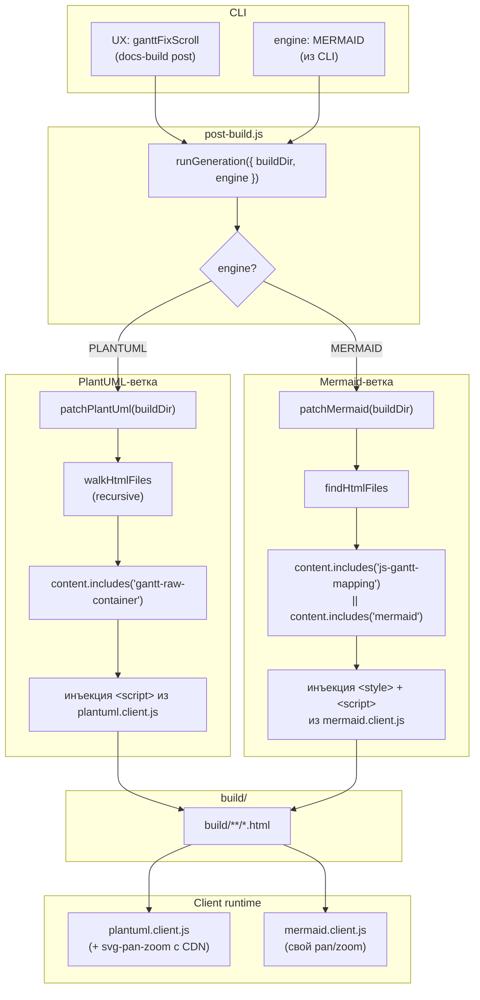
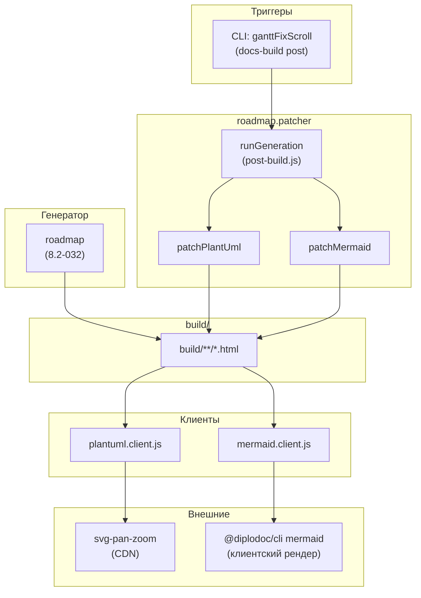

|               |                                                                                                                                                                             |
| ------------- | --------------------------------------------------------------------------------------------------------------------------------------------------------------------------- |
| ID            | [4.2-033](../../%D0%A1%D0%BE%D0%B3%D0%BB%D0%B0%D1%88%D0%B5%D0%BD%D0%B8%D1%8F/index.md#identifikaciya-modulej)                                                               |
| Идентификатор | `roadmap.patcher`                                                                                                                                                           |
| Наименование  | Патчер диаграммы Ганта                                                                                                                                                      |
| Слой          | [Post-processing](../../%D0%A1%D0%BB%D0%BE%D0%B8layer/%D0%A1%D0%BB%D0%BE%D0%B9Postprocessing/index.md#naznachenie) / [Клиентский runtime](../../%D0%A1%D0%BB%D0%BE%D0%B8layer/%D0%A1%D0%BB%D0%BE%D0%B9%D0%9A%D0%BB%D0%B8%D0%B5%D0%BD%D1%82%D1%81%D0%BA%D0%B8%D0%B9runtime/index.md#naznachenie) |
| Каталог       | [Дорожная карта](../../%D0%9A%D0%B0%D1%82%D0%B0%D0%BB%D0%BE%D0%B3Capabilitymap/%D0%9A%D0%B0%D1%82%D0%B0%D0%BB%D0%BE%D0%B3%D0%94%D0%BE%D1%80%D0%BE%D0%B6%D0%BD%D0%B0%D1%8F%D0%BA%D0%B0%D1%80%D1%82%D0%B0/index.md#dorozhnaya-karta)                                                                                                                                                                                |
| Семейство     | [Дорожная карта](../../%D0%A1%D0%B5%D0%BC%D0%B5%D0%B9%D1%81%D1%82%D0%B2%D0%BEfamily/%D0%A1%D0%B5%D0%BC%D0%B5%D0%B9%D1%81%D1%82%D0%B2%D0%BE%D0%94%D0%BE%D1%80%D0%BE%D0%B6%D0%BD%D0%B0%D1%8F%D0%BA%D0%B0%D1%80%D1%82%D0%B0/index.md#fam-roadmap)                                                                                                                                                                                |
| Расположение  | `src/plugins/roadMap/post-build.js`, `src/plugins/roadMap/patchers/*`                                                                                                       |
| Точка входа   | `runGeneration({ buildDir, engine })` (CLI: `generateGanttFixScroll`)                                                                                                       |
| Версия        | `1.54.0`                                                                                                                                                                    |
| Назначение    | Встраивает клиентский скрипт в HTML-страницы с диаграммой Ганта (pan/zoom, клики по узлам)                                                                                  |

{: .page-legend }

## Назначение

`roadmap.patcher` — клиентская «вторая половина» [дорожной карты](../МодульДорожнаякарта/index.md). Пока генератор `roadmap` пишет `roadmap/index.md` (с диаграммой PlantUML или Mermaid), `roadmap.patcher` **после** `@diplodoc/cli` проходит по готовому `build/`, находит страницы с диаграммой Ганта и встраивает в них клиентский `<script>`, который:

1. **Включает pan/zoom** — перетаскивание и масштабирование SVG мышью / колесом;
2. **Навешивает клики по узлам** — клик на конкретную задачу в диаграмме открывает URL модуля (поле `url` из `roadmap-data.json` → `mapping` → `data-mapping` в HTML → `onclick` в браузере);
3. **Добавляет тулбар** — кнопки «Перемещение (Pan)» и «Зум (Zoom)» для управления режимами.

Зачем это нужно. Статичный SVG-Гант (PlantUML или Mermaid) читается, но неинтерактивен: пользователь не может перетащить диаграмму, приблизить участок, кликнуть на задачу и перейти в модуль. `roadmap.patcher` решает это через **внедрение клиентского скрипта** — на этапе сборки, без участия пользователя.

Ключевая особенность: **два движка** (PlantUML и Mermaid) → **два патчера** (`patchPlantUml`, `patchMermaid`), но **общий контракт** обёртки (`.gantt-wrapper` + `.gantt-toolbar`), и **общий публичный API** (`runGeneration({ buildDir, engine })`).

## Применение

**Когда использовать:** всегда вместе с [`roadmap`](../МодульДорожнаякарта/index.md) — без патчера диаграмма Ганта статична (нет pan/zoom, нет кликов по узлам).

**Когда НЕ использовать:** диаграмма не нужна; `roadmap` не сгенерировал `index.md`.

**Альтернативы:**
- Нативный `<svg>` из `roadmap` — работает, но без интерактива.
- Внешний `svg-pan-zoom` вручную — то же, но код в каждом проекте.

**Типичный сценарий:** `docs-build.js` → `post` → `ganttFixScroll` → `roadmap.patcher` встраивает `<script>` в страницы с Гантом → pan/zoom + клики.

## Как это работает



### Фаза 1. Публичный API (`post-build.js`)

```js
const CURRENT_ENGINE = DiagramEngine.PLANTUML;

async function runGeneration(options) {
    const buildDir = typeof options === 'string' ? options : options?.buildDir || './build';
    const engine = (typeof options === 'object' && options.engine) || CURRENT_ENGINE;

    switch (engine) {
        case DiagramEngine.PLANTUML:
            await patchPlantUml(buildDir);
            break;
        case DiagramEngine.MERMAID:
            await patchMermaid(buildDir);
            break;
        default:
            console.warn(`[Gantt Post-Build] Неизвестный engine: ${engine}. Используем PlantUML.`);
            await patchPlantUml(buildDir);
            break;
    }
}

module.exports = {
    runGeneration,
    generateGanttFixScroll: runGeneration,
};
```

- **`buildDir`** — либо строка, либо `options.buildDir`, либо `'./build'`.
- **`engine`** — из `options.engine`, иначе `CURRENT_ENGINE = PLANTUML`.
- **Диспетчеризация** — `switch` по движку. Неизвестный движок → fallback на PlantUML с `console.warn`.

**Экспорт** — `runGeneration` и алиас `generateGanttFixScroll` (для CLI). Ни `patchPlantUml`, ни `patchMermaid` не экспортируются — только через `runGeneration`.

### Фаза 2a. PlantUML-патчер

```js
async function patchPlantUml(buildDir) {
    console.log(`[PlantUML Patcher] Старт обработки файлов в: ${buildDir}`);
    let processedCount = 0;

    walkHtmlFiles(buildDir, htmlPath => {
        let content = fs.readFileSync(htmlPath, 'utf8');

        if (content.includes('gantt-raw-container')) {
            const bodyCloseIndex = content.lastIndexOf('</body>');
            if (bodyCloseIndex !== -1) {
                const scriptTag = `\n<script>\n${getGanttRuntimeFixScrollScript()}\n</script>\n`;
                const newContent = content.slice(0, bodyCloseIndex) + scriptTag + content.slice(bodyCloseIndex);
                fs.writeFileSync(htmlPath, newContent, 'utf8');
                processedCount++;
                console.log(`[PlantUML Patcher] Внедрен скриптPan/Zoom в: ${htmlPath}`);
            }
        }
    });

    console.log(`[PlantUML Patcher] Завершено. Обработано страниц: ${processedCount}`);
}
```

1. **`walkHtmlFiles(buildDir, callback)`** — рекурсивный обход (`fs.readdirSync` + рекурсия, только `.html`).
2. **Маркер** — `content.includes('gantt-raw-container')`. Если в HTML нет `.gantt-raw-container` (класс из `wrapSvgContainer`), страница пропускается.
3. **Инъекция** — ищет последний `</body>`, вставляет `<script>…</script>` **перед** ним.
4. **`getGanttRuntimeFixScrollScript()`** — читает `plantuml.client.js` из `__dirname` (один и тот же файл, целиком inline).

**Нет проверки идемпотентности** — при повторном запуске `<script>` вставится ещё раз. См. «Известные ограничения».

### Фаза 2b. Mermaid-патчер

```js
async function patchMermaid(buildDir) {
    const clientJsPath = path.resolve(__dirname, 'mermaid.client.js');
    if (!fs.existsSync(clientJsPath)) {
        console.warn(`[Mermaid Patcher] Файл клиентского скрипта не найден: ${clientJsPath}`);
        return;
    }

    const clientJsContent = fs.readFileSync(clientJsPath, 'utf-8');
    const htmlFiles = findHtmlFiles(buildDir);

    let patchedCount = 0;

    const injectionBundle = `
<style>
  .gantt-wrapper { position: relative; overflow: hidden; }
  .gantt-toolbar { display: flex; gap: 8px; margin-bottom: 8px; }
  .gantt-toggle-btn { padding: 6px 12px; … }
  .gantt-toggle-btn.active { background: #007bc1; … }
  .gantt-node-clickable { cursor: pointer !important; }
  .gantt-node-clickable:hover { opacity: 0.8; }
</style>
<script>
${clientJsContent}
</script>
`;

    htmlFiles.forEach(filePath => {
        let content = fs.readFileSync(filePath, 'utf-8');
        if (content.includes('js-gantt-mapping') || content.includes('mermaid')) {
            if (!content.includes('initMermaidGanttLinks')) {
                content = content.replace('</body>', `${injectionBundle}\n</body>`);
                fs.writeFileSync(filePath, content, 'utf-8');
                patchedCount++;
            }
        }
    });

    console.log(`[Mermaid Patcher] Успешно обработано HTML-файлов: ${patchedCount}`);
}
```

1. **`findHtmlFiles(buildDir)`** — рекурсивный обход, **без колбэка** (возвращает массив).
2. **Маркеры** — `js-gantt-mapping` (класс из `wrapMermaidContainer`) **или** `mermaid` (слово в HTML). Второе — слишком широкое, ловит любую страницу со словом «mermaid» (в тексте, в коде, в ссылке). См. «Известные ограничения».
3. **Идемпотентность** — `!content.includes('initMermaidGanttLinks')`. Проверка формально есть, но **не работает** (в клиенте функция называется `initMermaidGantt`, без `Links`). См. «Известные ограничения».
4. **Инъекция** — единый bundle `<style>…</style><script>…</script>`, вставляется **перед** `</body>`.
5. **Стили** — дублируют часть `.gantt-wrapper` / `.gantt-toolbar` из `roadmap.css` (которые уже встроены через `wrapMermaidContainer`). Запасной вариант, если `roadmap.css` не подгрузилась.

### Фаза 3. Клиент для PlantUML (`plantuml.client.js`)

IIFE, исполняется сразу при загрузке:

**3.1. `loadScript(src, callback)`** — динамически подгружает `svg-pan-zoom@3.6.1` с CDN (`https://cdn.jsdelivr.net/npm/…`). Если `window.svgPanZoom` уже есть — `callback()` сразу.

**3.2. `initPanZoom()`** — для каждого `.gantt-wrapper` на странице:

1. Находит `.gantt-raw-container` и `svg` внутри. Если нет — пропускает.
2. Если `svg.dataset.panZoomInitialized === 'true'` — пропускает (идемпотентность).
3. Создаёт `svgPanZoom(svg, { panEnabled: false, zoomEnabled: false, controlIconsEnabled: true, minZoom: 0.05, maxZoom: 15, zoomScaleSensitivity: 0.2 })`.
4. Кнопки:
   - **`.js-toggle-pan`** — переключает `panEnabled` (по клику). `active`-класс.
   - **`.js-toggle-zoom`** — переключает `zoomEnabled`.
   - **`.js-fit-width`**, **`.js-fit-height`**, **`.js-fit-both`** — ищет, но в `controls.builder.js` их **нет**. Мёртвый код.
5. `alignToTopLeft()` — `resetZoom()` + `pan(0, 0)` при инициализации.
6. `svg.dataset.panZoomInitialized = 'true'`.
7. На `window.resize` — `panZoomInstance.resize()`.
8. Отдельный `document.addEventListener('click', …)` на `.yfm-tab` (переключение вкладок) — через 100 мс вызывает `instance.resize()` для всех SVG на странице.

**3.3. `setup()`** — `loadScript('https://cdn.jsdelivr.net/npm/svg-pan-zoom@3.6.1/…', initPanZoom)`. Если `document.readyState === 'loading'` — ждёт `DOMContentLoaded`.

### Фаза 4. Клиент для Mermaid (`mermaid.client.js`)

IIFE, **свой** pan/zoom (без `svg-pan-zoom`):

**4.1. `initMermaidGantt()`** — для каждого `.js-gantt-mapping`:

1. Находит `parentBlock = closest('.gantt-wrapper') || parentElement`.
2. Пробует `setupMermaidFeatures()`:
   - находит `svg` (`parentBlock.querySelector('.mermaid svg') || parentBlock.querySelector('svg')`);
   - `setupClickableNodes(container, svg)` — клики по узлам;
   - `setupPanAndZoom(parentBlock, svg)` — pan/zoom.
3. Если SVG ещё нет (Mermaid рендерит клиентом, асинхронно) — `MutationObserver` на `parentBlock`, ждёт появления, `setupMermaidFeatures()` снова. Отписка через 5 секунд.

**4.2. `setupClickableNodes(container, svg)`**:

1. `rawMapping = container.getAttribute('data-mapping')` — JSON `{ taskId: url }`.
2. `mapping = JSON.parse(rawMapping)`.
3. Для каждого `taskId` в `mapping`:
   - ищет `svg.querySelector(selector)` по списку: `#${taskId}`, `[id*="${taskId}"]`, `.task#${taskId}`, `[data-id="${taskId}"]`;
   - если нашёл — `style.cursor = 'pointer'`, `classList.add('gantt-node-clickable')`, `onclick = (e) => { e.preventDefault(); e.stopPropagation(); window.open(url, '_blank'); }`.

**4.3. `setupPanAndZoom(parentBlock, svg)`**:

1. Кнопки `.js-toggle-pan`, `.js-toggle-zoom`.
2. `suppressEvent` — блокирует `dblclick` на `svg` и `parentBlock`.
3. Состояние: `isPanActive`, `isZoomActive`, `isDragging`, `hasMoved`, `startX/Y`, `translateX/Y`, `scale`.
4. `updateTransform()` — `svg.style.transform = 'translate(...) scale(...)'`.
5. Кнопки Pan / Zoom — переключают `isPanActive` / `isZoomActive`, `active`-класс.
6. `pointerdown` / `mousedown` (capture) — если `isPanActive`, старт drag.
7. `pointermove` / `mousemove` (window, capture) — если drag, обновление `translateX/Y`, `updateTransform`, `suppressEvent`.
8. `pointerup` / `mouseup` (window, capture) — конец drag.
9. `click` (capture) — если `hasMoved` или `isPanActive`, `suppressEvent` (защита от клика после drag).
10. `wheel` (capture, `passive: false`) — если `isZoomActive`, `e.preventDefault()`, `scale ± 0.1` (0.2–5), `updateTransform`.

Итого: **свой** pan/zoom на CSS-`transform`. Без `svg-pan-zoom`, без CDN. Меньше зависимостей, но другой UX (в PlantUML — библиотека, в Mermaid — самописный).

### Файлы модуля

| Файл                                               | Ответственность                                                      |
| -------------------------------------------------- | -------------------------------------------------------------------- |
| `src/plugins/roadMap/post-build.js`                | `runGeneration`, `CURRENT_ENGINE` — публичный API                    |
| `src/plugins/roadMap/patchers/plantuml.patcher.js` | `patchPlantUml`, `walkHtmlFiles`, `getGanttRuntimeFixScrollScript`   |
| `src/plugins/roadMap/patchers/plantuml.client.js`  | Клиент: `loadScript`, `initPanZoom`, `setup`                         |
| `src/plugins/roadMap/patchers/mermaid.patcher.js`  | `patchMermaid`, `findHtmlFiles`, `injectionBundle`                   |
| `src/plugins/roadMap/patchers/mermaid.client.js`   | Клиент: `initMermaidGantt`, `setupClickableNodes`, `setupPanAndZoom` |

## Режимы работы

### CLI

```bash
node ./plugins/diplodoc-helper-cli.js ganttFixScroll --outputDir ./build
```

| Аргумент      | Обязателен | По умолчанию | Описание       |
| ------------- | ---------- | ------------ | -------------- |
| `--outputDir` | нет        | `./build`    | Каталог сборки |

**Внимание:** CLI передаёт `outputDir` в `runGeneration` как `options.docsRoot`:

```js
} else if (command === 'ganttFixScroll') {
    generateGanttFixScroll({ docsRoot: outputDir, engine: DiagramEngine.MERMAID });
}
```

А `runGeneration` читает **`options.buildDir`**, не `docsRoot`:

```js
const buildDir = typeof options === 'string' ? options : options?.buildDir || './build';
```

Практически работает, потому что в `docs-build.js` вызывается `cli('ganttFixScroll', './build')` — совпадает с дефолтом. Но если пользователь передаст `--outputDir ./custom`, патчится **`./build`** (default), не `./custom`. См. «Известные ограничения».

### Сборочный пайплайн

В `docs-build.js`, фаза `post`:

```js
cli('ganttFixScroll', './build'),
```

Идёт после `contexttags`, до `periodicTable*`. Пропускается флагом `--skip=ganttFixScroll`.

**Engine — MERMAID.** CLI жёстко передаёт `engine: DiagramEngine.MERMAID`, несмотря на `CURRENT_ENGINE = PLANTUML` в `post-build.js`. То есть **фактически** используется Mermaid-патчер (см. «Известные ограничения»).

### VS Code

Собственной команды нет. Только через `docs-build.js` или прямой CLI.

## Юнит-тесты





## Связи

`roadmap.patcher` — клиентская половина [дорожной карты](../МодульДорожнаякарта/index.md). Связь через **контракт HTML-разметки**:

| Генератор (roadmap)                                                                  | Патчер (roadmap.patcher)                                                    |
| ------------------------------------------------------------------------------------ | --------------------------------------------------------------------------- |
| `wrapSvgContainer` → `.gantt-wrapper` + `.gantt-raw-container` + `<svg>`             | `patchPlantUml` ищет `gantt-raw-container`, встраивает `plantuml.client.js` |
| `wrapMermaidContainer` → `.gantt-wrapper` + `.js-gantt-mapping` + ` ```mermaid ``` ` | `patchMermaid` ищет `js-gantt-mapping`, встраивает `mermaid.client.js`      |
| `buildGanttControls` → `.js-toggle-pan` / `.js-toggle-zoom`                          | Оба клиента ищут эти кнопки                                                 |

Если `roadmap` не сгенерировал страницу — патчить нечего. Если `roadmap` сгенерировал, а `patcher` не отработал (`--skip=ganttFixScroll`) — диаграмма статична, но видна.

**С `@diplodoc/cli`** (для Mermaid): диаграмма ` ```mermaid ``` ` рендерится **клиентом** Diplodoc (Mermaid JS), а не сервером. Патчер ждёт появления SVG через `MutationObserver`.

**С `svg-pan-zoom`** (для PlantUML): CDN-зависимость `https://cdn.jsdelivr.net/npm/svg-pan-zoom@3.6.1/…`. Не устанавливается через `package.json` — только runtime.

**С `roadmap.css`**: `patchMermaid` инжектит `<style>` с дублирующими правилами (`.gantt-wrapper`, `.gantt-toolbar`, `.gantt-toggle-btn`, `.gantt-node-clickable`). Стили уже встроены в HTML через `wrapMermaidContainer` (из `roadmap.css`) — дублирование для надёжности.






