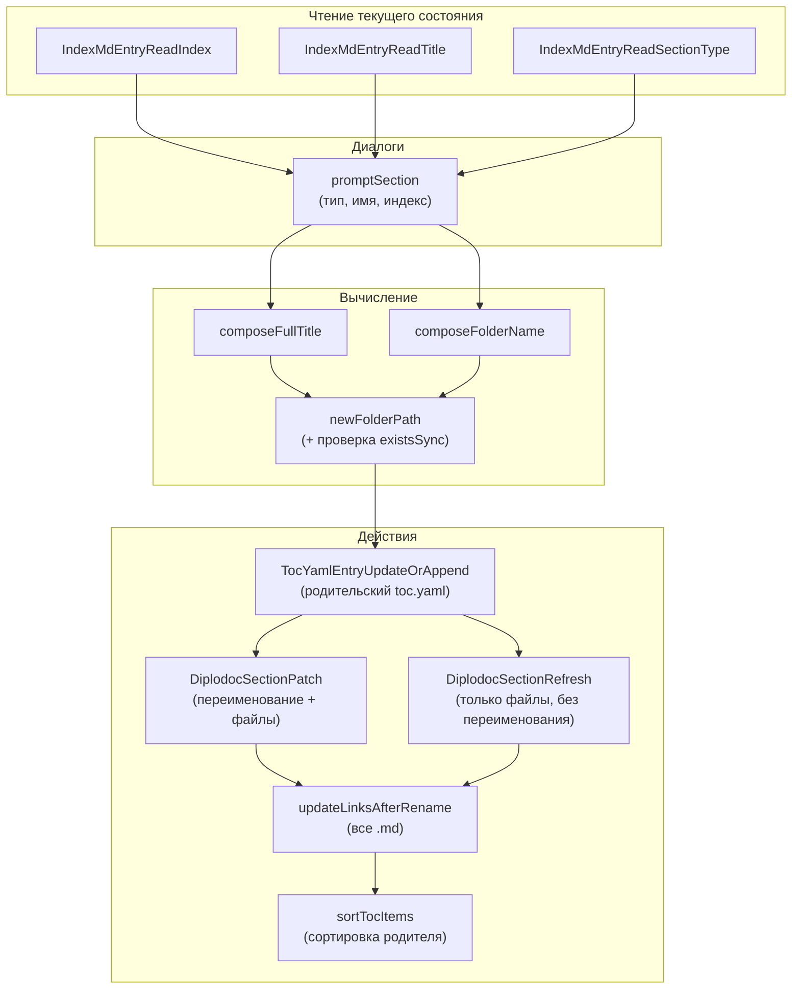

```mermaid
flowchart TB
    subgraph cmd[section.Rename]
        UX["ux_section_rename"]
    end
    subgraph read[Чтение]
        RI["IndexMdEntryRead*"]
    end
    subgraph prompt[Диалоги]
        PS["promptSection"]
    end
    subgraph compute[Вычисление]
        FT["composeFullTitle"]
        FN["composeFolderName"]
    end
    subgraph action[Действия]
        UOA["TocYamlEntryUpdateOrAppend"]
        PATCH["DiplodocSectionPatch"]
        REFRESH["DiplodocSectionRefresh"]
        LINKS["updateLinksAfterRename"]
        SORT["sortTocItems"]
    end
    subgraph shared[Shared core]
        MDE["md.index.entry"]
        TPL["frontmatter.templates"]
        FLOW["diplodoc.flow"]
        YT["yaml.toc.entry"]
        YB["yaml.base"]
        YI["yaml.index.entry"]
        MDF["md.index.file"]
        YS["yaml.toc.sort"]
        LM["links.md"]
    end
    subgraph sibling[Соседи]
        CREATE[section.Create]
        DELETE[section.Delete]
        MOVE[section.Move]
        RD[reindexer.directories]
    end
    UX --> RI
    UX --> PS
    UX --> FT
    UX --> FN
    UX --> UOA
    UX --> PATCH
    UX --> REFRESH
    UX --> LINKS
    UX --> SORT
    RI --> MDE
    FT --> TPL
    FN --> TPL
    UOA --> YT
    PATCH --> FLOW
    PATCH --> YT
    PATCH --> YB
    PATCH --> MDF
    REFRESH --> FLOW
    REFRESH --> YI
    LINKS --> LM
    SORT --> YS
    RD -.тот же DiplodocSectionPatch.-> FLOW
```

|               |                                                                                                                                                                 |
| ------------- | --------------------------------------------------------------------------------------------------------------------------------------------------------------- |
| ID            | [1.1-026](../../%D0%A1%D0%BE%D0%B3%D0%BB%D0%B0%D1%88%D0%B5%D0%BD%D0%B8%D1%8F/index.md#identifikaciya-modulej)                                                   |
| Идентификатор | `section.Rename`                                                                                                                                                |
| Наименование  | Переименование секции                                                                                                                                           |
| Слой          | [vscode-ui](../%D0%A1%D0%BB%D0%BE%D0%B8layer/%D0%A1%D0%BB%D0%BE%D0%B9VSCodeUI/index.md#naznachenie/index.md#naznachenie) / [Pre-processing](../../%D0%A1%D0%BB%D0%BE%D0%B8layer/%D0%A1%D0%BB%D0%BE%D0%B9Preprocessing/index.md#naznachenie) |
| Каталог       | [Структура](../../%D0%9A%D0%B0%D1%82%D0%B0%D0%BB%D0%BE%D0%B3Capabilitymap/%D0%9A%D0%B0%D1%82%D0%B0%D0%BB%D0%BE%D0%B3%D0%A1%D1%82%D1%80%D1%83%D0%BA%D1%82%D1%83%D1%80%D0%B0/index.md#struktura)                                                                                                                                                                                |
| Семейство     | [Структура](../../%D0%A1%D0%B5%D0%BC%D0%B5%D0%B9%D1%81%D1%82%D0%B2%D0%BEfamily/%D0%A1%D0%B5%D0%BC%D0%B5%D0%B9%D1%81%D1%82%D0%B2%D0%BE%D0%A1%D1%82%D1%80%D1%83%D0%BA%D1%82%D1%83%D1%80%D0%B0/index.md#fam-structure)                                                                                                                                                                                |
| Расположение  | `src/commands/diplodoc-helper.section.Rename.js`                                                                                                                |
| Точка входа   | `ux_section_rename(uri)`                                                                                                                                        |
| Версия        | `1.54.0`                                                                                                                                                        |
| Назначение    | Меняет имя, тип и индекс секции с переименованием папки и обновлением ссылок во всём проекте                                                                    |

{: .page-legend }

## Назначение

`section.Rename` — самая «богатая» по логике из четырёх команд семейства `sections`. Пользователь кликает правой кнопкой на папке-секции, выбирает **Diplodoc → Переименовать секцию**, проходит три диалога (тип, название, индекс) — и модуль:

1. Читает текущее состояние секции (`sectionIndex`, `pureTitle`, `sectionType`).
2. По результатам диалогов вычисляет целевые значения — `fullTitle`, `sectionIndex`, `folderName`.
3. Обновляет (или добавляет) запись в родительском `toc.yaml` — с новым `name`, но **старым** `href` (папка ещё не переименована).
4. Переименовывает папку, если имя изменилось.
5. Обновляет `index.md`, `index.yaml`, `toc.yaml` **внутри** секции.
6. Пересчитывает все markdown-ссылки в проекте — ссылки на переименованную секцию (и её потомков) перенаправляются на новое имя папки.
7. Сортирует `toc.yaml` родителя — если изменился `sectionIndex` или `sectionType`.

Без модуля для той же операции пришлось бы:

1. Вручную переименовать папку (с соблюдением `TEMPLATE_FOLDER_NAME`: `РазделN.Название` без пробелов).
2. Вручную отредактировать `title`/`pureTitle`/`sectionType`/`sectionIndex` в `index.md`.
3. Вручную отредактировать `title`/`description`/`meta.*`/`pureTitle` в `index.yaml`.
4. Вручную отредактировать `title` в `toc.yaml` самой секции.
5. Вручную отредактировать `name`/`href`/`include.path` записи в `toc.yaml` родителя.
6. Обновить все markdown-ссылки в проекте (`grep` по старому имени папки).
7. Пересортировать `toc.yaml` родителя, если изменился индекс/тип.

Модуль делает всё это за один диалоговый поток. Ограничение — не пересчитывает `sectionIndex` у потомков; для этого нужен отдельный [`reindexer.directories`](../МодульПереиндексация/index.md).

## Применение

**Когда использовать:** нужно переименовать секцию, изменить её тип (`Раздел` → `Глава`) или индекс (`1` → `2.5`) — с переименованием папки и обновлением всех ссылок.

**Когда НЕ использовать:** просто правите `title` в одном `index.md` — хватит редактора; перенос в другое место — `section.Move`.

**Альтернативы:**
- Ручное переименование папки + правка 4 файлов + `grep` ссылок — часы.
- `reindexer.directories` — массовая переиндексация, но без смены типа/имени.

**Типичный сценарий:** ПКМ на секции → **Diplodoc → Задать новый тип и наименование** → тип → имя → индекс → переименование папки + правка `index.md`/`index.yaml`/`toc.yaml` + обновление ссылок.

## Как это работает



### Фаза 1. Валидация и чтение текущего состояния

```js
async function ux_section_rename(uri) {
    if (!uri) return;
    const oldFolderPath = uri.fsPath;
    const oldFolderName = path.basename(oldFolderPath);
    const parentDir = path.dirname(oldFolderPath);

    if (!isDiplodocSection(oldFolderPath)) {
        vscode.window.showErrorMessage(translate(nls_ts.plugin.section.rename.error.isnotsection));
        return;
    }

    const currentIndex = IndexMdEntryReadIndex(oldFolderPath);
    const currentPureTitle = IndexMdEntryReadTitle(oldFolderPath);
    const currentSectionType = IndexMdEntryReadSectionType(oldFolderPath);
```

`isDiplodocSection` — папка содержит `index.md` + `index.yaml` + `toc.yaml`. Если нет — `«Переименовать можно только полноценный раздел.»` и выход.

Три чтения через `md.index.entry.js`:

| Функция                       | Что возвращает                                   | Пример       |
| ----------------------------- | ------------------------------------------------ | ------------ |
| `IndexMdEntryReadIndex`       | `String(data.sectionIndex \|\| '')`              | `'1'`        |
| `IndexMdEntryReadTitle`       | `String(data.pureTitle \|\| data.title \|\| '')` | `'Введение'` |
| `IndexMdEntryReadSectionType` | `String(data.sectionType \|\| '')`               | `'Section'`  |

Если `uri` не передан — тихий `return` без сообщения. См. «Известные ограничения».

### Фаза 2. Диалоги

```js
const newSectionObject = await promptSection(currentPureTitle, currentIndex);
if (!newSectionObject) {
    console.log(translate(nls_ts.plugin.section.rename.error.interrupted));
    return;
}
```

`promptSection(currentPureTitle, currentIndex)` — из `vscode.prompts.js`:

1. **`promptSectionType()`** — `QuickPick` со списком типов (тот же, что в `section.Create`). Возвращает `{ value, label, name, description }` или `undefined`.
   - Если `undefined` — `promptSection` возвращает `null`, `ux_section_rename` выходит **молча** (только `console.log`).

2. **`promptSectionName(currentPureTitle)`** — `InputBox` с предзаполненным текущим `pureTitle`:
   - `prompt: 'Введите новое название раздела'`;
   - `value: currentValue`;
   - `validateInput` — непустое, ≤ 255.
   - Если `undefined` — `return null`, выход.

3. **`promptSectionIndex(currentIndex)`** — `InputBox` с предзаполненным текущим индексом. Только если тип в `FrontMatterSectionTypesIndexed2` (`Part`, `Section`, `Chapter`; `Page` исключён).
   - `value: currentIndex`;
   - `validateInput` — `^\d+(\.\d+)*$`, без `..` и ведущих нулей.
   - Если `undefined` (пользователь нажал Escape) — `userIndex = undefined ?? '' = ''`. **Не** выход. См. «Известные ограничения».

Возвращает `{ newSectionType, newPureTitle, userIndex }` или `null`.

### Фаза 3. Вычисление целевых значений

```js
let finalIndex = newSectionObject.userIndex?.trim() || '';
const newPureTitle = newSectionObject.newPureTitle;
const newSectionTypeObj = newSectionObject.newSectionType;

const isIndexChanged = currentIndex !== finalIndex;
const isTypeChanged = currentSectionType !== newSectionTypeObj.value;
const needSorting = isIndexChanged || isTypeChanged;

if (!isIndexedSectionType(newSectionTypeObj)) {
    finalIndex = '';
}

const fullTitle = composeFullTitle(finalIndex, newSectionTypeObj, newPureTitle);
const newFolderName = composeFolderName(finalIndex, newSectionTypeObj, newPureTitle);
const newFolderPath = path.join(parentDir, newFolderName);

if (fs.existsSync(newFolderPath) && newFolderName !== oldFolderName) {
    vscode.window.showErrorMessage(translate(nls_ts.plugin.section.rename.error.folderexists, newFolderName));
    return;
}
```

Пошагово:

1. **`finalIndex`** — обрезанный `userIndex` или `''`. Если пользователь нажал Escape на диалоге индекса — `''`.

2. **`isIndexChanged`** — `currentIndex !== finalIndex`. Сравнение строк (`'1'` vs `'1.0'` → `true`). Семантически «то же число», но текстово разные — будет считаться изменением.

3. **`isTypeChanged`** — **баг**:

   ```js
   const currentSectionType = IndexMdEntryReadSectionType(oldFolderPath); // 'Section'
   const isTypeChanged = currentSectionType !== newSectionTypeObj.value;   // 'Раздел'
   ```

   `currentSectionType` — **имя** (`Section`), `newSectionTypeObj.value` — **label** (`Раздел`). Никогда не равны. `isTypeChanged` всегда `true`. → `needSorting` всегда `true` (если `newSectionTypeObj.value` непустой; для `Page` — `''`, и тогда `currentSectionType = 'Page' !== ''` → `true`).

   Практический эффект: `sortTocItems` вызывается **всегда**, даже когда тип не менялся. Не баг-в-баг (сортировка по `sectionIndex` идемпотентна), но сортировка при каждом переименовании — лишняя работа.

4. **`finalIndex = ''` для не-индексируемых** — `isIndexedSectionType(newSectionTypeObj)`:

   ```js
   return FrontMatterSectionTypesIndexed.includes(sectionType.name);
   ```

   `FrontMatterSectionTypesIndexed` включает `Part`, `Section`, `Chapter`, **`Page`**. То есть для `Page` (статья, `value: ''`) `isIndexedSectionType` вернёт `true` — `finalIndex` **не** обнулится. Но так как для `Page` `promptSection` не запрашивает индекс, `userIndex = ''` и `finalIndex = ''` уже. Компенсация: разработчик знал, что `promptSection` не даст индекса для `Page`, поэтому `isIndexedSectionType` для `Page` не используется на практике. Но семантически — «мёртвая ветка».

5. **`composeFullTitle`** — `Раздел 1. Введение`, `2.5. Настройка`, `Введение` (для `Page`).

6. **`composeFolderName`** — `Раздел1.Введение`, `2.5.Настройка`, `Введение`. Через `TEMPLATE_FOLDER_NAME` — с вырезанием пробелов и спецсимволов.

7. **Проверка конфликта** — если `newFolderPath` существует **и** `newFolderName !== oldFolderName` — ошибка `«Папка <name> уже существует.»`. Если имена совпадают (переименование «в себя») — конфликт игнорируется, дальше пойдёт `DiplodocSectionRefresh` (без `fs.renameSync`).

### Фаза 4. Порядок действий

```js
let finalFolderName = oldFolderName;

try {
    TocYamlEntryUpdateOrAppend(
        parentDir,
        oldFolderName,
        fullTitle,
        finalFolderName,   // = oldFolderName! (баг)
        newSectionTypeObj.value,
        finalIndex
    );

    if (newFolderName !== oldFolderName) {
        finalFolderName = DiplodocSectionPatch(oldFolderPath, newPureTitle, newSectionTypeObj, finalIndex);
        finalFolderName = path.basename(finalFolderName);
    } else {
        DiplodocSectionRefresh(oldFolderPath, newPureTitle, newSectionTypeObj.name, newSectionTypeObj.value, finalIndex);
    }

    const projectRoot = getLanguageRoot(parentDir);
    const effectiveOldPath = oldFolderPath;
    const effectiveNewPath = path.join(parentDir, finalFolderName);

    await updateLinksAfterRename(effectiveOldPath, effectiveNewPath, projectRoot, '**удалено**');

    if (needSorting) {
        sortTocItems(parentDir);
    }

    vscode.window.showInformationMessage(
        translate(nls_ts.plugin.section.rename.info.success, oldFolderName, finalFolderName)
    );
} catch (err) {
    const msg = err instanceof Error ? err.message : String(err);
    vscode.window.showErrorMessage(translate(nls_ts.plugin.section.rename.error.critical, msg));
    console.error('[Rename] Критическая ошибка:', err);
}
```

**Шаг 4.1. `TocYamlEntryUpdateOrAppend`** — из `yaml.toc.entry.js`:

```js
const updatedEntry = {
    name: composedTitle,
    href: `${newFolderName}/${FrontMatterFiles.INDEX_MD}`,   // newFolderName = finalFolderName = oldFolderName
    include: {
        path: `${newFolderName}/${FrontMatterFiles.TOC_YAML}`,
        mode: 'link',
    },
};
```

Так как `finalFolderName = oldFolderName` на момент вызова, `updatedEntry.href = oldFolderName/index.md`. Запись в `toc.yaml` родителя получает новый `name` (`fullTitle`), но `href` и `include.path` — с **старым** именем папки. Папка ещё не переименована — формально корректно.

Функция ищет существующую запись по `oldTargetHref = oldFolderName/index.md` и заменяет. Если записи нет (пользователь правил `toc.yaml` вручную) — добавляет в конец. Если записей несколько — обновляет **только первую**.

**Шаг 4.2а. Если `newFolderName !== oldFolderName` — `DiplodocSectionPatch`**:

```js
function DiplodocSectionPatch(folderPath, pureTitle, sectionType, sectionIndex = '') {
    const oldFolderName = path.basename(folderPath);
    const newFolderName = TEMPLATE_FOLDER_NAME(sectionType, pureTitle, sectionIndex);
    if (oldFolderName === newFolderName) return oldFolderName;
    
    const newFolderPath = path.join(path.dirname(folderPath), newFolderName);
    if (fs.existsSync(newFolderPath)) {
        console.warn(`Конфликт имён: …`);
        return oldFolderName;
    }
    
    try {
        fs.renameSync(folderPath, newFolderPath);                    // ← переименование папки
        TocYamlEntryPatchReference(parentDir, oldFolderName, newFolderName);  // ← правка родителя
        const composedTitle = composeFullTitle(sectionIndex, sectionType, pureTitle);
        TocYamlEntryPatchTitle(newFolderPath, composedTitle);        // ← правка toc.yaml секции
        IndexYamlEntryPatch(newFolderPath, pureTitle, sectionType, sectionIndex);  // ← index.yaml (js-yaml)
        IndexMdUpsert(newFolderPath, pureTitle, sectionType.name, sectionType.value, sectionIndex);  // ← index.md
        return newFolderName;
    } catch (err) {
        console.error(`❌ Не удалось переименовать ${oldFolderName}:`, msg);
        return oldFolderName;  // ← возвращает СТАРОЕ имя при ошибке, хотя папка уже переименована
    }
}
```

**`TocYamlEntryPatchReference`** — правка **родительского** `toc.yaml`:

```js
content = content.replace(new RegExp(oldFolderName, 'g'), newFolderName);
IndexYamlEntryPatchHRef(parentDir, oldFolderName, newFolderName, '');
```

Заменяет **все** вхождения `oldFolderName` на `newFolderName` в `toc.yaml` родителя. Так как `href` в записи был `oldFolderName/index.md`, после замены станет `newFolderName/index.md`. `include.path` аналогично.

**`TocYamlEntryPatchTitle`** — правка `title:` в `toc.yaml` **самой секции**:

```js
const regex = /(title:\s*)(.*)/;
content = content.replace(regex, `$1${composedTitle}`);
```

Первое `title:` в файле — заменяется. В `toc.yaml` секции `title` — единственный, но если файл отредактирован вручную и содержит комментарии с `title:`, они тоже попадут под замену. См. «Известные ограничения».

**`IndexYamlEntryPatch`** — правка `index.yaml` **внутри секции** (из `yaml.base.js`, js-yaml):

```js
data.title = composedTitle;
data.description = `Описывает ${composedTitle}`;
if (!data.meta) data.meta = {};
data.meta.title = composedTitle;
data.meta.sectionType = newSectionType.name;
data.meta.sectionIndex = sectionIndex;
data.pureTitle = newPureTitle;
fs.writeFileSync(yamlPath, yaml.dump(data, { … }), 'utf8');
```

Использует `js-yaml.dump` — **переформатирует** `index.yaml` целиком. Если пользователь писал комментарии в `index.yaml`, они потеряются.

**`IndexMdUpsert`** — правка `index.md`:

```js
data.title = composedTitle;
data.pureTitle = pureTitle;
data.sectionType = sectionTypeName;
if (sectionIndex) data.sectionIndex = sectionIndex; else delete data.sectionIndex;
fs.writeFileSync(indexPath, stringify(data, body), 'utf8');
```

Через `gray-matter.stringify` — сохраняет тело файла.

**Шаг 4.2б. Если `newFolderName === oldFolderName` — `DiplodocSectionRefresh`**:

```js
function DiplodocSectionRefresh(folderPath, pureTitle, sectionTypeName, sectionLabel, sectionIndex = '') {
    const sectionTypeOpt = { value: sectionLabel, name: sectionTypeName, label: '', description: '' };
    const composedTitle = composeFullTitle(sectionIndex, sectionTypeOpt, pureTitle);
    IndexMdFilePatch(folderPath, pureTitle, sectionTypeName, sectionLabel, sectionIndex);
    IndexYamlEntryPatchSection(folderPath, pureTitle, sectionTypeName, sectionLabel, sectionIndex);
    TocYamlEntryPatchTitle(folderPath, composedTitle);
}
```

Отличия от `DiplodocSectionPatch`:

- **нет** `fs.renameSync` — папка не переименовывается (имя совпадает);
- **нет** `TocYamlEntryPatchReference` — родительский `toc.yaml` уже обновлён на шаге 4.1 (там `href` совпал, т.к. имя папки не изменилось);
- **`IndexYamlEntryPatchSection`** вместо `IndexYamlEntryPatch` — использует **regex**, не js-yaml. Сохраняет комментарии и форматирование `index.yaml`;
- **`IndexMdFilePatch`** вместо `IndexMdUpsert` — старый API, но результат тот же.

То есть `DiplodocSectionRefresh` — «мягкая» правка (regex), `DiplodocSectionPatch` — «жёсткая» (перезапись). Косметическое различие: после `Rename` без смены папки комментарии в `index.yaml` сохраняются; после смены папки — теряются.

**Шаг 4.3. `updateLinksAfterRename`** — обход всех `.md`:

```js
const transform = absoluteTarget => {
    if (absoluteTarget === oldFolderPath || absoluteTarget.startsWith(oldFolderPath + path.sep)) {
        if (absoluteTarget === oldFolderPath) return newFolderPath;
        const rel = absoluteTarget.slice(oldFolderPath.length + 1);
        return path.join(newFolderPath, rel);
    }
    return undefined;
};
```

Для ссылок на старую папку (и её потомков) — новый путь `effectiveNewPath/…`. Для всех остальных — `undefined` (не трогать).

Если `finalFolderName === oldFolderName` (случай «только имя/тип/индекс изменились, но папка не переименовалась»), `effectiveOldPath === effectiveNewPath` — transform возвращает тот же путь для «своих» и `undefined` для чужих. `updateLinksInContent` пересоберёт ссылки, но относительные пути не изменятся → файлы **не** перезаписываются (`newContent !== content` не сработает). То есть на практике — просто бесполезный обход всех `.md`.

**Шаг 4.4. `sortTocItems(parentDir)`** — из `yaml.toc.sort.js`. Сортирует `items` в `toc.yaml` родителя по `sectionIndex` (читается из `index.md` каждой дочерней секции). `needSorting` всегда `true` (из-за бага `isTypeChanged`), так что `sortTocItems` запускается **при каждом** переименовании.

**Шаг 4.5. Сообщение**:

```js
translate(nls_ts.plugin.section.rename.info.success, oldFolderName, finalFolderName)
```

`plugin.section.rename.info.success`: `"Раздел переименован: «{0}» → «{1}»"`. Итог: `«Раздел переименован: «Раздел1.Введение» → «Раздел2.Архитектура»»`. Если имя папки не изменилось (только `pureTitle`), получится `«…«Раздел1.Введение» → «Раздел1.Введение»»` — странно. См. «Известные ограничения».

### Файлы модуля

| Файл                                             | Ответственность                                                                      |
| ------------------------------------------------ | ------------------------------------------------------------------------------------ |
| `src/commands/diplodoc-helper.section.Rename.js` | `ux_section_rename` — оркестратор                                                    |
| `src/commands/vscode.prompts.js`                 | `promptSection`, `promptSectionType`, `promptSectionName`, `promptSectionIndex`      |
| `src/plugins/utils/md.index.entry.js`            | `IndexMdEntryReadIndex`, `IndexMdEntryReadTitle`, `IndexMdEntryReadSectionType`      |
| `src/plugins/utils/frontmatter.section.title.js` | `composeFullTitle`, `composeFolderName`, `isIndexedSectionType`                      |
| `src/plugins/utils/diplodoc.flow.js`             | `DiplodocSectionPatch`, `DiplodocSectionRefresh`                                     |
| `src/plugins/utils/yaml.toc.entry.js`            | `TocYamlEntryUpdateOrAppend`, `TocYamlEntryPatchTitle`, `TocYamlEntryPatchReference` |
| `src/plugins/utils/yaml.base.js`                 | `IndexYamlEntryPatch` (js-yaml)                                                      |
| `src/plugins/utils/yaml.index.entry.js`          | `IndexYamlEntryPatchHRef`, `IndexYamlEntryPatchSection` (regex)                      |
| `src/plugins/utils/md.index.file.js`             | `IndexMdUpsert`, `IndexMdFilePatch`                                                  |
| `src/plugins/utils/yaml.toc.sort.js`             | `sortTocItems`                                                                       |
| `src/plugins/model/frontmatter.templates.js`     | `TEMPLATE_FOLDER_NAME`                                                               |
| `src/commands/diplodoc-helper.links.md.js`       | `updateLinksAfterRename`                                                             |
| `src/plugins/utils/path.directory.js`            | `isDiplodocSection`, `getLanguageRoot`                                               |

## Режимы работы

### VS Code

| Команда                         | Заголовок            | Где появляется                                                |
| ------------------------------- | -------------------- | ------------------------------------------------------------- |
| `diplodoc-helper.renameSection` | Переименовать секцию | Explorer → Diplodoc → Переименовать секцию (только на папках) |

Условие (`when`): `explorerResourceIsFolder`.

### CLI

CLI-команды нет. Модуль — только VS Code.

### Сборочный пайплайн

В `docs-build.js` не участвует.

## Юнит-тесты





## Связи

`section.Rename` — четвёртая и последняя команда семейства `sections`. Самая насыщенная по вызовам `sections.core`:

| Что вызывает                                                                         | Откуда                         |
| ------------------------------------------------------------------------------------ | ------------------------------ |
| `IndexMdEntryRead*` (3 функции)                                                      | `md.index.entry.js`            |
| `composeFullTitle`, `composeFolderName`                                              | `frontmatter.section.title.js` |
| `DiplodocSectionPatch` / `DiplodocSectionRefresh`                                    | `diplodoc.flow.js`             |
| `TocYamlEntryUpdateOrAppend`, `TocYamlEntryPatchTitle`, `TocYamlEntryPatchReference` | `yaml.toc.entry.js`            |
| `IndexYamlEntryPatch` (js-yaml)                                                      | `yaml.base.js`                 |
| `IndexYamlEntryPatchHRef`, `IndexYamlEntryPatchSection` (regex)                      | `yaml.index.entry.js`          |
| `IndexMdUpsert`, `IndexMdFilePatch`                                                  | `md.index.file.js`             |
| `sortTocItems`                                                                       | `yaml.toc.sort.js`             |
| `TEMPLATE_FOLDER_NAME`                                                               | `frontmatter.templates.js`     |

С [`sections.core`](../МодульЯдросоцифровок/index.md) — почти все функции ядра. Если `sections.core` меняется — `Rename` затронут больше всех.

С другими командами семейства:

| Команда              | Использует из общего                                                                                             | Отличие                                                                     |
| -------------------- | ---------------------------------------------------------------------------------------------------------------- | --------------------------------------------------------------------------- |
| `section.Create`     | `createSectionFolder`, `IndexMdFileCreate`, `IndexYamlFileCreate`, `TocYamlFileCreate`, `TocYamlEntryPatchItems` | Только создание, без переименования                                         |
| `section.Delete`     | `TocYamlEntryRemove`, `updateLinksAfterDelete`                                                                   | Удаление, `transform` → `null`                                              |
| `section.Move`       | `TocYamlEntryRemove`, `TocYamlEntryInsertAtPosition`, `updateLinksAfterRename`                                   | Перенос папки без правки `index.md`/`index.yaml`                            |
| **`section.Rename`** | Все перечисленные выше                                                                                           | Полная правка `index.md` + `index.yaml` + `toc.yaml` + переименование папки |

С [`reindexer.directories`](../МодульПереиндексация/index.md) — не вызывает, но `Rename` часто является «предшагом»: переименовал раздел → запустил `reindexer.directories`, чтобы пересчитать `sectionIndex` у детей. Обратная зависимость: `reindexer.directories` использует тот же `DiplodocSectionPatch`, что и `Rename`.






