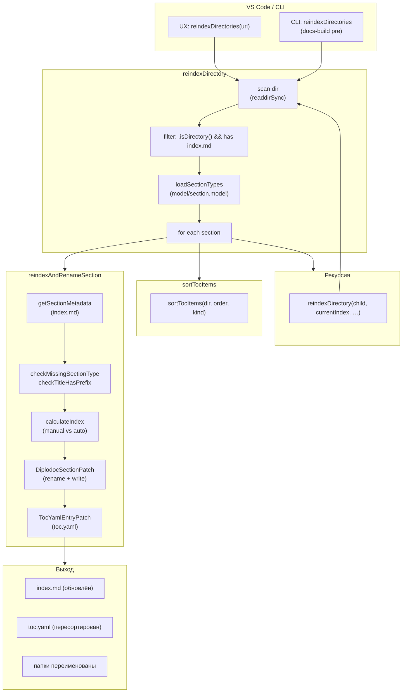
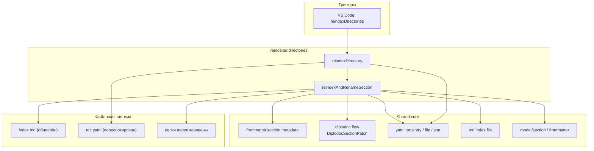

|               |                                                                                                                 |
| ------------- | --------------------------------------------------------------------------------------------------------------- |
| ID            | [1.2-041](../../%D0%A1%D0%BE%D0%B3%D0%BB%D0%B0%D1%88%D0%B5%D0%BD%D0%B8%D1%8F/index.md#identifikaciya-modulej)   |
| Идентификатор | `reindexer.directories`                                                                                         |
| Наименование  | Переиндексация папок                                                                                            |
| Слой          | [pre-processing](../%D0%A1%D0%BB%D0%BE%D0%B8layer/PreProcessing/index.md#naznachenie)                             |
| Расположение  | `src/plugins/reindexer/reindexer.directories.js`                                                                |
| Точка входа   | `reindexDirectory(dir, parentIndex, sortOrder, sortKind)`                                                       |
| Версия        | `1.54.0`                                                                                                        |
| Назначение    | Пересчитывает `sectionIndex` во всех секциях, переименовывает папки, обновляет `toc.yaml` и сортирует навигацию |

{: .page-legend }

## Назначение

`reindexer.directories` — «массовая» операция над деревом секций. Пользователь вызывает **Diplodoc → Переиндексировать папки** на папке-корне (обычно `docs/ru/` или конкретный раздел) — и модуль рекурсивно проходит по дереву, для каждой секции:

1. Читает `index.md` → `sectionType`, `pureTitle`, `sectionIndex`.
2. Если `sectionIndex` **не задан** — вычисляет автоматически (`<parentIndex>.<N>`), где `N` — следующий свободный номер.
3. Если `sectionIndex` **задан вручную** — использует его, но обновляет `localCounter`, чтобы следующие автоматические не конфликтовали.
4. Переименовывает папку в `TEMPLATE_FOLDER_NAME` (`Раздел1.Введение` и т.п.), если имя не соответствует.
5. Обновляет `title` в `index.md`, `toc.yaml` секции, `toc.yaml` родителя.
6. **Сортирует** `toc.yaml` родителя по `sectionIndex`.
7. **Рекурсивно** вызывает себя для дочерних секций с `parentIndex = <текущий>`.

Без модуля пришлось бы вручную править `sectionIndex`, переименовывать папки, синхронизировать `toc.yaml` — для 50+ секций это часы.

`reindexer.directories` — единственный модуль расширения, который делает **глубокую рекурсию** по дереву с полным переименованием. `section.Rename` и `section.Move` работают только с одной секцией за раз.

## Применение

**Когда использовать:** после массовых переименований/перемещений — пересчитать `sectionIndex`, переименовать папки по `TEMPLATE_FOLDER_NAME`, отсортировать `toc.yaml` по всему дереву.

**Когда НЕ использовать:** одна секция — хватит `section.Rename`; нет `toc.yaml` — сортировать нечего.

**Альтернативы:**
- Ручной пересчёт индексов и переименование — часы на 50+ секций.
- `section.Rename` — одна секция за раз.

**Типичный сценарий:** ПКМ на корне языка → **Diplodoc → Прочее → Индексация → Переиндексировать папки** → рекурсивный обход + переименование + сортировка.

## Как это работает



### Фаза 1. Обход

```js
function reindexDirectory(dir, parentIndex = '', sortOrder = 'ascending', sortKind = 'nonIndexedBottom') {
    console.log(`Переиндексация: ${path.relative(process.cwd(), dir) || '.'}`);

    const items = fs.readdirSync(dir, { withFileTypes: true });
    const sections = items.filter(
        item => item.isDirectory() && fs.existsSync(path.join(dir, item.name, 'index.md'))
    );

    if (sections.length === 0) return [];
    // …
}
```

- **`parentIndex`** — `sectionIndex` родительской секции. Для корня `docs/ru/` — `''`. Для `Раздел1.Введение` — `'1'`. Дочерние получают `1.1`, `1.2`, …
- **`sortOrder`** — `'ascending'` (по умолчанию) / `'descending'` / `'none'`.
- **`sortKind`** — `'nonIndexedBottom'` (по умолчанию) / `'nonIndexedTop'`.
- **`sections`** — только папки с `index.md`. Файлы и папки без `index.md` — пропускаются.
- **Если `sections.length === 0`** — пустой массив (нет warning'ов, нечего индексировать).

### Фаза 2. Подготовка

```js
let allWarnings = [];
const localSectionTypes = sectionTypes();
let localCounter = 0;
const tocPath = path.join(dir, 'toc.yaml');
let tocDoc = null;

if (fs.existsSync(tocPath)) {
    try {
        tocDoc = TocYamlFileLoad(tocPath);
    } catch (e) {
        console.error(`❌ Ошибка загрузки toc.yaml в ${dir} \n ${msg}`);
    }
}
```

- **`localSectionTypes`** — список `[Part, Section, Chapter, Page]` из `model/section.model`. Используется для поиска `sectionTypeObj` по `metadata.sectionType`.
- **`localCounter`** — счётчик «последний использованный номер». Изначально 0, увеличивается при `auto`-индексации и при `manual`, если номер больше счётчика.
- **`tocDoc`** — загруженный `toc.yaml` родителя (для правки `name` в записях). Если нет — `null` (правки не выполняются, но `index.md` обновляется).

### Фаза 3. Цикл по секциям

```js
for (const section of sections) {
    const result = reindexAndRenameSection({
        dir,
        sectionName: section.name,
        localCounter,
        parentIndex,
        localSectionTypes,
        tocDoc,
    });

    allWarnings = allWarnings.concat(result.warnings || []);
    localCounter = result.localCounter;

    const childWarnings = reindexDirectory(
        result.sectionPath,
        result.currentIndex || parentIndex,
        sortOrder,
        sortKind
    );
    allWarnings = allWarnings.concat(childWarnings);
}
```

Порядок:

1. **`reindexAndRenameSection`** — обрабатывает **одну** секцию: читает, проверяет, вычисляет `sectionIndex`, переименовывает, правит `toc.yaml` родителя.
2. **`localCounter = result.localCounter`** — обновляется после каждой секции. Если секция получила `'2'` вручную, `localCounter = 2`, следующая автоматическая получит `'3'`.
3. **Рекурсия** — `reindexDirectory(result.sectionPath, result.currentIndex || parentIndex, …)`. Если `result.currentIndex` пуст (Page), `parentIndex` пробрасывается как есть (дети Page будут `<parentIndex>.<N>`, а не `<пусто>.<N>`).

### Фаза 4. `reindexAndRenameSection`

```js
function reindexAndRenameSection({ dir, sectionName, localCounter, parentIndex, localSectionTypes, tocDoc }) {
    const oldSectionPath = path.join(dir, sectionName);
    const indexMdPath = path.join(oldSectionPath, 'index.md');

    if (!fs.existsSync(indexMdPath)) {
        return { sectionPath: oldSectionPath, currentIndex: '', newFolderName: sectionName, localCounter, warnings: [] };
    }

    const content = fs.readFileSync(indexMdPath, 'utf8');
    const metadata = getSectionMetadata(content);

    const warnings = [];
    checkMissingSectionType(metadata, oldSectionPath, warnings);
    checkTitleHasPrefix(metadata, oldSectionPath, warnings);
    // …
}
```

**4.1. `getSectionMetadata`** — из `utils/frontmatter.section.metadata.js`:

```js
return {
    sectionType: get(content, 'sectionType'),        // null если нет
    pureTitle: get(content, 'pureTitle') || get(content, 'title'),
    sectionIndex: get(content, 'sectionIndex'),      // null если нет
};
```

**4.2. Проверки (warnings):**

- **`checkMissingSectionType`** — если `metadata.sectionType` пуст → `warning: «Присвойте тип для раздела "<name>"»`. Не блокирует, но попадает в `allWarnings` и показывается пользователю в конце (`showWarnings`).
- **`checkTitleHasPrefix`** — если `title` начинается с `Часть `/`Раздел `/`Глава ` без `pureTitle` → `warning: «Переименуйте статью "<title>"»`. То есть в `index.md` есть `title: Раздел 1. Введение`, но нет `pureTitle: Введение` — модуль не может корректно извлечь `pureTitle`, предупреждает.

**4.3. Определение `sectionTypeObj`:**

```js
const DEFAULT_SECTION_TYPE = { name: 'Page', label: 'Статья', value: '', description: '' };
const sectionTypeObj = localSectionTypes.find(st => st.name === metadata.sectionType) || DEFAULT_SECTION_TYPE;
```

Если `metadata.sectionType` не найден в списке (например, `Page` для статьи) — fallback на `Page`.

**4.4. Вычисление `sectionIndex`:**

```js
const sectionType = sectionTypeObj.name;
const pureTitle = metadata.pureTitle || sectionName;
let currentIndex = String(metadata.sectionIndex || '').trim();

if (FrontMatterSectionTypesIndexed.includes(sectionType)) {
    const hadManualIndex = !!currentIndex;

    if (!currentIndex) {
        localCounter++;
        currentIndex = parentIndex ? `${parentIndex}.${localCounter}` : `${localCounter}`;
    } else {
        const parts = currentIndex.split('.');
        const lastNum = parseInt(parts[parts.length - 1], 10);
        if (!isNaN(lastNum)) {
            localCounter = Math.max(localCounter, lastNum);
        }
    }

    const sectionLabel = sectionTypeObj.label || '';
    const newTitle = `${sectionLabel} ${currentIndex}. ${pureTitle}`;

    IndexMdUpsert(oldSectionPath, pureTitle, sectionType, sectionLabel, currentIndex);
    const newFolderName = DiplodocSectionPatch(oldSectionPath, pureTitle, sectionTypeObj, currentIndex);
    const newSectionPath = path.join(dir, newFolderName);

    if (tocDoc?.items) {
        TocYamlEntryPatch(tocDoc, sectionName, newTitle);
    }

    return { sectionPath: newSectionPath, currentIndex, newFolderName, localCounter, warnings };
}

return { sectionPath: oldSectionPath, currentIndex: '', newFolderName: sectionName, localCounter, warnings };
```

**Логика `sectionIndex`:**

| Было         | Тип индексируется?        | Результат                                             |
| ------------ | ------------------------- | ----------------------------------------------------- |
| `''` (пусто) | Да (Part/Section/Chapter) | `parentIndex.N` (auto)                                |
| `'2'`        | Да                        | `'2'` (manual), `localCounter = max(localCounter, 2)` |
| `''`         | Нет (Page)                | `''` (без индекса)                                    |
| `'2'`        | Нет (Page)                | `''` (игнорируется, Page не индексируется)            |

**Внимание:** `FrontMatterSectionTypesIndexed` включает **`Page`** (см. `model/frontmatter.model.js`). То есть `Page` попадёт в `if`, `hadManualIndex` определится по `currentIndex` (у Page всегда `''`), `currentIndex = parentIndex.N`, папка переименуется. См. «Известные ограничения» — баг.

**`IndexMdUpsert`** — обновляет `index.md` (frontmatter: `title`, `pureTitle`, `sectionType`, `sectionIndex`).

**`DiplodocSectionPatch`** — переименовывает папку в `TEMPLATE_FOLDER_NAME(sectionTypeObj, pureTitle, currentIndex)`. Внутри — `fs.renameSync`, `TocYamlEntryPatchReference` (родитель), `TocYamlEntryPatchTitle` (свой `toc.yaml`), `IndexYamlEntryPatch`, `IndexMdUpsert`.

**`TocYamlEntryPatch`** — обновляет `name` в `toc.yaml` родителя (в памяти, `tocDoc`). **Не** сохраняет файл — сохранение будет в конце цикла (см. Фаза 5).

### Фаза 5. Сортировка и сохранение `toc.yaml`

```js
if (tocDoc && sortOrder !== 'none') {
    console.log(`   Сортируем toc.yaml (${sections.length} элементов)`);
    sortTocItems(dir, sortOrder, sortKind);
    console.log(`   toc.yaml отсортирован`);
}

return allWarnings;
```

- **`tocDoc` есть** (toc.yaml существует) и **`sortOrder !== 'none'`** — вызывается `sortTocItems`.
- `sortTocItems` (из `utils/yaml.toc.sort.js`):
  1. Загружает `toc.yaml`.
  2. Для каждого `items[i]` — `IndexMdEntryReadIndex(childFolderPath)` — читает `sectionIndex` дочерней секции.
  3. Разделяет на `indexed` (с `sectionIndex`) и `nonIndexed` (без).
  4. Сортирует `indexed` по `sectionIndex` (числовое сравнение с учётом `a.b.c`).
  5. `sortKind = 'nonIndexedBottom'` → `[...indexed, ...nonIndexed]`; `'nonIndexedTop'` → `[...nonIndexed, ...indexed]`.
  6. **Перезаписывает** `toc.yaml` через `YAML.stringify`.

**Важно:** `TocYamlEntryPatch` **в памяти** правит `name` в `tocDoc`, но `sortTocItems` **заново читает** `toc.yaml` с диска. То есть правки `TocYamlEntryPatch` теряются (не сохраняются). См. «Известные ограничения» — баг.

### Файлы модуля

| Файл                                                  | Ответственность                                                                                 |
| ----------------------------------------------------- | ----------------------------------------------------------------------------------------------- |
| `src/plugins/reindexer/reindexer.directories.js`      | `reindexDirectory`, `reindexAndRenameSection`, `checkMissingSectionType`, `checkTitleHasPrefix` |
| `src/commands/diplodoc-helper.reindex.directories.js` | `ux_reindex_directories`, `showWarnings` (UI-обёртка)                                           |
| `src/plugins/utils/frontmatter.section.metadata.js`   | `getSectionMetadata`                                                                            |
| `src/plugins/model/section.model.js`                  | `sectionTypes()` — список типов                                                                 |
| `src/plugins/model/frontmatter.model.js`              | `FrontMatterSectionTypesIndexed`                                                                |
| `src/plugins/utils/diplodoc.flow.js`                  | `DiplodocSectionPatch`                                                                          |
| `src/plugins/utils/yaml.toc.file.js`                  | `TocYamlFileLoad`                                                                               |
| `src/plugins/utils/yaml.toc.entry.js`                 | `TocYamlEntryPatch`                                                                             |
| `src/plugins/utils/yaml.toc.sort.js`                  | `sortTocItems`                                                                                  |
| `src/plugins/utils/md.index.file.js`                  | `IndexMdUpsert`                                                                                 |

### Формат `warnings[]`

```js
[
    { type: 'missingSectionType', message: 'Присвойте тип для раздела "<name>"', sectionPath: '/abs/path' },
    { type: 'titleHasPrefix', message: 'Переименуйте статью "<title>"', sectionPath: '/abs/path' },
]
```

## Режимы работы

### VS Code

| Команда                              | Заголовок               | Где появляется                            |
| ------------------------------------ | ----------------------- | ----------------------------------------- |
| `diplodoc-helper.reindexDirectories` | Переиндексировать папки | Explorer → Diplodoc → Прочее → Индексация |

`ux_reindex_directories(uri)`:

```js
async function ux_reindex_directories(uri) {
    if (!uri) return;
    const targetDir = uri.fsPath;
    let allWarnings = [];
    await vscode.window.withProgress(
        { location: vscode.ProgressLocation.Notification, title: translate(nls_ts.plugin.section.reindex.progress.text), cancellable: false },
        async () => { allWarnings = reindexDirectory(targetDir); }
    );
    vscode.window.showInformationMessage(translate(nls_ts.plugin.section.reindex.info.success));
    if (allWarnings.length > 0) showWarnings(allWarnings);
}
```

- **`withProgress`** — индикатор «Переиндексация Diplodoc...». Не отменяемый.
- **`showInformationMessage`** — «Переиндексация секций завершена!» — **всегда**, даже если были warnings.
- **`showWarnings`** — модальный диалог с уникальными сообщениями (через `Set`), кнопка «Понятно».

### CLI

CLI-команды нет. `reindexer.directories` доступен только через VS Code. В `docs-build.js` вызывается `reindexFigures` и `reindexFootnotes`, но **не** `reindexDirectories` — они не участвуют в сборке. См. «Известные ограничения».

### Сборочный пайплайн

**Не участвует.** Реиндексация — интерактивная операция (пользователь явно запускает). В `docs-build.js` нет шага `reindexDirectories`.

## Юнит-тесты





## Связи

`reindexer.directories` — «массовая» операция, использующая почти все функции `sections.core`:

| Что использует                                   | Откуда                                           |
| ------------------------------------------------ | ------------------------------------------------ |
| `getSectionMetadata`                             | `frontmatter.section.metadata`                   |
| `DiplodocSectionPatch`                           | `diplodoc.flow` (тот же, что в `section.Rename`) |
| `IndexMdUpsert`                                  | `md.index.file`                                  |
| `TocYamlEntryPatch`                              | `yaml.toc.entry`                                 |
| `TocYamlFileLoad`                                | `yaml.toc.file`                                  |
| `sortTocItems`                                   | `yaml.toc.sort`                                  |
| `sectionTypes`, `FrontMatterSectionTypesIndexed` | `model/*`                                        |

С [`sections.core`](../МодульЯдросоцифровок/index.md) — почти все функции. С [`section.Rename`](../МодульПереименованиесекции/index.md) — общий `DiplodocSectionPatch`. С [`section.Create`](../%D0%A0%D0%B5%D0%B5%D1%81%D1%82%D1%80/%D0%9C%D0%BE%D0%B4%D1%83%D0%BB%D1%8C%D0%A1%D0%BE%D0%B7%D0%B4%D0%B0%D0%BD%D0%B8%D0%B5%D1%81%D0%B5%D0%BA%D1%86%D0%B8%D0%B8/index.md) — общий `reindexer.md` (`calculateNextIndex` — нет, `reindexer.md` — отдельный модуль, см. `1.2-043`).

**С `reindexer.md`** — `calculateNextIndex` используется в `section.Create`, но **не** в `reindexer.directories` (там своя логика `localCounter++`). Дублирование логики — см. «Известные ограничения».

**С `reindexer.figures`** — независимы. `reindexer.figures` нумерует картинки, `reindexer.directories` — секции. Оба в `pre-processing`, но разных артефактов.






