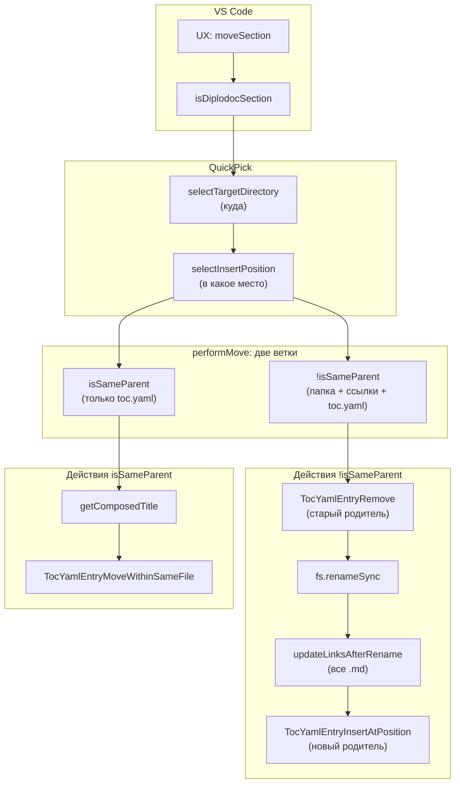
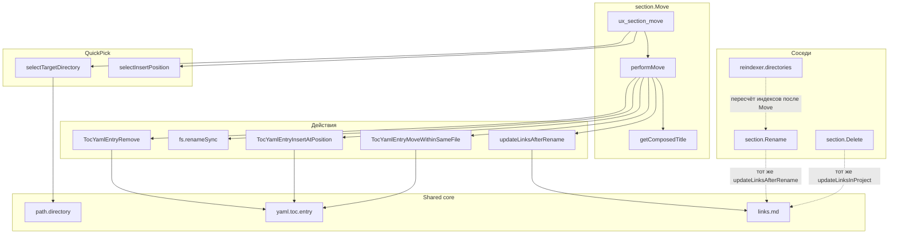

|               |                                                                                                                                                                 |
| ------------- | --------------------------------------------------------------------------------------------------------------------------------------------------------------- |
| ID            | [1.1-025](../../%D0%A1%D0%BE%D0%B3%D0%BB%D0%B0%D1%88%D0%B5%D0%BD%D0%B8%D1%8F/index.md#identifikaciya-modulej)                                                   |
| Идентификатор | `section.Move`                                                                                                                                                  |
| Наименование  | Перемещение секции                                                                                                                                              |
| Слой          | [vscode-ui](../%D0%A1%D0%BB%D0%BE%D0%B8layer/%D0%A1%D0%BB%D0%BE%D0%B9VSCodeUI/index.md#naznachenie/index.md#naznachenie) / [Pre-processing](../../%D0%A1%D0%BB%D0%BE%D0%B8layer/%D0%A1%D0%BB%D0%BE%D0%B9Preprocessing/index.md#naznachenie) |
| Каталог       | [Структура](../../%D0%9A%D0%B0%D1%82%D0%B0%D0%BB%D0%BE%D0%B3Capabilitymap/%D0%9A%D0%B0%D1%82%D0%B0%D0%BB%D0%BE%D0%B3%D0%A1%D1%82%D1%80%D1%83%D0%BA%D1%82%D1%83%D1%80%D0%B0/index.md#struktura)                                                                                                                                                                                |
| Семейство     | [Структура](../../%D0%A1%D0%B5%D0%BC%D0%B5%D0%B9%D1%81%D1%82%D0%B2%D0%BEfamily/%D0%A1%D0%B5%D0%BC%D0%B5%D0%B9%D1%81%D1%82%D0%B2%D0%BE%D0%A1%D1%82%D1%80%D1%83%D0%BA%D1%82%D1%83%D1%80%D0%B0/index.md#fam-structure)                                                                                                                                                                                |
| Расположение  | `src/commands/diplodoc-helper.section.Move.js`                                                                                                                  |
| Точка входа   | `ux_section_move(uri)`                                                                                                                                          |
| Версия        | `1.54.0`                                                                                                                                                        |
| Назначение    | Перемещает секцию в другого родителя с обновлением `toc.yaml` обоих родителей и всех ссылок в проекте                                                           |

{: .page-legend }

## Назначение

`section.Move` — операция «перенести раздел (главу, статью) в другое место документации». Пользователь кликает правой кнопкой на папке-секции в Explorer, выбирает **Diplodoc → Переместить секцию**, отвечает на два вопроса в `QuickPick` — **куда** и **в какое место** — и модуль делает всё остальное:

1. Удаляет запись о секции из `toc.yaml` старого родителя.
2. Переносит папку физически (`fs.renameSync`).
3. Обновляет все markdown-ссылки в проекте, которые указывали на перемещённый раздел или его потомков.
4. Добавляет запись в `toc.yaml` нового родителя — в указанную позицию (в начало, в конец или после конкретной секции).

Плюс отдельный сценарий — **перемещение внутри одного родителя** (только смена позиции в `toc.yaml`, без `fs.renameSync`), чтобы не гонять файловые операции зря.

Без модуля для той же операции пришлось бы:

1. Вручную вырезать папку, вставить в новый родитель.
2. Найти и удалить `items`-запись в старом `toc.yaml`.
3. Добавить `items`-запись в новый `toc.yaml` (с правильным `name`, `href`, `include`).
4. Обновить `index.yaml` обоих родителей (если там есть `href`-ссылки).
5. Найти все `.md` в проекте, где есть ссылки на перемещённый раздел, и пересчитать относительные пути (`../foo/bar/index.md` → `../../baz/bar/index.md`).
6. Переиндексировать (если нужно) — обычно индекс раздела зависит от нового родителя.

Модуль автоматизирует всё, кроме переиндексации (её делает отдельный [`reindexer.directories`](../МодульПереиндексация/index.md)).

## Применение

**Когда использовать:** нужно перенести секцию (с подсекциями) в другого родителя — с обновлением `toc.yaml` обоих родителей и пересчётом всех markdown-ссылок.

**Когда НЕ использовать:** перемещение внутри одного родителя (смена порядка) — используйте `section.Rename` с `toc.yaml`-сортировкой или `TocYamlEntryMoveWithinSameFile`.

**Альтернативы:**
- Ручной `mv` + правка двух `toc.yaml` + пересчёт ссылок вручную — часы на 100 ссылок.
- `section.Rename` — меняет имя/тип, а не место в дереве.

**Типичный сценарий:** ПКМ на секции → **Diplodoc → Переместить секцию** → выбрать целевого родителя → выбрать позицию («в начало», «после X», «в конец») → перенос + ссылки.

## Как это работает



### Фаза 1. Валидация

```js
async function ux_section_move(uri) {
    if (!uri) return;
    const sourcePath = uri.fsPath;
    if (!isDiplodocSection(sourcePath)) {
        vscode.window.showErrorMessage(translate(nls_ts.plugin.section.move.error.incorrectSection));
        return;
    }
    const sourceName = path.basename(sourcePath);
```

`isDiplodocSection(sourcePath)` — папка содержит `index.md` + `index.yaml` + `toc.yaml`. Если нет — `«Переместить можно только полноценный раздел Diplodoc.»` и выход.

Если `uri` не передан (команда вызвана из палитры) — тихий `return` без сообщения. См. «Известные ограничения».

### Фаза 2. QuickPick 1 — куда перемещать

```js
const targetDir = await selectTargetDirectory(sourcePath);
if (!targetDir) return;
```

`selectTargetDirectory(sourcePath)` — из `vscode.quickpick.mdhierarchy.js`:

1. `languageRoot = getLanguageRoot(sourcePath)` — корень языка **источника** (не целевой папки). То есть перемещение между языками запрещено.
2. `targets = collectMoveTargets(languageRoot)`:
   - `walk(languageRoot)` — рекурсивный обход;
   - для каждого каталога, если `isDiplodocSection(fullPath)` — добавить в список;
   - **сам `languageRoot` не входит в список** (walk начинается с его детей);
   - `level` — глубина вложенности от корня, для отступов в QuickPick.
3. Каждый target → `{ label: '  '.repeat(level) + label, description: path, targetPath: path }`.
4. `QuickPick` с `placeHolder: 'Выберите целевую папку для перемещения'` и `matchOnDescription: true`.
5. Возврат `selected?.targetPath || null`.

То есть в списке — все секции языка (`docs/ru/`), кроме перемещаемой (она была исключена? нет — не исключена в `selectTargetDirectory`, только в `selectInsertPosition`; но `collectMoveTargets` вернёт и её, хотя перемещать в себя — бессмысленно; защита — в `performMove`).

### Фаза 3. QuickPick 2 — в какое место

```js
const position = await selectInsertPosition(targetDir, sourceName);
if (!position) return;
```

`selectInsertPosition(targetDir, movingSectionName)` — из `vscode.quickpick.mdanchor.js`:

1. Читает `fs.readdirSync(targetDir, { withFileTypes: true })`.
2. Фильтрует: `isDirectory() && isDiplodocSection(...) && name !== movingSectionName`.
3. Формирует items:
   - **`start`** — «В начало списка»;
   - **`after-<name>`** — по одному на каждую секцию в `targetDir`: «После: `<name>`»;
   - **`end`** — «В конец списка».
4. `QuickPick` с `placeHolder: 'Куда переместить "<sourceName>" внутри целевой папки?'`.
5. Возврат `{ label, position: 'start' | 'after' | 'end', afterName?: string }` или `null`.

Если `targetDir === sourcePath` (перемещение в себя) — `movingSectionName` не исключается, но в `performMove` сработает защита (см. ниже).

### Фаза 4. Выполнение (`performMove`)

```js
async function performMove(sourcePath, targetDir, position) {
    const sourceName = path.basename(sourcePath);
    const targetPath = path.join(targetDir, sourceName);
    const oldParentDir = path.dirname(sourcePath);
    const newParentDir = targetDir;
    const isSameParent = oldParentDir === newParentDir;
```

Три предварительные проверки:

1. **Перемещение в самого себя** (смена позиции на текущую):

   ```js
   if (isSameParent && position.position === 'after' && position.afterName === sourceName) {
       vscode.window.showWarningMessage(translate(nls_ts.plugin.section.move.warning.samePosition, sourceName));
       return false;
   }
   ```

   На практике недостижимо — `selectInsertPosition` исключает `movingSectionName` из items, так что «После: `<sourceName>`» пользователь выбрать не может. Защита на будущее.

2. **Рекурсивное перемещение** (в свой же подкаталог):

   ```js
   if (!isSameParent && targetPath.startsWith(sourcePath + path.sep)) {
       vscode.window.showErrorMessage(translate(nls_ts.plugin.section.move.error.recursive));
       return false;
   }
   ```

   Если пользователь выбрал в `QuickPick` подсекцию перемещаемой (например, «Раздел1/Подраздел1»), `targetPath` будет внутри `sourcePath`. `fs.renameSync` на такое упадёт (нельзя переместить папку в её же потомка).

3. **Целевая папка уже существует**:

   ```js
   if (!isSameParent && fs.existsSync(targetPath)) {
       vscode.window.showErrorMessage(translate(nls_ts.plugin.section.move.error.sectionexists, sourceName));
       return false;
   }
   ```

   В `targetDir` уже есть папка с тем же именем (`sourceName`). Замена не выполняется — пользователь должен либо переименовать целевую, либо отказаться.

**Ветка A: `isSameParent`** (перемещение внутри одного родителя):

```js
console.log(`[Move] Изменение позиции внутри одного родителя для: ${sourceName}`);
const composedTitle = await getComposedTitle(sourcePath);
TocYamlEntryMoveWithinSameFile(newParentDir, composedTitle, sourceName, position);
return true;
```

Только правка `toc.yaml`. Никаких `fs.renameSync`, никаких обновлений ссылок. Ссылки между файлами остались прежними (пути не изменились), `index.md` не тронут.

**Ветка B: `!isSameParent`** (перенос в другого родителя):

```js
TocYamlEntryRemove(oldParentDir, sourceName);
fs.renameSync(sourcePath, targetPath);

const projectRoot = getLanguageRoot(targetPath);
await updateLinksAfterRename(sourcePath, targetPath, projectRoot, '**удалено**');

const composedTitle = await getComposedTitle(targetPath);
TocYamlEntryInsertAtPosition(newParentDir, composedTitle, sourceName, position);
```

Четыре шага строго по порядку:

**Шаг B.1. `TocYamlEntryRemove(oldParentDir, sourceName)`** — из `yaml.toc.entry.js`:

- `tocPath = oldParentDir/toc.yaml`. Если нет — тихо `return`.
- `tocData = YAML.parse(...)`.
- `targetHref = sourceName + '/index.md'`.
- `tocData.items = tocData.items.filter(item => item.href !== targetHref)`.
- Запись сохраняется (через `YAML.stringify`).

**Шаг B.2. `fs.renameSync(sourcePath, targetPath)`** — переносит папку в нового родителя. Атомарно на одной файловой системе, но между дисками бросит `EXDEV`.

**Шаг B.3. `updateLinksAfterRename(sourcePath, targetPath, projectRoot, '**удалено**')`** — из `diplodoc-helper.links.md.js`:

```js
async function updateLinksAfterRename(oldFolderPath, newFolderPath, projectRoot, stubText) {
    const transform = absoluteTarget => {
        if (absoluteTarget === oldFolderPath || absoluteTarget.startsWith(oldFolderPath + path.sep)) {
            if (absoluteTarget === oldFolderPath) return newFolderPath;
            const rel = absoluteTarget.slice(oldFolderPath.length + 1);
            return path.join(newFolderPath, rel);
        }
        return undefined;
    };
    await updateLinksInProject(projectRoot, transform, stubText);
}
```

То есть для каждой ссылки в каждом `.md`:

- если `absoluteTarget` — сама папка `oldFolderPath` — заменить на `newFolderPath`;
- если внутри `oldFolderPath` — пересчитать `newFolderPath/relativePart`;
- иначе — оставить как есть.

`updateLinksInProject` обходит **все** `.md` в `projectRoot` (`docs/<lang>/`), для каждого читает содержимое, применяет `updateLinksInContent` (заменяет `[text](old)` на `[text](new)` с пересчётом относительного пути), записывает обратно.

`stubText = '**удалено**'` — в этой функции не используется (transform никогда не возвращает `null`, только новый путь или `undefined`). Передан для совместимости с сигнатурой.

**Шаг B.4. `getComposedTitle(targetPath)`**:

```js
async function getComposedTitle(sectionPath) {
    const indexPath = path.join(sectionPath, 'index.md');
    if (!fs.existsSync(indexPath)) return path.basename(sectionPath);

    const content = fs.readFileSync(indexPath, 'utf8');
    const titleMatch = content.match(/title:\s*(.+)/);
    return titleMatch ? titleMatch[1].trim() : path.basename(sectionPath);
}
```

Читает `title:` из `index.md` регулярным выражением — **первое** совпадение `title:` в файле. Если `index.md` не имеет `title:` (только `pureTitle:`) — возвращает имя папки (fallback). См. «Известные ограничения».

**Шаг B.5. `TocYamlEntryInsertAtPosition(newParentDir, composedTitle, sourceName, position)`** — из `yaml.toc.entry.js`:

- `tocPath = newParentDir/toc.yaml`. Если нет — тихо `return`.
- `tocData = YAML.parse(...)`.
- Собирается `newEntry`:

  ```js
  {
      name: composedTitle,
      href: `${sourceName}/index.md`,
      include: {
          path: `${sourceName}/toc.yaml`,
          mode: 'link',
      },
  }
  ```

- По `position.position`:
  - `'start'` — `tocData.items.unshift(newEntry)`;
  - `'end'` — `tocData.items.push(newEntry)`;
  - `'after'` — найти `index` элемента с `href === afterName/index.md`, вставить после; если не найден — `push` в конец.
- `fs.writeFileSync(tocPath, YAML.stringify(tocData))`.

**Итог фазы 4.** Сообщение:

```js
vscode.window.showInformationMessage(translate(nls_ts.plugin.section.move.info.success, sourceName));
```

`plugin.section.move.info.success`: `"Обновлено ссылок в {0} файлах"` — где `{0}` = `sourceName`. Формулировка неточная (см. «Известные ограничения»).

### Файлы модуля

| Файл                                           | Ответственность                                                                        |
| ---------------------------------------------- | -------------------------------------------------------------------------------------- |
| `src/commands/diplodoc-helper.section.Move.js` | `ux_section_move`, `performMove`, `getComposedTitle`                                   |
| `src/commands/vscode.quickpick.mdhierarchy.js` | `selectTargetDirectory`, `collectMoveTargets`                                          |
| `src/commands/vscode.quickpick.mdanchor.js`    | `selectInsertPosition`                                                                 |
| `src/plugins/utils/yaml.toc.entry.js`          | `TocYamlEntryRemove`, `TocYamlEntryInsertAtPosition`, `TocYamlEntryMoveWithinSameFile` |
| `src/commands/diplodoc-helper.links.md.js`     | `updateLinksAfterRename`, `updateLinksInProject`                                       |
| `src/plugins/utils/path.directory.js`          | `isDiplodocSection`, `getLanguageRoot`                                                 |

### Формат `position` (результат `selectInsertPosition`)

```js
{ label: 'В начало списка', position: 'start' }
{ label: 'После: Раздел1.Введение', position: 'after', afterName: 'Раздел1.Введение' }
{ label: 'В конец списка', position: 'end' }
```

## Режимы работы

### VS Code

| Команда                       | Заголовок          | Где появляется                                              |
| ----------------------------- | ------------------ | ----------------------------------------------------------- |
| `diplodoc-helper.moveSection` | Переместить секцию | Explorer → Diplodoc → Переместить секцию (только на папках) |

Условие появления (`when`): `explorerResourceIsFolder`. Команда в подменю Diplodoc.

### CLI

CLI-команды нет. Модуль — только VS Code.

### Сборочный пайплайн

В `docs-build.js` не участвует.

## Юнит-тесты





## Связи

`section.Move` — третья команда семейства `sections` (после `Create` и `Delete`). Единственная, которая делает **и** файловые операции, **и** правку `toc.yaml`, **и** обход всех `.md` для обновления ссылок.

С [`sections.core`](../МодульЯдросоцифровок/index.md) — использует `TocYamlEntryRemove`, `TocYamlEntryInsertAtPosition`, `TocYamlEntryMoveWithinSameFile` (три функции из «ядра»). Больше ничего из ядра не вызывает — `DiplodocSectionPatch` не нужен (папка переносится, а не переименовывается).

С [`reindexer.directories`](../МодульПереиндексация/index.md) — **не** вызывает. Индексы (`sectionIndex`) не пересчитываются. Если перенести `Раздел2.Архитектура` в `Раздел1.Введение`, то `index.md` сохранит `title: Раздел 2. Архитектура`, `sectionIndex: "2"` — хотя теперь он внутри раздела 1 и должен быть `1.1`. Для исправления нужен `reindexer.directories` (или `section.Rename`).

С [`section.Rename`](../МодульПереименованиесекции/index.md) — переиспользует `updateLinksAfterRename` (один и тот же `updateLinksAfterRename` вызывается и там, и там). Разница: `Rename` вызывает `DiplodocSectionPatch` (переименование + правка файлов), `Move` — `fs.renameSync` (только перенос) + `TocYamlEntryInsertAtPosition`.

С [`section.Delete`](../%D0%A0%D0%B5%D0%B5%D1%81%D1%82%D1%80/%D0%9C%D0%BE%D0%B4%D1%83%D0%BB%D1%8C%D0%A3%D0%B4%D0%B0%D0%BB%D0%B5%D0%BD%D0%B8%D0%B5%D1%81%D0%B5%D0%BA%D1%86%D0%B8%D0%B8/index.md) — `Delete` использует `updateLinksAfterDelete` (та же функция `updateLinksInProject`, но `transform` возвращает `null` → `stubText`). `Move` использует `updateLinksAfterRename` (`transform` возвращает новый путь). Обе — один `updateLinksInProject` с разным `transform`.

С **`selectTargetDirectoryWithCandidates`** (`vscode.quickpick.mdhierarchy.js`) — переиспользуется в [`linter.links`](../МодульЛинтерссылок/index.md). `Move` использует простой `selectTargetDirectory`, linter — расширенный с кандидатами.






