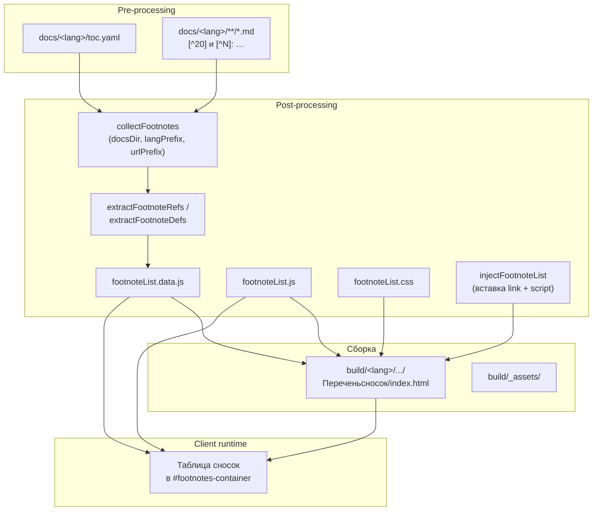



## Назначение

`footnoteList` — финальный шаг темы «сноски». Пока `footnotes` (pre) пересчитывает нумерацию в `.md`, `footnoteAnchors` (post) чинит якоря, а `footnoteNumbering` (post) делает номера сквозными, этот модуль собирает **сводную таблицу**: все сноски проекта в одном месте, с номером, текстом и ссылкой на статью, где сноска встречается.

Типичный сценарий использования — страница «Дополнительная информация → Перечень сносок» (или её аналог), на которой ревьюер или редактор одним взглядом видит все сноски руководства. Без модуля для этого пришлось бы вручную просматривать N статей и выписывать `[^N]: …` в сводку.

Модуль работает только в `post-processing`: **читает** исходные `.md` (через `toc.yaml`), **пишет** в готовый `.html`. Это единственный модуль в цепочке сносок, который straddle'ит фазы по данным (см. «Связи»).

## Применение

**Когда использовать:** нужна сводная таблица всех сносок проекта (номер, текст, статья) — для ревью «нет ли дубликатов, все ли актуальны».

**Когда НЕ использовать:** сносок 5–10 — хватит ручного просмотра; не нужна отдельная страница — не подключайте `injectFootnoteList`.

**Альтернативы:**
- `grep` по `[^N]:` — не даёт сортировки, не собирает в одну таблицу.
- Ручная страница «Перечень сносок» — рассинхронизируется.

**Типичный сценарий:** `docs-build.js` → `post` → после `footnoteNumbering` → `footnoteList` → `injectFootnoteList` встраивает данные в `Переченьсносок/index.html` → `footnoteList.client` рисует таблицу.

## Как это работает



### Фаза 1. Сбор

`collectFootnotes(docsDir, langPrefix, urlPrefix)`:

1. **Порядок файлов.** `collectMdFilesByToc(docsDir)` — обход `toc.yaml` рекурсивно через `include`. Возвращает `.md` в порядке чтения. Fallback на `fs.readdirSync`, если `toc.yaml` нет.

2. **Для каждого `.md`:**
   - читается содержимое;
   - frontmatter через `gray-matter` — берётся `title` (приоритет: `data.title` → `data.pureTitle` → имя папки);
   - `extractFootnoteRefs(content)` — все ссылки `[^20]` (из `reindexer.footnotes`);
   - `extractFootnoteDefs(content)` — все определения `[^N]: …`.

3. **Сопоставление.**
   - `idToNumber: Map<id, globalNumber>` — по порядку первого появления ссылки: первый `[^21]` получает `counter++`, второй новый id — следующий `counter`, и т.д. Глобальный счётчик сквозной по всему проекту.
   - `defsById: Map<id, content>` — первое определение для каждого id. Если id определён дважды, побеждает первое (молча, без предупреждения).

4. **Запись.**
   - `rel = path.relative(docsDir, file).replace('.md', '.html')`;
   - `url = urlPrefix + langPrefix + '/' + rel` — ссылка на статью;
   - `refUrl = url + '#fnref' + num` — ссылка на конкретный указатель сноски;
   - `text = stripLinks(defsById.get(id))` — текст сноски с удалёнными markdown-ссылками и HTML-тегами `<a>`;
   - результат: `{ number, text, article, url, refUrl }`.

5. **`stripLinks`** — три `replace`:
   - `` → `alt`;
   - `[text](url)` → `text`;
   - `</?a>…` → без тега.

   То есть в таблице текст сноски — плоский, без ссылок. Это упрощает рендер, но если в определении была ссылка — она потеряется (см. «Известные ограничения»).

### Фаза 2. Инъекция

`injectFootnoteList({ docsDir, targetHtml, lang, langPrefix })`:

1. **Проверка.** Если `targetHtml` не существует — ошибка `[footnoteList] Не найден целевой HTML: …`, `{ success: false }`.

2. **Префикс языка.**
   - `langPrefix` либо передан явно (например, `'ru'` из CLI), либо равен `lang` (по умолчанию `'ru'`).
   - `findBuildRoot(targetHtml)` — ищет корень `build/` вверх по дереву (по наличию `_assets/`). Fallback — три уровня вверх от `targetHtml`.

3. **Относительные пути.** `relFromRoot = path.relative(buildRoot, targetDir)` — путь от `build/` до папки с целевой страницей. Например, `ru/Дополнительнаяинформация/Переченьсносок`. Из него строятся абсолютные пути от корня сайта:
   - `cssHref = /${relFromRoot}/footnoteList.css`;
   - `dataSrc = /${relFromRoot}/footnoteList.data.js`;
   - `jsSrc = /${relFromRoot}/footnoteList.js`.

4. **`urlPrefix`** — относительный префикс от целевой страницы до `build/`. Например, для страницы в `build/ru/Дополнительнаяинформация/Переченьсносок/index.html` это `../../../`. Нужен для ссылок на статьи, которые строит `collectFootnotes` (там `url = urlPrefix + langPrefix + '/' + rel`).

5. **Запись файлов рядом с целевой страницей:**
   - `footnoteList.data.js`:
     ```js
     const footnotesData = {"items": [...], "lang": "ru"};
     ```
   - `footnoteList.js` — копия клиентского скрипта из `src/plugins/contentNavigator/footnoteList.js`;
   - `footnoteList.css` — копия стилей.

6. **Инъекция в HTML:**
   - `<link rel="stylesheet" href="${cssHref}">` в `</head>` (если ещё не вставлено — проверка `if (!html.includes('footnoteList.css'))`);
   - `<script src="${dataSrc}" defer></script>` и `<script src="${jsSrc}" defer></script>` в `</body>` (аналогичная проверка).

7. **`injectContainerIntoState`** — дополнительная функция в файле, которая должна добавлять `<div id="footnotes-container">` внутрь JSON `diplodoc-state` (чтобы контейнер был доступен до hydrate). Фактически **не вызывается** из `injectFootnoteList` (см. «Известные ограничения»).

### Фаза 3. Клиент

`footnoteList.js` (IIFE):

1. Проверяет `if (typeof footnotesData === 'undefined') return;` — ждёт, что `data.js` уже загружен (`defer` в HTML).

2. Ищет `#footnotes-container`. Если нет — ищет «тело статьи» в порядке:
   - `.dc-doc-page__body`;
   - `.dc-doc-page__content`;
   - `.dc-doc-page__main`;
   - `main`.

   Если контейнера нет, но тело найдено — создаёт `#footnotes-container` и добавляет в конец тела.

3. Если контейнер не найден — fallback: 60 попыток с интервалом 250 мс (15 секунд), потом — `MutationObserver` на `body` (создать контейнер при появлении тела).

4. **`renderTable()`** — рисует таблицу:
   - `<div class="footnote-meta">Всего сносок: N</div>`;
   - `<table class="footnote-table">` с 3 колонками:
     - `Номер` — `it.number`;
     - `Текст сноски` — `it.text`, ссылка `<a class="cell-link" href="${it.refUrl}">…</a>` (переход на конкретное вхождение сноски);
     - `Применяемость сноски` — `it.article`, ссылка `<a href="${it.url}">…</a>` (переход на статью).
   - `<th>` с `data-col` (для сортировки): `number`, `text`, `article`.

5. **Сортировка.** `state = { column: null, direction: null }`. Клик по `<th>`:
   - первый — `column = key`, `direction = 'asc'`;
   - второй — `'desc'`;
   - третий — сброс (`null`).

   При сортировке по `number` — числовое сравнение (`(a.number - b.number) * dir`); по `text`/`article` — `localeCompare('ru')`.

6. **Индикатор сортировки** — `▲` / `▼` через `indicator(colKey)`.

7. **`formatCellContent(url, text)`** — если `url` задан, оборачивает `text` в `<a href="${url}">`. `stripLinks` (клиентская версия) удаляет `<a>…</a>` из `text` ещё раз (на случай, если markdown-ссылки не были вычищены на этапе `collectFootnotes`).

8. **`esc(s)`** — экранирование `&<>"'`.

### Файлы модуля

| Файл                                                              | Ответственность                                                          |
| ----------------------------------------------------------------- | ------------------------------------------------------------------------ |
| `src/plugins/contentNavigator/Pagebuilder.Config.FootnoteList.js` | `injectFootnoteList`, `findBuildRoot`, `injectContainerIntoState`        |
| `src/plugins/contentNavigator/footnoteList.collector.js`          | `collectFootnotes`, `stripLinks`                                         |
| `src/plugins/contentNavigator/footnoteList.js`                    | Клиентский скрипт: `renderTable`, сортировка, `ensureContainer`          |
| `src/plugins/contentNavigator/footnoteList.css`                   | Стили таблицы (`.footnote-table`, `.footnote-meta`, `.cell-link` и т.д.) |
| `src/plugins/utils/toc.order.js`                                  | `collectMdFilesByToc` — порядок файлов                                   |
| `src/plugins/reindexer/reindexer.footnotes.js`                    | `extractFootnoteRefs`, `extractFootnoteDefs` — парсинг сносок            |

### Формат `footnoteList.data.js`

```js
const footnotesData = {
    "items": [
        {
            "number": 1,
            "text": "См. раздел «Установка».",
            "article": "Модуль. Хлебные крошки",
            "url": "../../../ru/Модули/МодульХлебныеКрошки/index.html",
            "refUrl": "../../../ru/Модули/МодульХлебныеКрошки/index.html#fnref1"
        },
        …
    ],
    "lang": "ru"
};
```

| Поле      | Комментарий                                              |
| --------- | -------------------------------------------------------- |
| `number`  | Глобальный номер сноски (сквозной по проекту)            |
| `text`    | Текст определения с удалёнными ссылками и HTML-тегами    |
| `article` | Заголовок статьи (из frontmatter)                        |
| `url`     | Абсолютный URL от корня сайта на страницу статьи         |
| `refUrl`  | Тот же URL + `#fnrefN` — переход на конкретное вхождение |

## Режимы работы

### CLI

```bash
node ./plugins/diplodoc-helper-cli.js footnoteList --docsDir ./docs/ru --section "Переченьсносок"
```

| Аргумент       | Обязателен                           | По умолчанию | Описание                                                |
| -------------- | ------------------------------------ | ------------ | ------------------------------------------------------- |
| `--docsDir`    | нет                                  | `./docs`     | Корень языка (не `./docs`, а `./docs/<lang>`)           |
| `--section`    | один из `--section` / `--targetHtml` | `null`       | Имя папки-секции (ищет `index.html` без учёта регистра) |
| `--targetHtml` | один из                              | —            | Явный путь к `index.html`; приоритетнее `--section`     |
| `--outputDir`  | нет                                  | `./build`    | Корень сборки (где искать `index.html` по `--section`)  |

Логика:

- если `--section` задан → `findSectionIndexHtml(outputDir, section)` (рекурсивный поиск папки с таким именем + `index.html` внутри);
- иначе если `--targetHtml` задан → `path.resolve(...)`;
- иначе — ошибка `[footnoteList] Нужен --section или --targetHtml`, `process.exitCode = 1`.

`langPrefix` определяется автоматически: `path.basename(path.resolve(docsDir))`. Если basename матчит `/^[a-z]{2}$/i` (например, `ru`, `en`, `de`) — используется как `langPrefix`; иначе `null` (тогда `url = urlPrefix + rel`, без языкового сегмента).

Код возврата: `0` при успехе, `1` — если `injectFootnoteList` вернул `{ success: false }` (нет целевого HTML).

### Сборочный пайплайн

В `docs-build.js`, фаза `post`:

```js
cli(
    'footnoteList',
    '--docsDir',
    './docs/ru',
    '--targetHtml',
    './build/ru/Дополнительнаяинформация/Переченьсносок/index.html'
),
```

Идёт после `footnoteNumbering`, до `gostsInject`, `breadcrumb`, `contexttags`, `ganttFixScroll`, `periodicTable*`. Порядок: `footnoteList` собирает данные уже с глобальными номерами (после `footnoteNumbering`) и абсолютными якорями (после `footnoteAnchors`).

**Страница-приёмник должна существовать.** Модуль не создаёт её — это задача `@diplodoc/cli` (`.md`-файл должен быть в `docs/ru/Дополнительнаяинформация/Переченьсносок/index.md` и попасть в `toc.yaml`). `footnoteList` только добавляет в неё `<link>`, `<script>` и данные.

Пропускается флагом `--skip=footnoteList`.

### VS Code

Собственной команды нет. В `package.json` есть только неявная связка: `diplodoc-helper.reindexFootnotes` (переиндексация в `.md`, это модуль `footnotes`, не этот). Генерация перечня — только через CLI.

## Юнит-тесты





## Связи

`footnoteList` — самый «поздний» модуль в цепочке сносок. Стоит после всех остальных и опирается на их артефакты:

| Модуль                                                                                                                                                                                                                                                 | Слой | Роль для `footnoteList`                                                                      |
| ------------------------------------------------------------------------------------------------------------------------------------------------------------------------------------------------------------------------------------------------------ | ---- | -------------------------------------------------------------------------------------------- |
| [`footnotes`](../%D0%A0%D0%B5%D0%B5%D1%81%D1%82%D1%80/%D0%9C%D0%BE%D0%B4%D1%83%D0%BB%D1%8C%D0%A1%D0%BD%D0%BE%D1%81%D0%BA%D0%B8/index.md)                                                                                                               | pre  | Обеспечивает корректную нумерацию в `.md` (иначе номера в таблице будут непоследовательными) |
| [`footnoteAnchors`](../МодульЯкоряСносок/index.md)                                                                                                                                                                                                     | post | Делает `href` абсолютными (иначе `refUrl` будет работать только на «родной» странице)        |
| [`footnoteNumbering`](../%D0%A0%D0%B5%D0%B5%D1%81%D1%82%D1%80/%D0%9C%D0%BE%D0%B4%D1%83%D0%BB%D1%8C%D0%A1%D0%BA%D0%B2%D0%BE%D0%B7%D0%BD%D0%B0%D1%8F%D0%BD%D1%83%D0%BC%D0%B5%D1%80%D0%B0%D1%86%D0%B8%D1%8F%D1%81%D0%BD%D0%BE%D1%81%D0%BE%D0%BA/index.md) | post | Делает номера в `.html` сквозными (совпадают с номерами в `footnoteList.data.js`)            |
| **`footnoteList`**                                                                                                                                                                                                                                     | post | Собирает сводку и инжектит её                                                                |

Зависимости от `shared-core`:

- `utils/toc.order` — порядок `.md`;
- `reindexer/reindexer.footnotes` — `extractFootnoteRefs` / `extractFootnoteDefs` (переиспользует парсер из `footnotes`);
- `utils/upsert.footnote` — не используется (только в `footnoteNumbering`).

С `contentNavigator` — «одна семья»: `footnoteList` физически живёт в `src/plugins/contentNavigator/`, рядом с `Pagebuilder.Config.*` для таблиц `bytescounter`, `contextmap`, `helptagmap`. По смыслу — это тоже «отчёт по документации», но отдельный (для сносок, а не для контекстов/helptags). В `generateNavigationContent.js` есть `command === 'footnoteList'` → `generateFootnoteListPage`, но функции `generateFootnoteListPage` **нет** в `Pagebuilder.Config.FootnoteList.js` (там только `injectFootnoteList`). См. «Известные ограничения».



```mermaid
flowchart TB
    subgraph triggers[Триггеры]
        CLI["CLI: footnoteList<br/>(docs-build post)"]
    end
    subgraph chain[Цепочка сносок]
        PRE["footnotes (pre)"]
        FA["footnoteAnchors"]
        FN["footnoteNumbering"]
        FL["footnoteList"]
    end
    subgraph shared[Shared core]
        TOC["utils/toc.order"]
        RX["reindexer.footnotes"]
    end
    subgraph artifact[Артефакты]
        HTML["Переченьсносок/index.html"]
        DATA["footnoteList.data.js"]
        CL["footnoteList.js + .css"]
    end
    CLI --> FL
    PRE -.нумерация в .md.-> FL
    FA -.абсолютные якоря.-> FL
    FN -.сквозные номера.-> FL
    FL --> TOC
    FL --> RX
    FL --> HTML
    FL --> DATA
    FL --> CL
```




