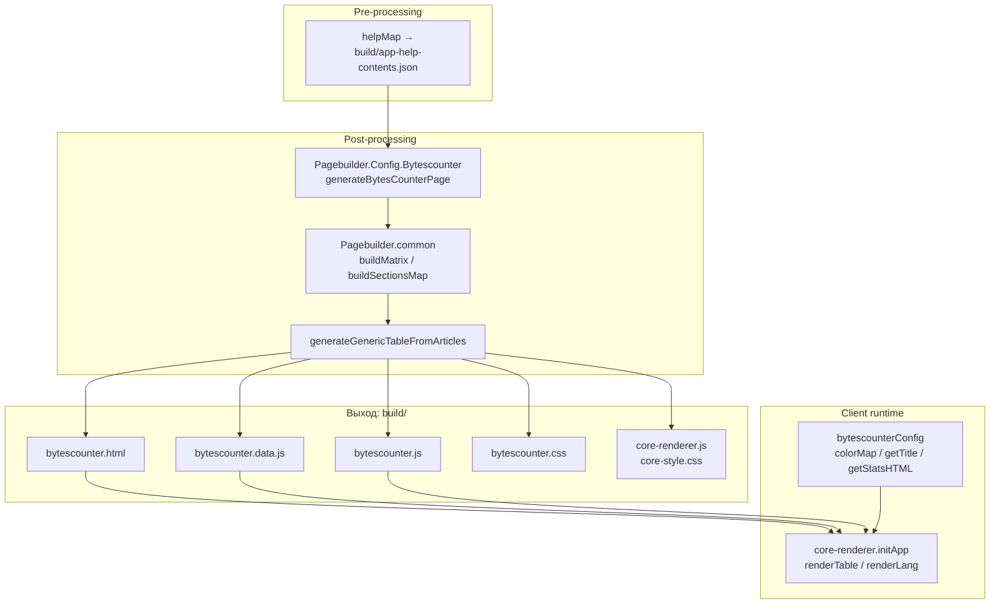
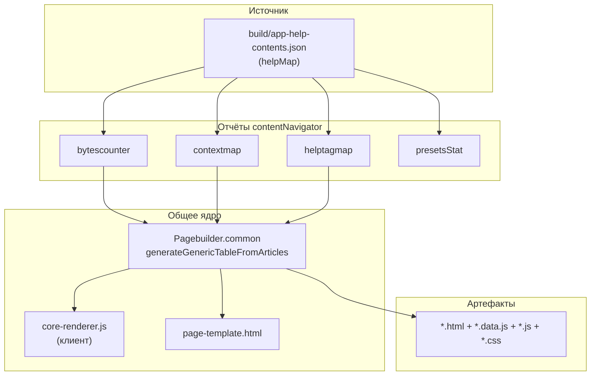



## Назначение

`bytescounter` — один из отчётов семейства `contentNavigator`. Читает `app-help-contents.json` (его создаёт [`helpMap`](../МодульКартапомощи/index.md)), группирует статьи по разделам и главам и рисует **таблицу-периодическую карту**: по вертикали — главы, по горизонтали — разделы, в ячейках — плитки статей, цвет плитки — «заполненность» статьи относительно среднего по проекту.

Задача — дать техническому писателю или редактору взгляд «сверху» на **объём** документации: где статьи непропорционально короткие (нужно дополнить), где слишком длинные (возможно, пора разбить), где вообще «дыры» (нет статей в главе).

Страница получается полностью статичной, но её содержимое «оживает» в браузере: клиентский скрипт `core-renderer.js` (общий для всех `contentNavigator`-отчётов) строит таблицу из `bytescounter.data.js` и навешивает переключатель языков и легенду.

## Применение

**Когда использовать:** нужно «взглядом сверху» увидеть, где статьи непропорционально короткие (дополнить), где слишком длинные (разбить), где «дыры».

**Когда НЕ использовать:** документация маленькая (10–20 статей) — визуальная карта не нужна.

**Альтернативы:**
- `wc -c` по `docs/` — не даёт визуальной картины.
- `contextmap`/`helptagmap` — про контексты/теги, не про размеры.

**Типичный сценарий:** `docs-build.js` → `post` → `periodicTable` → `bytescounter.html` с тепловой картой; читается через `contentNavigator`-навигацию.

## Как это работает



### Фаза 1. Конфиг модуля

`Pagebuilder.Config.Bytescounter.js` задаёт всё, что отличает этот отчёт от соседей (`contextmap`, `helptagmap`):

```js
const DEFAULT_HTML_FILENAME = 'bytescounter.html';
const DEFAULT_JS_FILENAME = 'bytescounter.js';
const DEFAULT_CSS_FILENAME = 'bytescounter.css';
const DEFAULT_DATA_FILENAME = 'bytescounter.data.js';

const LEGEND_ITEMS = [
    { color: 'color-excess',  description: 'Избыток (>120% от среднего)' },
    { color: 'color-full',    description: 'Заполнена (≥80% от среднего)' },
    { color: 'color-partial', description: 'Частично (50–80%)' },
    { color: 'color-minimum', description: 'Минимально (≥490 байт, <50%)' },
    { color: 'color-empty',   description: 'Пустая (<490 байт)' },
    { color: 'chapter-article', description: 'Текст главы' },
];
```

`generateBytesCounterPage` — тонкая обёртка:

```js
return generateGenericTableFromArticles({
    mapDir, outputDir, lang,
    htmlFileName: 'bytescounter.html',
    cssFileName: 'bytescounter.css',
    jsFileName: 'bytescounter.js',
    dataFileName: 'bytescounter.data.js',
    title: 'Распределение размера статей по разделам и главам',
    legendItems: LEGEND_ITEMS,
    matrixBuilder: buildSizeMatrix,
    navLinks: [
        { label: 'Контексты', url: 'contextmap.html' },
        { label: 'Хелптаги', url: 'helptagmap.html' },
    ],
});
```

Отличия от соседей — только конфиг. Вся логика рендера — в `Pagebuilder.common.js` (общая для всех `contentNavigator`-отчётов).

### Фаза 2. Сбор матрицы (`Pagebuilder.common`)

`generateGenericTableFromArticles` читает `build/app-help-contents.json`, для каждого языка (`ru`, `en`) вызывает `matrixBuilder(jsonData, lang)`. Для `bytescounter` — это `buildSizeMatrix`:

1. **Фильтр.** `data.filter(item => item.lang === lang && item.title && item.title.trim() !== '')`.
2. **Средний размер.** `avg = totalSize / totalArticles` по отфильтрованным статьям.
3. **Статус каждой статьи.** `getArticleStatus(size, avg)`:
   - `size < 490` → `empty`;
   - `ratio = size / avg`; `ratio > 1.2` → `excess`; `ratio >= 0.8` → `full`; `ratio >= 0.5` → `partial`; иначе `minimum`.
4. **Группировка.** `buildSectionsMap(articles)` — по URL статьи:
   - `parseUrlParts(url)` вычленяет `sectionName` (`Раздел N …`), `chapterName` (`Глава N …`), `articleFolder`;
   - статьи без `Раздел`/`Глава` попадают в `SECTION_LABELS.NO_SECTION` (`Без раздела`) и `SECTION_LABELS.NO_CHAPTER` (`Без главы`).
5. **Сортировка разделов** по номеру (`Раздел 1` < `Раздел 2` < … < `Без раздела`). Сортировка глав — по сквозному `globalNum`, вытащенному из имени `Глава N`.
6. **Матрица.** Строки — главы (плюс строка «Текст раздела», плюс «Прочее»), столбцы — разделы. В ячейке — массив статей этой главы в этом разделе.

### Фаза 3. Запись артефактов

`generateGenericTableFromArticles` создаёт в `outputDir`:

1. **`bytescounter.data.js`** — данные для клиента:
   ```js
   const periodicData = {
       matrixData: { ru: {…}, en: {…} },
       legendItems: [...],
       navLinks: [...],
   };
   ```
   Каждый `matrixData[lang]` = `{ matrix, rows, cols, avgSize, totalArticles }`.

2. **Копии клиентских файлов** из `src/plugins/contentNavigator/`:
   - `bytescounter.css` (стили колонок `.col-num`, `.col-code`, и т.д.);
   - `bytescounter.js` (конфиг `bytescounterConfig` + `renderAll` → `initApp`);
   - `core-renderer.js` (общий рендерер — см. ниже);
   - `core-style.css` (общие стили таблицы).

3. **`bytescounter.html`** — из `page-template.html` с подстановкой:
   - <code>&#123;&#123;CSS_LINK&#125;&#125;</code> → `<link rel="stylesheet" href="core-style.css"><link rel="stylesheet" href="bytescounter.css">`;
   - <code>&#123;&#123;DATA_LINK&#125;&#125;</code> → `<script src="bytescounter.data.js" defer></script>`;
   - <code>&#123;&#123;JS_LINK&#125;&#125;</code> → `<script src="core-renderer.js" defer></script><script src="bytescounter.js" defer></script>`;
   - <code>&#123;&#123;TITLE&#125;&#125;</code> → заголовок страницы.

   Шаблон `page-template.html` содержит разметку: `<div id="lang-selector">`, `<div id="nav-links">`, `<div id="stats">`, `<div id="legend-container">`, `<div id="table-container">`.

### Фаза 4. Клиентский рендер

При загрузке страницы выполняются три скрипта (`defer` — в порядке подключения):

1. **`bytescounter.data.js`** — определяет `const periodicData = {…}`.
2. **`core-renderer.js`** — определяет `initApp(matrixDataMap, navLinks, config)`.
3. **`bytescounter.js`** — вызывает `renderAll(periodicData.matrixData, periodicData.navLinks)` → `initApp(...)` с `bytescounterConfig`.

`bytescounterConfig`:

```js
const bytescounterConfig = {
    colorMap: {
        'excess':  'color-excess',
        'full':    'color-full',
        'partial': 'color-partial',
        'minimum': 'color-minimum',
        'empty':   'color-empty',
    },
    getTitle(art, t) {
        return `${art.title} (${art.size} ${t.bytes})`;
    },
    getStatsHTML(lang, matrixData, t) {
        return `…<span>${t.langLabel}: ${lang}</span>…`;
    },
};
```

`core-renderer.js`:

1. **`renderLang`** — читает `localStorage.preferredLang`, рендерит селектор языков (`ru` / `en`), возвращает выбранный.
2. **`renderNavLinks`** — кнопки-ссылки на другие отчёты (`contextmap.html`, `helptagmap.html`) в `#nav-links`.
3. **`renderLegend`** — цветовая легенда в `#legend-container` из `legendItems`.
4. **`renderTable(lang, matrixData, config)`** — таблица:
   - `<thead>` с колонками «Разделы»;
   - `<tbody>` со строками `Глава 01`, `Глава 02`, …, `Прочее`;
   - в каждой ячейке — `<div id="cell-R-C">`, который потом заполняется через `renderArticles`;
   - статистика в `#stats` через `config.getStatsHTML(lang, matrixData, t)`.
5. **`renderArticles(articles, container, config)`** — плитки статей в ячейке:
   - сортировка: статьи-главы (`isChapterArticle: true`) — в конец;
   - CSS-grid с колонками `repeat(cols, 3ch)`, где `cols = ceil(sqrt(count))`;
   - каждая плитка — `<a href="${art.url}" target="_blank" class="article-block ${colorClass} ${borderClass}" title="${config.getTitle(art, t)}"></a>`;
   - `colorClass` берётся из `config.colorMap[art.status]`;
   - `borderClass = 'chapter-article'`, если статья — «текст главы».

### Файлы модуля

| Файл                                                              | Ответственность                                                                                                                    |
| ----------------------------------------------------------------- | ---------------------------------------------------------------------------------------------------------------------------------- |
| `src/plugins/contentNavigator/Pagebuilder.Config.Bytescounter.js` | `generateBytesCounterPage`, `buildSizeMatrix`, `getArticleStatus`, `isChapterName`, `LEGEND_ITEMS`                                 |
| `src/plugins/contentNavigator/Pagebuilder.common.js`              | **Общее ядро** (см. «Связи»): `generateGenericTableFromArticles`, `buildMatrix`, `buildSectionsMap`, `renderFile`, `parseUrlParts` |
| `src/plugins/contentNavigator/Pagebuilder.common.constants.js`    | `FILE_NAMES`, `SECTION_LABELS`, `SECTION_TYPES`, `FILE_EXTENSIONS` — константы                                                     |
| `src/plugins/contentNavigator/page-template.html`                 | HTML-шаблон с плейсхолдерами                                                                                                       |
| `src/plugins/contentNavigator/core-renderer.js`                   | **Клиент:** общий рендерер (`initApp`, `renderTable`, `renderLang`)                                                                |
| `src/plugins/contentNavigator/core-style.css`                     | Общие стили таблицы                                                                                                                |
| `src/plugins/contentNavigator/bytescounter.js`                    | **Клиент:** конфиг (`bytescounterConfig`) + `renderAll`                                                                            |
| `src/plugins/contentNavigator/bytescounter.css`                   | Стили, специфичные для `bytescounter` (плитки статей, цветовые классы)                                                             |

### Формат `bytescounter.data.js`

```js
const periodicData = {
    matrixData: {
        ru: {
            matrix: [ [ [ { title, size, status, url, isChapterArticle }, … ], … ], … ],
            rows: ['Текст раздела', '01', '02', …, 'Прочее'],
            cols: [ { key: 'Раздел 1', displayName: 'Раздел 1. Введение' }, … ],
            avgSize: 12345,
            totalArticles: 487,
        },
        en: { … },
    },
    legendItems: [ … ],
    navLinks: [ … ],
};
```

## Режимы работы

### CLI

```bash
node ./plugins/diplodoc-helper-cli.js periodicTable
```

| Аргумент | Обязателен | По умолчанию | Описание       |
| -------- | ---------- | ------------ | -------------- |
| —        | —          | —            | Аргументов нет |

`docsDir` и `outputDir` парсятся из `--docsDir` / `--outputDir` на уровне CLI, но `generateBytesCounterPage` **не использует `docsDir`** — только `outputDir` (через `mapDir`).

Команда называется `periodicTable` (не `bytescounter`) — по аналогии с «периодической таблицей». Историческое имя, общее для всех отчётов `contentNavigator`.

Код возврата: `0`.

### Сборочный пайплайн

В `docs-build.js`, фаза `post` (в конце):

```js
cli('periodicTable'),
```

Идёт после `ganttFixScroll`, до `periodicTableHelpTag`, `periodicTableContext`. Порядок между отчётами не важен — они независимо читают `app-help-contents.json` и пишут в `build/`. Пропускается флагом `--skip=periodicTable`.

### VS Code

Собственной команды нет. В `diplodoc-helper.contextmap.Generate.js` есть похожая `ux_contextmap_generate`, но она для `contextmap`, не для `bytescounter`. Для `bytescounter` — только CLI.

## Юнит-тесты





## Связи

`bytescounter` — один из четырёх отчётов семейства `contentNavigator`:

| Модуль             | Что показывает                | Источник данных                | Общая часть                                            |
| ------------------ | ----------------------------- | ------------------------------ | ------------------------------------------------------ |
| **`bytescounter`** | Размеры статей                | `app-help-contents.json`       | `Pagebuilder.common`, `core-renderer`, `page-template` |
| `contextmap`       | Контексты                     | `app-help-contents.json`       | те же                                                  |
| `helptagmap`       | Helptags                      | `app-help-contents.json`       | те же                                                  |
| `presetsStat`      | Статистика для `presets.yaml` | `app-help-contents.json` + git | `Pagebuilder.Stats`, без клиента                       |

**Общее ядро.** `Pagebuilder.common.js` содержит 90% логики (парсинг URL → раздел/глава/статья, группировка, построение матрицы, рендер файлов). Каждый конкретный отчёт — это только:
- конфиг (имена файлов, заголовок, легенда, `navLinks`);
- `matrixBuilder` — функция, которая добавляет к матрице «статус» каждой статьи (`getArticleStatus` для `bytescounter`, `getContextStatus` для `contextmap`, `getHelptagStatus` для `helptagmap`);
- клиентский конфиг (`bytescounterConfig` с `colorMap`, `getTitle`, `getStatsHTML`).

**Зависимости от `shared-core`.** Нет. Модуль работает с `fs` напрямую, никаких `utils/*` не использует. Зависимость от `helpMap` — через `app-help-contents.json`, без прямого импорта.

**Клиентское ядро — общее.** `core-renderer.js` не знает, что рендерит: `bytescounter`, `contextmap` или `helptagmap`. Всё «различие» — в конфиге, который передаётся через `initApp(matrixDataMap, navLinks, config)`. Поэтому при добавлении нового отчёта правится только конфиг, а `core-renderer` не трогается.






