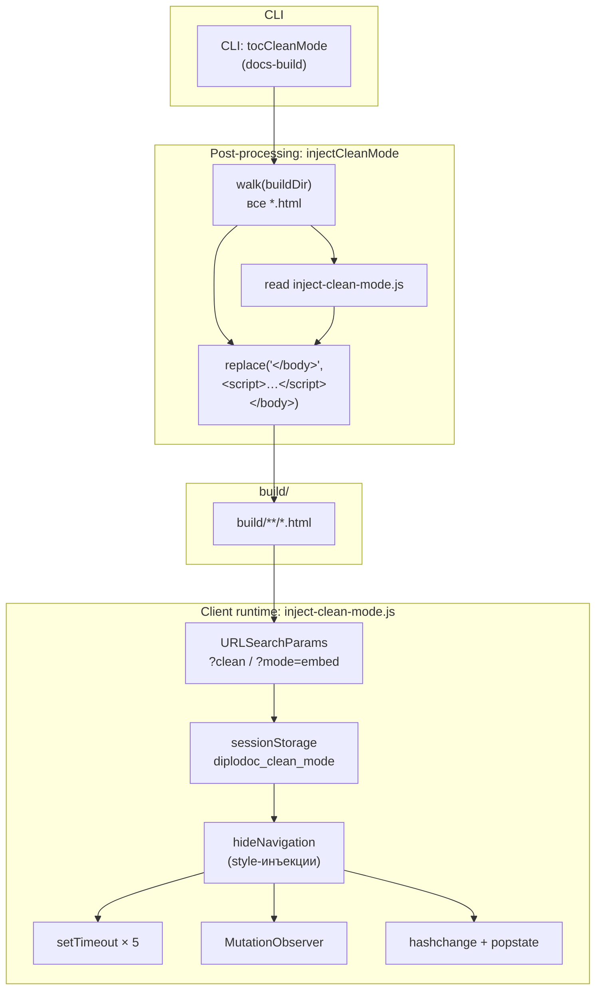
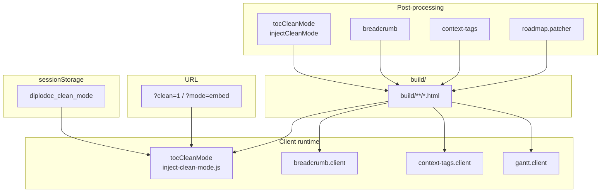

|               |                                                                                                                                                                             |
| ------------- | --------------------------------------------------------------------------------------------------------------------------------------------------------------------------- |
| ID            | [4.2-044](../../%D0%A1%D0%BE%D0%B3%D0%BB%D0%B0%D1%88%D0%B5%D0%BD%D0%B8%D1%8F/index.md#identifikaciya-modulej)                                                               |
| Идентификатор | `tocCleanMode`                                                                                                                                                              |
| Наименование  | Режим без навигации                                                                                                                                                         |
| Слой          | [post-processing](../%D0%A1%D0%BB%D0%BE%D0%B8layer/PostProcessing/index.md#naznachenie) / [client-runtime](../%D0%A1%D0%BB%D0%BE%D0%B8layer/ClientRuntime/index.md#naznachenie) |
| Расположение  | `src/plugins/tocCleanMode/post-build.js`, `src/plugins/tocCleanMode/inject-clean-mode.js`                                                                                   |
| Точка входа   | `injectCleanMode(buildDir)`                                                                                                                                                 |
| Версия        | `1.54.0`                                                                                                                                                                    |
| Назначение    | Встраивает в HTML клиентский скрипт, скрывающий боковую навигацию при `?clean=1` или `?mode=embed`                                                                          |

{: .page-legend }

## Назначение

`tocCleanMode` — «режим встраивания». Пользователь открывает страницу документации с параметром URL `?clean=1` (или `?mode=embed`) — и клиентский скрипт **скрывает** боковую навигацию, хлебные крошки, левую панель. Контент статьи растягивается на всю ширину. Следующие переходы внутри документации остаются в этом режиме (через `sessionStorage`), пока пользователь не закроет вкладку.

Зачем это нужно. Документация встраивается в другие приложения — в `iframe`, в панель помощи внутри продукта, в модальные окна. В таком контексте:

- боковая навигация (TOC) занимает 30–40% ширины и сжимает контент;
- хлебные крошки дублируют навигацию внешнего приложения;
- пользователь «заперт» внутри iframe без возможности вернуться в полный интерфейс.

`?clean=1` даёт «чистый» вид — только статья, без обвесов. `sessionStorage` запоминает выбор, чтобы переход по ссылке внутри статьи не сбрасывал режим.

`?mode=embed` — синоним (для обратной совместимости, если внешнее приложение использует этот параметр).

Модуль работает в двух частях: **post-processing** (`injectCleanMode` встраивает `<script>`) и **client-runtime** (сам скрипт `inject-clean-mode.js`).

## Применение

**Когда использовать:** документация встраивается в iframe или панель приложения, и боковая навигация только мешает — `?clean=1` даёт «чистый» вид.

**Когда НЕ использовать:** документация открывается напрямую в браузере — clean mode не нужен.

**Альтернативы:**
- Собственный `<iframe>` с CSS-обрезкой навигации — хрупко, при обновлении Diplodoc-темы ломается.
- Отдельная сборка «для встраивания» — дублирует проект.

**Типичный сценарий:** ссылка `https://docs.example.com/ru/foo/index.html?clean=1` → скрипт активируется → `sessionStorage` помнит режим → при переходах по ссылкам внутри документации clean mode сохраняется.

## Как это работает




### Фаза 1. `injectCleanMode(buildDir)` (post-processing)

```js
function injectCleanMode(buildDir) {
    const files = [];
    function walk(dir) {
        fs.readdirSync(dir, { withFileTypes: true }).forEach(file => {
            const fullPath = path.join(dir, file.name);
            if (file.isDirectory()) walk(fullPath);
            else if (file.name.endsWith('.html')) files.push(fullPath);
        });
    }
    walk(buildDir);

    const cleanScript = fs.readFileSync(path.join(__dirname, './inject-clean-mode.js'), 'utf8');

    files.forEach(file => {
        let content = fs.readFileSync(file, 'utf8');
        if (content.includes('</body>')) {
            content = content.replace('</body>', `<script>${cleanScript}</script>\n</body>`);
            fs.writeFileSync(file, content);
        }
    });
    console.log(`[tocInject] Процесс завершён.`);
}
```

1. **Рекурсивный обход** `buildDir` — все `.html` в массив.
2. **Чтение** клиентского скрипта (`inject-clean-mode.js`) целиком — **один раз**.
3. **Для каждой страницы**: `replace('</body>', '<script>…</script>\n</body>')`.
4. **`console.log`** — `[tocInject] Процесс завершён.` (без счётчика).

**Особенности:**

- **Нет проверки идемпотентности.** Если `injectCleanMode` вызван дважды — `<script>` дублируется. См. «Известные ограничения».
- **`content.includes('</body>')`** — если нет `</body>` (например, minify-фрагмент или `404.html` без него), страница пропускается **молча** (без `console.warn`).
- **`</body>` без `id`-маркера** — клиентский скрипт ищется только по строке. Если Diplodoc изменит шаблон (например, `<BODY>` в верхнем регистре), скрипт не встроится.

### Фаза 2. Клиент (`inject-clean-mode.js`)

```js
(function () {
    const urlParams = new URLSearchParams(window.location.search);
    const hasCleanParam = urlParams.has('clean') || urlParams.get('mode') === 'embed';

    if (hasCleanParam) {
        sessionStorage.setItem('diplodoc_clean_mode', 'true');
    }

    const isCleanMode = sessionStorage.getItem('diplodoc_clean_mode') === 'true';

    if (!isCleanMode) return;

    console.log('[Diplodoc Clean Mode] Activated');

    function hideNavigation() {
        document.querySelectorAll('.dc-doc-layout__left').forEach(el => {
            el.style.cssText = `
                visibility: hidden !important;
                width: 0 !important;
                min-width: 0 !important;
                max-width: 0 !important;
                flex: 0 0 0 !important;
                overflow: hidden !important;
                padding: 0 !important;
                margin: 0 !important;
            `;
        });

        document.querySelectorAll('.dc-sidebar, .dc-doc-layout__sidebar, [class*="sidebar"]')
            .forEach(el => (el.style.display = 'none'));

        document.querySelectorAll('.dc-doc-layout__right, .dc-doc-page__main, .dc-doc-page, main')
            .forEach(el => {
                el.style.cssText = `
                    margin-left: 0 !important;
                    max-width: 100% !important;
                    width: 100% !important;
                    flex: 1 1 auto !important;
                `;
            });

        document.querySelectorAll('.dc-breadcrumb, [class*="breadcrumb"]')
            .forEach(el => (el.style.display = 'none'));
    }

    hideNavigation();
    setTimeout(hideNavigation, 300);
    setTimeout(hideNavigation, 700);
    setTimeout(hideNavigation, 1200);
    setTimeout(hideNavigation, 2000);

    const observer = new MutationObserver(hideNavigation);
    observer.observe(document.body, { childList: true, subtree: true });

    window.addEventListener('hashchange', hideNavigation);
    window.addEventListener('popstate', hideNavigation);

    console.log('[Diplodoc Clean Mode] Persistent mode enabled');
})();
```

**2.1. Чтение URL:**

```js
const urlParams = new URLSearchParams(window.location.search);
const hasCleanParam = urlParams.has('clean') || urlParams.get('mode') === 'embed';
```

- **`?clean`** (любое значение, даже `?clean=0`) → `hasCleanParam = true`.
- **`?mode=embed`** → `hasCleanParam = true`.
- `?mode=page` (другое значение) → `false`.

**2.2. `sessionStorage`:**

```js
if (hasCleanParam) {
    sessionStorage.setItem('diplodoc_clean_mode', 'true');
}
const isCleanMode = sessionStorage.getItem('diplodoc_clean_mode') === 'true';
if (!isCleanMode) return;
```

Логика:

- **Первый визит** с `?clean=1` — устанавливает `sessionStorage`, `isCleanMode = true`, активирует.
- **Переход по ссылке** внутри документации — URL без `?clean`, но `sessionStorage` = `'true'` → `isCleanMode = true`, режим сохраняется.
- **Первый визит без параметра** — `sessionStorage` пуст, `isCleanMode = false`, скрипт выходит сразу.
- **`sessionStorage` живёт до закрытия вкладки** (или до `sessionStorage.clear()`). Не сбрасывается по `?clean=0`.

**2.3. `hideNavigation()`** — 4 группы селекторов:

| Селектор                                                        | Что скрывает                        | Метод                                         |
| --------------------------------------------------------------- | ----------------------------------- | --------------------------------------------- |
| `.dc-doc-layout__left`                                          | Левая панель (TOC)                  | `visibility: hidden` + `width: 0` + `flex: 0` |
| `.dc-sidebar, .dc-doc-layout__sidebar, [class*="sidebar"]`      | Боковые панели (если есть отдельно) | `display: none`                               |
| `.dc-doc-layout__right, .dc-doc-page__main, .dc-doc-page, main` | Контейнер контента                  | `width: 100%`, `margin-left: 0`               |
| `.dc-breadcrumb, [class*="breadcrumb"]`                         | Хлебные крошки                      | `display: none`                               |

- Первая группа — `visibility: hidden` + `width: 0` (сохраняет layout для transition-анимаций, если будут).
- Вторая и четвёртая — `display: none` (полное удаление из layout).
- Третья — расширение контента на весь экран.

**2.4. Многократный вызов:**

```js
hideNavigation();
setTimeout(hideNavigation, 300);
setTimeout(hideNavigation, 700);
setTimeout(hideNavigation, 1200);
setTimeout(hideNavigation, 2000);
```

Пять вызовов с интервалами — на случай, если Diplodoc рендерит DOM асинхронно (Mermaid, плагины, hydration из `diplodoc-state`). К 2000 мс DOM уже точно готов.

**2.5. `MutationObserver`:**

```js
const observer = new MutationObserver(hideNavigation);
observer.observe(document.body, { childList: true, subtree: true });
```

При **любом** изменении DOM под `body` — снова `hideNavigation()`. Защита от повторного рендера навигации (например, при переключении вкладок).

**2.6. `hashchange` / `popstate`:**

```js
window.addEventListener('hashchange', hideNavigation);
window.addEventListener('popstate', hideNavigation);
```

При переходе по `#anchor` или `history.back()` — снова скрыть (Diplodoc может пересоздать DOM).

**2.7. `console.log`** — `[Diplodoc Clean Mode] Activated` и `[Diplodoc Clean Mode] Persistent mode enabled`. Остаются в консоли пользователя (в проде).

### Файлы модуля

| Файл                                            | Ответственность                               |
| ----------------------------------------------- | --------------------------------------------- |
| `src/plugins/tocCleanMode/post-build.js`        | `injectCleanMode(buildDir)` — обход, инъекция |
| `src/plugins/tocCleanMode/inject-clean-mode.js` | Клиентский скрипт (IIFE)                      |

## Режимы работы

### CLI

```bash
node ./plugins/diplodoc-helper-cli.js tocCleanMode --outputDir ./build
```

| Аргумент      | Обязателен | По умолчанию | Описание       |
| ------------- | ---------- | ------------ | -------------- |
| `--outputDir` | нет        | `./build`    | Каталог сборки |

В `diplodoc-helper-cli.js`:

```js
} else if (command === 'tocCleanMode') {
    generateTocCleanMode(outputDir);
}
```

`outputDir` передаётся как `buildDir`.

### Сборочный пайплайн

В `docs-build.js` — **две** записи:

1. **В фазе `pre`** (ошибка!):
   ```js
   cli('helpMap'),
   cli('tocCleanMode'),   // ← здесь
   cli('periodicStat'),
   ```
2. **Фактически** должен быть в `post` (после `@diplodoc/cli`). См. «Известные ограничения» — это баг в `docs-build.js`, не в модуле.

**Если запускать `docs-build.js`:** `injectCleanMode` вызывается **до** `@diplodoc/cli`. На пустой папке `build/` (только что очищенной `clean build`). `files = []`, `console.log('[tocInject] Процесс завершён.')` — но ничего не инжектится. После `@diplodoc/cli` — HTML создан, но скрипт **не** встроен. Режим не работает.

**Если запускать `injectCleanMode` вручную после `@diplodoc/cli`:** работает.

### VS Code

Собственной команды нет. Только через CLI или `docs-build.js`.

## Юнит-тесты





## Связи

`tocCleanMode` — единственный модуль с «режимом отображения», управляемым через URL. Не пересекается с другими `post-processing` (`breadcrumb`, `context-tags`, `roadmap.patcher`) — каждый инжектит свой скрипт, но в разные места:

| Модуль                                              | Что вставляет                    | Где             |
| --------------------------------------------------- | -------------------------------- | --------------- |
| **`tocCleanMode`**                                  | `<script>` со скрытием навигации | Перед `</body>` |
| [`breadcrumb`](../МодульХлебныеКрошки/index.md)     | `<script>` для хлебных крошек    | Перед `</body>` |
| [`context-tags`](../МодульКонтекстныеТеги/index.md) | `<script>` с `__CONTEXT_ITEMS__` | Перед `</body>` |
| [`roadmap.patcher`](../МодульПатчерГанта/index.md)  | `<script>` для pan/zoom Ганта    | Перед `</body>` |

Порядок инъекций в `docs-build.js` (post-фаза):

1. `footnoteAnchors`
2. `abbrTitles`
3. `termTitles`
4. `footnoteNumbering`
5. `footnoteList`
6. `gostsInject`
7. `copy mdedit_fixes`
8. `breadcrumb`
9. `contexttags`
10. `ganttFixScroll`
11. `periodicTable*`

`tocCleanMode` **отсутствует** в post-фазе (ошибка — см. «Известные ограничения»). Все инъекции — независимы (не мешают друг другу).

С [`breadcrumb`](../МодульХлебныеКрошки/index.md) — общая идея «инжекта скрипта в `</body>`», но разные DOM-манипуляции. `breadcrumb` **добавляет** `<nav>` в `.dc-doc-page__main`, `tocCleanMode` **скрывает** `.dc-doc-layout__left`, `.dc-breadcrumb`. Если оба активны — хлебные крошки добавятся, но сразу же будут скрыты (если `hideNavigation` найдёт `.dc-breadcrumb`). Ок.






