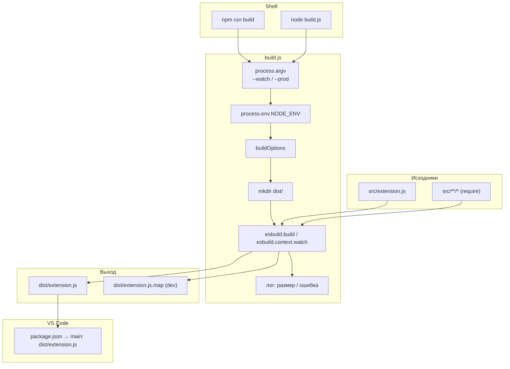
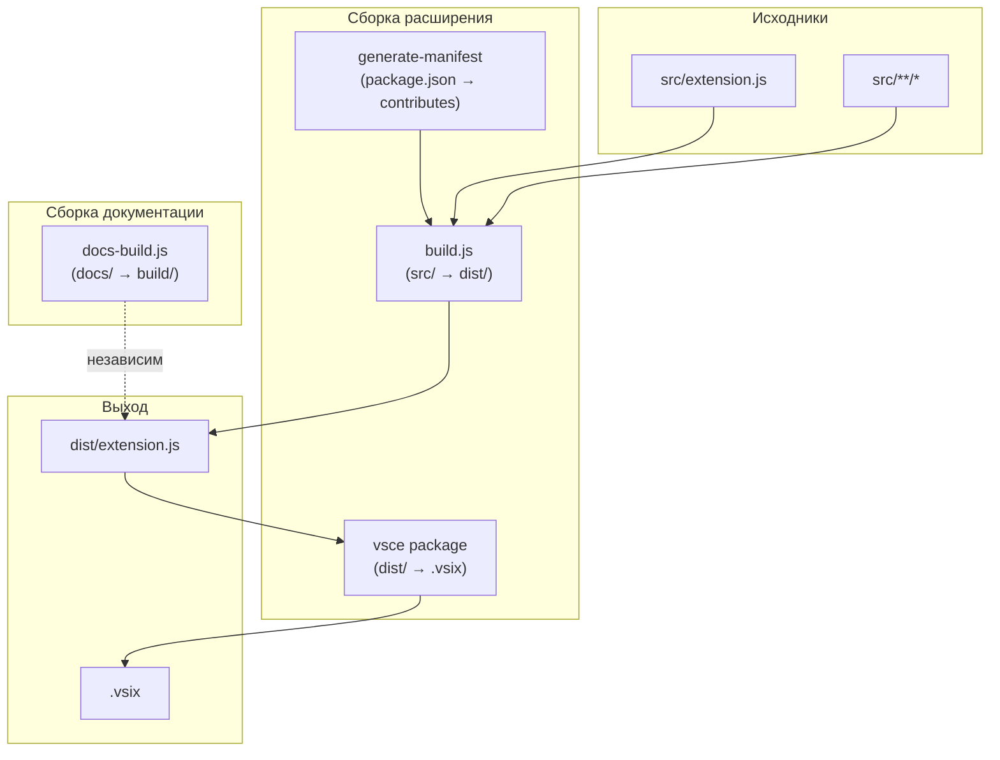

|               |                                                                                                                                                                                                                                                                        |
| ------------- | ---------------------------------------------------------------------------------------------------------------------------------------------------------------------------------------------------------------------------------------------------------------------- |
| ID            | [6.2-050](../../../%D0%A1%D0%BE%D0%B3%D0%BB%D0%B0%D1%88%D0%B5%D0%BD%D0%B8%D1%8F/index.md#identifikaciya-modulej)                                                                                                                                                          |
| Идентификатор | `build.js`                                                                                                                                                                                                                                                             |
| Наименование  | Сборка расширения                                                                                                                                                                                                                                                      |
| Слой          | [Build](../../%D0%A1%D0%BB%D0%BE%D0%B8layer/%D0%A1%D0%BB%D0%BE%D0%B9Build/index.md#build)                                                                                                                                                                                                              |
| Каталог       | [Инфраструктура](../../%D0%9A%D0%B0%D1%82%D0%B0%D0%BB%D0%BE%D0%B3Capabilitymap/%D0%9A%D0%B0%D1%82%D0%B0%D0%BB%D0%BE%D0%B3%D0%98%D0%BD%D1%84%D1%80%D0%B0%D1%81%D1%82%D1%80%D1%83%D0%BA%D1%82%D1%83%D1%80%D0%B0/index.md#infrastruktura)                                                                                                                                                                                                                                                                       |
| Семейство     | [Инфраструктура](../../%D0%A1%D0%B5%D0%BC%D0%B5%D0%B9%D1%81%D1%82%D0%B2%D0%BEfamily/%D0%A1%D0%B5%D0%BC%D0%B5%D0%B9%D1%81%D1%82%D0%B2%D0%BE%D0%98%D0%BD%D1%84%D1%80%D0%B0%D1%81%D1%82%D1%80%D1%83%D0%BA%D1%82%D1%83%D1%80%D0%B0/index.md#fam-infrastructure) |
| Расположение  | `build.js` (корень)                                                                                                                                                                                                                                                    |
| Точка входа   | `node build.js [--watch] [--prod]`                                                                                                                                                                                                                                     |
| Версия        | `1.54.0`                                                                                                                                                                                                                                                               |
| Назначение    | Собирает `src/extension.js` в `dist/extension.js` через esbuild для установки в VS Code                                                                                                                                                                                |

{: .page-legend }

## Назначение

`build.js` — esbuild-сборка **расширения** (не документации). Пользователь запускает `npm run build` (или `node build.js`) — и модуль:

1. Проверяет `dist/`.
2. Собирает `src/extension.js` (со всеми `require`-зависимостями) → `dist/extension.js`.
3. Минифицирует в production (`NODE_ENV=production` или `--prod`).
4. Добавляет sourcemap в development.
5. Выводит размер.

**Важно:** это **не** сборка документации. Документация собирается через [`docs-build.js`](../МодульОркестраторсборки/index.md). `build.js` — это сборка **расширения VS Code** в единый файл, который VS Code загружает через `package.json → main: "dist/extension.js"`.

Зачем это нужно. Исходный код расширения — ~150 файлов в `src/` (JS + `require`). VS Code при установке расширения из `.vsix` ожидает **единый** `dist/extension.js` (или несколько), потому что `package.json → files` перечисляет только `dist/`. `build.js`:

- **батчит** все `require` в один файл (`bundle: true`);
- **транспилирует** в `node16` (`target: 'node16'`);
- **форматирует** как CommonJS (`format: 'cjs'`);
- **исключает** `vscode` (built-in модуль, доступный только в runtime VS Code);
- **опционально** минифицирует (`minify: true`).

Без `build.js` пришлось бы:

- собирать вручную через `esbuild` CLI;
- помнить все флаги;
- вручную добавлять `vscode` в `external`;
- не иметь watch-режима.

## Применение

**Когда использовать:** собираете `.vsix` для публикации или обновления расширения — esbuild батчит `src/**/*.js` в `dist/extension.js`, который загружает VS Code.

**Когда НЕ использовать:** вы работаете с документацией — используйте `docs-build.js` (это **другая** сборка, не `build.js`).

**Альтернативы:**
- `tsc` — только типы, не батчит в один файл.
- `webpack`/`rollup` — тяжелее для расширения VS Code.

**Типичный сценарий:** `npm run build:prod` → `generate-manifest` → `node build.js --prod` (esbuild) → `dist/extension.js` → `vsce package` → `.vsix`.

## Как это работает



### Фаза 1. Парсинг аргументов

```js
const esbuild = require('esbuild');
const fs = require('fs');

const isWatch = process.argv.includes('--watch');
const isProduction = process.env.NODE_ENV === 'production' || process.argv.includes('--prod');
```

- **`--watch`** — watch-режим (esbuild-watch).
- **`--prod`** или **`NODE_ENV=production`** — production-режим.
- Иначе — development (по умолчанию).

В `package.json → scripts`:

```json
"build": "npm run compile",
"compile": "npm run generate-manifest && node build.js",
"build:prod": "cross-env NODE_ENV=production npm run compile",
"build:dev": "cross-env NODE_ENV=development npm run compile",
```

- `npm run build` → `compile` → `generate-manifest` + `node build.js` → **development** (нет `NODE_ENV=production`).
- `npm run build:prod` → `NODE_ENV=production npm run compile` → **production** (минификация).
- `npm run build:dev` → `NODE_ENV=development npm run compile` → **development** (sourcemap).

`--prod` — альтернатива `NODE_ENV`:

```bash
node build.js --prod        # production
node build.js --watch       # watch
node build.js --watch --prod # watch + production
```

### Фаза 2. `buildOptions`

```js
const buildOptions = {
    entryPoints: ['src/extension.js'],
    bundle: true,
    outfile: 'dist/extension.js',
    external: ['vscode'],
    format: 'cjs',
    platform: 'node',
    target: 'node16',
    logLevel: 'info',

    sourcemap: !isProduction,
    sourcesContent: !isProduction,
    minify: isProduction,
    treeShaking: true,
};
```

| Опция            | Значение               | Что                                       |
| ---------------- | ---------------------- | ----------------------------------------- |
| `entryPoints`    | `['src/extension.js']` | Точка входа                               |
| `bundle`         | `true`                 | Батчит все `require` в один файл          |
| `outfile`        | `'dist/extension.js'`  | Выход                                     |
| `external`       | `['vscode']`           | **Не** батчит `vscode` (built-in VS Code) |
| `format`         | `'cjs'`                | CommonJS (VS Code ожидает)                |
| `platform`       | `'node'`               | Node.js                                   |
| `target`         | `'node16'`             | Синтаксис Node 16                         |
| `logLevel`       | `'info'`               | Логи esbuild                              |
| `sourcemap`      | `!isProduction`        | Sourcemap в dev, нет в prod               |
| `sourcesContent` | `!isProduction`        | Исходники в map (dev)                     |
| `minify`         | `isProduction`         | Минификация в prod                        |
| `treeShaking`    | `true`                 | Удаление неиспользуемого кода             |

**`external: ['vscode']`** — критично. `vscode` — это не npm-пакет, а built-in модуль VS Code. Если его батчить — esbuild бросит «Cannot find module 'vscode'». С `external` — `require('vscode')` останется в коде, разрешится в runtime VS Code.

**`format: 'cjs'`** — VS Code загружает `dist/extension.js` через `require` (CommonJS). ESM был бы несовместим.

**`target: 'node16'`** — VS Code (Electron) на Node 16+. Синтаксис (optional chaining `?.`, nullish coalescing `??`) — поддерживается. Если target `'es2020'` — тоже сработает, но `node16` надёжнее.

### Фаза 3. `build`

```js
async function build() {
    if (!fs.existsSync('dist')) {
        fs.mkdirSync('dist', { recursive: true });
    }

    try {
        if (isWatch) {
            const ctx = await esbuild.context(buildOptions);
            await ctx.watch();
            console.log('Watch mode (development with sourcemaps) started...');
        } else {
            await esbuild.build(buildOptions);
            const mode = isProduction ? 'PRODUCTION' : 'DEVELOPMENT';
            console.log(`Build completed (${mode})`);
            const size = (fs.statSync('dist/extension.js').size / 1024).toFixed(2);
            console.log(`Size: ${size} KB`);
        }
    } catch (err) {
        console.error('Build failed:', err);
        process.exit(1);
    }
}

build();
```

**`mkdir dist/`** — если нет. `recursive: true`.

**Watch-режим:**

- `esbuild.context(buildOptions)` — создаёт контекст.
- `ctx.watch()` — запускает watch.
- **Не ждёт** — `await ctx.watch()` резолвится сразу после старта. `build()` завершается, но процесс Node **не** выходит (esbuild держит открытый handle). Убить — `Ctrl+C`.
- `console.log('Watch mode (development with sourcemaps) started...')` — **всегда** «development», даже если `--prod --watch`. Баг.

**Обычная сборка:**

- `esbuild.build(buildOptions)` — ждёт завершения.
- `console.log('Build completed (PRODUCTION|DEVELOPMENT)')` — режим.
- `size` — размер `dist/extension.js` в KB, 2 знака.
- `console.log('Size: N KB')`.

**Ошибка:**

- `console.error('Build failed:', err)` — стек esbuild.
- `process.exit(1)` — **немедленный** выход. См. «Известные ограничения».

### Файлы модуля

| Файл       | Ответственность |
| ---------- | --------------- |
| `build.js` | Весь модуль     |

## Режимы работы

### CLI

```bash
node build.js            # development
node build.js --prod     # production
node build.js --watch    # watch (development)
node build.js --watch --prod  # watch + production
```

### npm

```bash
npm run build       # = npm run compile = generate-manifest + node build.js (development)
npm run build:prod  # NODE_ENV=production npm run compile (production)
npm run build:dev   # NODE_ENV=development npm run compile (development)
npm run compile     # generate-manifest + node build.js
```

**`npm run build`** — это **не** `docs-build.js`. Это `node build.js` (сборка расширения).

Для сборки **документации** — `node ./plugins/docs-build.js` (или `node ./build-docs.js`, если установлен через `installer`).

### VS Code

`build.js` **не участвует** в runtime VS Code. Результат (`dist/extension.js`) загружается VS Code через `package.json → main`. `build.js` — build-time-инструмент.

В `.vscode/launch.json`:

```json
{
    "name": "Запустить расширение",
    "type": "extensionHost",
    "request": "launch",
    "args": ["--extensionDevelopmentPath=${workspaceFolder}"],
    "outFiles": ["${workspaceFolder}/dist/**/*.js"],
    "preLaunchTask": "Watch (for Debugging)",
    "sourceMaps": true,
    "smartStep": true,
    "skipFiles": ["<node_internals>/**"]
}
```

`preLaunchTask: "Watch (for Debugging)"` — запускает `npm run watch` перед дебагом. `sourceMaps: true` — отладка по `dist/extension.js.map` (работает, если сборка в development).

В `.vscode/tasks.json`:

```json
{
    "label": "Watch (for Debugging)",
    "type": "shell",
    "command": "npm run watch",
    "isBackground": true,
    "problemMatcher": { … }
}
```

`npm run watch` — но в `package.json → scripts` **нет** `watch`! См. «Известные ограничения» — это баг: `.vscode/launch.json` ссылается на несуществующий таск.

## Юнит-тесты





## Связи

`build.js` — последний шаг в цепочке сборки **расширения**:

| Шаг                         | Что                                                                           |
| --------------------------- | ----------------------------------------------------------------------------- |
| `npm run generate-manifest` | `manifest` обновляет `package.json → contributes`                             |
| `node build.js`             | Собирает `src/extension.js` → `dist/extension.js`                             |
| `vsce package`              | Упаковывает `dist/` + `package.json` + `README.md` + `CHANGELOG.md` → `.vsix` |

**Не связан с `docs-build.js`:**

- `docs-build.js` — сборка **документации** (`docs/` → `build/`).
- `build.js` — сборка **расширения** (`src/` → `dist/`).

Разные `entryPoints`, разные `outfile`, разные цели. `npm run build` → `build.js`, не `docs-build.js`. `node ./plugins/docs-build.js` → сборка документации.

**С `manifest`** — `generate-manifest` вызывается **до** `build.js` (в `npm run compile`). `manifest` обновляет `package.json`, `build.js` собирает runtime. Оба нужны для корректной работы расширения.

**С `package.json → files`:**

```json
"files": [
    "dist",
    "package.nls.json",
    "package.nls.ru.json",
    "README.md",
    "CHANGELOG.md",
    "LICENSE.md"
]
```

Только `dist/` (результат `build.js`) и декларации. `src/` **не** попадает в `.vsix` — VS Code загружает только `dist/extension.js`.






