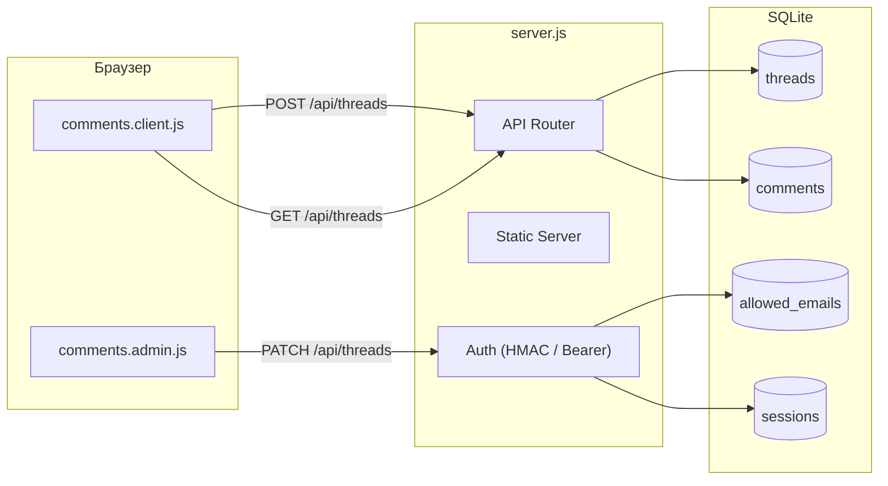

|               |                                                                                                                                                                                                                                                                                                                        |
| ------------- | ---------------------------------------------------------------------------------------------------------------------------------------------------------------------------------------------------------------------------------------------------------------------------------------------------------------------- |
| ID            | [6.2-052](../../Соглашения/index.md#identifikaciya-modulej)                                                                                                                                                                                                                                                            |
| Идентификатор | `comments.server`                                                                                                                                                                                                                                                                                                      |
| Наименование  | Сервер комментариев                                                                                                                                                                                                                                                                                                    |
| Слой          | [Infrastructure](../Слоиlayer/Infrastructure/index.md#naznachenie)                                                                                                                                                                                                                                                     |
| Каталог       |                                                                                                                                                                                                                                                                                                                        |
| Семейство     | [Комментарии пользователей](../../%D0%A1%D0%B5%D0%BC%D0%B5%D0%B9%D1%81%D1%82%D0%B2%D0%BEfamily/%D0%A1%D0%B5%D0%BC%D0%B5%D0%B9%D1%81%D1%82%D0%B2%D0%BE%D0%9A%D0%BE%D0%BC%D0%BC%D0%B5%D0%BD%D1%82%D0%B0%D1%80%D0%B8%D0%B8%D0%BF%D0%BE%D0%BB%D1%8C%D0%B7%D0%BE%D0%B2%D0%B0%D1%82%D0%B5%D0%BB%D0%B5%D0%B9/index.md#moduli) |
| Расположение  | `server/`                                                                                                                                                                                                                                                                                                              |
| Точка входа   | `node server/server.js`                                                                                                                                                                                                                                                                                                |
| Версия        | `1.0.0`                                                                                                                                                                                                                                                                                                                |
| Назначение    | Раздача статики, API для работы с комментариями, БД SQLite, Whitelist-авторизация                                                                                                                                                                                                                                      |

{: .page-legend }

## Назначение

Сервер заменяет стандартный `http-server` из `Diplodoc`. Он делает две вещи:
1. Раздаёт статические файлы из `build/`.
2. Предоставляет REST API для комментариев.

Это **единственный** источник данных в системе, так как отдельного бэкенда не предусмотрено.

## Безопасность и доступ

Безопасность построена на **Whitelist (Белом списке)**:
- Админ (Техпис) загружает список доверенных email (через `allowed-emails.json` или Админку).
- Читатель вводит Email. Если он есть в списке, система генерирует `claim-code` (6 символов).
- При первом вводе кода создается `session_token` (Bearer token), который браузер сохраняет в `localStorage`.
- Все последующие запросы от читателя идут с этим токеном.
- Защита от спама: rate-limit на создание тредов (60/час на IP).

## Как это работает

### Схема БД (SQLite)

- `threads`: корневая сущность (цитата, URL страницы, статус).
- `comments`: реплики внутри треда (автор, текст, тип, ТЗ).
- `allowed_emails`: список email, которым разрешено писать, и их claim-коды.
- `sessions`: активные токены (привязаны к email).

### Docker и инфраструктура

При деплое через Azure Pipeline:
- Используется Volume `gulf-help-data:/app/data` для сохранения БД между перезапусками контейнера.
- Переменная `MODERATOR_TOKEN` передается в контейнер. Если она не задана, сервер генерирует её при первом старте и сохраняет в `data/admin-token.txt`.

## API Endpoints

| Метод   | Путь                | Описание                                                  |
| ------- | ------------------- | --------------------------------------------------------- |
| `GET`   | `/api/threads`      | Получить треды (публичные или все для админа)             |
| `POST`  | `/api/threads`      | Создать комментарий (требует Bearer token или Claim Code) |
| `POST`  | `/api/comments`     | Ответ техписа в тред (требует Auth)                       |
| `PATCH` | `/api/threads/:id`  | Смена статуса (resolve/archive)                           |
| `GET`   | `/api/admin/emails` | Управление Whitelist (только админ)                       |
| `GET`   | `/admin/status`     | Проверка авторизации админа                               |