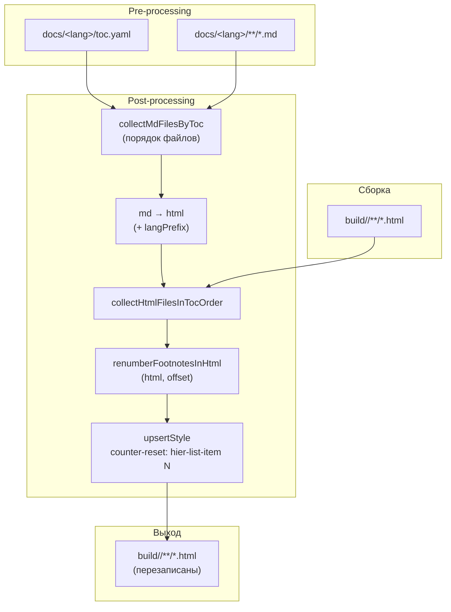
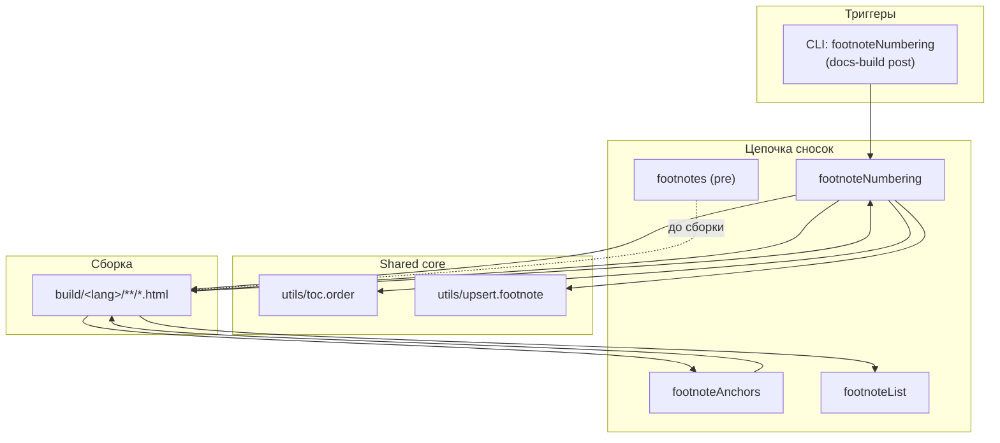

|               |                                                                                                                                                                                                 |
| ------------- | ----------------------------------------------------------------------------------------------------------------------------------------------------------------------------------------------- |
| ID            | [4.2-013](../../../%D0%A1%D0%BE%D0%B3%D0%BB%D0%B0%D1%88%D0%B5%D0%BD%D0%B8%D1%8F/index.md#identifikaciya-modulej)                                                                                   |
| Идентификатор | `footnoteNumbering`                                                                                                                                                                             |
| Наименование  | Сквозная нумерация сносок                                                                                                                                                                       |
| Слой          | [Post-processing](../../%D0%A1%D0%BB%D0%BE%D0%B8layer/%D0%A1%D0%BB%D0%BE%D0%B9Postprocessing/index.md#naznachenie)                                                                              |
| Каталог       | [Навигация](../../%D0%9A%D0%B0%D1%82%D0%B0%D0%BB%D0%BE%D0%B3Capabilitymap/%D0%9A%D0%B0%D1%82%D0%B0%D0%BB%D0%BE%D0%B3%D0%9D%D0%B0%D0%B2%D0%B8%D0%B3%D0%B0%D1%86%D0%B8%D1%8F/index.md#navigaciya) |
| Семейство     | [Сноски](../../%D0%A1%D0%B5%D0%BC%D0%B5%D0%B9%D1%81%D1%82%D0%B2%D0%BEfamily/%D0%A1%D0%B5%D0%BC%D0%B5%D0%B9%D1%81%D1%82%D0%B2%D0%BE%D0%A1%D0%BD%D0%BE%D1%81%D0%BA%D0%B8/index.md#fam-footnote)   |
| Расположение  | `src/plugins/footnoteNumbering/`                                                                                                                                                                |
| Точка входа   | `renumberFootnotes({ docsDir, outputDir })`                                                                                                                                                     |
| Версия        | `1.54.0`                                                                                                                                                                                        |
| Назначение    | Делает нумерацию сносок сквозной по всей документации в собранном HTML                                                                                                                          |

{: .page-legend }

## Назначение

`@diplodoc/cli` нумерует сноски **внутри каждой страницы с 1**. Если в документации принят стиль «сноски идут сквозняком по всему руководству» (например, для печатной версии или PDF-экспорта — одна книга, одна нумерация), то стандартный рендер не подходит: на второй странице снова появится `[1]`.

Модуль `footnoteNumbering` решает эту задачу **после** сборки: он идёт по HTML-файлам в порядке `toc.yaml`, для каждого файла находит локальные номера сносок (`#fn1`, `#fnref1`, `[1]` в тексте), сдвигает их на глобальный offset и записывает обратно. На выходе — во всех страницах `build/` номера сносок продолжают друг друга в порядке чтения.

Модуль работает только с `.html` и только в `post-processing`. Ни `.md`, ни клиентского скрипта, ни VS Code-команды у него нет.

## Применение

**Когда использовать:** принят стиль «сквозная нумерация сносок по всему руководству» (например, для печатной версии или PDF-экспорта) — а `@diplodoc/cli` по умолчанию нумерует с 1 на каждой странице.

**Когда НЕ использовать:** нумерация «с 1 на каждой странице» устраивает.

**Альтернативы:**
- CSS-хаки с `counter-reset` вручную — не масштабируются.
- `footnotes` (pre) — правит `.md`, но `@diplodoc/cli` при рендере HTML всё равно сбрасывает.

**Типичный сценарий:** `docs-build.js` → `post` → после `footnoteAnchors` → `footnoteNumbering` → в HTML номера сносок продолжают друг друга по `toc.yaml`.

## Как это работает



### Фаза 1. Порядок файлов

`collectHtmlFilesInTocOrder(docsDir, outputDir)`:

1. `collectMdFilesByToc(docsDir)` — обход `toc.yaml` рекурсивно через `include`, с fallback на `fs.readdir` если `toc.yaml` нет. Возвращает список `.md` в порядке чтения.
2. Определяется `langPrefix` из имени `docsDir` (`ru` / `en`), если basename матчит `/^[a-z]{2}$/i`.
3. Для каждого `.md` строится путь к соответствующему `.html` в `outputDir`: `path.join(langPrefix, relPath.replace(/\.md$/, '.html'))`.
4. Если `.html` не существует — файл пропускается с предупреждением `[footnotes] HTML не найден для …`.

Итог: массив HTML-файлов в том порядке, в каком сноски должны нумероваться.

### Фаза 2. Пересчёт одного файла

`renumberFootnotesInHtml(html, offset)` — чистая функция. Шаги:

1. **Поиск локальных номеров.** `\b(fnref|fn)(\d+)\b` — собирает в `Set` все номера, встречающиеся в HTML (в `id`, в `href`, в CSS-классах, где угодно). Если `Set` пуст — `count: 0`, файл не меняется.

2. **Map сдвига.** Для каждого `local` в `Set`: `map.set(local, local + offset)`. Например, `offset = 3`, `localNums = {1, 2, 3}` → `map = {1→4, 2→5, 3→6}`.

3. **Перенумерация id/href.** `html.replace(/\b(fnref|fn)(\d+)\b/g, …)` — меняет `fn1` → `fn4`, `fnref3` → `fnref6` по всему тексту.

4. **Перенумерация отображаемых номеров.** Отдельный `replace`:

   ```js
   /\[(\d+)\](<\/a>|&lt;\/a&gt;)/g
   ```

   Ловит `[N]</a>` и `[N]&lt;/a&gt;`. Для `[1]</a>` со сдвигом становится `[4]</a>` — это меняет текст ссылки `[1]`, который пользователь видит.

5. **`<ol start="N">`** (raw, в видимой разметке). `startNum = offset + 1`; атрибут `start` либо обновляется, либо добавляется.

6. **`<ol class=\"footnotes-list\" start=\"N\">`** (JSON-escaped, для `<script id="diplodoc-state">`). См. «Известные ограничения» — регулярка пытается поймать этот вариант, но фактически в исходнике Diplodoc-разметка `<ol>` в state хранится иначе.

7. **`counter-reset: hier-list-item N`** — критично для CSS. Правка добавляет/обновляет inline-стиль на `<ol class="footnotes-list">`:

   ```
   counter-reset: hier-list-item (startNum - 1)
   ```

   CSS-счётчик `hier-list-item` стартует с этого значения, а `li::before` инкрементирует его перед отображением. То есть `counter-reset: hier-list-item 3` → первая сноска покажет `4`. Это нужно, потому что Diplodoc использует именно `hier-list-item`, а не нативный `list-item`. Атрибут `start` при кастомном счётчике браузер игнорирует.

### Фаза 3. Сквозной счётчик

`renumberFootnotes({ docsDir, outputDir })`:

1. `htmlFiles = collectHtmlFilesInTocOrder(docsDir, outputDir)`.
2. `counter = 1` — глобальный счётчик.
3. Для каждого файла: `offset = counter - 1`, `renumberFootnotesInHtml(html, offset)`.
4. Если файл содержал сноски (`count > 0`): `counter += count`.
5. Если `changed === true` — файл записывается, `changedFiles++`.

Итог: `[1]` на первой странице, `[4]` на второй (если в первой было три), `[7]` на третьей и т.д.

### `upsertStyle(attrs, styleDecl, isJson)`

Из `utils/upsert.footnote`. Идемпотентно вставляет/обновляет `style="…"` в строке атрибутов:

- если `style` уже есть — вырезает из него существующий `counter-reset: …;`, добавляет новый в конец;
- если нет — добавляет `style="counter-reset: …;"` как последний атрибут.

Два режима: `isJson: false` для обычных атрибутов (`class="…"`), `isJson: true` — для JSON-escaped (`class=\"…\"`).

### Файлы модуля

| Файл                                   | Ответственность                                                              |
| -------------------------------------- | ---------------------------------------------------------------------------- |
| `renumber-footnotes.js`                | `renumberFootnotes`, `renumberFootnotesInHtml`, `collectHtmlFilesInTocOrder` |
| `src/plugins/utils/upsert.footnote.js` | `upsertStyle` — вставка/обновление `style`                                   |
| `src/plugins/utils/toc.order.js`       | `collectMdFilesByToc`, `collectMdFilesInOrder`                               |

### Пример результата

**Страница 1** (`build/ru/foo/index.html`), было 3 сноски. После `renumberFootnotesInHtml(html, 0)`:

```html
<ol class="footnotes-list" start="1" style="counter-reset: hier-list-item 0;">
  <li id="fn1"><a href="#fnref1">[1]</a> …</li>
  …
</ol>
```

**Страница 2** (`build/ru/bar/index.html`), было 2 сноски. После `renumberFootnotesInHtml(html, 3)`:

```html
<ol class="footnotes-list" start="4" style="counter-reset: hier-list-item 3;">
  <li id="fn4"><a href="#fnref4">[4]</a> …</li>
  …
</ol>
```

На странице 2 пользователь видит `[4]`, `[5]` — продолжение сквозной нумерации.

## Режимы работы

### CLI

```bash
node ./plugins/diplodoc-helper-cli.js footnoteNumbering --docsDir ./docs/ru --outputDir ./build
```

| Аргумент      | Обязателен | По умолчанию | Описание                                      |
| ------------- | ---------- | ------------ | --------------------------------------------- |
| `--docsDir`   | нет        | `./docs`     | Корень языка (не `./docs`, а `./docs/<lang>`) |
| `--outputDir` | нет        | `./build`    | Каталог сборки                                |

Код возврата: `0`. Модуль возвращает `{ success, total, changed }`, но `process.exitCode` в CLI не устанавливается — ошибки не диагностируются.

**`docsDir` — именно корень языка**, не корень проекта. `collectMdFilesByToc` ожидает `toc.yaml` в `docsDir`. То есть для русской документации — `./docs/ru`.

### Сборочный пайплайн

В `docs-build.js`, фаза `post`:

```js
cli('footnoteNumbering', '--docsDir', './docs/ru', '--outputDir', './build'),
```

Идёт после `footnoteAnchors`, `abbrTitles`, `termTitles`, но **до** `footnoteList` и `gostsInject`. Порядок существенен:

1. `footnoteAnchors` — делает `href` абсолютными;
2. **`footnoteNumbering`** — меняет номера сносок (и `id`, и `href`, и текст `[N]`);
3. `footnoteList` — собирает перечень сносок уже с глобальными номерами.

Пропускается флагом `--skip=footnoteNumbering`.

### Только `ru`

В `docs-build.js` — только для `./docs/ru`. Английская документация сносок не получает сквозной нумерации. По аналогии с `footnotes` (pre) — модуль однопроходный, один язык за вызов.

## Юнит-тесты





## Связи

`footnoteNumbering` — средний модуль в цепочке «три шага сносок в post-processing»:

| Модуль                                                                                                                                   | Слой | Что делает                          |
| ---------------------------------------------------------------------------------------------------------------------------------------- | ---- | ----------------------------------- |
| [`footnotes`](../%D0%A0%D0%B5%D0%B5%D1%81%D1%82%D1%80/%D0%9C%D0%BE%D0%B4%D1%83%D0%BB%D1%8C%D0%A1%D0%BD%D0%BE%D1%81%D0%BA%D0%B8/index.md) | pre  | Пересчитывает нумерацию в `.md`     |
| [`footnoteAnchors`](../МодульЯкоряСносок/index.md)                                                                                       | post | Делает `href="#fn…"` абсолютными    |
| **`footnoteNumbering`**                                                                                                                  | post | Делает нумерацию сквозной в `.html` |
| [`footnoteList`](../МодульПереченьсносок/index.md)                                                                                       | post | Собирает сводный перечень сносок    |

Зависимости от `shared-core`:

- `utils/toc.order` — порядок файлов;
- `utils/upsert.footnote` — вставка `style` в атрибуты.

Оба модуля — тонкие утилиты. Никаких клиентов, никаких JS.

С `@diplodoc/cli` — неявная зависимость на формат разметки: `class="footnotes-list"`, `id="fnN"`, `href="#fnrefN"`, текст `[N]`, CSS-счётчик `hier-list-item`. Если `@diplodoc/cli` изменит эти селекторы — модуль молча перестанет работать (`count: 0`, `changed: false`, `total: 0`).






