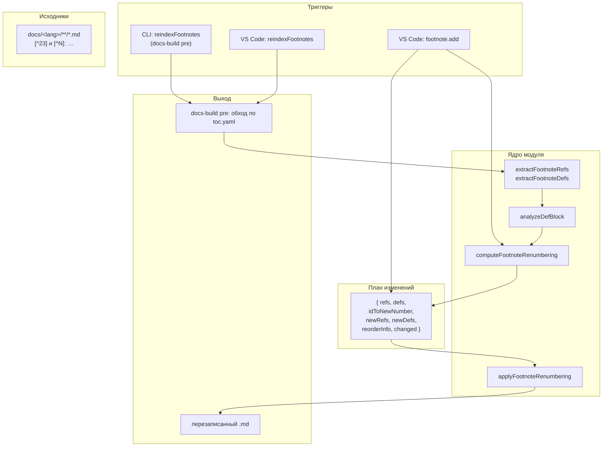
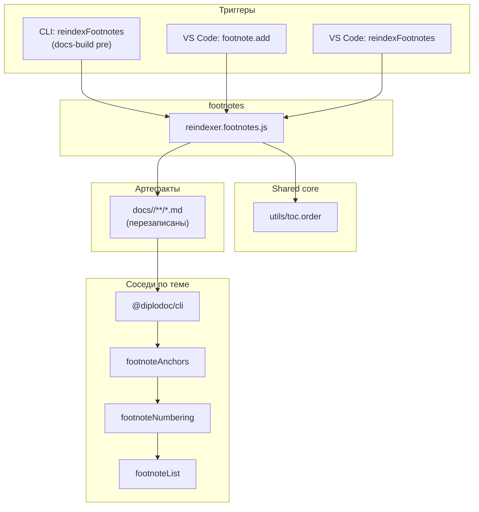

|               |                                                                                                                      |
| ------------- | -------------------------------------------------------------------------------------------------------------------- |
| ID            | [3.2-011](../../%D0%A1%D0%BE%D0%B3%D0%BB%D0%B0%D1%88%D0%B5%D0%BD%D0%B8%D1%8F/index.md#identifikaciya-modulej)        |
| Идентификатор | `footnotes`                                                                                                          |
| Наименование  | Сноски                                                                                                               |
| Слой          | [pre-processing](../%D0%A1%D0%BB%D0%BE%D0%B8layer/PreProcessing/index.md#naznachenie)                                  |
| Расположение  | `src/plugins/reindexer/reindexer.footnotes.js`                                                                       |
| Точка входа   | `reindexFootnotes(rootDir)`, `computeFootnoteRenumbering(text, startNumber)`, `applyFootnoteRenumbering(text, plan)` |
| Версия        | `1.54.0`                                                                                                             |
| Назначение    | Пересчитывает нумерацию сносок в `.md`-файлах и вставляет новые сноски с автоматическим сдвигом существующих         |

{: .page-legend }

## Назначение

Модуль `footnotes` — «исходная» часть работы со сносками: он правит **`.md`-файлы**, до того как `@diplodoc/cli` соберёт их в HTML. Отвечает за две операции:

1. **Добавление сноски** — вставляет `[^23]` в текст и `[^N]: <текст>` в блок определений, при необходимости сдвигая нумерацию всех последующих сносок в файле.
2. **Переиндексация** — пересчитывает нумерацию по порядку появления ссылок (`[^23]`). Убирает дубли определений, чистит «сиротские» определения (без ссылок), выравнивает блок определений по возрастанию номеров. По умолчанию работает **сквозно по всему проекту**: нумерация продолжается между файлами в порядке `toc.yaml`.

Работать со сносками в `.md` — значит обращаться с ними как с **позиционными** сущностями: номер сноски определяется её позицией в тексте, а не исходным идентификатором. Модуль реализует эту логику и на уровне одного файла (`computeFootnoteRenumbering` / `applyFootnoteRenumbering`), и на уровне проекта (`reindexFootnotes`).

Сноски в **HTML** (якоря, сквозная нумерация, сводный перечень) — задача других модулей: [`footnoteAnchors`](../МодульЯкоряСносок/index.md), [`footnoteNumbering`](../МодульСквознаянумерациясносок/index.md), [`footnoteList`](../МодульПереченьсносок/index.md). Этот модуль — только `.md`.

## Применение

**Когда использовать:** в статьях есть сноски (`[^24]`), и нужно, чтобы нумерация была корректной (пересчёт при вставке/удалении/перемещении).

**Когда НЕ использовать:** сносок нет; нужен только перечень — хватит `footnoteList` без `footnotes` (но нумерация может «съехать»).

**Альтернативы:**
- Ручная нумерация `[^25]` — ломается при вставке новой сноски в середину.
- Только `footnoteNumbering` — правит `.html`, но не `.md`; в исходнике номера останутся старыми.

**Типичный сценарий:** добавили сноску в середину — `docs-build.js` → `pre` → `reindexFootnotes` пересчитывает `[^25]` в `.md` по порядку в `toc.yaml`.

## Как это работает



### Модель данных

Сноска в `.md` — это две сущности:

- **ссылка** — <code>&lsqb;^3&rsqb;</code> в тексте (regex `\[\^([^26]\s]+)\](?!:)`);
- **определение** — <code>&lsqb;^N&rsqb;: текст</code> (regex `^\[\^([^26]\s]+)\]:[ \t]*(.*)$` в многострочном режиме).

`N` — идентификатор сноски в исходнике. Не обязательно число: допустим <code>&lsqb;^5&rsqb;</code>. Модуль умеет пересчитывать «в числа» (`1`, `2`, `3`, …), но если в исходнике смешаны числа и строки — все идентификаторы перенумеровываются по порядку появления первой ссылки на них.

### `computeFootnoteRenumbering(text, startNumber)`

Главная функция. Возвращает «план» изменений без записи на диск:

```js
{
    refs,           // исходные ссылки { id, index, length }
    defs,           // исходные определения { id, index, length, content }
    idToNewNumber,  // Map: старый id → новый номер
    newRefs,        // новые ссылки { id, originalId, index, length }
    newDefs,        // новые определения { id, originalId, index, length, content }
    reorderInfo,    // { canReorder, blockStart, blockEnd }
    changed,        // boolean — есть ли изменения
}
```

Логика:

1. **`idToNewNumber`** — по порядку первого появления в `refs`. `startNumber` — с какого числа начинать (для сквозной нумерации по проекту). Если `startNumber = 1` и в файле сноски появляются в порядке `b, a, c`, то `b → 1`, `a → 2`, `c → 3`.
2. **`newRefs`** — та же последовательность ссылок, но с новыми `id`. Если `originalId === id` — ссылка не требует правки, но в плане всё равно присутствует.
3. **`newDefs`** — определения, где:
   - `content: null` — «сиротское» определение (ссылки с таким id нет) → помечается к удалению;
   - повторное определение (`seenDefIds`) → `content: null`;
   - иначе — `content` сохраняется.
4. **`reorderInfo`** — определяет, можно ли переупорядочить **все** определения одним блоком (заменить диапазон целиком):
   - если `defs.length === 0` → `canReorder: false` (нечего переупорядочивать);
   - если `defs.length === 1` → `canReorder: true`, диапазон — это единственное определение;
   - если между определениями только пробелы/переводы строк → `canReorder: true`, диапазон — от первого до последнего;
   - если между определениями есть «мусор» (абзацы, код, ссылки) → `canReorder: false`, определения правятся по одному.
5. **`changed`** — вычисляется, есть ли хоть одно различие: `id` изменился, или `content === null`, или (при `canReorder`) порядок `numbers` не совпадает с сортированным.

### `applyFootnoteRenumbering(text, plan)`

Применяет план к тексту. Два сценария:

**Сценарий A — `reorderInfo.canReorder === true`.** Все определения — единым блоком:

<code>&lsqb;^6&rsqb;: Первая</code>
<code>&lsqb;^9&rsqb;: Третья</code>

Собираются `newDefs` с `content !== null`, сортируются по `Number(id)`, склеиваются через `\n`, заменяется диапазон `[blockStart, blockEnd)`.

**Сценарий B — `reorderInfo.canReorder === false`.** Правки по одной:

- определение-«сирота» (или дубль) — удаляется, включая следующий за ним `\r?\n`;
- определение с изменившимся `id` — заменяется `[^N]: content`.

**Применение.** Все правки сортируются по `index` по убыванию, затем применяются к строке через `slice`. Так индексы не «съезжают» от предыдущих замен.

### `analyzeDefBlock(text, defs)`

Вспомогательная функция — определяет, можно ли переупорядочивать блок определений целиком:

```js
if (defs.length === 0) return { canReorder: false, blockStart: 0, blockEnd: 0 };
if (defs.length === 1) {
    const d = defs[0];
    return { canReorder: true, blockStart: d.index, blockEnd: d.index + d.length };
}
// проверить, что между определениями только \s
```

Это нужно, чтобы не потерять содержимое, если между <code>&lsqb;^1&rsqb;: …</code> и <code>&lsqb;^2&rsqb;: …</code> вклинился текст (например, пользователь разнёс определения по разным местам файла).

### `reindexFootnotes(rootDir)`

Проектный уровень:

1. `collectMdFilesByToc(rootDir)` — список `.md` в порядке `toc.yaml` (из `utils/toc.order`). Если `toc.yaml` нет — обходом `docs/` без навигации.
2. `counter = 1`.
3. Для каждого файла: `computeFootnoteRenumbering(text, counter)`, `applyFootnoteRenumbering`, запись на диск.
4. `counter += plan.idToNewNumber.size` — сноски перетекают между файлами: файл 1 начал с 1, использовал 3 сноски → файл 2 начинает с 4.

Если `plan.changed === false` — файл не перезаписывается (`fs.writeFileSync` не вызывается).

### Файлы модуля

| Файл                                               | Ответственность                                                                                                                                                               |
| -------------------------------------------------- | ----------------------------------------------------------------------------------------------------------------------------------------------------------------------------- |
| `src/plugins/reindexer/reindexer.footnotes.js`     | Ядро: `extractFootnoteRefs`, `extractFootnoteDefs`, `computeFootnoteRenumbering`, `analyzeDefBlock`, `applyFootnoteRenumbering`, `reindexFootnotesInFile`, `reindexFootnotes` |
| `src/commands/diplodoc-helper.footnote.Add.js`     | VS Code команда «Добавить сноску» — использует `computeFootnoteRenumbering`                                                                                                   |
| `src/commands/diplodoc-helper.footnote.Reindex.js` | VS Code команда «Переиндексировать сноски» — обёртка над `reindexFootnotes`                                                                                                   |

### Формат сносок в `.md`

```md
Текст с обычной сноской[^27] и ещё одной[^28].

[^28]: Вторая сноска.
```

Требования:

- Ссылка: <code>&lsqb;^8&rsqb;</code>, где `<id>` — любые символы, кроме `]`, пробелов и перевода строки. Отрицательный lookahead `(?!:)` отличает ссылку от определения.
- Определение: `[^<id>]: текст` в начале строки (многострочный режим), с любым количеством пробелов/табов после двоеточия. **Одна строка** — многострочные определения не поддерживаются (`[^1]: первая строка\nвторая строка` — «вторая строка» останется как обычный текст).
- После переиндексации все `id` становятся числами (`1`, `2`, `3`, …), строковые идентификаторы теряются.

## Режимы работы

### VS Code

| Команда                            | Заголовок                | Где появляется                          |
| ---------------------------------- | ------------------------ | --------------------------------------- |
| `diplodoc-helper.footnote.add`     | Добавить сноску          | Редактор → контекстное меню (выделение) |
| `diplodoc-helper.reindexFootnotes` | Переиндексировать сноски | Explorer → Diplodoc → Индексация        |

**`footnote.add`**:

1. Проверяет активный редактор (markdown), наличие выделения.
2. Промпт на текст сноски (с валидацией непустоты).
3. `computeFootnoteRenumbering(fullText)` — строит план.
4. Считает новый номер: количество уникальных id в `refs`, у которых `index < selectionEnd` (то есть все сноски, встреченные **до** курсора).
5. Формирует пакет правок:
   - вставка `[^23]` сразу после выделения;
   - перенумерация всех ссылок, кроме тех, что **внутри** выделения;
   - блок определений — либо целиком (если `canReorder`), либо по одной (если нет);
   - если у файла вообще нет определений — дописывает в конец файла с префиксом `\n\n` (или `\n`, или без него, если файл уже кончается переводами строк).
6. Все правки — одним `editor.edit` с сортировкой по убыванию индекса.

**`reindexFootnotes`**:

1. `getLanguageRoot(uri.fsPath)` — определяет корень языка (родитель `docs/<lang>/`).
2. `withProgress('Переиндексация Diplodoc...')` → `reindexFootnotes(targetDir)`.
3. По результату — `showInformationMessage` («Сносок: N, изменено файлов: M») или `showWarningMessage` (при ошибке).

### CLI

```bash
node ./plugins/diplodoc-helper-cli.js reindexFootnotes --docsDir ./docs/ru
```

| Аргумент    | Обязателен | По умолчанию | Описание                                      |
| ----------- | ---------- | ------------ | --------------------------------------------- |
| `--docsDir` | нет        | `./docs`     | Корень языка (не `./docs`, а `./docs/<lang>`) |

В отличие от `abbrs`/`terms`/`gosts`, модуль работает только с **одним** языком за вызов. Чтобы обновить оба, нужно вызвать дважды — по числу языков в `docs/`.

Код возврата: `0` при успехе (модуль не проверяет `result.success` в CLI — только пишет лог).

### Сборочный пайплайн

В `docs-build.js`, фаза `pre`:

```js
cli('reindexFootnotes', '--docsDir', './docs/ru'),
```

Только для `ru` (не для `en`). Идёт после `reindexFigures`, до `helpMap`, `contexts`, `helptags`. Порядок в цепочке: сначала исправить нумерацию в `.md`, потом всё остальное, что читает эти `.md`.

Флаг `--skip=reindexFootnotes` — пропуск шага.

### Сквозная нумерация по проекту

`reindexFootnotes(rootDir)` использует `collectMdFilesByToc(rootDir)` — порядок файлов берётся из `toc.yaml` (рекурсивно через `include`), а не из `fs.readdirSync`. Это значит:

- Нумерация соответствует порядку чтения документации, а не файловой системе.
- Если файл **не** упомянут в `toc.yaml` — он не будет обработан (сноска останется с исходным номером).
- Если `toc.yaml` нет — fallback на обход `docs/` (без навигации, порядок непредсказуем, но стабилен для данной ОС).

## Юнит-тесты





## Связи

`footnotes` — «входная» часть темы «сноски». Работает исключительно с `.md` и не имеет пост-обработки. Его потребители — сам `@diplodoc/cli` (который парсит `[^23]` / `[^N]:` и рендерит в HTML) и последующие модули пост-обработки.

С `utils/toc.order` — единственная зависимость от `shared-core`, и то только в `reindexFootnotes` для порядка файлов. `computeFootnoteRenumbering` / `applyFootnoteRenumbering` — чистые функции над строкой, ни от чего не зависят.

С `footnoteAnchors` / `footnoteNumbering` — не пересекаются: `footnotes` работает в `.md`, они — в `.html`. Их порядок в `docs-build.js`:

1. `reindexFootnotes` (pre) — нумерация в `.md` по `toc.yaml`;
2. `@diplodoc/cli` — сборка;
3. `footnoteAnchors` (post) — фикс относительных якорей;
4. `footnoteNumbering` (post) — сквозная нумерация в `.html`;
5. `footnoteList` (post) — сводный перечень.

Модуль не пытается решать задачи пост-обработки. Даже если в `.md` нумерация уже сквозная, в `.html` Diplodoc заново нумерует сноски с 1 в каждом файле — это чинит `footnoteNumbering`, а не `footnotes`.






