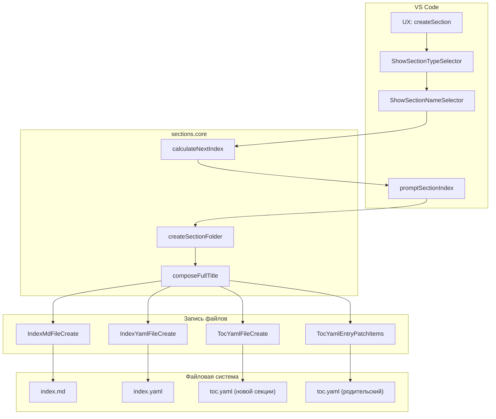
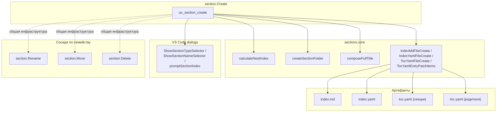

|               |                                                                                                                                                                 |
| ------------- | --------------------------------------------------------------------------------------------------------------------------------------------------------------- |
| ID            | [1.1-023](../../%D0%A1%D0%BE%D0%B3%D0%BB%D0%B0%D1%88%D0%B5%D0%BD%D0%B8%D1%8F/index.md#identifikaciya-modulej)                                                   |
| Идентификатор | `section.Create`                                                                                                                                                |
| Наименование  | Создание секции                                                                                                                                                 |
| Слой          | [vscode-ui](../%D0%A1%D0%BB%D0%BE%D0%B8layer/VsCodeUi/index.md#naznachenie) / [pre-processing](../%D0%A1%D0%BB%D0%BE%D0%B8layer/PreProcessing/index.md#naznachenie) |
| Расположение  | `src/commands/diplodoc-helper.section.Create.js`                                                                                                                |
| Точка входа   | `ux_section_create(uri)`                                                                                                                                        |
| Версия        | `1.54.0`                                                                                                                                                        |
| Назначение    | Создаёт папку-секцию с тремя файлами (`index.md`, `index.yaml`, `toc.yaml`) и добавляет запись в родительский `toc.yaml`                                        |

{: .page-legend }

## Назначение

`section.Create` — самая «пользовательская» из четырёх команд семейства `sections`. Пользователь кликает правой кнопкой на папке в Explorer, выбирает **Diplodoc → Создать секцию**, отвечает на три-четыре вопроса в диалогах — и в выбранной папке появляется новая подпапка с правильным именем (`Раздел1.Введение`, `Глава3.Настройка`) и полным набором файлов: `index.md` с frontmatter, `index.yaml` с описанием, `toc.yaml` с заголовком. Плюс в **родительский** `toc.yaml` добавляется запись со ссылкой на новую папку.

Без модуля для той же операции пришлось бы:

1. Вручную создать папку.
2. Вручную написать в ней `index.md` с полями `title`, `pureTitle`, `sectionType`, `sectionIndex`.
3. Вручную написать `index.yaml` с полями `title`, `description`, `meta.title`, `meta.sectionType`, `meta.noIndex`.
4. Вручную написать `toc.yaml` с `title` и `href: index.yaml`.
5. Открыть родительский `toc.yaml` и добавить `items` запись: `name`, `href`, `include.path`, `include.mode: link`.
6. Убедиться, что имя папки соответствует соглашению (`<Тип><Индекс>.<Название>`), а `sectionIndex` — следующий свободный в родителе.

Модуль делает всё это за один диалог, включая автоматический расчёт следующего индекса и корректное формирование имени папки. См. подробное описание каждого шага — в разделе «Как это работает».

## Применение

**Когда использовать:** нужно добавить новую секцию (раздел/главу/статью) в дерево документации — с автоматическим `index.md`, `index.yaml`, `toc.yaml` и записью в родительский `toc.yaml`.

**Когда НЕ использовать:** нужна одна статья без структуры — хватит обычного `.md`; массовое создание — лучше скрипт.

**Альтернативы:**
- Ручное создание папки + трёх файлов — 5–10 минут, ошибки в `sectionIndex`/`include`.
- `reindexer.directories` — пересчитывает уже существующие, не создаёт.

**Типичный сценарий:** в Explorer ПКМ на папке → **Diplodoc → Создать секцию** → тип → имя → индекс (предложен автоматически) → папка + три файла + запись в `toc.yaml`.

## Как это работает



### Фаза 1. Валидация родителя

```js
async function ux_section_create(uri) {
    if (!uri) return;
    const targetDir = uri.fsPath;

    if (!isDiplodocSection(targetDir) && !isLanguageRoot(targetDir)) {
        vscode.window.showErrorMessage(translate(nls_ts.plugin.section.create.error.incorrectSection));
        return;
    }
```

`uri` — папка, на которой кликнули в Explorer. Проверка:

- **`isDiplodocSection(targetDir)`** — папка содержит `index.md` + `index.yaml` + `toc.yaml` (полноценная секция). Создавать подсекцию можно;
- **`isLanguageRoot(targetDir)`** — папка содержит `toc.yaml`, но не `index.md` (корень языка, `docs/ru/` или `docs/en/`). Создавать секцию первого уровня можно.

Если **ни то, ни другое** (например, выбрана случайная папка `src/`, или `docs/` без языка, или подпапка секции без `toc.yaml`) — ошибка `"Раздел можно создать только внутри другого раздела или в корне папки языка."` и выход.

Если `uri` не передан (команда вызвана из палитры без выделения) — тихий `return` без сообщения. См. «Известные ограничения».

### Фаза 2. Диалоги

Три (или два) диалога, последовательно:

**1. `ShowSectionTypeSelector()`** — `QuickPick` со списком типов из `sectionTypes()` (`model/section.model.js`):

| `value` (label в UI) | `label` (в UI) | `name` (в frontmatter) | `description`                      |
| -------------------- | -------------- | ---------------------- | ---------------------------------- |
| `'Часть'`            | Часть          | `Part`                 | «Структурная единица руководства…» |
| `'Раздел'`           | Раздел         | `Section`              | «Крупная рубрика…»                 |
| `'Глава'`            | Глава          | `Chapter`              | «Крупная рубрика, имеющая…»        |
| `''`                 | Статья         | `Page`                 | —                                  |

Возвращает объект `{ value, label, name, description }` или `undefined` (пользователь закрыл). Если `undefined` — выход.

**2. `ShowSectionNameSelector()`** — `InputBox`:

- `prompt: 'Введите название подраздела'`
- `placeHolder: 'Например: Справочник Номенклатуры'`
- `validateInput: value => (isValidName(value) ? null : 'Некорректное имя')`

`isValidName` (из `utils/path.directory`):

```js
function isValidName(name) {
    if (!name || name.trim().length === 0) return false;
    if (name.length > 255) return false;
    return true;
}
```

То есть проверяется только непустота и длина. Спецсимволы (`<`, `>`, `:`, `"`, `/`, `\`, `|`, `?`, `*`) **не** отсеиваются — они попадут в `title`, `pureTitle`, а в имени папки `TEMPLATE_FOLDER_NAME` их вырежет (`replace(/[^29]/g, '')`). См. «Известные ограничения».

Если `undefined` — выход.

**3. `promptSectionIndex(sectionIndexCalculated)`** — `InputBox`, **только если** тип входит в `FrontMatterSectionTypesIndexed2` (`Part`, `Section`, `Chapter`; `Page` исключён):

```js
const hasIndex = FrontMatterSectionTypesIndexed2.includes(sectionType.name);
const sectionIndexCalculated = calculateNextIndex(targetDir);
const sectionIndex = hasIndex ? await promptSectionIndex(sectionIndexCalculated) : '';
```

`calculateNextIndex(targetDir)` (из `reindexer.md`):

- читает `targetDir/index.md` → `sectionIndex` родителя (`''` для корня языка, `'2'` для раздела 2);
- перебирает дочерние папки `targetDir`, читает `sectionIndex` каждой;
- берёт максимум последней части (`2.3` → `3`, `2.5` → `5`) и прибавляет 1;
- возвращает `${parentIndex}.${nextSubNumber}` или `${nextSubNumber}`.

Например: `targetDir = docs/ru/Раздел2.Архитектура` (родитель с `sectionIndex: 2`), дети: `2.1`, `2.2`. Возвращает `'2.3'`.

`promptSectionIndex` валидирует:

```js
if (!/^\d+(\.\d+)*$/.test(value)) return 'Индекс должен состоять из цифр и точек';
if (/\.\./.test(value) || value.split('.').some(part => part.length > 1 && part.startsWith('0'))) {
    return 'Некорректный формат индекса';
}
```

Пустая строка разрешена (`if (!value || value.trim() === '') return null;`) — пользователь может не указывать индекс, тогда `sectionIndex = ''` и папка создастся без индекса (`Раздел.Введение`).

Если `undefined` (пользователь закрыл) — **не** выход, а `sectionIndex = ''` (`?? ''` в `promptSection`). См. «Известные ограничения».

### Фаза 3. Создание папки

```js
const folderResult = createSectionFolder(targetDir, sectionType, userSectionName, sectionIndex, message => {
    vscode.window.showErrorMessage(message);
});
if (!folderResult) return;
```

`createSectionFolder` (из `diplodoc.flow.js`):

1. `folderName = TEMPLATE_FOLDER_NAME(sectionType, sectionName, sectionIndex)` — по правилам:
   - `sectionType.value` + `sectionIndex` + `'.'` + `sectionName.replace(/[^29]/g, '')`;
   - если `sectionType.value` нет — `sectionIndex + '.' + name`;
   - если `sectionIndex` нет — `sectionType.value + '.' + name`;
   - если ничего нет — `name`.
2. `newFolderPath = path.join(targetDir, folderName)`.
3. `createDirectory(canCreateFolder, newFolderPath, true, folderName, onError)`:
   - `canCreateFolder` проверяет, что папки ещё нет (`fs.existsSync`) и есть права на запись в родителя;
   - если папка уже есть — `onError('Путь уже существует: …')` и `return null`;
   - если прав нет — `onError('Нет прав на запись: …')`;
   - иначе — `fs.mkdirSync(newFolderPath, { recursive: true })`.

Возвращает `{ folderPath, folderName }` или `null`.

### Фаза 4. Формирование полного заголовка

```js
const fullTitle = composeFullTitle(sectionIndex, sectionType, userSectionName);
```

`composeFullTitle` (из `frontmatter.section.title.js`):

```js
function composeTitlePrefix(index, sectionType) {
    const hasPrefix = !!sectionType.value;
    const hasIndex = !!index;
    if (hasPrefix && hasIndex) return `${sectionType.value} ${index}. `;
    if (hasPrefix && !hasIndex) return sectionType.value;
    if (!hasPrefix && hasIndex) return `${index}. `;
    return '';
}
```

Примеры:

| `sectionType.value` | `sectionIndex` | `pureTitle` | `fullTitle`                              |
| ------------------- | -------------- | ----------- | ---------------------------------------- |
| `Раздел`            | `1`            | `Введение`  | `Раздел 1. Введение`                     |
| `Раздел`            | `''`           | `Введение`  | `РазделВведение` *(пробел не ставится!)* |
| `''` (статья)       | `'2.5'`        | `Настройка` | `2.5. Настройка`                         |
| `''`                | `''`           | `Настройка` | `Настройка`                              |

Ветка `hasPrefix && !hasIndex` (`'Раздел' + 'Введение'` → `'РазделВведение'`) — баг: пропущен пробел. См. «Известные ограничения».

### Фаза 5. Запись трёх файлов

```js
IndexMdFileCreate(folderResult.folderPath, userSectionName, sectionType.name, sectionType.value, sectionIndex);
IndexYamlFileCreate(folderResult.folderPath, userSectionName, sectionType.name, sectionType.value, sectionIndex);
TocYamlFileCreate(folderResult.folderPath, userSectionName, sectionType.value, sectionIndex);
TocYamlEntryPatchItems(targetDir, fullTitle, sectionType.value, folderResult.folderName, sectionIndex);
```

Все четыре — из `yaml.base.js`.

**`IndexMdFileCreate`**:

```js
const metaObj = {
    title: TEMPLATE_FINAL_TITLE(sectionValue, sectionIndex, title),
    sectionType: sectionType,
    pureTitle: title,
    sectionIndex: sectionIndex,
};
fs.writeFileSync(filePath, `---\n${YAML.stringify(metaObj)}---`, 'utf8');
```

`TEMPLATE_FINAL_TITLE` (из `frontmatter.templates.js`) — **другая** логика, чем `composeFullTitle`:

```js
function TEMPLATE_FINAL_TITLE(sectionValue, sectionIndex, title) {
    if (!sectionValue || sectionValue.trim() === '') return title;
    const leftPart = sectionIndex.trim().length === 0 ? sectionValue : `${sectionValue} ${sectionIndex.trim()}`;
    return `${leftPart}. ${title}`;
}
```

Для `hasPrefix && !hasIndex` (Раздел без индекса) даёт `'Раздел. Введение'` — с точкой. Это **не** совпадает с `composeFullTitle`, который для того же входа даёт `'РазделВведение'` (без точки). Расхождение. См. «Известные ограничения».

Итоговый `index.md` (пример для `Раздел 1. Введение`):

```md
---
title: Раздел 1. Введение
sectionType: Section
pureTitle: Введение
sectionIndex: "1"
---
```

**`IndexYamlFileCreate`**:

```js
const obj = {
    title: TEMPLATE_FINAL_TITLE(sectionValue, sectionIndex, title),
    description: `Описывает ${finalTitle}`,
    meta: {
        title: finalTitle,
        sectionType: sectionType,
        noIndex: true,
    },
};
```

Итоговый `index.yaml`:

```yaml
title: Раздел 1. Введение
description: Описывает Раздел 1. Введение
meta:
  title: Раздел 1. Введение
  sectionType: Section
  noIndex: true
```

**`TocYamlFileCreate`**:

```js
const obj = {
    title: TEMPLATE_FINAL_TITLE(sectionLabel, sectionIndex, title),
    href: 'index.yaml',
};
```

`toc.yaml` секции — минимален: `title` и `href` на `index.yaml` (не на `index.md`). Логика Diplodoc: `index.yaml` — «страница-раздел», `toc.yaml` в родителе включает её через `include.path: …/toc.yaml`, а внутри — `href` на `index.yaml`.

**`TocYamlEntryPatchItems`** — запись в **родительский** `toc.yaml`:

```js
const tocPath = path.join(parentDir, 'toc.yaml');
if (!fs.existsSync(tocPath)) return;
const fileContent = fs.readFileSync(tocPath, 'utf8');
let tocData = YAML.parse(fileContent) || {};
if (!tocData.items || !Array.isArray(tocData.items)) tocData.items = [];
const newItem = {
    name: sectionTitle,          // fullTitle
    href: `${folderName}/index.md`,
    include: {
        path: `${folderName}/toc.yaml`,
        mode: 'link',
    },
};
tocData.items.push(newItem);
fs.writeFileSync(tocPath, YAML.stringify(tocData), 'utf8');
```

Запись добавляется **в конец** массива `items`. Сортировка (по `sectionIndex`) — не выполняется. См. «Известные ограничения».

### Фаза 6. Сообщение

```js
vscode.window.showInformationMessage(
    translate(nls_ts.plugin.section.create.info.success, fullTitle, sectionType.label)
);
```

«Раздел «Раздел 1. Введение» (Раздел) создан!»

### Файлы модуля

| Файл                                             | Ответственность                                                                             |
| ------------------------------------------------ | ------------------------------------------------------------------------------------------- |
| `src/commands/diplodoc-helper.section.Create.js` | `ux_section_create` — оркестратор                                                           |
| `src/commands/vscode.prompts.js`                 | `ShowSectionTypeSelector`, `ShowSectionNameSelector`, `promptSectionIndex`, `promptSection` |
| `src/plugins/model/section.model.js`             | `sectionTypes()` — список типов                                                             |
| `src/plugins/model/frontmatter.model.js`         | `FrontMatterSectionTypesIndexed2` — какие типы индексируются                                |
| `src/plugins/reindexer/reindexer.md.js`          | `calculateNextIndex` — следующий индекс                                                     |
| `src/plugins/utils/diplodoc.flow.js`             | `createSectionFolder`                                                                       |
| `src/plugins/utils/yaml.base.js`                 | `IndexMdFileCreate`, `IndexYamlFileCreate`, `TocYamlFileCreate`, `TocYamlEntryPatchItems`   |
| `src/plugins/utils/frontmatter.section.title.js` | `composeFullTitle`                                                                          |
| `src/plugins/utils/path.directory.js`            | `isDiplodocSection`, `isLanguageRoot`, `isValidName`, `canCreateFolder`, `createDirectory`  |
| `src/plugins/model/frontmatter.templates.js`     | `TEMPLATE_FOLDER_NAME`, `TEMPLATE_FINAL_TITLE`                                              |

## Режимы работы

### VS Code

| Команда                         | Заголовок      | Где появляется                                          |
| ------------------------------- | -------------- | ------------------------------------------------------- |
| `diplodoc-helper.createSection` | Создать секцию | Explorer → Diplodoc → Создать секцию (только на папках) |

Условие появления (`when` в `package.json`): `explorerResourceIsFolder`. То есть команда видна **только** в контекстном меню папки, не файла и не пустого места.

### CLI

CLI-команды нет. Модуль — только VS Code.

### Сборочный пайплайн

В `docs-build.js` не участвует. Создание секций — интерактивная операция, не автоматизируемая.

## Юнит-тесты





## Связи

`section.Create` — «тонкая обёртка»: диалоги + последовательность вызовов функций из `sections.core` ([`Ядро секций`](../МодульЯдросоцифровок/index.md)). Сама команда не содержит логики записи, кроме `try/catch` и показа сообщений.

С другими командами семейства:

| Команда                                                    | Что общего с `section.Create`                                                                                |
| ---------------------------------------------------------- | ------------------------------------------------------------------------------------------------------------ |
| [`section.Rename`](../МодульПереименованиесекции/index.md) | Использует те же `yaml.base`-функции (`IndexMdFilePatch`, `IndexYamlEntryPatch`), но для существующей секции |
| [`section.Move`](../МодульПеремещениесекции/index.md)      | Использует `TocYamlEntry*`, но `Remove` + `InsertAtPosition`, а не `PatchItems`                              |
| [`section.Delete`](../%D0%A0%D0%B5%D0%B5%D1%81%D1%82%D1%80/%D0%9C%D0%BE%D0%B4%D1%83%D0%BB%D1%8C%D0%A3%D0%B4%D0%B0%D0%BB%D0%B5%D0%BD%D0%B8%D0%B5%D1%81%D0%B5%D0%BA%D1%86%D0%B8%D0%B8/index.md)       | Использует `TocYamlEntryRemove` (обратная операция к `TocYamlEntryPatchItems`)                               |

С [`reindexer.directories`](../МодульПереиндексация/index.md) — `calculateNextIndex` читает `sectionIndex` существующих дочерних папок. То есть `section.Create` **ожидает**, что уже существующие секции в родителе проиндексированы (`sectionIndex` заполнен). Если какая-то папка не проиндексирована — `calculateNextIndex` её проигнорирует, и новая секция может получить номер, занятый «забытой» папкой.






