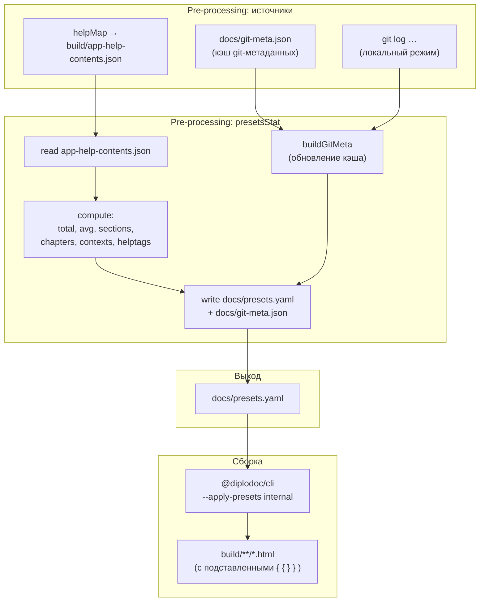
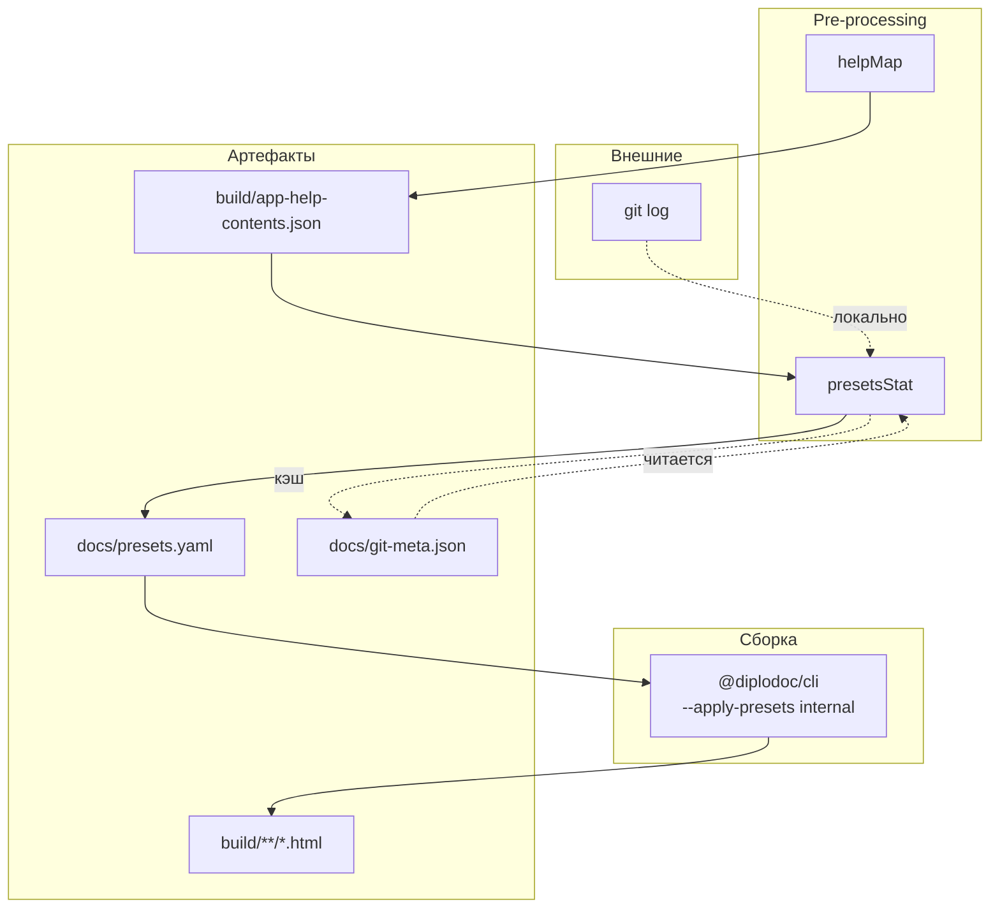

|               |                                                                                                                                   |
| ------------- | --------------------------------------------------------------------------------------------------------------------------------- |
| ID            | [8.2-018](../../%D0%A1%D0%BE%D0%B3%D0%BB%D0%B0%D1%88%D0%B5%D0%BD%D0%B8%D1%8F/index.md#identifikaciya-modulej)                     |
| Идентификатор | `presetsStat`                                                                                                                     |
| Наименование  | Статистика пресетов                                                                                                               |
| Слой          | [pre-processing](../%D0%A1%D0%BB%D0%BE%D0%B8layer/PreProcessing/index.md#naznachenie)                                               |
| Расположение  | `src/plugins/contentNavigator/Pagebuilder.Stats.js`                                                                               |
| Точка входа   | `generateStat({ outputDir, docsDir })`                                                                                            |
| Версия        | `1.54.0`                                                                                                                          |
| Назначение    | Собирает агрегированную статистику документации и генерирует `docs/presets.yaml` для подстановки переменных через `@diplodoc/cli` |

{: .page-legend }

## Назначение

`presetsStat` — единственный модуль семейства `contentNavigator`, который **не выдаёт HTML**. Он читает `app-help-contents.json` (создан [`helpMap`](../МодульКартапомощи/index.md)), вычисляет агрегаты (число статей, средний размер, число разделов и глав, уникальные контексты и helptags, git-метаданные) и пишет `docs/presets.yaml` — YAML-файл, из которого `@diplodoc/cli` **подставляет переменные** в статьи при сборке.

Зачем это нужно. В Diplodoc есть механизм «пресетов»: если в `.yfm` сборки передан `--apply-presets internal`, то в статьях работают подстановки вида <code>&#123;&#123; stats.total_articles &#125;&#125;</code> — берутся из `presets.yaml → internal → stats → total_articles`. Это позволяет писать в тексте «В руководстве N статей, средний размер M КБ» и не следить за цифрами вручную — они пересчитываются на каждой сборке.

Пример в статье:

```md
В руководстве {{ stats.total_articles }} статей общим объёмом около
{{ stats.avg_size }} байт. На чтение одной статьи в среднем уходит
{{ stats.reading_time }} мин. Последнее обновление: {{ stats.last_update }}.
```

После сборки с `--apply-presets internal` пользователь увидит реальные числа.

Модуль работает только в `pre-processing`: он читает `build/app-help-contents.json` (да, из **build** — это единственный случай, когда pre-обработчик читает артефакт будущей сборки) и пишет `docs/presets.yaml`. Клиентского скрипта, VS Code-команды и HTML у него нет.

## Применение

**Когда использовать:** в статьях используются подстановки <code>&#123;&#123; stats.* &#125;&#125;</code>, <code>&#123;&#123; about.* &#125;&#125;</code> — и вы хотите, чтобы цифры (объём, число статей, дата обновления) обновлялись автоматически при сборке.

**Когда НЕ использовать:** нет подстановок в статьях; не нужен `presets.yaml`.

**Альтернативы:**
- Вручную обновлять `presets.yaml` — забывается, рассинхронизируется.
- <code>&#123;&#123; stats.* &#125;&#125;</code> через <code>&#123;&#123; cut &#125;&#125;</code> — статичные значения, не обновляются.

**Типичный сценарий:** `docs-build.js` → `pre` → `helpMap` → `periodicStat` пишет `docs/presets.yaml` → `@diplodoc/cli --apply-presets internal` подставляет в HTML.

 ## Как это работает



### Фаза 1. Чтение `app-help-contents.json`

```js
const rawData = fs.readFileSync(STATS_JSON_PATH, 'utf8');
const articles = JSON.parse(rawData);
if (!Array.isArray(articles)) throw new Error(…);
```

`STATS_JSON_PATH = outputDir/app-help-contents.json`. Модуль ожидает, что `helpMap` уже отработал (в `docs-build.js` — идёт шаг `helpMap` → `periodicStat`, именно в этом порядке). Если файла нет — `try/catch` пишет в `console.error`, но не падает.

### Фаза 2. Агрегаты

Из массива `articles` считаются:

| Метрика          | Формула                                                | Пример                     |
| ---------------- | ------------------------------------------------------ | -------------------------- |
| `totalArticles`  | `articles.length`                                      | `487`                      |
| `totalSize`      | `Σ size`                                               | `3 242 218`                |
| `avgSizeNumeric` | `Σ size / totalArticles`                               | `12345`                    |
| `avgSize`        | `avgSizeNumeric.toLocaleString('ru-RU')`               | `"12 345"`                 |
| `readingTime`    | `Math.ceil(avgSizeNumeric / 2500)`                     | `5` (минут на одну статью) |
| `totalSections`  | `count(title matches /^Раздел\s+\d+/)`                 | `12`                       |
| `totalChapters`  | `count(title matches /^Глава\s+\d+/)`                  | `56`                       |
| `totalContexts`  | `unique(context.split(',').map(trim().toLowerCase()))` | `142`                      |
| `totalHelptags`  | `unique(helptag.split(',').map(trim().toLowerCase()))` | `38`                       |

`title` берётся из `articles[i].title` — это `data.title` или `data.pureTitle` из frontmatter статьи. Для «Раздел N …» сработает, если title именно так и сформирован (соглашение `reindexer`). Для статей внутри раздела title = «Модуль. …» — не сработает, что правильно.

`split(',')` для `context` и `helptag` — по запятой, `trim().toLowerCase()`. Пустые отбрасываются. Это **согласовано с `contextmap`**, но **не согласовано с `contexts.extractor.js`** (там `split(/[\s,]+/)`) — общая проблема семейства.

### Фаза 3. Git-метаданные (`buildGitMeta`)

```js
function buildGitMeta(docsDir) {
    const gitMetaPath = path.join(docsDir, 'git-meta.json');
    let gitMeta = {
        firstCommitDate: 'Январь 2025 г.',
        lastCommitHash: 'unknown',
        lastCommitDate: '',
    };
    if (fs.existsSync(gitMetaPath)) {
        gitMeta = JSON.parse(fs.readFileSync(gitMetaPath, 'utf8'));
    }

    const isCI = process.env.TF_BUILD || process.env.CI;
    if (!isCI) {
        // 1. git log --max-parents=0 --reverse -n 1
        // 2. git log -1 --format="%ad|%H"
        // 3. fs.writeFileSync(gitMetaPath, …) — обновление кэша
    } else {
        console.log('=== Сборка на CI: используем зафиксированные Git-данные ===');
    }

    return gitMeta;
}
```

Логика:

- **`docs/git-meta.json`** — кэш. Читается всегда. Формат: `{ firstCommitDate, lastCommitHash, lastCommitDate }`.
- **Локально** (нет `CI` или `TF_BUILD` в env) — кэш **обновляется** через `git log` и **записывается обратно**.
- **В CI** — кэш **только читается**. Предполагается, что разработчик запускает локальную сборку перед коммитом, `git-meta.json` попадает в git, и CI использует зафиксированные данные. Так сборки воспроизводимы.

Форматы дат:

| Поле              | Команда git                                                                    | Формат                              | Пример             |
| ----------------- | ------------------------------------------------------------------------------ | ----------------------------------- | ------------------ |
| `firstCommitDate` | `git log --max-parents=0 --reverse -n 1 --format=%ad --date=format:"%d.%m.%Y"` | `дд.мм.гггг`                        | `15.03.2024`       |
| `lastCommitDate`  | `git log -1 --format="%ad                                                      | %H" --date=format:"%d.%m.%Y %H:%M"` | `дд.мм.гггг чч:мм` | `23.10.2026 14:35` |
| `lastCommitHash`  | тот же `%H`                                                                    | `40-hex`                            | `a1b2c3d4…`        |

Если `git` недоступен (нет репозитория, нет прав, git не установлен) — `getGitInfo` возвращает `null`, все попытки `if (firstDate) …` тихо пропускаются, кэш остаётся прежним (или дефолтным).

### Фаза 4. Запись `presets.yaml`

```js
const generateBlock = () => `
    about:
        author: "${stubAuthor}"
        start_date: "${startDate}"
        version: "${stubVersion}"
    stats:
        total_articles: "${totalArticles}"
        avg_size: "${avgSize}"
        reading_time: "${readingTime}"
        total_sections: "${totalSections}"
        total_chapters: "${totalChapters}"
        total_contexts: "${totalContexts}"
        total_tags: "${totalHelptags}"
        last_update: "${lastCommitDate}"
        commit_hash: "${lastCommitHash}"
`.trimEnd();

const yamlContent = `# Автоматически сгенерированные переменные. Не редактировать вручную.
default:
${generateBlock()}

internal:
${generateBlock()}
`;
```

Обе секции (`default` и `internal`) содержат **идентичный** контент — они формируются одним вызовом `generateBlock()`.

`stubAuthor` и `stubVersion` — **захардкожены**:

```js
const stubAuthor = '[Вавренюк Виктор Андреевич](mailto:vavrenyuk@ascon.by)';
const stubVersion = '1.4';
```

Финальный `presets.yaml` (пример):

```yaml
# Автоматически сгенерированные переменные. Не редактировать вручную.
default:
    about:
        author: "[Вавренюк Виктор Андреевич](mailto:vavrenyuk@ascon.by)"
        start_date: "15.03.2024"
        version: "1.4"
    stats:
        total_articles: "487"
        avg_size: "12 345"
        reading_time: "5"
        total_sections: "12"
        total_chapters: "56"
        total_contexts: "142"
        total_tags: "38"
        last_update: "23.10.2026 14:35"
        commit_hash: "a1b2c3d4…"

internal:
    about:
        author: "[Вавренюк Виктор Андреевич](mailto:vavrenyuk@ascon.by)"
        start_date: "15.03.2024"
        version: "1.4"
    stats:
        total_articles: "487"
        …
```

**Все значения — строки** (в двойных кавычках), потому что пишутся через `"${...}"`. Даже числа, `reading_time`, `version`. При подстановке в статье это неважно (рендерится как текст), но если кто-то использует `presets.yaml` программно — надо помнить, что `total_articles` — `"487"`, а не `487`.

### Файлы модуля

| Файл                                                | Ответственность                              |
| --------------------------------------------------- | -------------------------------------------- |
| `src/plugins/contentNavigator/Pagebuilder.Stats.js` | `generateStat`, `buildGitMeta`, `getGitInfo` |

Один файл. Зависимостей от `Pagebuilder.common` и `core-renderer` **нет** — это самостоятельный модуль, случайно оказавшийся в папке `contentNavigator`.

### Кто использует `presets.yaml`

`@diplodoc/cli` при сборке (см. `docs-build.js`, фаза `build`):

```js
npx(
    'diplodoc build',
    '@diplodoc/cli',
    '-i', './docs',
    '-o', './build',
    '--allow-custom-resources',
    '--apply-presets', 'internal',
    '--quiet'
),
```

Флаг `--apply-presets internal` говорит Diplodoc: «подстановки <code>&#123;&#123; var &#125;&#125;</code> в статьях берутся из `presets.yaml → internal`». Без этого флага Diplodoc либо не подставляет ничего, либо берёт `default` (зависит от версии — в текущей конфигурации используется именно `internal`).

Если в статье встретится <code>&#123;&#123; stats.total_articles &#125;&#125;</code>, а в `presets.yaml → internal → stats` нет такого ключа — Diplodoc выдаст warning (`Variable … not found`), который мы уже обсуждали в «Соглашениях» (способ обхода через `<code>&#123;&#123; … &#125;&#125;</code>`).

## Режимы работы

### CLI

```bash
node ./plugins/diplodoc-helper-cli.js periodicStat
```

| Аргумент      | Обязателен | По умолчанию | Описание                                                           |
| ------------- | ---------- | ------------ | ------------------------------------------------------------------ |
| `--docsDir`   | нет        | `./docs`     | Корень документации (куда писать `presets.yaml` и `git-meta.json`) |
| `--outputDir` | нет        | `./build`    | Корень сборки (откуда читать `app-help-contents.json`)             |

Команда называется `periodicStat` — «периодическая статистика». Как и `periodicTable*` у соседей, историческое имя.

Код возврата: `0` всегда (ошибки ловятся `try/catch` и выводятся в `console.error`, `process.exitCode` не устанавливается).

### Сборочный пайплайн

В `docs-build.js`, фаза `pre`:

```js
cli('helpMap'),
cli('tocCleanMode'),
cli('periodicStat'),
cli('contexts'),
…
```

Порядок критичен:

- **`helpMap`** должен идти **до** `periodicStat` — иначе `app-help-contents.json` не существует, и `presetsStat` тихо ничего не сделает.
- **`periodicStat`** должен идти **до** `@diplodoc/cli` (фаза `build`) — иначе `presets.yaml` не попадёт в сборку.

Пропускается флагом `--skip=periodicStat`.

### VS Code

**Собственной команды нет.** И это осознанно: `presets.yaml` не нужно пересобирать при каждом редактировании статьи — достаточно на полной сборке (`docs-build.js`). Даже `diplodoc-helper.generateContextmap` (Debug-команда, генерирующая три HTML-отчёта) **не** вызывает `periodicStat`.

То есть пользователь VS Code не может «нажать кнопку» и обновить `presets.yaml`. Только через `npm run build` или CLI в терминале.

## Юнит-тесты





## Связи

`presetsStat` стоит **между** `helpMap` (pre) и `@diplodoc/cli` (build). Его вход — артефакт `helpMap` (`app-help-contents.json`), его выход — артефакт для сборки (`presets.yaml`).

Отличие от других `contentNavigator`-отчётов:

| Модуль            | Вход                         | Выход                     | Слой    |
| ----------------- | ---------------------------- | ------------------------- | ------- |
| `bytescounter`    | `app-help-contents.json`     | `build/bytescounter.html` | post    |
| `contextmap`      | `app-help-contents.json`     | `build/contextmap.html`   | post    |
| `helptagmap`      | `app-help-contents.json`     | `build/helptagmap.html`   | post    |
| **`presetsStat`** | **`app-help-contents.json`** | **`docs/presets.yaml`**   | **pre** |

`presetsStat` — единственный в семействе, кто пишет **не в `build/`, а в `docs/`**. И единственный, кто работает **до** `@diplodoc/cli`, а не после.

**Общее с `helpMap`**: и `helpMap`, и `presetsStat` читают `docs/`, агрегируют данные и пишут артефакт. Разница — `helpMap` пишет JSON для потребителей (в т.ч. `presetsStat`), а `presetsStat` пишет YAML для `@diplodoc/cli`. Оба друг от друга не зависят напрямую, кроме этой цепочки данных.

**Зависимость от `git`.** `presetsStat` — единственный модуль расширения, который вызывает `git` через `child_process.execSync`. Все остальные работают с файловой системой и `vscode`-API.

**Зависимость от `docs/git-meta.json`** — единственный файл, который `presetsStat` читает **и пишет** в `docs/` (кроме `presets.yaml`). То есть `presetsStat` создаёт **два** файла в `docs/`:
1. `docs/presets.yaml` — основной артефакт;
2. `docs/git-meta.json` — кэш git-метаданных (обновляется только локально).

Оба файла должны быть либо в `.gitignore`, либо закоммичены (второй — специально, для воспроизводимости сборок на CI).






