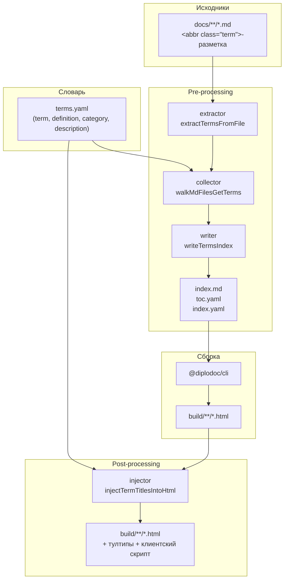
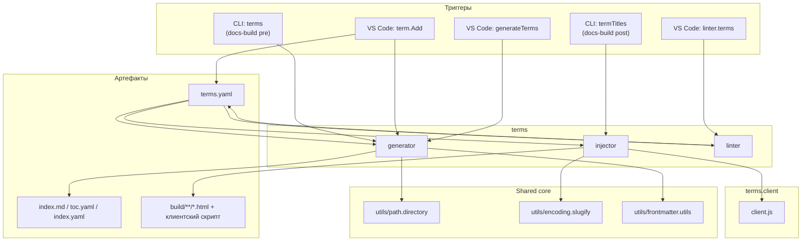

|               |                                                                                                                                                                             |
| ------------- | --------------------------------------------------------------------------------------------------------------------------------------------------------------------------- |
| ID            | [3.2-005](../../%D0%A1%D0%BE%D0%B3%D0%BB%D0%B0%D1%88%D0%B5%D0%BD%D0%B8%D1%8F/index.md#identifikaciya-modulej)                                                               |
| Идентификатор | `terms`                                                                                                                                                                     |
| Наименование  | Термины                                                                                                                                                                     |
| Слой          | [pre-processing](../%D0%A1%D0%BB%D0%BE%D0%B8layer/PreProcessing/index.md#naznachenie) / [post-processing](../%D0%A1%D0%BB%D0%BE%D0%B8layer/PostProcessing/index.md#naznachenie) |
| Расположение  | `src/plugins/terms/`                                                                                                                                                        |
| Точка входа   | `runGeneration(docsRoot)` (генератор), `runGeneration({ buildDir, docsRoot })` (инжектор), `lintTerms(docsRoot)` (линтер)                                                   |
| Версия        | `1.54.0`                                                                                                                                                                    |
| Назначение    | Ведёт словарь терминов, строит страницу-указатель и обогащает разметку `<abbr class="term">` определениями                                                                  |

{: .page-legend }

## Назначение

Модуль `terms` — структурный «двойник» `abbrs`, но со своей зоной разметки: он работает исключительно с `<abbr class="term">`, а всё «простое» `<abbr>` без класса оставляет `abbrs`. Разделение придумано для того, чтобы в одной и той же статье могли соседствовать аббревиатуры (сокращения) и термины (полноценные понятия с определениями) — не пересекаясь ни в словаре, ни в шаблонах, ни в клиентских CSS-классах.

Модуль даёт:

- **словарь** — YAML (`terms.yaml`) с полями `term`, `definition`, `category`, `description`;
- **разметку в статьях** — `<abbr class="term" data-term="…">`, с опциональным `data-term` для случаев, когда видимое слово отличается от канонического термина;
- **страницу-указатель** — генерируется из словаря + обхода `docs/`, с алфавитной навигацией, определениями и вхождениями под ``;
- **тултипы в готовом HTML** — на этапе пост-обработки каждый `<abbr class="term">` получает определение и ссылку на анкор страницы-указателя;
- **линтер** — проверяет, что каждый `<abbr class="term">` определён в словаре.

Клиентская часть (сворачивание длинных списков вхождений, позиционирование тултипов) — в отдельной статье: [Модуль. Клиент терминов](../../Модули/МодульКлиентатерминов/index.md).

## Применение

**Когда использовать:** в документации есть термины с определениями (`Абстракция`, `Онтология`, `Номенклатура`) — и читателю нужно видеть определение во всплывающей подсказке + единый глоссарий.

**Когда НЕ использовать:** сокращения (это `abbrs`); термины без определений (это просто слова в тексте).

**Альтернативы:**
- Сноска на глоссарий вручную — не масштабируется, нет тултипов.
- `<abbr title="определение">` — inline, но без страницы-указателя.

**Типичный сценарий:** `<abbr class="term">Абстракция</abbr>` в тексте → **Diplodoc → Термин: вставить / создать** → определение + категория → `generateTerms` → `termTitles` в `post` → `terms.client` рисует тултипы.

## Как это работает



**Pre-processing** (генерация страницы-указателя):

1. **Словарь.** `loadTermDictionary(langDir)` читает `terms.yaml`; ключ — `term`. Все записи попадают в `termMap` с `definedInDictionary: true`.
2. **Извлечение.** `extractTermsFromFile` маскирует код-блоки и находит `<abbr>` **только с `class="term"`**. Ключ — `data-term` или видимый текст. Возвращает `{ title, href, occurrences }`.
3. **Сбор.** `walkMdFilesGetTerms` обходит `langDir`, пропускает `SKIP_DIRS` (`terms`, `abbrs`, `contexts`, `helptags`, `figures`, `roadmap`) и собственную выходную папку модуля.
4. **Запись.** `writeTermsIndex` собирает `index.md`: frontmatter `title: Список терминов`, баннер «Нет в словаре» (если `showWarnings: true`), разделы `## БУКВА`, записи вида `<strong id="term-slug">ТЕРМИН</strong> — Определение`, список вхождений под ``.

**Post-processing** (тултипы):

5. `injectTermTitlesIntoHtml` читает `terms.yaml`, маскирует `<code>`/`<pre>` и заменяет каждый `<abbr class="term">` на `<div class="dl-term">` с тултипом и стабильным `id` (`term-slug-N`). Аббревиатуры без `class` не трогаются — их оставляем `abbrs.injector`.
6. В каждую HTML-страницу инжектится клиентский скрипт `terms.client.js` (см. отдельную статью).

### Файлы модуля

| Файл                                  | Ответственность                                                                                                                                                    |
| ------------------------------------- | ------------------------------------------------------------------------------------------------------------------------------------------------------------------ |
| `terms.js`                            | `runGeneration(docsRoot)` — генератор страницы-указателя                                                                                                           |
| `terms.collector.js`                  | `walkMdFilesGetTerms` — обход `docs/`                                                                                                                              |
| `terms.extractor.js`                  | `extractTermsFromFile`, `extractDataTerm`                                                                                                                          |
| `terms.dictionary.js`                 | `loadTermDictionary`, `getTermDictionaryPath`                                                                                                                      |
| `terms.dictionary.writer.js`          | `appendTermToDictionary` — запись в YAML с сортировкой                                                                                                             |
| `terms.writer.js`                     | `writeTermsIndex` — рендер `index.md`                                                                                                                              |
| `terms.injector.js`                   | `injectTermTitlesIntoHtml`, `runGeneration({ buildDir, docsRoot })`                                                                                                |
| `terms.linter.js`                     | `lintTerms(docsRoot)`                                                                                                                                              |
| `terms.model.js`                      | `termAnchorId`, `termOccurrenceId`                                                                                                                                 |
| `terms.paths.js` + `terms.paths.yaml` | путь к папке модуля по языкам                                                                                                                                      |
| `terms.template.js` + `templates/*`   | MD-шаблоны `cut.md`, `entry.md`, `letter.md`, `occ.line.md`, `occ.link.md`, `occ.list.md`, `frontmatter.md`, `unused.md`, `entry.undefined.md`, `entry.warning.md` |
| `terms.textRange.js`                  | `findTermAroundOffset` — поиск `<abbr class="term">` под курсором                                                                                                  |
| `terms.config.js`                     | `showWarnings`, `showUnused`, `usageCutTitle`, `usageVisibleCount`                                                                                                 |
| `shared/*`                            | общие с `abbrs`: маскирование кода, модель анкоров, шаблонизатор, `findAroundOffset`                                                                               |

### Формат `terms.yaml`

```yaml
# ── А ──

- term: "Абстракция"
  definition: |-
    Отвлечённое понятие, образуемое в результате отвлечения
    от несущественных сторон и признаков предметов
  category: "philosophy"
  description: |-
    См. также [Инкапсуляция](../ООП/index.md)

# ── О ──

- term: "Онтология"
  definition: |-
    Учение о сущем
  category: "philosophy"
```

| Поле          | Обязательность | Комментарий                                              |
| ------------- | -------------- | -------------------------------------------------------- |
| `term`        | да             | Уникальный ключ (проверяется в `appendTermToDictionary`) |
| `definition`  | да             | Определение; допускает markdown-ссылки                   |
| `category`    | нет            | Группировка в словаре (в индексе не отображается)        |
| `description` | нет            | Дополнительное описание — попадает в тултип              |

### Разметка в статьях

```md
Термин <abbr class="term">Абстракция</abbr> — ключевое понятие.

<!-- если видимое слово отличается от канонического термина -->
<abbr class="term" data-term="Абстракция">абстракций</abbr>
```

`class="term"` — единственный признак, по которому модуль отличает «свои» теги от аббревиатур. `<abbr>` без `class` (или с другим `class`) `terms` игнорирует.

## Режимы работы

### VS Code

| Команда                         | Заголовок                        | Где появляется                           |
| ------------------------------- | -------------------------------- | ---------------------------------------- |
| `diplodoc-helper.term.Add`      | Термин: вставить / создать       | Редактор → контекстное меню (выделение)  |
| `diplodoc-helper.generateTerms` | Термины: собрать/обновить список | Explorer → Diplodoc → Прочее → Термины   |
| `diplodoc-helper.linter.terms`  | Термины: проверить определения   | Explorer → Diplodoc → Очистка и проверки |

**`term.Add`** работает так же, как `abbr.Add`: создать / вставить из словаря / снять разметку.

**Code actions** (лампочка в `.md`): показать определение, добавить в словарь, снять разметку, обернуть выделение, обернуть слово.

### CLI

Генерация страницы-указателя:

```bash
node ./plugins/diplodoc-helper-cli.js terms --docsDir ./docs
```

| Аргумент    | Обязателен | По умолчанию | Описание            |
| ----------- | ---------- | ------------ | ------------------- |
| `--docsDir` | нет        | `./docs`     | Корень документации |

Инъекция тултипов:

```bash
node ./plugins/diplodoc-helper-cli.js termTitles --docsDir ./docs --outputDir ./build
```

| Аргумент      | Обязателен | По умолчанию | Описание            |
| ------------- | ---------- | ------------ | ------------------- |
| `--docsDir`   | нет        | `./docs`     | Корень документации |
| `--outputDir` | нет        | `./build`    | Корень сборки       |

### Сборочный пайплайн

В `docs-build.js` — два шага: `terms` (pre) и `termTitles` (post). Пропускаются флагами `--skip=terms` / `--skip=termTitles`.

## Юнит-тесты





## Связи

Модуль `terms` живёт в двух слоях: `pre-processing` (генератор) и `post-processing` (инжектор). С клиентом (`terms.client`) общается через готовую HTML-разметку. Общие с `abbrs` утилиты (`terms/shared/*` — идентичная копия `abbrs/shared/*`) не связывают модули в рантайме. Ключевое отличие от `abbrs`: `terms` работает с `<abbr class="term">`, `abbrs` — с `<abbr>` без `class`.






