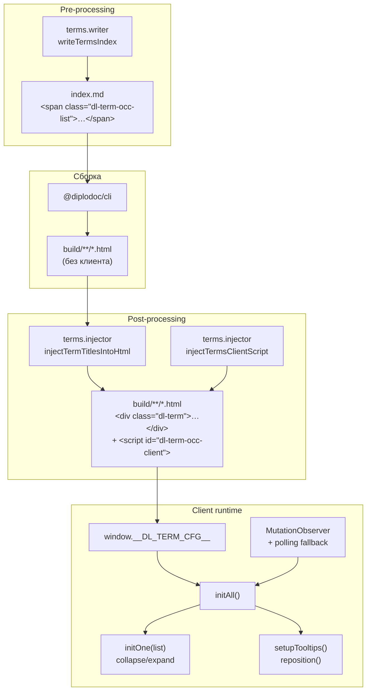
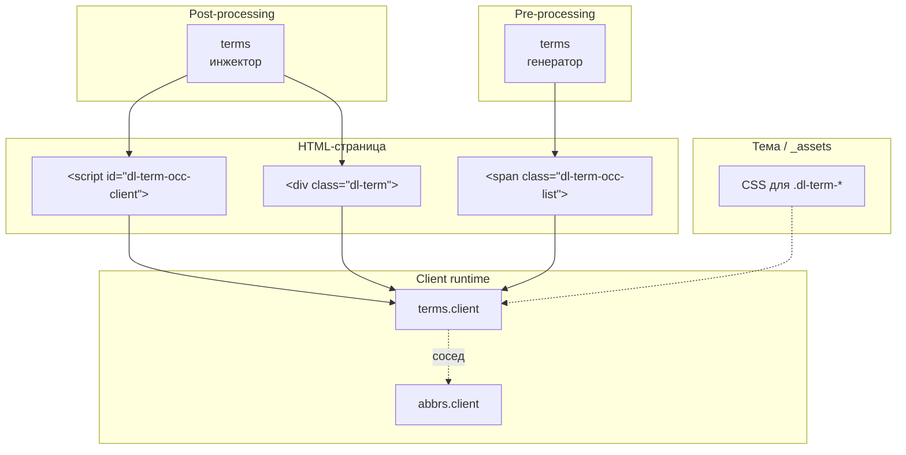

|               |                                                                                                               |
| ------------- | ------------------------------------------------------------------------------------------------------------- |
| ID            | [3.2-006](../../%D0%A1%D0%BE%D0%B3%D0%BB%D0%B0%D1%88%D0%B5%D0%BD%D0%B8%D1%8F/index.md#identifikaciya-modulej) |
| Идентификатор | `terms.client`                                                                                                |
| Наименование  | Клиент терминов                                                                                               |
| Слой          | [Клиентский runtime](../../%D0%A1%D0%BB%D0%BE%D0%B8layer/%D0%A1%D0%BB%D0%BE%D0%B9%D0%9A%D0%BB%D0%B8%D0%B5%D0%BD%D1%82%D1%81%D0%BA%D0%B8%D0%B9runtime/index.md#naznachenie)                           |
| Каталог       | [Терминология](../../%D0%9A%D0%B0%D1%82%D0%B0%D0%BB%D0%BE%D0%B3Capabilitymap/%D0%9A%D0%B0%D1%82%D0%B0%D0%BB%D0%BE%D0%B3%D0%A2%D0%B5%D1%80%D0%BC%D0%B8%D0%BD%D0%BE%D0%BB%D0%BE%D0%B3%D0%B8%D1%8F/index.md#terminologiya)                                                                                                                                                                                |
| Семейство     | [Термины](../../%D0%A1%D0%B5%D0%BC%D0%B5%D0%B9%D1%81%D1%82%D0%B2%D0%BEfamily/%D0%A1%D0%B5%D0%BC%D0%B5%D0%B9%D1%81%D1%82%D0%B2%D0%BE%D0%A2%D0%B5%D1%80%D0%BC%D0%B8%D0%BD%D1%8B/index.md#fam-term)                                                                                                                                                                                |
| Расположение  | `src/plugins/terms/terms.client.js`                                                                           |
| Точка входа   | IIFE при загрузке страницы (после инъекции `<script id="dl-term-occ-client">`)                                |
| Версия        | `1.54.0`                                                                                                      |
| Назначение    | Оживляет разметку терминов в браузере: сворачивает длинные списки вхождений и позиционирует тултипы           |

{: .page-legend }

## Назначение

`terms.client` — клиентская половина модуля `terms`. Пока `terms` (генератор + инжектор) готовит страницу-указатель и обогащает `<abbr class="term">` определениями, `terms.client` доводит эту разметку до интерактивного состояния в браузере читателя:

- **сворачивает длинные списки вхождений** — под каждым `` показывает первые `usageVisibleCount` ссылок `[N]`, остальные скрывает за кнопкой «ещё N» / «свернуть»;
- **позиционирует тултипы** — у каждого `<div class="dl-term">` есть `<abbr>` (триггер) и плавающая подсказка `.dl-term-tip`; клиент вычисляет координаты так, чтобы подсказка не выходила за границы окна, и переключает её между «сверху» и «снизу»;
- **переживает динамический рендер** — Diplodoc строит DOM из `diplodoc-state` уже после `DOMContentLoaded`, поэтому клиент инициализирует разметку не однократно, а по `MutationObserver` + коротким polling'ом.

По структуре модуль зеркалит `abbrs.client`, но живёт в своём namespace (классы `dl-term-*`, атрибуты `data-dl-term-*`, конфиг `window.__DL_TERM_CFG__`). Оба клиента инициализируются независимо — на одной странице могут работать одновременно, каждый на своей разметке.

Сам по себе модуль бесполезен: без `terms.injector` в HTML нет ни `<script id="dl-term-occ-client">`, ни `<div class="dl-term">`. И без `terms` (генератора) нет страницы-указателя со списками вхождений.

## Применение

**Когда использовать:** всегда вместе с [`terms`](../МодульТермины/index.md) — без клиента определения не показываются, списки вхождений не сворачиваются.

**Когда НЕ использовать:** отдельно от `terms` не имеет смысла.

**Альтернативы:**
- `<abbr class="term" title="…">` — inline-override через `title`, без словаря и без клиента. Работает, но не масштабируется.

**Типичный сценарий:** `terms.injector` встраивает `<script id="dl-term-occ-client">` → клиент находит `.dl-term` → показывает тултип при наведении → сворачивает длинные списки вхождений.

## Как это работает



### Фаза 1. Инъекция

`terms.injector.js` (`injectTermsClientScript`) вставляет в `</body>`:

```html
<script id="dl-term-occ-client">
window.__DL_TERM_CFG__ = {"visible": 10, "more": "ещё", "collapse": "свернуть"};
/* …тело terms.client.js… */
</script>
```

Маркер `id="dl-term-occ-client"` — единственный признак идемпотентности. Конфиг собирается из `terms.config.js` (`usageVisibleCount`) и языка: «ещё»/«свернуть» для `ru`, `'more'`/`'collapse'` — для остальных.

### Фаза 2. Инициализация

1. **`initAll()`** — обходит все `.dl-term-occ-list` (вызывает `initOne`), затем `setupTooltips()`. Возвращает число найденных списков.
2. **Polling-fallback** — если `initAll()` вернул `0`, до 120 попыток с интервалом 250 мс (около 30 с), пока не появится первый список.
3. **MutationObserver** — подписка на `document.body`, при изменениях вызывает `initAll()` заново.

### Фаза 3. Сворачивание списков (`initOne`)

Для каждого `.dl-term-occ-list`:

1. Если `data-dl-term-init="1"` — выход.
2. Собирает `.dl-term-occ` (ссылки `[N]`).
3. Если `links.length <= VISIBLE` — помечает последнюю видимую классом `dl-term-occ-last`, ставит маркер, выходит.
4. Иначе — навешивает `dl-term-occ-hidden` с индекса `VISIBLE`, создаёт кнопку `.dl-term-occ-more` («ещё N»), по клику переключает и меняет текст на `collapse` («свернуть»).

### Фаза 4. Тултипы (`setupTooltips`)

Отличия от `abbrs.client`:

- **подписка на `window.scroll`** — `terms.client` пересчитывает позицию при скролле (`window.addEventListener('scroll', reposition, { passive: true })`). У `abbrs.client` этого нет (там тултип `position: fixed` и пересчёта при скролле не требуется — но фактически у `terms` тултип тоже должен быть `fixed`... если это не так, поведение стоит унифицировать);
- **порог `getBoundingClientRect()`** — идентичен: скрываем в `-9999px`, вычисляем `left`/`top`, при переполнении переключаем `data-placement="bottom"`.

Для каждого `.dl-term`:

1. Если `data-dl-term-tip="1"` — выход.
2. Находит `abbr` (триггер) и `.dl-term-tip` (подсказку).
3. Вешает `mouseenter` на `wrap` и `focusin` на `abbr`; дополнительно `window.scroll` → `reposition`.
4. `reposition()` — как в `abbrs.client`: скрыть, измерить, посчитать `left` / `top`, переключить `data-placement`, записать `--dl-term-arrow-left`, показать обратно.
5. Ставит `data-dl-term-tip="1"`.

### Классы и data-атрибуты

Контракт между инжектором и клиентом:

| Класс / атрибут           | Источник                          | Назначение                          |
| ------------------------- | --------------------------------- | ----------------------------------- |
| `dl-term`                 | инжектор (`renderTooltipHtml`)    | Обёртка тултипа                     |
| `dl-term-tip`             | инжектор                          | Сама подсказка                      |
| `dl-term-occ-list`        | `writeTermsIndex` (`occ.list.md`) | Обёртка списка ссылок `[N]`         |
| `dl-term-occ`             | `writeTermsIndex` (`occ.link.md`) | Ссылка на конкретное вхождение      |
| `dl-term-occ-hidden`      | клиент                            | Скрытая ссылка (после `VISIBLE`)    |
| `dl-term-occ-last`        | клиент                            | Последняя видимая ссылка (для CSS)  |
| `dl-term-occ-more`        | клиент                            | Кнопка «ещё/свернуть»               |
| `data-dl-term-init`       | клиент                            | Маркер «список инициализирован»     |
| `data-dl-term-tip`        | клиент                            | Маркер «тултип инициализирован»     |
| `data-placement`          | клиент                            | `top` / `bottom` — сторона тултипа  |
| `--dl-term-arrow-left`    | клиент                            | CSS-переменная — позиция стрелки    |
| `id="dl-term-occ-client"` | инжектор                          | Маркер «клиентский скрипт вставлен» |

### Файлы модуля

| Файл              | Ответственность                                                                          |
| ----------------- | ---------------------------------------------------------------------------------------- |
| `terms.client.js` | Весь клиент: `initOne`, `setupTooltips`, `initAll`, polling-fallback, `MutationObserver` |

CSS — вне модуля, подключается темой Diplodoc или отдельным файлом `_assets/`. См. «Известные ограничения».

## Режимы работы

### Клиентский runtime

Собственной точки запуска нет — ни VS Code-команды, ни CLI-шага. Исполняется как часть HTML-страницы, куда его вставил `terms.injector` (функция `injectTermsClientScript`).

Проверка в DevTools:

```js
document.getElementById('dl-term-occ-client')      // → <script id="dl-term-occ-client">…</script>
window.__DL_TERM_CFG__                              // → { visible: 10, more: "ещё", collapse: "свернуть" }
document.querySelectorAll('.dl-term').length        // → > 0, если на странице есть <abbr class="term">
document.querySelectorAll('.dl-term-occ-list').length  // → > 0 на странице-указателе
```

### Настройка

Единственный параметр — `usageVisibleCount` в `terms.config.js`. Попадает в `__DL_TERM_CFG__.visible` при инъекции, поэтому изменение требует пересборки `build/`.

## Юнит-тесты





## Связи

`terms.client` — «листовая» часть пары `terms` / `terms.client`. Всё нужное приходит в готовом HTML:

- **инжектор** вставляет сам скрипт и разметку `<div class="dl-term">`;
- **генератор** создаёт списки `.dl-term-occ-list` на странице-указателе;
- **тема** предоставляет CSS для классов.

С `abbrs.client` пересечений нет: разные классы (`dl-term-*` vs `dl-abbr-*`), разные маркеры (`dl-term-occ-client` vs `dl-abbr-occ-client`), разные конфиги (`__DL_TERM_CFG__` vs `__DL_ABBR_CFG__`). Оба клиента могут сосуществовать на одной странице.






